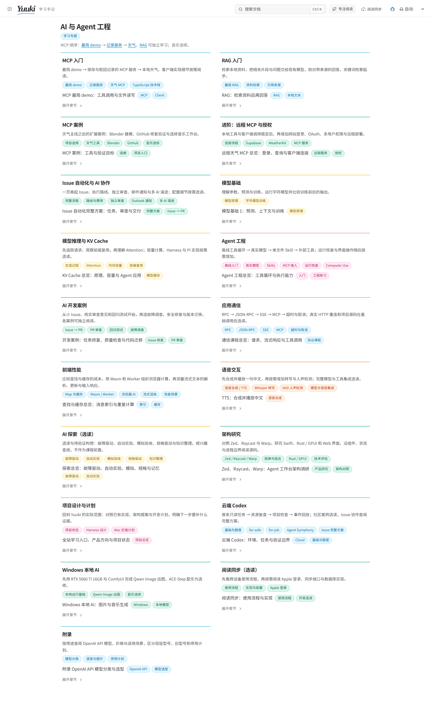

# Yuuki Box · 从一个问题开始

AI 学习笔记、动手实验与个人 Agent 工作台。

[在线阅读](https://box.yuuki.page/) · [学习目录](docs/README.md) · [示例](examples/README.md)

## 环境

| 工具 | 版本 |
| --- | --- |
| Node.js | ≥ 22.22.0 |
| pnpm | 11.14.0 |

## 本地运行

在仓库根目录执行：

```bash
pnpm i
pnpm docs:dev
```

默认地址：<http://127.0.0.1:4321/>。

## 常用命令

`docs:*` 文档站 · `install:*` 安装 · `demo:*` 演示 · `build:*` 构建 · `check:*` 检查。

| 命令 | 用途 |
| --- | --- |
| `pnpm i --frozen-lockfile` | 按锁文件安装 |
| `pnpm docs:build` | 构建文档站 |
| `pnpm --dir site check` | 检查类型 |
| `pnpm install:mini-mcp` | 安装依赖 |
| `pnpm demo:mini-mcp` | 运行演示 |
| `pnpm run` | 命令列表 |

文档站与 MCP 示例分别安装依赖。详细配置见[文档站说明](site/README.md)与各示例文档。

## 首页预览


