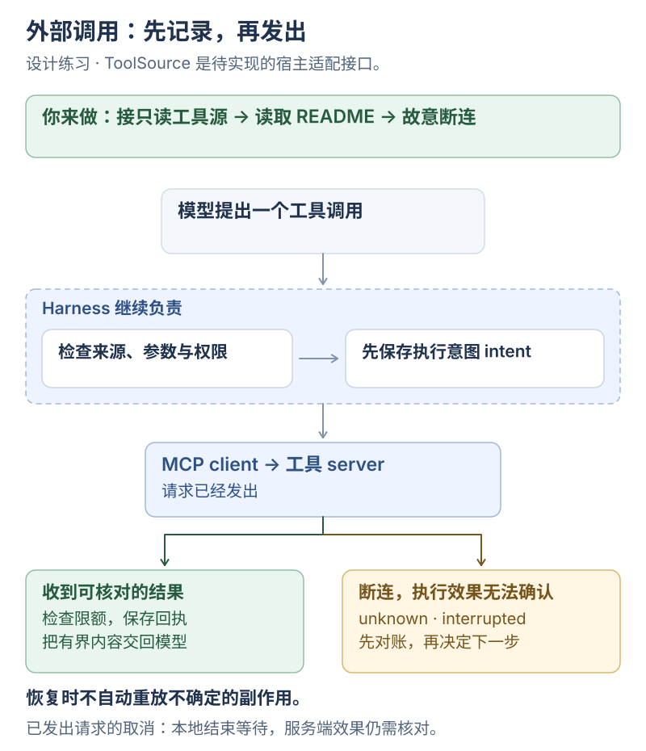

# MCP：把外部工具接进 Harness

**这一课的目的：把外部工具放进现有运行流程，让成功、拒绝和断连都有可查的结果。**

**这是实现练习。** 当前 [shared/runtime](../../examples/shared/runtime/README.md) 提供 `list_files`、`read_file`、`write_note`，尚未接入这里的 MCP `ToolSource`。下面的接口、状态和图是待实现方案，没有一条命令能直接跑出全部验收结果。

**你来做：找到现有执行入口 → 接一个只读工具源 → 跑一次读取 → 在调用中途断连。** 开始前先完成[极简 MCP](../ai-from-scaling/00-minimal-mcp.md)，并具备[运行状态与恢复](05-harness-vertical-slice.md)的基础。

## 先看：正常返回与中途断连

[](../../site/public/diagrams/agent-engineering/01-mcp-tool-source.svg)

图中的 `proposed`、`ready`、`unknown` 等是本练习采用的内部状态名，便于记录发生过什么。MCP 提供发现与调用协议，宿主继续负责策略、审批、记录与恢复。

## 1. 定位：先找到现有工具执行入口

**你来做：** 打开 [Sources/main.swift](../../examples/shared/runtime/Sources/main.swift)，结合 [runtime 说明](../../examples/shared/runtime/README.md#代码如何读)，找到 `run`、`tool`、`workspacePath` 和 `saveSessions`。

写下三个答案：谁决定执行哪个工具，哪里检查工作区路径，哪里保存工具意图和结果。外部工具接入时，需要经过对应的检查和记录。

**完成标志：** 你能在现有代码上指出外部调用应该接入的位置。

## 2. 实现：把发现和调用包成一个工具源

先提供两个能力：查询工具清单、按名称调用工具。接口可以从下面的示意开始；`SideEffect`、`ToolResult` 需要与你的运行时类型对齐。

```swift
struct ToolDescriptor: Sendable {
    let name: String
    let description: String
    let inputSchema: Data
    let sideEffect: SideEffect
}

protocol ToolSource: Sendable {
    var id: String { get }
    func discover() async throws -> [ToolDescriptor]
    func call(_ tool: String, arguments: Data) async throws -> ToolResult
}
```

**你来做：** 为一个本地测试 server 实现适配器。第一版只提供 `list_directory` 和 `read_file`，读取你准备的临时练习目录，只处理文本结果。

调用顺序可以先对照[极简客户端](../../examples/minimal-mcp/src/client.ts)的连接、发现、调用和关闭，再适配当前技术栈。对外工具名加上来源，例如 `mcp.filesystem.read_file`，并按[下一课的允许清单](02-mcp-policy.md)筛选。

**完成标志：** 适配器能发现两个工具，且一次调用能映射回正确的 server 和原始工具名。

## 3. 串起：让一次读取留下完整记录

让运行时完成这个任务：

```text
列出练习目录，读取其中的 README.md，然后概括内容。
```

**你来做：** 把图中的主线接完整：参数与权限检查 → 保存执行意图 → 发出调用 → 检查结果 → 保存回执 → 把有界内容交回模型。

每次调用至少能查到来源、工具名、参数摘要、开始时间、耗时、结果字节数和终态。参数摘要不记录 token 或密码原文。

**完成标志：** 正常调用返回预期文件内容，并有与之对应的执行记录。找到输出中某句话时，也能追到它来自哪次工具结果。

## 4. 故障练习：在三个位置打断它

用你控制的测试 server 做以下实验，先写出预期，再运行：

| 你制造的情况 | 必须观察到什么 |
| --- | --- |
| 绕过展示清单，直接请求未授权工具 | 调用入口返回 `permission_denied`，不向 server 发出调用 |
| 请求已发出，收到结果前终止测试 server | 记录断连；无法确认执行效果时标为 `unknown`，Run 进入 `interrupted` |
| 返回超过配置上限的文本 | 接收有硬上限；返回明确错误或有界内容与截断标记，模型上下文不接收整份超大文本 |

如果能确认请求尚未发出，可以记录调用失败。**请求已发出但没有结果时，要保留“发生过什么尚不确定”这条事实。** 重启后读取记录，先核对文件或外部状态，再决定后续动作。

取消也有两端：本地可以结束等待并记录取消，服务端可能已经完成操作。普通请求的 `notifications/cancelled` 通知不能证明副作用被撤回；迟到响应需要按已终止请求处理。[取消规范](https://modelcontextprotocol.io/specification/2025-11-25/basic/utilities/cancellation)

**完成标志：** 你能用记录解释“调用失败”“已发出但结果未知”和“用户取消等待”的差别。

## 到这里完成

交出一次成功读取、一条拒绝记录和一次断连记录。每条都能对应到请求及终态，恢复时不会自动重放不确定的副作用。以上需要你完成适配器与故障测试后才能算通过。

## 选读与参考

<details>
<summary>协议与实现细节</summary>

基础连接顺序是 `initialize → notifications/initialized → tools/list → tools/call`。SDK 可以处理初始化和消息编码；适配器仍需要把请求 ID、超时、进程退出、stderr、未知通知、取消和结果上限接到宿主的生命周期中。[生命周期规范](https://modelcontextprotocol.io/specification/2025-11-25/basic/lifecycle)

第一版只支持文本；遇到图片、资源引用或未知 content 类型，记录类型和受限的原始材料，向模型明确返回暂不支持。原始材料的保存也要有大小与访问限制。

工具描述和 schema 由外部服务提供，应验证、筛选后生成模型可用的工具表。工具版本或定义变化应触发检查，不能只凭同名工具自动继承权限。

</details>

<details>
<summary>宿主检查与进程权限的边界</summary>

允许清单和参数检查约束的是宿主发出的调用。stdio server 是独立本机进程，其文件和网络权限由运行它的系统环境决定，不会自动继承内建 `read_file` 的限制。

工具的 `readOnlyHint` 等标注只提供线索。准入和副作用分类要来自你核对过的实现与配置。远程服务还需要明确凭据来源、访问范围和服务身份。

</details>

<details>
<summary>已有代码与后续设计入口</summary>

- [runtime 协议](../../examples/shared/runtime/PROTOCOL.md)：现有 UI 与运行时的 JSONL 命令。
- [Mac 本地 Harness](../architecture/mac-local-harness.md)：Run、ToolCall、持久化与恢复的设计建议。
- [故障演练](07-scenario-regression.md)：把成功、拒绝、取消与断连做成可重复场景。

</details>

返回[总览](README.md) · 下一篇[MCP：决定哪些工具可以执行](02-mcp-policy.md)。
