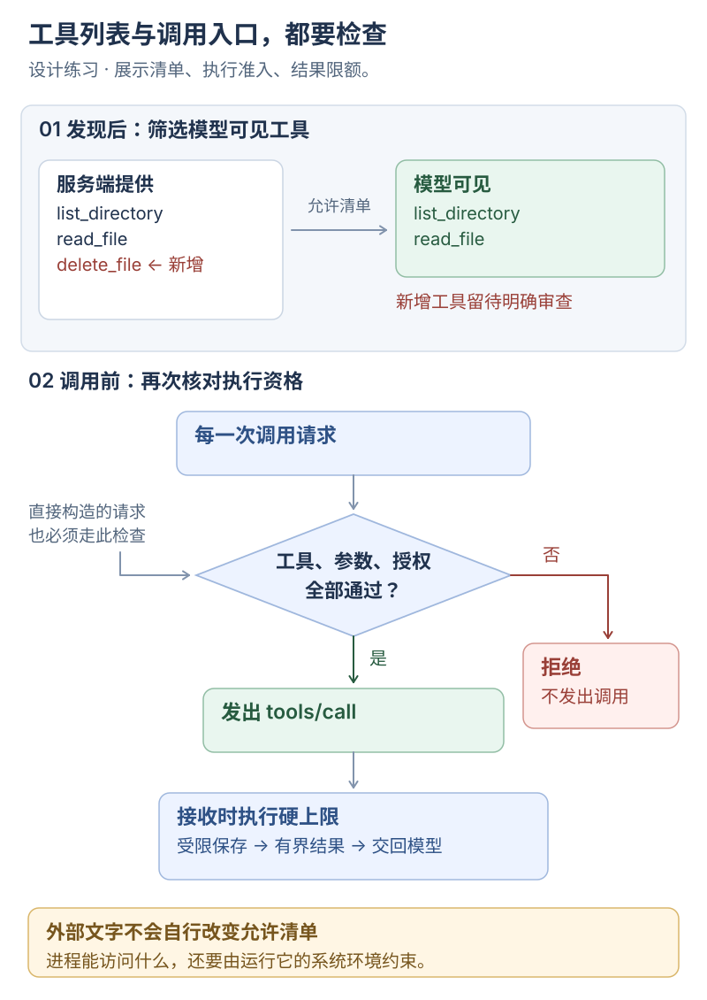

# MCP：决定哪些工具可以执行

**这一课的目的：让“服务端提供了一个工具”经过明确规则，才成为“这次允许执行的调用”。**

练习场景：服务端原本只提供列目录和读文件，升级后多出删除工具。你要让它默认无法进入模型工具表；即使有人绕过列表直接请求，调用入口也要拒绝。

**这是设计与实现练习。** 下面的配置是字段示意，尚未接入当前 runtime。先完成[外部工具源适配](01-mcp-tool-source.md)，再按本课实现并验证策略。

**你来做：写允许清单 → 对照两道检查 → 制造越界请求 → 核对拒绝记录。**

## 先看：展示前一次检查，调用前再查一次

[](../../site/public/diagrams/agent-engineering/02-mcp-policy.svg)

MCP 定义工具发现与调用消息，具体准入、审批和记录由宿主实现。[工具规范](https://modelcontextprotocol.io/specification/2025-11-25/server/tools)

## 1. 配置：只允许两个已核对的只读工具

**你来做：** 为测试 server 写一份配置，先只允许 `list_directory` 和 `read_file`：

```json
{
  "id": "filesystem",
  "transport": "stdio",
  "command": ["<server-command>", "<allowed-root>"],
  "version": "<pinned-version>",
  "allowedTools": ["list_directory", "read_file"],
  "sideEffects": {
    "list_directory": "read",
    "read_file": "read"
  },
  "timeoutMs": 15000,
  "maxResultBytes": 262144
}
```

占位符需要替换为你实际使用的服务、目录和版本。`sideEffects` 来自你核对过的实现，不能仅抄服务端的“只读”声明。远程连接只存凭据引用，token 由配置之外的凭据来源提供。

**完成标志：** 你能说出允许哪些工具、读取哪个目录，以及每次调用最多等多久、接收多少内容。

## 2. 实现：把工具清单与调用入口都管住

**你来做：** 实现图中的两道检查。

第一道在发现之后：记录服务端返回的候选，只把已核对且位于 `allowedTools` 的工具加入模型工具表。版本、描述或 schema 改变时重新检查，记录差异。

第二道在每次调用之前：重新核对来源、工具名、参数、路径与审批状态。拒绝分支直接返回结构化错误，不发出 `tools/call`。隐藏工具只影响展示，调用入口的检查才覆盖直接构造的请求。

本练习采用下面的默认策略；这是宿主策略，具体项目可以按已授权范围配置：

| 已核对的副作用 | 默认处理 |
| --- | --- |
| 只读 | 工具、参数和路径检查通过后执行并记录 |
| 写入 | 展示目标与变更，取得相应授权后执行 |
| 外部网络访问 | 限定目的地址和凭据范围，按配置决定审批 |
| 删除或覆盖 | 默认拒绝，另行明确授权和范围 |

一次操作可能同时有多种副作用，需要满足相关约束。一个叫 `read_file` 的工具，也要检查其实际实现是否上传了内容。

**完成标志：** 新增工具不会自动进入模型工具表，直接调用它也会得到拒绝。

## 3. 处理结果：给内容和保存过程都设上限

**你来做：** 在结果进入模型上下文之前，接入以下处理：

1. 接收时执行硬上限，超限就停止继续积累，返回明确错误或受限的截断结果。
2. 需要保存原始材料时，限定 artifact 的大小和访问权限，记录来源、时间与完整性；敏感内容按保存策略脱敏或拒绝保留。
3. 向模型返回有界文本，明确是否截断以及材料引用。
4. 把返回文字作为外部资料。它能影响模型的建议，但不能直接更改允许清单或替代授权。

`maxResultBytes` 是这份配置对结果接收的上限；artifact 和模型上下文也要分别设置预算。收到超过上限的内容时，不能一边声称受限，一边无界保存完整输出。

**完成标志：** 超大结果有可见终态，模型输入与保存产物都符合已设上限。

## 4. 验证：亲手安排四次越界尝试

只对自己控制的测试 server 和临时练习目录运行这些场景：

| 你改变什么 | 你要观察什么 |
| --- | --- |
| 服务端清单新增 `delete_file` | 模型仍只看到原先两个工具，留下工具表变化记录 |
| 直接请求 `delete_file` | 返回 `permission_denied`，测试 server 没收到这次调用 |
| 返回超过 262144 字节的文本 | 按限制停止接收；错误或截断标记与实际保存内容一致 |
| 结果文字要求删除练习文件 | 文本被当作材料；即使模型提出删除，策略仍拒绝并记录 |

每条记录至少包含 server、tool、version、参数摘要、耗时、接收字节数、是否截断、终态及审批结果。不要把 token、密码或整段用户内容原样写入日志。

**完成标志：** 你能从结果和服务端调用记录同时证明请求在哪里被拦住。

## 到这里完成

用四次实验回答：工具为什么没进入列表，直接调用为什么被拒绝，超大结果在哪里停止，以及外部文字为什么不能自行获得执行权限。完成实现和实测后，再把这些场景留作回归检查。

## 选读与参考

<details>
<summary>两类边界需要分别检查</summary>

本课允许清单约束宿主可以发出哪些调用。server 进程本身能读什么文件、访问什么网络，还要由系统账户、沙箱或隔离环境约束。通过参数校验不代表服务端进程已经受限。

固定版本便于核对行为，后续升级仍需审查。工具标注也不构成权限证明。[工具规范中的安全考虑](https://modelcontextprotocol.io/specification/2025-11-25/server/tools#security-considerations)

</details>

<details>
<summary>错误与记录字段</summary>

`permission_denied` 等是本练习的宿主错误分类，应转换为模型可读、UI 可查的结构化结果。`unknown` 用来保留已发出但无法确认效果的事实。具体字段可与[运行状态设计](05-harness-vertical-slice.md)对齐。

```text
server / tool / version
args_hash / args_summary
started_at / duration_ms
result_bytes / truncated
status / approval
```

摘要会丢失信息，需要完整材料时回到有访问控制的 artifact，并核对是否完整。日志、文件路径和材料引用本身也需要按实际数据处理。

</details>

返回[上一篇](01-mcp-tool-source.md) · [总览](README.md) · 下一篇[Skills：结构与触发](03-skills-structure.md)。
