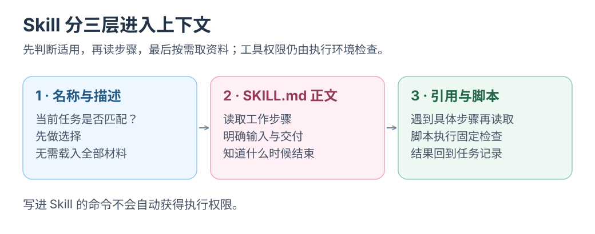

# Skills：结构、触发与复用

将章节拆分、导航调整、链接检查和构建流程保存为 Skill，验证跨会话复用。

Skill 保存<mark class="key">触发条件、步骤与验收</mark>，可版本化、复用。

实现建议；按 Agent Skills 与 Claude Code / Codex 文档整理，加载行为以所用版本为准。核对：2026-10-23。

## Skill 由什么组成

首轮只创建 `SKILL.md`，用显式调用完成一次任务；脚本、引用资料与自建加载器按需增加。

```text
.claude/skills/docs-restructure/
├── SKILL.md              # 必需：触发条件与步骤
├── scripts/validate.mjs  # 可选：确定性校验
├── references/checklist.md
└── assets/template.md
```

`SKILL.md` 开头是 YAML frontmatter：

```yaml
---
name: docs-restructure
description: 重构 docs 目录、拆分章节并同步站点导航。当用户要求调整文档结构、侧栏顺序或拆分章节时使用；只改错别字或单篇内容时不要触发。
---
```

规范建议 `name` 使用小写字母和连字符，长度不超过 64 个字符；`description` 不超过 1024 个字符，不要包含 XML 标签。正文建议控制在 500 行以内。[Agent Skills specification](https://agentskills.io/specification)

Claude Code 使用 `.claude/skills/<name>/SKILL.md`，Codex 使用 `.agents/skills/<name>/SKILL.md`，结构可共用。显式调用分别为 `/skill-name`、`$skill-name`；也可由 description 触发。

## 正文模板

```markdown
# 文档结构重构

## 什么时候用
- 用户要求拆分章节、调整侧栏顺序或移动文件。
- 需要同步 `docs/README.md` 与 `site/src/lib/navigation.mjs`；站点配置在 `site/astro.config.ts`。

## 输入
- 目标目录、新的章节顺序、需要保留的链接。

## 步骤
1. 列出当前文件与引用。
2. 按学习目标设计导航分组，优先保留已有页面地址。
3. 确需移动文件时，更新相对链接并为旧地址安排兼容路径。
4. 更新站点侧栏与目录表。
5. 运行校验。

## 输出契约
- 说明移动了哪些文件、改了哪些链接。
- 给出校验命令与结果。

## 失败处理
- 链接缺失时停止，不猜测目标。
- 站点构建失败时保留原始文件，不回滚用户改动。

## 验收
- `pnpm --dir site test`
- `pnpm --dir site check`
- `pnpm --dir site build`
```

正文只写任务步骤；通用规则引用项目已有说明。

<details>
<summary>选读：自动触发与渐进加载</summary>

[](../../site/public/diagrams/agent-engineering/03-skill-loading.svg)

读图只看：这一步为什么需要新增上下文。

## 加载是渐进的

1. 启动时只把 `name` 和 `description` 放进上下文。
2. 任务匹配后，才加载 `SKILL.md` 正文。
3. 只有正文明确要求时，才读取 `references/` 或运行 `scripts/`。

按需加载正文，避免所有规则同时占用上下文。

## description 才是触发器

description 要写清<mark class="key">做什么、何时用、何时不用</mark>；“帮助处理文档”太宽。

| 写法 | 问题 |
| --- | --- |
| `帮助处理文档` | 太宽，几乎所有文档任务都会命中 |
| `重构 docs 目录、拆分章节并同步站点导航。当用户要求调整文档结构、侧栏顺序或拆分章节时使用；只改错别字或单篇内容时不要触发。` | 有动作、有触发条件、有负例 |

把负例保留为触发测试。

</details>

<div class="heading-alias" id="小挑战把最近重复过的任务教一遍" aria-hidden="true"></div>

## 复用对照实验

选最近重复过、验收明确的真实任务。

- **Baseline：** 不带 skill 做 3 次同类任务。
- **With skill：** 带 skill 做 3 次同类任务。
- 记录：是否在正确任务上加载、是否需要补充解释、返工次数、从开始到验收的时间、加载了多少上下文。
- 再跑 2 个负例，确认不会误触发。

## 验收

- 3 次真实任务的结果不差于 baseline，返工次数没有增加。
- 负例不触发 skill。
- 新会话只凭 `SKILL.md` 完成任务，不依赖此前对话的隐含说明。
- skill 的改动可以像代码一样审查和回滚。

## 边界

- <mark class="caution">Skill 不提供权限</mark>；审批、路径和沙箱仍由工具策略检查。
- **会过期：** 接口、目录、命令变化后重查，正文标注版本与日期。
- **会冲突：** description 尽量互斥，或写明依赖和优先关系。
- **不存密钥：** 引用环境变量或 Keychain。
- **先读后启用：** 下载的 `SKILL.md` 与 `scripts/` 不自动执行。

## 资料

- [Agent Skills specification](https://agentskills.io/specification)
- [Claude Code Skills](https://code.claude.com/docs/en/skills)
- [OpenAI Codex Skills](https://developers.openai.com/plugins/build/skills)

返回[总览](README.md) · 下一篇[Skills：校验与渐进加载](04-skills-validation.md)；[MCP 工具策略](02-mcp-policy.md)按需选读。
