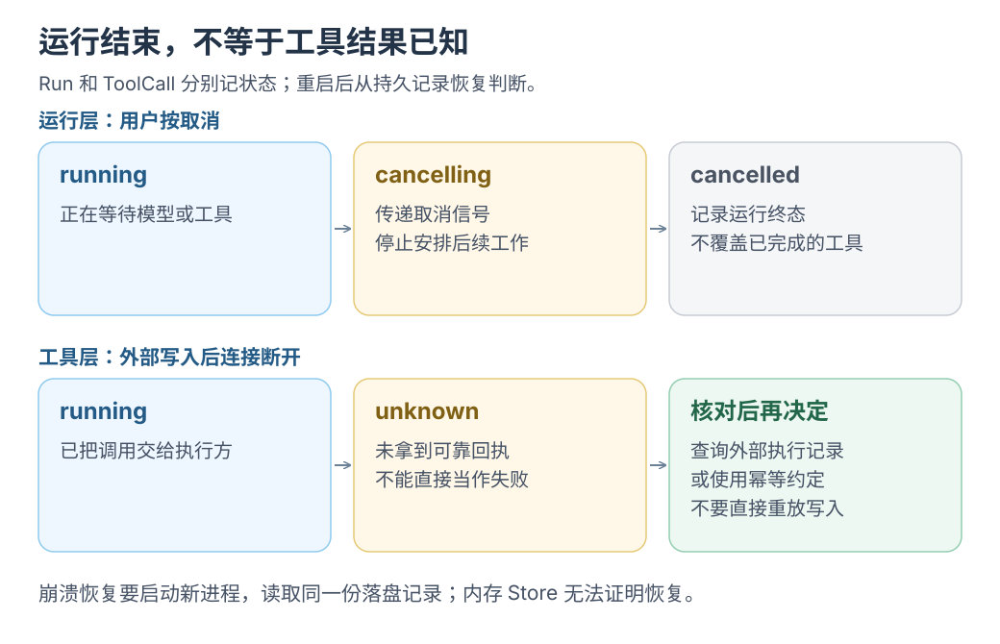

# Harness：按下取消，再故意让它崩一次

Agent 正在输出，你按下取消；它等着审批，你关掉进程；重新打开以后，它还记不记得刚才那次写入有没有发生？这一篇把这些瞬间摆到台面上，亲手走一遍。

**在加 MCP 和 Skills 之前，先让一次 Run 能被取消、崩溃、重启和解释。** 功能可以后加，状态机和恢复语义一旦写错，后面每加一个工具都会放大问题。

状态：实现建议。状态名沿用 [Mac 本地 Harness](../architecture/mac-local-harness.md) 的提案，当前 runtime 已实现部分工具与审批，但未完成本文的全部恢复验收。资料核对：2026-10-23。

## 最值得拆穿的「能跑了」

按功能开发很容易得到“聊天能跑、工具能调、取消按钮也在”的假象。真正的问题是：

- 取消发生在流式输出中间，UI 还会不会收到迟到的 delta？
- 审批超时后，模型能不能继续回答？
- 工具 intent 已落盘、结果没落盘时崩溃，重启后知道发生了什么吗？
- 重复提交同一个 `commandId`，会创建两个 Run 吗？
- 事件顺序在重启后还可信吗？

这些问题只有一条端到端路径才能暴露。垂直切片就是一次完整的 `submit → model → tool → result → end`，而不是先做五个孤立模块。

## 切片包含什么

```text
run.submit
→ command.accepted
→ run.started
→ model request
→ tool.proposed
→ policy: allow / ask / deny
→ (ask) waiting_for_approval → approval.respond
→ ready → running → tool result / error / unknown
→ model request
→ run.succeeded / failed / cancelled / interrupted
```

最小实现用 **fake model adapter**：它不访问网络，按固定脚本返回一次工具调用和一次最终回答。这样不用付费 API，也能测完整的控制面。

```text
fake model: "调用 list_files"
→ Harness 执行只读工具
→ fake model: "根据结果回答完成"
```

真实模型 adapter 之后替换它；Run 状态、事件、审批和恢复逻辑不变。

[](../../site/public/diagrams/agent-engineering/05-run-recovery.svg)

图中两行属于不同层级。工具结果未知时，相关 Run 应进入 `interrupted`；不能为了结束等待就把外部动作写成已撤销。

## 六个状态场景

| 注入 | 期望终态与证据 |
| --- | --- |
| 流式输出中取消 | Run `cancelling → cancelled`；取消后不再发布 delta；已发生的工具副作用保留记录 |
| 审批等待中超时 | ToolCall `failed` / `permission_denied`；Run 可继续生成无需该工具的回答 |
| 工具 intent 落盘后崩溃 | ToolCall `unknown`；Run `interrupted`；重启后提示对账，不自动重放 |
| 重复 `commandId`、相同输入 | 返回已有 Run，不创建第二个 |
| 重复 `commandId`、不同输入 | 返回冲突错误，不覆盖原任务 |
| 工具返回结构化错误 | 错误作为 tool result 回传模型；Run 不因单次工具失败直接崩溃 |

## 事件不变量

无论走哪条路径，以下事实都应成立：

- 同一 Store 分配的 `seq` 单调递增，不重用；客户端不能假设没有缺口。
- 终态事件不可改写；后续补充以新事件表达，并保留原状态。
- 每个 tool call 与其结果成对出现；取消或崩溃时也要留下“无结果”或 `unknown` 记录。
- 执行 intent 先于副作用；结果事件后于副作用尝试。
- 取消是请求，不是撤销证明；已经发生的写入、请求或计费仍要记录。

## 小挑战：让六种结局各发生一次

1. 用 fake model 和内存 Store 跑通成功路径，确认事件顺序。
2. 在流式输出中触发取消，检查是否还有 delta。
3. 在审批等待中让审批超时，检查 ToolCall 与 Run 的终态。
4. 将 Store 换成临时目录中的持久化实现，在 intent 落盘后退出子进程；启动新进程读取同一目录，确认 Run 为 `interrupted`。内存 Store 无法验证这一步。
5. 重复提交同一个 `commandId`，分别测试相同与不同输入。
6. 让工具返回一个错误，确认模型能收到结构化结果并继续。

## 验收

- 六个场景都有自动化测试，不依赖真实模型和网络。
- 重启后能从事件重建“上次发生了什么”，不需要猜。
- 取消、失败、未知、成功四种终态不会互相伪装。
- 任何副作用都能追溯到 Run、ToolCall 和审批记录。

## 边界

- **事件日志不是 replay 脚本。** 重放历史事件用于恢复视图，不等于重新执行工具。
- **取消不等于撤销。** 取消后仍可能留下文件、网络请求或远端计费。
- **`unknown` 是真实状态。** 不要为了界面好看把它改成 `failed` 或 `succeeded`。
- **内存 Store 只用于测试。** 生产环境仍需要事务、迁移和单写者约束，见架构提案第 10 节。

## 和现有代码的关系

- 当前 runtime 的命令与事件：[`PROTOCOL.md`](../../examples/shared/runtime/PROTOCOL.md)
- 当前工具与取消行为：[runtime 说明](../../examples/shared/runtime/README.md)
- 目标状态机与事件语义：[Mac 本地 Harness](../architecture/mac-local-harness.md) 第 6、7、9 节

返回[总览](README.md) · 下一篇[Harness：上下文与运行报告](06-context-and-report.md)。
