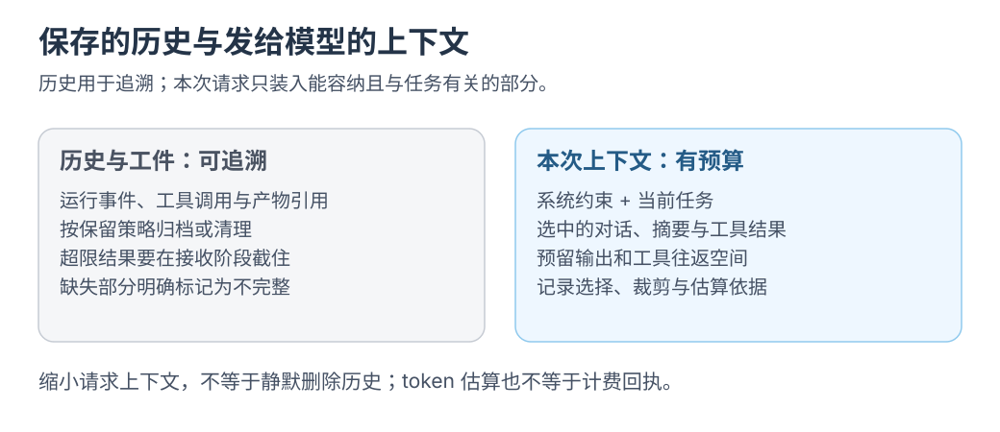

# Harness：上下文、耗时与用量报告

用上下文清单与运行报告追踪输入、耗时和用量。

<mark class="key">历史与请求上下文分开管理</mark>；裁剪输入不删除用户历史或产物。

实现建议，字段示意尚未接入 runtime。核对：2026-10-24。

<div class="heading-alias" id="两本账" aria-hidden="true"></div>

## 历史与请求上下文

| 账本 | 保存什么 | 用途 |
| --- | --- | --- |
| 完整历史 | 全部事件、工具结果、artifact 引用 | 恢复、审计、导出、对账 |
| 请求上下文 | 实际发送给模型的内容 | 控制 token、保持工具调用成对、留出输出空间 |

历史不必每轮全发；重复发送会增加成本、延迟与超限风险。

[](../../site/public/diagrams/agent-engineering/06-context-budget.svg)

长日志可存为有上限的工件，本轮仅发相关片段与引用。报告注明取舍，不把未发送部分算作已读。

## 上下文装配规则

第一版可以按固定规则装配：

1. 当前任务与明确约束。
2. 最近 N 个完整交互轮次；不要从一轮中间切断。
3. 与当前任务相关的工具请求和结果，必须成对保留。
4. 大输出只保留有界摘要 + artifact 引用。
5. 为模型输出、工具 schema 和下一次工具结果预留空间。
6. 无法构造合法上下文时停止，并显示原因；不要原样重试到超限。

接近预算先裁可重建日志，再做摘要。标明摘要范围，保留原始记录。

这是保留优先级；装配仍遵循接口角色与时序，不每轮重排历史前缀。

## `context.manifest`

每次请求前生成一份清单，说明“为什么发送这些内容”：

```json
{
  "runId": "r-7",
  "estimatedInputTokens": 18400,
  "reservedOutputTokens": 4096,
  "included": [
    "current-task",
    "constraints",
    "turn-8..turn-12",
    "tool-pair-31"
  ],
  "excluded": [
    { "reason": "older-than-window", "count": 24 },
    { "reason": "artifact-summary-only", "count": 3 }
  ],
  "artifacts": ["art-3", "art-5"],
  "method": "chars-div-4-with-10-percent-margin"
}
```

把清单也存成事件，便于回查发送内容、排除项与估算依据。

## `run.report`

每次 Run 结束生成一份报告，单独保存为 artifact：

```json
{
  "runId": "r-7",
  "status": "succeeded",
  "modelRequests": 3,
  "toolCalls": 4,
  "approvalWaitMs": 12000,
  "estimatedTokens": 27100,
  "actualUsage": { "prompt": 24000, "completion": 3100 },
  "resultBytes": 81234,
  "errors": [],
  "cancelledAt": null,
  "durationMs": 48300
}
```

按供应商能力选字段，报告至少回答：

- 耗时：模型、工具、审批、持久化各占多少？
- 用量：输入、输出、重试和重复历史各占多少？
- 失败：网络、限流、工具、超限还是取消？
- 预算：输入估算与输出预留还剩多少？

## 缓存用量

逐次保存原始 usage、供应商和模型；汇总用“命中 token 总数 ÷ 有效输入 token 总数”，注明覆盖请求数，缺值保留未知。

<details class="qa">
<summary>为什么不能直接相加或平均每轮命中率？</summary>

DeepSeek `prompt_tokens` 已含命中，Pi `input` 将缓存读写另列；先统一口径，不能平均不同大小请求的命中率。

另记压缩、换模型与工具清单变化。详见 [DeepSeek](../kv-cache/03-prefix-cache-and-yuuki.md)、[dsh](../kv-cache/04-deepseek-harness.md)、[Pi](../kv-cache/05-pi.md)。这些观测尚未接入当前 runtime。

</details>

<div class="heading-alias" id="小挑战聊到第-100-轮再查一次账" aria-hidden="true"></div>

## 100 轮上下文实验

合成一条包含 100 轮交互和多次大工具输出的会话：

1. 每轮都重新装配上下文，记录 `context.manifest`。
2. 检查 token 估算是否保持在预算内，而不是随历史线性增长。
3. 检查每个 tool call 和它的结果是否仍然成对。
4. 检查待审批、`unknown` 工具结果和取消记录没有被摘要裁掉。
5. 在接近预算时触发一次超限，确认系统停止并说明原因。

## 验收

- `run.report` 可解释单次 Run 的耗时、token 与失败点。
- 100 轮中上下文保持有界；历史另按归档策略管理。超预算停止，不原样重试。
- 上下文清单能解释“模型看到了什么、没看到什么”。
- 估算 token 与实际 usage 分开记录；差异大时能看到估算方法。

## 边界

- <mark class="caution">估算不是账单</mark>：字符数除以 4 仅供粗估，记录方法并留余量。
- **摘要可能漏条件：** 精确信息回查 artifact 或原始事件。
- **用户产物不静默删除：** 文件、报告与证据不由日志清理策略处理。
- **保留待审批与未知结果：** 它们仍影响后续决策。
- **报告也限额：** 失败时不递归生成巨量报告。

## 和现有文档的关系

- 上下文与持久化建议：[Mac 本地 Harness](../architecture/mac-local-harness.md) 第 7.1、10 节
- 事件与输出边界：[PROTOCOL.md](../../examples/shared/runtime/PROTOCOL.md)
- 场景实验的计量口径：[十五个 Harness 场景](../learning/harness-scenario-lab.md)

返回[上一篇](05-harness-vertical-slice.md) · [总览](README.md) · 下一篇[Harness：场景回归](07-scenario-regression.md)。
