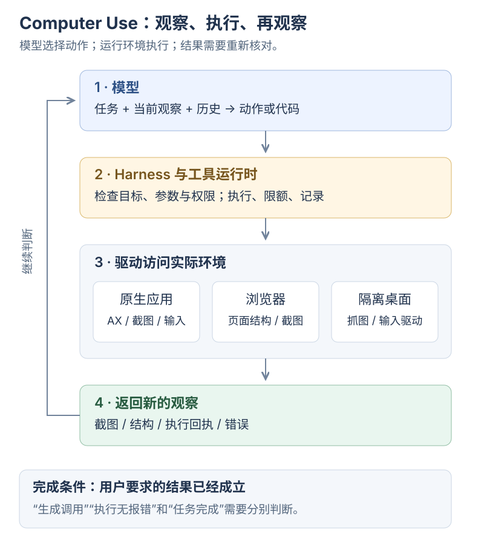

# Computer Use：模型怎样看界面、做动作、检查结果

Computer Use 把界面接进工具循环：<mark class="key">观察 → 提出动作 → 执行 → 重新观察</mark>。模型、工具、连接与系统权限各有职责。

按顺序读，或直接找对应问题：

| 顺序 | 入口 | 读完能解释什么 |
| --- | --- | --- |
| 1 | 本篇：执行原理 | 截图、AX、DOM、CDP 分别在哪一层；一次点击怎样发生 |
| 2 | [Codex 与 cua_repl](cua-repl.md) | JavaScript 在哪里运行，变量怎样保留，桌面与浏览器怎样连接 |
| 3 | [同类工具对照](computer-use-ecosystem.md) | Claude、Gemini、Playwright MCP、Browser Use、Stagehand 与 UI-TARS 各提供什么 |
| 4 | [理解误区与自测](computer-use-misconceptions.md) | 为什么能看见却不能操作，调用成功却没完成，重试可能重复提交 |

资料核对：**2026-10-31**。产品事实附官方来源，`cua_repl` 细节来自本次工具说明；图与分层为教学归纳。仅查阅清单和接口，未点击桌面、安装扩展或调用付费模型。

## 一次“把标题改为周计划”怎样完成

[](../../site/public/diagrams/agent-engineering/computer-use-loop.svg)

以已打开的测试文档为例：

1. **观察。** 宿主读取截图或结构，找到标题框及当前值。
2. **定位。** 将“标题”对应到元素引用、定位器或坐标，即 grounding。
3. **提出动作。** 输出结构化工具调用或界面操作代码。
4. **执行。** Harness 检查目标与权限，驱动向系统或浏览器发送输入。
5. **核对。** 重新观察；若要求保存，还须确认保存状态。

模型返回动作，应用负责执行与回传观察；代码执行路线也由应用提供运行环境。[OpenAI Computer Use](https://developers.openai.com/api/docs/guides/tools-computer-use)

合法调用、驱动无报错、目标成立是三种结果；<mark class="caution">前两个不能代替任务完成</mark>。

## 先分清五层

| 层 | 输入与输出 | 不应混淆的责任 |
| --- | --- | --- |
| 模型 | 任务、观察、历史 → 动作或代码 | 推理和选择动作；并不直接获得操作系统权限 |
| Harness | 模型调用 → 校验、执行、记录、下一轮上下文 | 管理预算、取消、失败与恢复 |
| 工具接口 / 运行时 | 结构化参数或脚本 → 返回值、错误、图片 | 例如 `cua_repl`；规定可调用哪些能力 |
| 驱动与连接 | 元素引用、坐标、文字 → 浏览器或系统操作 | 绑定哪个应用、窗口、标签页、浏览器 profile |
| 被操作环境 | 真实输入 → 页面和应用状态变化 | 持有登录态、文件、焦点、弹窗和业务数据 |

MCP 暴露工具，Skill 描述步骤，均不替代驱动或目标环境。参见 [MCP 工具源](01-mcp-tool-source.md)与 [Skills 结构](03-skills-structure.md)。

## “看见界面”有三种常见表示

| 表示 | 模型收到什么 | 适合什么 | 缺少什么 |
| --- | --- | --- | --- |
| 截图 / 像素 | 窗口或视口图像 | 位置、颜色、遮挡、图表、画布、自绘控件 | 没有天然的 DOM 节点身份；定位受缩放和画面变化影响 |
| AX / 可访问性树 | 按钮、文本框等角色，以及名称、值、状态 | 根据语义寻找“保存”按钮或标题框 | 完整程度取决于应用；不能完整表达视觉布局 |
| DOM / 页面结构 | 网页元素、属性、文本及工具允许读取的页面信息 | 表单、列表、网页定位与调试 | 不覆盖所有原生应用；也不能直接解释画布内每个对象 |

AX（accessibility）来自应用或浏览器的交互语义，并非截图 OCR。DOM 组织网页节点，AX 表达可访问性，两者也不同。[Apple AXUIElement API](https://developer.apple.com/documentation/applicationservices/axuielement_h)、[Playwright MCP 快照](https://github.com/microsoft/playwright.dev/blob/main/mcp/snapshots.mdx)

观察范围决定结论：文字证明按钮存在，视觉证据才能确认颜色、对齐和遮挡；一张截图不覆盖其他标签页。

<details class="qa">
<summary>模型怎样从截图生成点击位置？必须先做 OCR 吗？</summary>

图像与任务、历史进入模型，模型输出动作，程序解析为坐标和输入。OCR、元素检测或标号可以参与，但不是必需的独立步骤。

UI-TARS 公开了动作解析与坐标后处理；它展示 GUI 专项训练，不能代表其他模型的内部实现。[UI-TARS 模型与后处理](https://github.com/bytedance/UI-TARS)

</details>

## 再往下：谁真正完成点击

**macOS 原生应用。** `AXUIElement` 可读取属性、设置受支持的值和执行动作；ScreenCaptureKit 可抓屏。录屏权限不等于操作权限。这是系统能力示例，未确认 Codex 使用了哪些函数。[Apple AXUIElement API](https://developer.apple.com/documentation/applicationservices/axuielement_h)、[ScreenCaptureKit 示例](https://developer.apple.com/documentation/screencapturekit/capturing-screen-content-in-macos)

**浏览器。** 驱动定位元素、发送输入、抓图。Chromium 的 CDP 是调试控制通道；扩展可通过 `chrome.debugger` 访问受支持的 DOM、Input、Network 域，但意图仍由模型判断。[Chrome debugger API](https://developer.chrome.com/docs/extensions/reference/api/debugger)

**隔离桌面。** 应用可在虚拟机或容器的图形环境运行。Claude 参考环境将显示、应用、动作与 Agent 循环分开；接入方仍须连接机器、抓图和输入。[Claude Computer Use](https://platform.claude.com/docs/en/agents-and-tools/tool-use/computer-use-tool)

这些路线可以组合，仅凭一次网页点击无法确定底层驱动。

<details class="qa">
<summary>屏幕坐标、截图像素和网页 CSS 像素为什么不能直接混用？</summary>

缩放、裁剪、滚动和像素密度都会改变坐标。例如原图宽 1440、等比缩到 720 后，横坐标 300 对应原图 600；裁剪时还须加回原点偏移。

实际换算以驱动契约为准，可能使用归一化坐标；执行器须绑定图像、窗口和尺寸。[OpenAI 截图与分辨率](https://developers.openai.com/api/docs/guides/tools-computer-use-integration#capture-screenshots)

</details>

## 为什么使用“代码执行”入口

下面是两种**概念示意**，不是可以直接调用的通用 API：

```text
结构化动作：模型 → click(元素引用) → 工具结果
代码执行：  模型 → 一段脚本 → 脚本调用界面 API → 工具结果
```

代码可复用对象、条件判断和批量执行。`await` 只等待调用；模型通常收到整轮结果后才重新判断。

已确认的短步骤可合并；遇到未知弹窗、跳转或目标变化，先返回新观察。

公开指南同时提供代码执行与结构化动作，两者仍并存。[OpenAI 代码执行路线](https://developers.openai.com/api/docs/guides/tools-computer-use#use-code-execution)

## 如果给 Yuuki 增加这种能力

下面是与本仓库 Harness 对应的**设计建议，尚未实现**：

| 现有职责 | 增加 GUI 后需要明确什么 |
| --- | --- |
| ToolCall | 操作属于哪个应用、窗口或标签页；依据哪次观察 |
| 执行策略 | 用户授权的目标和操作；驱动自身允许的能力 |
| 工具结果 | 返回值之外，附上执行后的状态或证据引用 |
| 取消与恢复 | 停止后续动作；对已经发生但回执丢失的副作用先核对 |
| 运行报告 | 模型耗时、驱动耗时、等待页面耗时、失败原因分别记录 |

先读测试窗口的标题和截图，再加一个可逆动作及独立检查；单个 `click()` 成功不代表长流程可靠。

读下一篇：[Codex 与 cua_repl：接口、连接与状态](cua-repl.md)。
