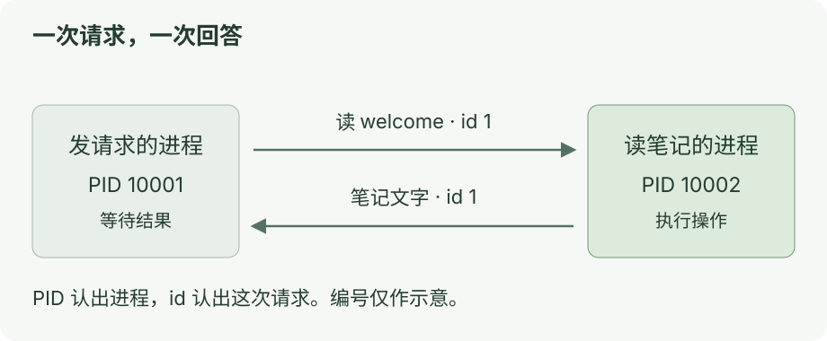

# 第一章：让一次函数调用跨过进程

[目录](README.md) · [下一课](02-json-rpc.md)

**这一课：请另一个程序读笔记，再把结果发回来。**

RPC 就是这种调用方式。先用本机的两个进程练习。进程是一份正在运行的程序。

## 先运行

在项目根目录执行：

```bash
node docs/ai-communication/labs/01-rpc.ts
```

最后会看到：

```text
结果： 今天只追踪一次跨进程调用。
确认：两个 PID 不同，请求与响应的 id 相同。
```

## 看图

[](../../site/public/diagrams/ai-communication/01-rpc.svg)

先分清两个编号：

| 编号 | 用来认出什么 |
| --- | --- |
| `PID` | 哪个进程 |
| `id` | 哪一次请求 |

两个 PID 不同：确实有两个进程。

请求和回答的 id 相同：它们属于同一次调用。

## 到这里就停

能说清 **“一个进程发请求，另一个进程执行，再返回同一个 id 的回答”**，就完成了。

<details>
<summary>代码入口</summary>

先只找两处：

- [01-rpc.ts](labs/01-rpc.ts)：`spawnSync()` 启动另一个进程，并发出请求。
- [note-server.ts](labs/note-server.ts)：按 `message.method` 找到操作，`reply()` 返回结果。

请求中的 `method` 是操作名，`params` 是参数，`id` 是请求编号。这份实验使用 JSON-RPC 2.0 的消息格式。[规范](https://www.jsonrpc.org/specification)

请求写入子进程的 `stdin`，回答从 `stdout` 读回。每行放一条 JSON；调试日志放在 `stderr`，避免混进消息。[Node 文档](https://nodejs.org/docs/latest-v24.x/api/child_process.html)

这课用 `spawnSync()`，方便按顺序看清过程。它会阻塞当前进程；实验限制为 3 秒、输出最多 64 KiB。下一课再改用异步的 `spawn()`。

笔记是服务进程内的固定文字，没有读取用户文件。

</details>

<details>
<summary>试一次错误输入</summary>

把客户端的 `name: 'welcome'` 改成 `name: 'missing'`，再运行。

服务端会回答“笔记不存在”。客户端原本预期成功，所以检查会失败。观察后改回去。

</details>
