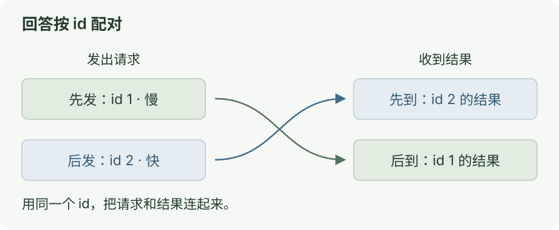

# 第二章：JSON-RPC 请求与响应配对

[上一课](01-rpc.md) · [目录](README.md) · [下一课](03-sse.md)

同时发两个请求，<mark class="key">按 id 找回答</mark>。

## 先运行

```bash
node docs/ai-communication/labs/02-json-rpc.ts
```

慢请求先发、快请求先回，结果仍正确配对。

## 看图

[](../../site/public/diagrams/ai-communication/02-id.svg)

JSON-RPC 的基本字段：

| 字段 | 含义 |
| --- | --- |
| `method` | 操作名称 |
| `params` | 操作参数 |
| `id` | 请求标识 |
| `result` | 成功时的结果 |
| `error` | 失败时的原因 |

等待表按 id 保存请求；`id: 2` 的结果只交给编号 2。

<div class="heading-alias" id="到这里就停" aria-hidden="true"></div>

## 验收标准

响应可乱序到达，仍按 id 配对。

<details>
<summary>错误、通知和清理</summary>

实验还会做两件事：

- 调用不存在的方法，检查错误码 `-32601`。
- 发一条没有 id 的通知。通知不需要回答。

响应包含 `result` 或 `error` 中的一种。通知没有 id，发送方无法获得对应的结果确认。[JSON-RPC 规范](https://www.jsonrpc.org/specification)

等待表使用 `Map`。[rpc-client.ts](labs/rpc-client.ts) 中，`pending.set()` 登记请求，`take(response.id)` 取出对应项。

`take()` 清理等待项、定时器和取消监听。外部 JSON 仍需运行时检查，TypeScript 类型不能验证消息。

| 错误码 | 本实验中的意思 |
| --- | --- |
| `-32700` | JSON 无法解析 |
| `-32600` | 请求结构无效 |
| `-32601` | 方法不存在 |
| `-32602` | 参数无效 |
| `-32001` | 笔记不存在 |

断连时等待项收到“结果未知”，不同于服务端明确返回错误。

</details>

<details class="qa">
<summary>JSON-RPC 与 JSONL 有什么区别？</summary>

JSON-RPC 定义消息含义，JSONL 定义一行一个 JSON；本课将两者组合用于管道，也可换传输方式。[规范](https://www.jsonrpc.org/specification)

实验仅支持对象参数、单条消息；服务端接受字符串、数字或 null id，客户端生成数字 id。

</details>
