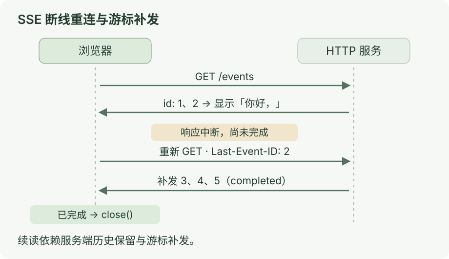

# SSE 实战：真实 HTTP、断线重连与结束状态

[上一课：SSE 入门](03-sse.md) · [目录](README.md) · [下一课：MCP](04-mcp.md)

断流后续接；<mark class="key">收到完成事件才标记完成</mark>。

本课用真实 HTTP 和浏览器 `EventSource`，发送五条固定事件；无需模型或 API Key。

## 先运行，再断一次

需 Node.js ≥22.22：

```bash
node docs/ai-communication/labs/03-sse-http.ts
```

打开终端打印的 `http://127.0.0.1:端口`，点「模拟断流重连」。

你会看到：

1. 第一次连接收到 `id=1`、`id=2`，页面显示「你好，」。
2. 服务端提前结束响应。页面保留文字，显示「等待自动重连；尚未完成」。
3. 浏览器重新连接，服务端补发 `id=3`、`id=4`、`id=5`。
4. 页面显示「你好，SSE。」；收到 `completed` 后显示完成，并主动关闭订阅。

浏览器开发者工具的 **Network → 第二次 `/events?mode=drop` 请求 → Request Headers** 中，应能找到 `Last-Event-ID: 2`。它告诉服务端上次读到了哪里。

再点「正常接收」，收到一段文字后点「停止接收」。已收到的文字会保留，状态应是「已停止接收；尚未确认完成」。终端按 `Ctrl+C` 退出服务。

## 看图

[](../../site/public/diagrams/ai-communication/03-sse-http.svg)

<mark class="caution">连接结束不证明业务完成。</mark>

`completed` 是本实验约定，SSE 没有通用的业务完成事件。

## 到这里就停

只记住这三个状态：

| 你观察到什么 | 本实验怎样显示 |
| --- | --- |
| 收到 `delta` | 追加文字，继续等待 |
| 响应中途结束，正在重连 | 保留文字，尚未完成 |
| 收到 `completed` | 标记完成，调用 `close()` |

源码：[03-sse-http.ts](labs/03-sse-http.ts)。沿 `history` → `last-event-id` → 浏览器状态阅读。

<details>
<summary>响应里有什么？id、retry 和注释分别做什么？</summary>

实验的响应头包含：

```http
HTTP/1.1 200 OK
Content-Type: text/event-stream; charset=utf-8
Cache-Control: no-cache, no-transform
X-Accel-Buffering: no
```

响应体开头和第一条事件如下，块与块之间留一个空行：

```text
retry: 500

: connected

id: 1
event: delta
data: {"text":"你好"}

```

`event` 是类型，`data` 是内容，`id` 是续接位置；`retry: 500` 建议等待 500 ms，实际可能更晚。`:` 注释不是业务消息；本实验只发一次，长连接可按链路超时配置注释心跳。[MDN：事件流格式](https://developer.mozilla.org/en-US/docs/Web/API/Server-sent_events/Using_server-sent_events#event_stream_format)

浏览器负责解析；上一课未实现 `id`、`retry`、重连的解析器不能直接替代它。

</details>

<details>
<summary>自动重连，为什么不等于自动恢复任务？</summary>

同一 `EventSource` 自动重连会带非空事件 ID；服务端须据此补发历史。[HTML 标准：Last-Event-ID](https://html.spec.whatwg.org/multipage/server-sent-events.html#the-last-event-id-header)

五条历史预存在内存；服务端收到 `2` 补发 `3、4、5`，客户端按递增 ID 去重。SSE 本身不要求 ID 是递增整数。

放进真实任务时，还要明确：

- **原任务。** 重连不应重新创建生成任务。
- **历史。** 游标过期或历史丢失时取快照或报错，不静默漏内容。
- **重复。** 应用负责去重与进度；ID 不保证副作用只执行一次。

新 `EventSource` 不继承旧游标，本实验会从头开始；跨刷新恢复需保存任务、进度并约定恢复参数。

</details>

<details>
<summary>为什么要主动 close？204 又表示什么？</summary>

事件流结束后通常会重连，所以收到 `completed` 就 `close()`。若末尾游标 `5` 再来，服务端用 `204 No Content` 停止重连。[HTML 标准：处理模型](https://html.spec.whatwg.org/multipage/server-sent-events.html#processing-model)

`204` 不证明业务成功；缺少完成事件时仍显示“尚未确认完成”，再查询任务状态。

「停止接收」会 `close()` 并清理本实验的发送等待；真实后台任务还需取消机制，见[第五课](05-failure.md)。

</details>

<details>
<summary>接模型接口时，选 EventSource 还是 fetch？</summary>

| 需要做什么 | 合适的入口 |
| --- | --- |
| 用一个 URL 订阅已有任务的事件 | 原生 `EventSource`，由它负责解析和重连 |
| 发送 POST、JSON 请求体或自定义 Authorization 头 | `fetch`，再读取响应流 |

原生 `EventSource` 只接 URL 和凭据选项，不能自定义方法、请求体或请求头。[接口定义](https://html.spec.whatwg.org/multipage/server-sent-events.html#the-eventsource-interface)

`fetch` 先查状态、`Content-Type`、响应体，再解析 SSE；失败可能返回 JSON/HTML。取消传 `signal`，续接需自己实现；重试 POST 先约定任务 ID 与幂等。[MDN：使用 Fetch](https://developer.mozilla.org/en-US/docs/Web/API/Fetch_API/Using_Fetch)

`/events` 仅支持 GET，POST 返回 `405`；未提供模型代理或鉴权。

</details>

<details>
<summary>本地能逐字显示，上线后为什么变成一大块？</summary>

沿“应用写入 → 代理 → 客户端 → 页面”检查。`flushHeaders()` 提前发头，`write()` 背压时等 `drain`；这些不保证远端已收到或显示。[Node HTTP：响应写入](https://nodejs.org/docs/latest-v24.x/api/http.html#responsewritechunk-encoding-callback)

Nginx 可能缓冲响应；`X-Accel-Buffering: no` 受代理配置影响，`proxy_ignore_headers` 可禁用它。其他代理、压缩层也需检查。[Nginx：proxy_buffering](https://nginx.org/en/docs/http/ngx_http_proxy_module.html#proxy_buffering)

先确认事件到达时间，再查网络或 UI；密集更新可合批，见[流式渲染性能](../learning/rendering-performance.md)。

</details>

<details>
<summary>验证方法与实验边界</summary>

运行自动检查：

```bash
node --experimental-eventsource --test docs/ai-communication/labs/sse-http.test.mjs
```

开关只供 Node 原生 `EventSource` 测试，浏览器无需它。覆盖 HTTP、响应类型、游标补发、重连的 `Last-Event-ID`、完成/提前关闭和错误请求。[测试源码](labs/sse-http.test.mjs)

2026-10-30 以 Node.js 24.15.0、无界面 Chrome 验证接收、重连与关闭；无脚本错误，390 px 下无横向溢出。

提前结束响应只模拟断流；未测真实断网、模型、代理/CDN、鉴权、多用户或持久化恢复。

</details>
