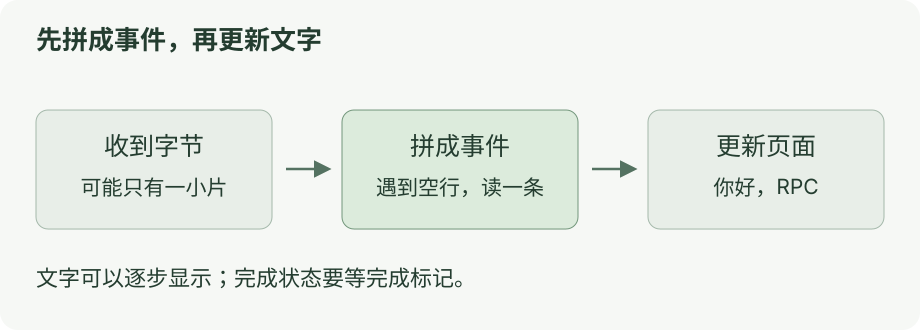

# 第三章：从完整响应走到 SSE

[上一课](02-json-rpc.md) · [目录](README.md) · [下一课](04-mcp.md)

**这一课：一边接收消息，一边显示文字。**

SSE 让服务端通过 HTTP 持续发来事件。OpenAI 的 HTTP 流式回复现在仍使用它。[官方文档](https://developers.openai.com/api/docs/guides/streaming-responses)

## 先运行

```bash
node docs/ai-communication/labs/03-sse.ts
```

实验把同一份数据切成 1、7、1024 字节的小片段。三次都应拼出：

```text
3 个事件 → 你好，RPC → completed
```

数据在本地模拟，没有调用模型或网络。

## 看图

[](../../site/public/diagrams/ai-communication/03-sse.svg)

一条事件可以这样写：

```text
event: delta
data: {"text":"你好"}

```

`event` 是名字，`data` 是内容。**空行表示这一条事件结束。**

一次读到的数据可能只有半条事件，也可能包含好几条。要先拼完整，再处理。[SSE 标准](https://html.spec.whatwg.org/multipage/server-sent-events.html#parsing-an-event-stream)

## 到这里就停

记住：**先拼成事件，再更新文字；还要等这次响应的完成标记。**

实验最后还演示了只有文字、没有完成标记就断开的情况。它会保留文字，完成状态仍为否。

<details>
<summary>代码与分片细节</summary>

源码：[03-sse.ts](labs/03-sse.ts) · [sse.ts](labs/sse.ts)。

先找 `decoder.decode(chunk, { stream: true })`：它能接住被切开的中文 UTF-8 字节。再找空行处组装事件的代码。

网络分片、SSE 事件、模型 token 是不同单位。token 是模型处理内容的单位，一个事件可以装多个 token 对应的文字。

SSE 用 UTF-8；多行 `data` 用换行拼接。教学解析器支持 LF/CRLF、注释、`event` 和 `data`，没有实现单独 CR、`id`/`retry`、重连和 HTTP 检查。[标准](https://html.spec.whatwg.org/multipage/server-sent-events.html#parsing-an-event-stream)

这里的 `completed` 是实验自己约定的事件。当前 Swift runtime 使用具体接口约定的 `[DONE]`；它也不是所有 SSE 都必须有的标记。[源码](../../examples/shared/runtime/Sources/main.swift:351)

</details>

<details>
<summary>EventSource、fetch、WebSocket、WebRTC</summary>

| 名字 | 先记这个用途 |
| --- | --- |
| `EventSource` | 浏览器订阅 SSE 事件 |
| `fetch` | 发请求，再自己读取响应流 |
| WebSocket | 双方保持连接，持续发消息 |
| WebRTC | 实时音视频通信 |

`EventSource` 接收 URL 和凭据选项，没有任意请求头、请求体或方法参数。需要 POST 时，可以用 `fetch` 接收 SSE。[接口](https://html.spec.whatwg.org/multipage/server-sent-events.html#the-eventsource-interface)

接真实 HTTP 时，还要检查状态码、内容类型和响应体，并传入取消信号。本课没有测代理缓冲、网络延迟或真实断网。

OpenAI 也提供适合持续工具调用的 [WebSocket 模式](https://developers.openai.com/api/docs/guides/websocket-mode)，实时语音另有 [WebRTC 与 WebSocket 连接](https://developers.openai.com/api/docs/guides/realtime)。

SSE 重连后能否补回内容，还取决于服务端有没有保留事件、怎样处理编号与重复消息。

</details>
