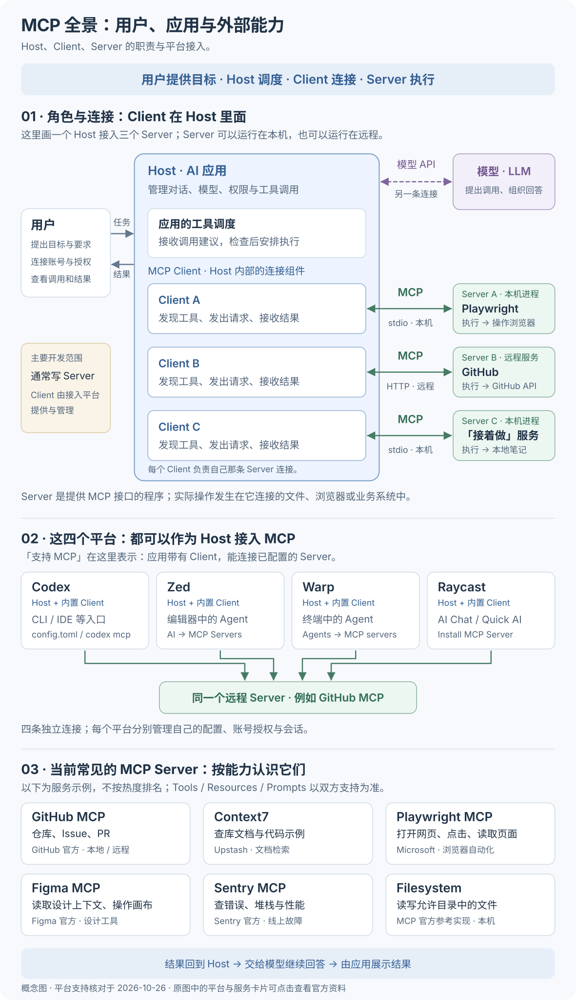
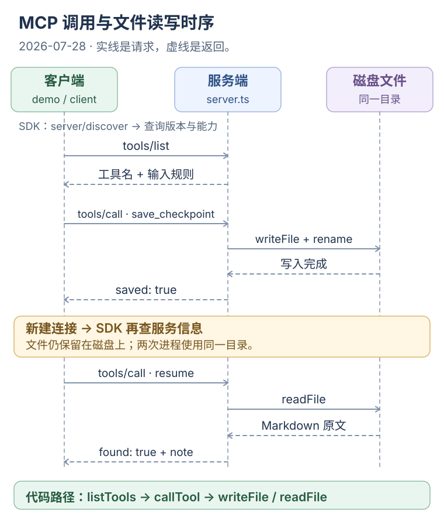
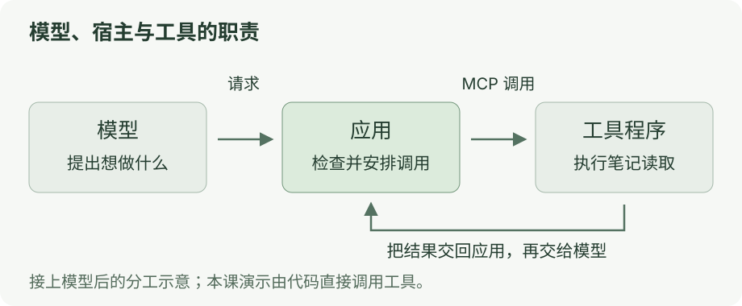

# 第四章：看清 MCP 的发现与调用

[](../../site/public/diagrams/ai-communication/mcp-roles-platforms.svg)

点击图可打开完整 SVG、放大查看；原图中的平台与服务卡片链接到官方资料。

[上一课](03-sse.md) · [目录](README.md) · [下一课](05-failure.md)

**这一课的目的：把“先问有哪些工具，再按约定调用”对应到代码和协议消息。**

复用[第一个 MCP 演示](../ai-from-scaling/00-minimal-mcp.md)。这次重点看两个方法：`tools/list` 返回工具名称和输入规则，`tools/call` 发送具体工具名与参数。前者发现的是已连接服务提供的工具，不是扫描电脑或搜索互联网来寻找 MCP 服务；服务启动命令在 `client.ts` 中已经指定。[工具规范](https://modelcontextprotocol.io/specification/2026-07-28/server/tools)

**你来做：看输出 → 顺时序找代码 → 对照一次调用的名称、参数和结果。**

## 先分清：你、Host、Client、Server

| 角色 | 负责什么 | 和你的关系 |
| --- | --- | --- |
| 用户 | 提出目标、选择应用、连接账号，按应用策略确认操作 | 你在应用里说话、查看调用与结果 |
| **Host：宿主应用** | 管理对话和模型、决定暴露哪些工具、检查权限、管理 Client | 在这个接入场景里，就是你操作的 Codex、Zed、Warp 或 Raycast |
| **Client：连接组件** | 与一个 Server 通信，发现能力、发送请求、接收结果 | 通常内置在 Host 中，接入已有平台时由平台提供 |
| **Server：能力提供程序** | 提供工具、资源或提示模板；收到调用后访问实际文件、浏览器或业务 API | 你安装、连接或自己编写的 MCP 服务 |
| 模型（LLM） | 根据上下文提出工具调用，收到结果后继续回答 | Host 通过模型接口联系它；图中紫色连接表示模型 API，绿色连接表示 MCP |

**一个 Host 可以管理多个 Client，每个 Client 负责一条 Server 连接；同一个远程 Server 可以同时服务多个平台的 Client。** 这些是角色分工：本机运行的程序也可以是 Server。[MCP 官方架构说明](https://modelcontextprotocol.io/docs/learn/architecture)

平时大家也会把整个 Codex 或 Zed 叫作“MCP 客户端”。这是从使用者角度说“它能接 MCP”；严格拆开内部结构时，整个应用是 Host，负责协议连接的组件是 Client。

<details>
<summary>图里的四个平台，分别怎样接入 MCP？</summary>

以下支持方式核对于 **2026-10-26**，指各平台自己的 AI / Agent 功能接入外部 Server。

| 平台 | 接入入口与配置 | 连接方式与边界 |
| --- | --- | --- |
| [Codex](https://learn.chatgpt.com/docs/extend/mcp) | `codex mcp`、MCP 设置；配置保存在 `config.toml` | 本机 stdio、远程 Streamable HTTP；支持相应的 token / OAuth 认证。本仓库的[Codex 实操篇](../ai-from-scaling/00-codex-mcp.md)只需编写 Server |
| [Zed](https://zed.dev/docs/ai/mcp) | Settings → AI → MCP Servers；配置字段是 `context_servers`，也可通过扩展安装 | 支持本地命令和远程 URL；Zed Agent 直接使用这些服务，外部 Agent 的配置传递还涉及 ACP |
| [Warp](https://docs.warp.dev/agents/capabilities/mcp/) | Settings → Agents → MCP servers；添加启动命令或 URL | 本地命令、Streamable HTTP，也兼容 SSE 连接；此处指 Warp 应用内的本地 Agent |
| [Raycast](https://manual.raycast.com/ai/model-context-protocol) | `Install MCP Server` / `Manage MCP Servers`；在 AI Chat、Quick AI 等入口使用 | 桌面支持 stdio 和 HTTP，HTTP 支持 OAuth；iOS 只支持 HTTP |

复用同一个 Server 时，各平台分别管理配置、登录授权和会话。能否连接还取决于双方支持的传输、认证和具体功能。比如把 GitHub MCP 接到 Codex 和 Raycast，意味着两边各有自己的连接，可以访问授权范围内的 GitHub 数据。

“在 Warp 终端里运行 Codex CLI”时，直接连接 MCP 的是 Codex；使用 Warp 自己的 Agent 时，则由 Warp 管理连接。Zed 的内置 Agent、外部 Agent 和终端线程也有各自的配置路径，详见上表官方文档。

</details>

<details>
<summary>图中常见的 MCP Server，各自提供什么？</summary>

以下按用途举例，不是热度排行榜。服务提供的 Tools、Resources、Prompts，以及平台能使用其中哪些功能，都以双方实际支持为准。

| Server | 把什么能力接进 Host | 实际连接的对象 |
| --- | --- | --- |
| [GitHub MCP](https://github.com/github/github-mcp-server) | 查询或操作仓库、Issue、PR 等 | GitHub API；官方提供本地与远程服务 |
| [Context7](https://github.com/upstash/context7) | 按库查询文档与代码示例 | Context7 的开发文档索引 |
| [Playwright MCP](https://github.com/microsoft/playwright-mcp) | 打开网页、点击、读取页面 | Playwright 控制的浏览器 |
| [Figma MCP](https://developers.figma.com/docs/figma-mcp-server/) | 读取设计上下文，按支持的功能创建或修改画布内容 | Figma 文件与设计系统；具体能力受服务模式与权限影响 |
| [Sentry MCP](https://mcp.sentry.dev/) | 查询错误、性能与项目问题 | 授权范围内的 Sentry 项目 |
| [Filesystem](https://github.com/modelcontextprotocol/servers/tree/main/src/filesystem) | 读写允许目录中的文件 | 本机文件系统；这是 MCP 的参考实现之一 |

你自己的「接着做」也处在 **Server** 的位置：Host 里的 Client 调用 `save_checkpoint` / `resume`，服务端代码读写 Markdown。接入 Codex 时，这个 Client 由 Codex 提供；下面独立演示里的 `client.ts` 则是为了让你看见连接过程而单独写的。

</details>

总览图说明角色与连接关系；下面的实验和消息顺序按本课明确引用的 **2026-07-28** 规范阅读。

## 1. 运行：观察两种不同的请求

已经跑过第一个演示，可以直接看下一步。首次使用先按[开场教程](../ai-from-scaling/00-minimal-mcp.md)安装依赖，再运行：

```bash
pnpm --dir examples/minimal-mcp demo
```

看到 `[MCP] tools/list → save_checkpoint, resume`，说明客户端拿到了清单；随后两次 `tools/call` 分别调用保存和读取工具，`[结果]` 显示各自的执行结果。重启后仍能取回原文，是工具读写同一份 Markdown 文件的效果；MCP 负责调用，不自动保存记录。演示由代码填写参数，安装依赖后离线运行，不需要模型。

**完成标志：** 你能从输出中分出“发现工具”和“执行工具”两个阶段。

## 2. 看图：文件操作发生在服务端

[](../../site/public/diagrams/ai-communication/04-mcp-sequence.svg)

图按本例实际协商的 **2026-07-28** 版本画出逻辑交互，省略请求 ID、`_meta` 和 SDK 用于版本探测的短暂服务进程。`client.ts` 的 `versionNegotiation: { mode: 'auto' }` 让 SDK 先发送 `server/discover`，查询服务身份、支持的版本和能力；这与随后查询具体工具的 `tools/list` 是两件事。[服务发现规范](https://modelcontextprotocol.io/specification/2026-07-28/server/discover)

**你来做：** 在源码中沿三条线找位置：

1. [demo.ts](../../examples/minimal-mcp/src/demo.ts) 的 `listTools()` 对应图中的查询清单。
2. [client.ts](../../examples/minimal-mcp/src/client.ts) 的 `client.callTool({ name, arguments: args })` 对应发送调用。
3. [server.ts](../../examples/minimal-mcp/src/server.ts) 的 `writeFile()` / `readFile()` 对应真正的文件操作。

`demo.ts` 两次使用同一个目录，因此新服务能读回文件；整个演示结束后才清理临时目录。第二次连接仍由 SDK 查询服务信息，但调用方代码已经知道 `resume` 的名称与参数，所以直接调用它，没有再次执行 `listTools()`。

**完成标志：** 你能指出哪条箭头跨过进程，以及哪条箭头真正改变了文件。

## 3. 对照：方法名和工具名各指什么

在 [demo.ts](../../examples/minimal-mcp/src/demo.ts) 找到调用 `resume` 的一行，对照下面的协议示意。为突出工具调用，这里省略 `_meta` 中的版本、客户端身份和能力字段；本例实际发送时由 SDK 补上这些元数据：

```json
{"jsonrpc":"2.0","id":7,"method":"tools/call","params":{"name":"resume","arguments":{"project":"yuuki-box"}}}
```

- `tools/call`：协议方法，表示“调用一个工具”。
- `resume`：具体工具名，决定服务端执行哪个回调。
- `project`：工具参数，决定读取哪份记录。
- `id`：把请求与响应配对；这里的 `7` 是示意值。

`resume`、`project`、`found` 和 `note` 都是本例定义的工具名或业务字段。换成 Blender 工具，会传 `modelId`，返回几何信息；协议方法仍是 `tools/call`。客户端检查 `structuredContent` 中的真实数据后，才把原文交给演示打印。终端的 `[MCP]`、`[结果]` 是日志标签，不是报文字段。

**完成标志：** 你能把工具名、参数、执行函数和返回原文连起来。

## 到这里完成

用代码解释：客户端怎样知道服务端有什么工具，以及一个 `tools/call` 最终怎样读到文件。想观察调用没有正常结束的情况，继续[下一课](05-failure.md)。

## 选读与参考

<details>
<summary>接上模型后，谁提出、谁安排、谁执行</summary>

[](../../site/public/diagrams/ai-communication/04-mcp.svg)

模型可以提出工具调用；应用安排连接、检查参数和权限，再把执行结果交回模型。本课的演示由固定代码完成调用，可以先独立观察这条通信链。

</details>

<details>
<summary>当前版本、旧版初始化与两类错误</summary>

本例使用 SDK 的 `auto` 模式。与当前示例服务连接时，协商到 2026-07-28，首次发现并调用工具的顺序为：

```text
server/discover             查询服务身份、支持的版本与能力
tools/list                  看有哪些工具
tools/call                  调用工具
```

2026-07-28 的请求各自携带版本与能力元数据，不靠旧连接记住它们。SDK 会处理这些字段；协议无会话状态，也不妨碍工具把业务数据保存在文件或数据库里。[架构说明](https://modelcontextprotocol.io/docs/2026-07-28/learn/architecture#statelessness-and-discovery)

旧的 2025-11-25 教程则从 `initialize → notifications/initialized` 开始，再进入发现与调用。SDK 的 `auto` 模式也能在符合回退条件时连接旧版服务。先看日志中的实际协议版本，再对照对应规范，不能把旧版初始化顺序当成本次运行记录。[旧版生命周期](https://modelcontextprotocol.io/specification/2025-11-25/basic/lifecycle)

连接代码在 [client.ts](../../examples/minimal-mcp/src/client.ts)，输入和输出检查在 [contracts.ts](../../examples/minimal-mcp/src/contracts.ts)。

工具结果里的 `isError` 表示工具执行错误；JSON-RPC 的 `error` 表示协议层面的调用错误。另一个层次是业务结论：GitHub 实验的 `run_check` 可以成功返回“断言失败”的检查回执；调用完成不等于被测代码通过。[错误约定](https://modelcontextprotocol.io/specification/2026-07-28/server/tools#error-handling)

应用还要保存运行编号、模型工具调用编号和 RPC 请求编号的对应关系。工具结果经过检查，再交回模型，让它继续回答。

</details>

<details>
<summary>选读：MCP 与 SSE 的关系</summary>

这里引用的规范提供 stdio 和 Streamable HTTP 两种标准传输。前者按行发送 JSON-RPC；后者可以返回 JSON，也可以使用 SSE。[传输规范](https://modelcontextprotocol.io/specification/2026-07-28/basic/transports)

Streamable HTTP 替代了早期 HTTP+SSE 的传输布局。看旧教程时，要确认版本。

现有 Swift runtime 还在调用内建工具。把 MCP 接进去是[下一步练习](../agent-engineering/01-mcp-tool-source.md)。

</details>
