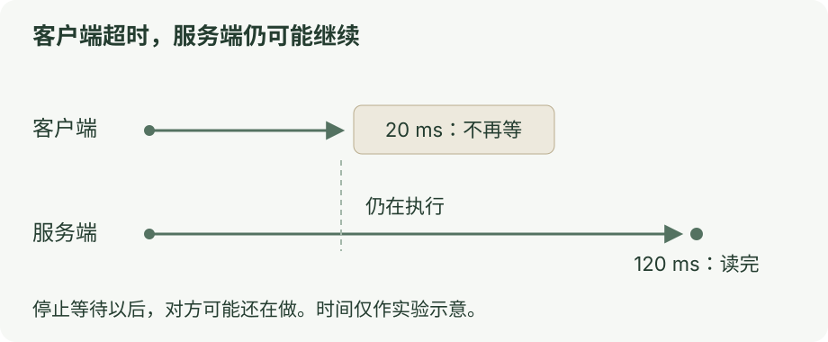

# 第五章：取消、超时与重试

[上一课](04-mcp.md) · [目录](README.md) · [下一课](06-yuuki.md)

<mark class="caution">停止等待，不等于对方停止执行。</mark>

## 先运行

```bash
node docs/ai-communication/labs/05-failure.ts
```

客户端只等 20 ms，服务端需 120 ms 才读完。

## 看图

[](../../site/public/diagrams/ai-communication/05-timeout.svg)

实验会确认：

- 客户端已经超时，服务端仍读了一次。
- 客户端取消等待，服务端仍完成了第二次读取。

计数保存在内存里，没有修改用户文件。

## 再试一次之前

重试前<mark class="key">确认上一次是否已执行</mark>，避免重复操作。

请求 id 只配对回答，不保证操作只执行一次。[JSON-RPC 规范](https://www.jsonrpc.org/specification)

## 到这里就停

知道取消还需传到执行方即可。

<details>
<summary>代码与迟到结果</summary>

源码：[05-failure.ts](labs/05-failure.ts) · [rpc-client.ts](labs/rpc-client.ts) · [note-server.ts](labs/note-server.ts)。

实验里的 `AbortController` 只取消客户端等待，没有把取消消息发给服务端。

超时或取消会删除等待项；迟到结果被忽略，不会把原调用改成成功。

| 看到什么 | 能确定什么 |
| --- | --- |
| 成功响应 | 对方明确返回了结果 |
| 错误响应 | 对方明确返回了错误 |
| 超时或断线 | 最终结果没有可靠到达，执行情况可能未知 |
| 点击取消 | 用户要求停止，还要继续传给执行方 |

实验不自动重试；应用需按操作约定去重、查询结果或人工核对。

</details>

<details class="qa">
<summary>怎样把取消传下去？</summary>

MCP 普通请求用 `notifications/cancelled`，任务增强请求用 `tasks/cancel`；仍需处理迟到结果。[取消规范](https://modelcontextprotocol.io/specification/2025-11-25/basic/utilities/cancellation)

Yuuki 的 [run.cancel](../../examples/shared/runtime/Sources/main.swift:236) 取消 Swift 任务和网络请求、唤醒待确认操作；已完成工具仍保留记录。[运行时说明](../../examples/shared/runtime/README.md)

想继续学恢复，读[把一次运行管到底](../agent-engineering/05-harness-vertical-slice.md)。

</details>
