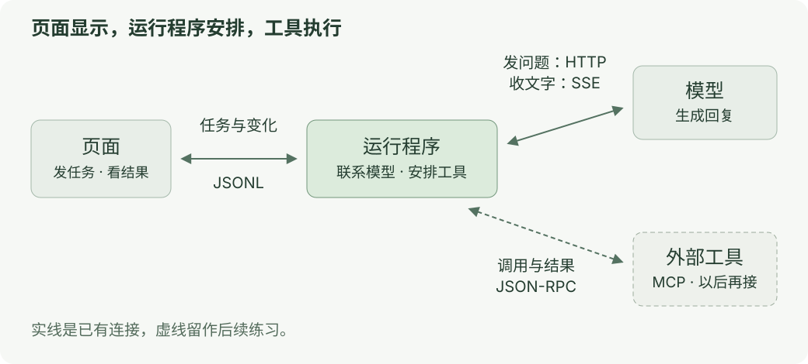

# 第六章：接回自己的 AI 工作台

[上一课](05-failure.md) · [目录](README.md)

**这一课：在自己的代码里，认出前面学过的步骤。**

这次只读代码，不需要模型 Key。

## 看图

[](../../site/public/diagrams/ai-communication/request-map.svg)

图里的“运行程序”就是代码中的 runtime。它负责安排模型和工具工作。

MCP 工具还没有接入当前 runtime。虚线表示后续练习；目前执行的是内建工具。

## 只找三处

| 打开哪里 | 找什么 |
| --- | --- |
| [协议说明](../../examples/shared/runtime/PROTOCOL.md) | `run.start` 开始，`run.cancel` 取消 |
| [completion()](../../examples/shared/runtime/Sources/main.swift:351) | 发请求，接收 SSE，拼接文字和工具参数 |
| [run()](../../examples/shared/runtime/Sources/main.swift:280) | 调用工具，把结果交回模型，再继续回答 |

一次模型回复结束，整个任务还可能继续。比如模型要先读文件，读完后再回答。

## 到这里就停

能在代码里指出 **“哪里发请求、哪里收文字、哪里执行工具”**，这一轮就完成了。

<details>
<summary>页面怎样收到变化</summary>

页面与 runtime 用 JSONL 通信，一行一条 JSON。它们使用自己的命令和事件格式。

runtime 发给页面的文字变化类似：

```json
{"type":"delta","sessionId":"…","messageId":"…","text":"追加的文字"}
```

`sessionId` 找到会话，`messageId` 找到消息，`text` 追加文字。

`completion()` 会先积累文字，在后续文字到来、间隔达到约 50 ms 时发布一次，结束时补齐。这样能减少部分更新次数；界面是否流畅还需要测量。

取消入口在 [run.cancel](../../examples/shared/runtime/Sources/main.swift:236)。它会取消任务和网络请求；已经完成的工具结果仍保留。[运行时说明](../../examples/shared/runtime/README.md)

这一课来自源码阅读，未执行真实模型调用、界面操作或性能测量。实际运行按[客户端说明](../../examples/README.md)操作。

</details>

<details>
<summary>后续学习入口</summary>

- 想自己写工具循环：[搭建 Harness](../ai-from-scaling/03-build-a-harness.md)。
- 想接外部工具：[MCP 工具源](../agent-engineering/01-mcp-tool-source.md)。
- 想提供自己的远程服务：[Supabase × Apple WeatherKit 天气 MCP](weather-mcp/README.md)。
- 想知道模型缓存什么：[KV Cache](../kv-cache/00-first-request.md)。
- 想查界面为什么卡：[渲染实验](../learning/rendering-performance.md)。
- 想让它听见和开口：[语音工具](../tts/README.md)。

</details>
