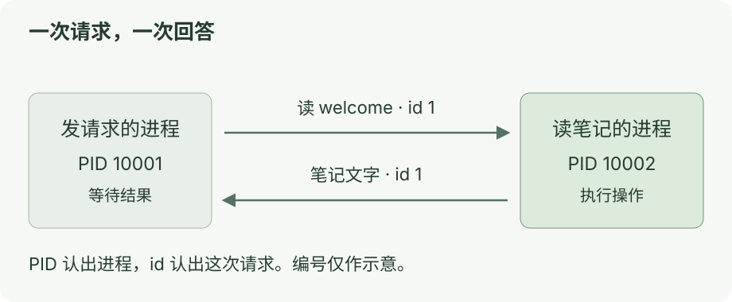

# AI 应用通信：从 RPC、SSE 到 Agent 工具调用

从“读一条笔记”开始，看懂程序怎样沟通。本专题只沿请求、响应、流式事件与失败处理展开；模型训练和前端性能可以分别学习。

**每课一张图、一个动作。看懂就停。**

## 今天只学第一课

打开[第一课：让一次函数调用跨过进程](01-rpc.md)。在项目根目录运行：

```bash
node docs/ai-communication/labs/01-rpc.ts
```

[](../../site/public/diagrams/ai-communication/01-rpc.svg)

找到请求和回答里相同的 `id`，今天就到这里。

<details>
<summary>六课目录</summary>

| 课 | 学什么 |
| --- | --- |
| [1 · RPC](01-rpc.md) | 请另一个程序做事 |
| [2 · JSON-RPC](02-json-rpc.md) | 用编号找到对应结果 |
| [3 · SSE](03-sse.md) | 一边接收，一边显示 |
| [4 · MCP](04-mcp.md) | 让应用调用外部工具 |
| [5 · 取消与超时](05-failure.md) | 停止等待后，对方还在做吗 |
| [6 · 接回 Yuuki](06-yuuki.md) | 在自己的代码里找到这些步骤 |

</details>

## 学完后选做：让 Codex 查询 Apple 天气

想把“用户登录 → 授权 → 工具调用”接成完整服务，到 [MCP 项目实战](../mcp-projects/README.md)选择[远程天气教程](weather-mcp/README.md)。它是独立的工程跟做课程，后端使用 Supabase，天气来自 Apple WeatherKit；不作为通信六课的必修续篇。

<details>
<summary>运行环境与检查</summary>

使用 Node.js 22.22 或更高版本。新增实验只用标准库，不需要安装依赖或填写模型 Key。Node 可以直接运行这里的 TypeScript，但不会替你检查类型。[Node 文档](https://nodejs.org/docs/latest-v24.x/api/typescript.html)

第四课使用已有 MCP 示例，首次运行要按原教程安装依赖。

检查新增实验：

```bash
node --test docs/ai-communication/labs/verify.test.mjs
```

课程整理于 2026-10-25。本地实验已运行；SSE 使用模拟数据；真实模型调用和界面性能未测。第六课按当前源码讲解。

</details>

返回[文档目录](../../site/src/pages/index.astro) · 跨专题联读[前端与 AI 实验](../learning/ai-frontend-intersections.md)。
