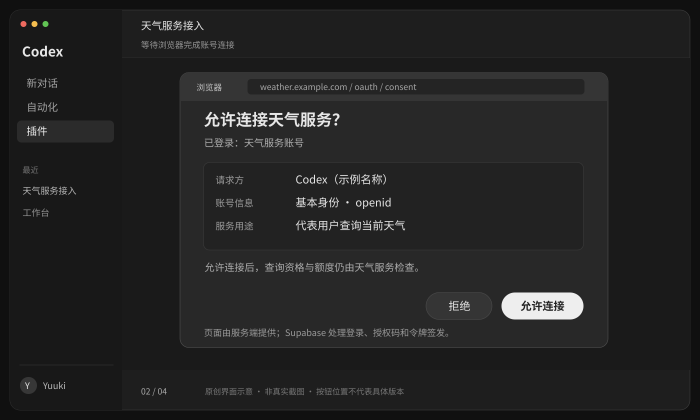
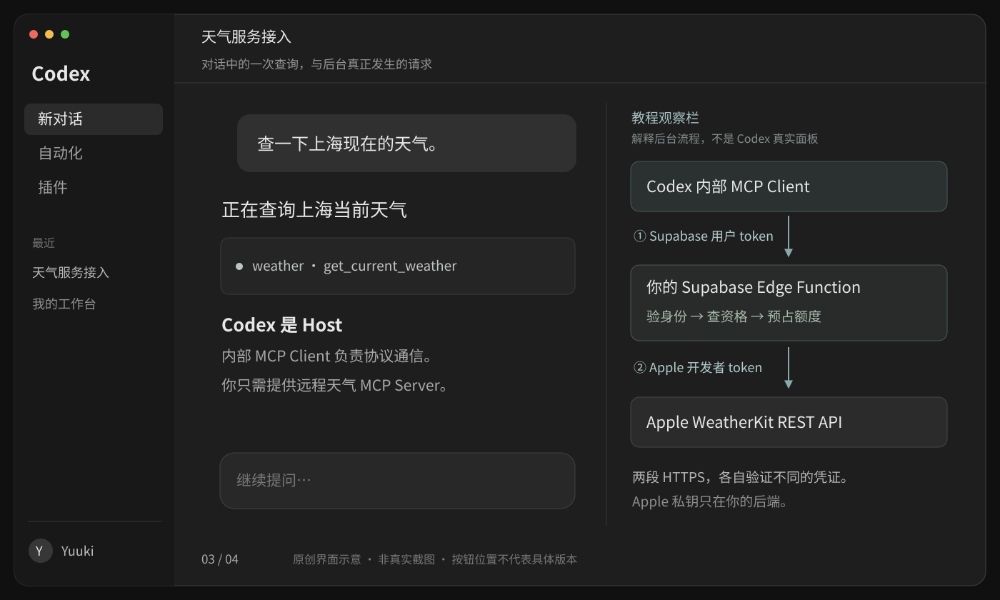

# 1 · 天气服务的连接与授权流程

[目录](README.md) · [下一课：Supabase 授权](02-supabase-auth.md)

分清<mark class="key">登录、授权、天气查询</mark>。

## 用户看到的四步

1. 在 Codex 添加天气服务；发布后可通过插件提供名称、介绍和连接配置。
2. 点击连接，浏览器进入服务的登录同意页。已登录用户可复用会话。
3. 查看请求方与权限说明，选择允许或拒绝。
4. 回到 Codex，发送“用天气服务查一下上海现在的天气”。

客户端处理 token，用户只连接、授权；联调见[第五课](05-connect-and-verify.md)。[Codex MCP 支持](https://learn.chatgpt.com/docs/extend/mcp?surface=cli)、[插件连接配置](https://developers.openai.com/plugins/build/plugins)

[](../../../site/public/diagrams/weather-mcp/02-consent.svg)

服务端提供同意页并显示真实客户端名称；密码不进入对话。

## 登录与授权分别证明什么

| 动作 | 校验内容 | 处理方 |
| --- | --- | --- |
| 登录 | 当前用户身份 | 登录页面 + Supabase Auth |
| 同意 OAuth 请求 | 是否允许该客户端代表自己访问服务 | 用户确认，Supabase Auth 记录授权 |
| 检查天气资格 | 用户是否获准调用天气工具 | Edge Function + 数据库 |

<mark class="caution">OAuth 同意不等于天气资格或额度。</mark>先为测试用户开通服务。

## 第一次连接的后台过程

流程省略注册、PKCE 参数和令牌格式；协议由 Codex、Supabase、SDK 实现。

```text
Codex → 天气 MCP：尝试连接
天气 MCP → Codex：401，并指出 OAuth 元数据地址
Codex → 元数据地址：找到 Supabase 的授权服务器
Codex → 浏览器：打开 OAuth 授权请求
Supabase → 网站 /oauth/consent：携带 authorization_id
网站 → 用户：登录，显示请求详情，允许 / 拒绝
Supabase → Codex 回调：返回一次性授权码
Codex → Supabase token endpoint：用授权码和 PKCE 校验材料换 token
Codex → 天气 MCP：带上 access token 再请求
```

授权码用于一次性交换，后续 `Authorization` 头放 access token；密码不交给工具或模型。[MCP HTTP 授权规范](https://modelcontextprotocol.io/specification/2026-07-28/basic/authorization)

## 一次天气查询有两套凭证

[](../../../site/public/diagrams/weather-mcp/03-request.svg)

| 凭证 | 谁签发 | 谁持有和使用 | 谁验证 |
| --- | --- | --- | --- |
| Supabase OAuth access token | Supabase Auth | Codex 一侧的 MCP Client | 天气 MCP 服务 |
| Apple developer token | 后端使用 Apple 私钥签名 | Edge Function | Apple WeatherKit |
| Apple `.p8` 私钥 | Apple 开发者后台创建并下载 | 仅服务端密钥存储 | 用于生成上面第二种 token |

两段请求虽都用 Bearer，但用户 token 只到天气 MCP，Apple token 只到 Apple，私钥只留后端。[Apple 请求认证](https://developer.apple.com/documentation/weatherkitrestapi/request-authentication-for-weatherkit-rest-api)

<details class="qa" id="为什么这里还有-host">
<summary>为什么还需要 Host？</summary>

Codex 组织对话并内置 Client，服务端只需实现 Server。先用 Inspector/脚本测接口，再验收 Codex 集成。

</details>

## 用户拒绝、令牌过期与额度用完

| 情况 | 应有的体验 |
| --- | --- |
| 用户拒绝授权 | 连接保持未完成，可以稍后再连，不自动批准 |
| access token 到期 | 在授权服务器支持且授予刷新凭证时自动续期 |
| 授权撤销或刷新失败 | 提示重新连接账号 |
| 账号没有天气资格 | 明确显示未开通，不循环弹登录窗口 |
| 当日额度用完 | 说明限额与恢复时间，不伪造天气结果 |
| Apple 暂时不可用 | 告知上游暂不可用，不误导用户重新登录 Supabase |

刷新凭证也会过期，授权不是永久有效。[Supabase 令牌刷新](https://supabase.com/docs/guides/auth/oauth-server/oauth-flows#refresh-token-flow)

<div class="heading-alias" id="到这里就停" aria-hidden="true"></div>

## 验收标准

指出两套凭证的接收方，再进入[Supabase 用户与授权](02-supabase-auth.md)。
