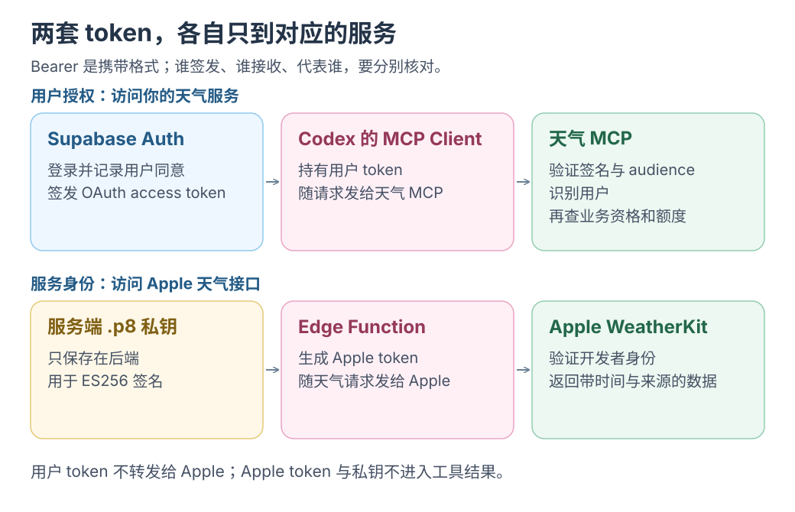

# 2 · 用 Supabase 登录、签发 token，并决定谁能查天气

[上一课](01-user-journey.md) · [目录](README.md) · [下一课：Apple WeatherKit](03-apple-weatherkit.md)

**这一课的目标：让 Codex 拿到由 Supabase 签发、专门用于天气服务的 access token。**

先用独立的练习项目。这一课包含数据库与 Auth 配置步骤，复制到已有项目之前，应先核对现有 RLS、OAuth 客户端和 Access Token Hook，不能覆盖它们。

[](../../../site/public/diagrams/weather-mcp/token-boundaries.svg)

本课只准备图中上半条链。后端为 Apple 签名是下一课的事情；不要用“都有 Bearer”判断凭证可以互换。

## 1. 记下三个地址

这里的值都是占位符，请换成你的项目。Supabase 默认项目域名足够完成第一次练习，不必先配置自定义域名。

| 名称 | 示例 |
| --- | --- |
| `SUPABASE_URL` | `https://YOUR_PROJECT_REF.supabase.co` |
| `WEATHER_MCP_URL` | `https://YOUR_PROJECT_REF.supabase.co/functions/v1/weather-mcp` |
| 登录同意页 | `https://weather.example.com/oauth/consent` |

`WEATHER_MCP_URL` 在 token 的 `aud`、MCP 资源元数据和 Codex 配置中必须一致，连末尾斜杠也保持一致。授权服务器的 issuer 则是 `SUPABASE_URL + /auth/v1`。

## 2. 开启 OAuth Server

在 Supabase Dashboard 中：

1. 打开 **Authentication → OAuth Server**，启用 OAuth Server。
2. 启用 **Dynamic Client Registration**，用于这次 Codex 接入。
3. 在 **URL Configuration** 中设置你前端的 Site URL。
4. 把 Authorization Path 设为 `/oauth/consent`。
5. 检查 JWT Signing Keys，使用 **ES256 或 RS256 非对称签名**。本教程后端用 JWKS 验证签名，不接受旧 HS256 项目密钥。

动态注册是“给客户端登记身份与回调地址”，不等于给用户批准访问。用户仍然需要登录和同意。发布后要允许用户撤销授权，并检查注册的客户端；已有固定接入方也可改用预注册客户端。[Supabase MCP 认证](https://supabase.com/docs/guides/auth/oauth-server/mcp-authentication)

先访问公开的发现文档：

```text
https://YOUR_PROJECT_REF.supabase.co/.well-known/oauth-authorization-server/auth/v1
```

应能看到授权、token、注册等端点，以及 PKCE 支持。这里只读取公开配置，不应出现你的 access token 或私钥。[OAuth Server 设置](https://supabase.com/docs/guides/auth/oauth-server/getting-started)

## 3. 明确一个 Supabase 的限制

**截至本教程整理日，Supabase OAuth Server 支持 `openid`、`email`、`profile`、`phone`，尚不支持自定义 OAuth scopes。**

因此前面讨论中的 `weather:read` 只是概念示例，本教程不把它填进 Codex 的 OAuth scopes。这里申请 `openid`，天气使用资格单独保存在数据库里。

Supabase OAuth access token 包含 `client_id`，但普通用户 RLS 不会自动变成“仅允许查询天气”。本例的业务表不对 `anon` / `authenticated` 直接开放；Edge Function 验证 token 后，只通过限定的数据库查询与 RPC 使用它们。[Scopes 与数据访问边界](https://supabase.com/docs/guides/auth/oauth-server/oauth-flows#available-scopes)、[OAuth 与 RLS](https://supabase.com/docs/guides/auth/oauth-server/token-security)

## 4. 建立使用资格与原子额度检查

在你的天气工程里新建 Supabase migration，把下面 SQL 放进去。两个表只存资格与每日调用次数，不存 Apple 天气原始数据。

`supabase/migrations/202610260001_weather_access.sql`：

<!-- file: supabase/migrations/202610260001_weather_access.sql -->
```sql
create table public.weather_access (
  user_id uuid primary key references auth.users(id) on delete cascade,
  enabled boolean not null default false,
  daily_limit integer not null default 20 check (daily_limit between 1 and 1000)
);

create table public.weather_usage (
  user_id uuid not null references auth.users(id) on delete cascade,
  usage_day date not null,
  calls integer not null check (calls >= 0),
  primary key (user_id, usage_day)
);

alter table public.weather_access enable row level security;
alter table public.weather_usage enable row level security;
revoke all on public.weather_access, public.weather_usage from anon, authenticated;
grant select on public.weather_access to service_role;

-- 只有已经验证过用户身份的 Edge Function 能调用。
-- 一次事务完成资格检查和计数，避免并发请求穿透限额。
create function public.reserve_weather_call(p_user_id uuid)
returns text
language plpgsql
security definer
set search_path = ''
as $$
declare
  max_calls integer;
  reserved integer;
  today_utc date := (current_timestamp at time zone 'UTC')::date;
begin
  select daily_limit into max_calls
    from public.weather_access
    where user_id = p_user_id and enabled
    for share;
  if max_calls is null then
    return 'denied';
  end if;

  insert into public.weather_usage as usage (user_id, usage_day, calls)
    values (p_user_id, today_utc, 1)
    on conflict (user_id, usage_day) do update
      set calls = usage.calls + 1
      where usage.calls < max_calls
    returning calls into reserved;

  if reserved is null then
    return 'quota_exceeded';
  end if;
  return 'allowed';
end;
$$;

revoke all on function public.reserve_weather_call(uuid)
  from public, anon, authenticated;
grant execute on function public.reserve_weather_call(uuid) to service_role;
```

在 Dashboard 创建或登录一个真实测试用户，复制其 Auth 用户 ID，然后由管理员开通：

```sql
insert into public.weather_access(user_id, enabled, daily_limit)
values ('替换为真实用户UUID', true, 20)
on conflict (user_id) do update set enabled = true, daily_limit = 20;
```

这个 SQL 中的 UUID 是管理员操作；工具调用参数中不允许出现可任意填写的 `user_id`。服务器要从验证后的 token `sub` 取用户 ID。

这里的限额按 UTC 日期重置，统计**查询尝试次数**。即使 Apple 请求失败，该次也计入额度，防止失败重试无限消耗上游。它是教学用的用户额度，不是 Apple 全账号月额度，也不能替代网关限流。

## 5. 把 token 限定给天气 MCP

MCP 要求服务端验证 token 是签发给自己使用的。不能因为签名正确，就接受这个 Supabase 项目里的所有登录 token。

下面的 Hook 适用于**只有天气 OAuth 用途的独立练习项目**：存在 `client_id` 的 OAuth token 使用天气服务 audience；普通网站登录 token 保持原样。

`supabase/migrations/202610260002_weather_token_hook.sql`：

<!-- file: supabase/migrations/202610260002_weather_token_hook.sql -->
```sql
create function public.weather_access_token_hook(event jsonb)
returns jsonb
language plpgsql
stable
as $$
declare
  claims jsonb := event->'claims';
begin
  if nullif(claims->>'client_id', '') is not null then
    claims := jsonb_set(
      claims,
      '{aud}',
      to_jsonb('https://YOUR_PROJECT_REF.supabase.co/functions/v1/weather-mcp'::text)
    );
  end if;
  return jsonb_build_object('claims', claims);
end;
$$;

grant usage on schema public to supabase_auth_admin;
grant execute on function public.weather_access_token_hook(jsonb)
  to supabase_auth_admin;
revoke execute on function public.weather_access_token_hook(jsonb)
  from public, anon, authenticated;
```

替换项目地址，执行 migration，然后在 **Authentication → Hooks → Custom Access Token Hook** 中选择这个函数。保留原有必需 claims；不要删除 `sub`、`role`、`exp` 等字段。[Access Token Hook 输入输出](https://supabase.com/docs/guides/auth/auth-hooks/custom-access-token-hook)

**已有项目不能直接对所有 `client_id` 改 audience。** 应把条件改成你登记的天气客户端 ID 白名单，并把条件合并到现有 Hook。动态登记但尚未加入白名单的客户端应连接失败，而不是放宽后端 audience 检查。其他业务客户端仍使用各自的 audience。[按客户端定制 token](https://supabase.com/docs/guides/auth/oauth-server/token-security)

本教程后端使用服务器凭证访问上述专用表，不把这个定向 OAuth token 当成一个通用 Supabase 数据库会话转发。后端的 `service_role` 会绕过 RLS，所以身份校验和固定查询路径都必须保留。

## 6. 做一个真正的登录同意页

Supabase 提供 OAuth 协议端点，但**同意页面需要你提供**。在你已有的前端路由 `/oauth/consent` 中放置以下元素：

```html
<main>
  <h1>连接天气服务</h1>
  <p id="status" role="status"></p>
  <form id="login" hidden>
    <label>邮箱 <input id="email" type="email" required autocomplete="email"></label>
    <button>发送登录邮件</button>
  </form>
  <section id="consent" hidden>
    <p id="client"></p>
    <p id="scopes"></p>
    <p>客户端将代表你查询天气。可用城市和调用额度由天气服务管理。</p>
    <button id="allow">允许连接</button>
    <button id="deny">拒绝</button>
  </section>
</main>
```

下面是配套浏览器 TypeScript，使用前端构建工具编译；`@supabase/supabase-js` 应使用包含 OAuth Server API 的 v2 版本。publishable key 可放前端，`service_role` 和 Apple 私钥不能放这里。

`web/consent.ts`：

<!-- file: web/consent.ts -->
```ts
import { createClient } from '@supabase/supabase-js';

const supabase = createClient(
  'https://YOUR_PROJECT_REF.supabase.co',
  'YOUR_SUPABASE_PUBLISHABLE_KEY',
);
const element = (id: string) => document.getElementById(id)!;
const status = element('status');
const authorizationId = new URL(location.href).searchParams.get('authorization_id');

async function loadConsent() {
  if (!authorizationId) {
    status.textContent = '缺少授权请求，请回到 Codex 重新连接。';
    return;
  }

  const { data: sessionData } = await supabase.auth.getSession();
  // 这里只决定显示登录还是同意页；权限由 Supabase 与后端重新验证。
  if (!sessionData.session) {
    element('login').hidden = false;
    return;
  }

  const { data, error } = await supabase.auth.oauth.getAuthorizationDetails(authorizationId);
  if (error || !data) {
    status.textContent = '授权请求已失效，请回到 Codex 重新连接。';
    return;
  }
  if (!('authorization_id' in data)) {
    // 已同意的请求，由 Supabase 返回下一步地址。
    location.assign(data.redirect_url);
    return;
  }
  element('login').hidden = true;
  element('client').textContent = `请求连接的应用：${data.client.name}`;
  element('scopes').textContent = `账号信息范围：${data.scope || '未指定'}`;
  element('consent').hidden = false;
}

element('login').addEventListener('submit', async (event) => {
  event.preventDefault();
  if (!authorizationId) return;
  const returnTo = new URL('/oauth/consent', location.origin);
  returnTo.searchParams.set('authorization_id', authorizationId);
  const { error } = await supabase.auth.signInWithOtp({
    email: (element('email') as HTMLInputElement).value,
    options: { emailRedirectTo: returnTo.href },
  });
  status.textContent = error ? '发送失败，请稍后再试。' : '请在邮件中完成登录，再回到授权页面。';
});

async function decide(allow: boolean) {
  if (!authorizationId) return;
  const buttons = ['allow', 'deny'].map((id) => element(id) as HTMLButtonElement);
  buttons.forEach((button) => { button.disabled = true; });
  const { data, error } = allow
    ? await supabase.auth.oauth.approveAuthorization(authorizationId)
    : await supabase.auth.oauth.denyAuthorization(authorizationId);
  if (error || !data) {
    status.textContent = '没有完成连接，请重试或回到 Codex 重新发起。';
    buttons.forEach((button) => { button.disabled = false; });
    return;
  }
  location.assign(data.redirect_url);
}

element('allow').addEventListener('click', () => { void decide(true); });
element('deny').addEventListener('click', () => { void decide(false); });
await loadConsent();
```

在 Auth Redirect URLs 中允许你的 `/oauth/consent` 回跳路径及其授权请求参数。首次练习先用相同浏览器完成邮件登录；生产环境应接入你已有的登录回调处理，并验证跨设备邮件、邮件限流和错误状态。[Supabase 邮件登录](https://supabase.com/docs/guides/auth/auth-email-passwordless)、[同意页 API](https://supabase.com/docs/guides/auth/oauth-server/getting-started#build-your-authorization-ui)

不要把 URL 里任意传入的 `redirect` 当作回调直接跳转。这里仅使用 Supabase 验证授权请求后返回的 `redirect_url`；显示请求方名称和 scope 时用 `textContent`。

## 到这里就停

核对三个结果：公开发现文档能打开；测试用户在 `weather_access` 里已启用；Hook 只修改你打算修改的 OAuth token。完整登录与 audience 验证留到[第五课](05-connect-and-verify.md)，现在先准备 [Apple 的凭证](03-apple-weatherkit.md)。
