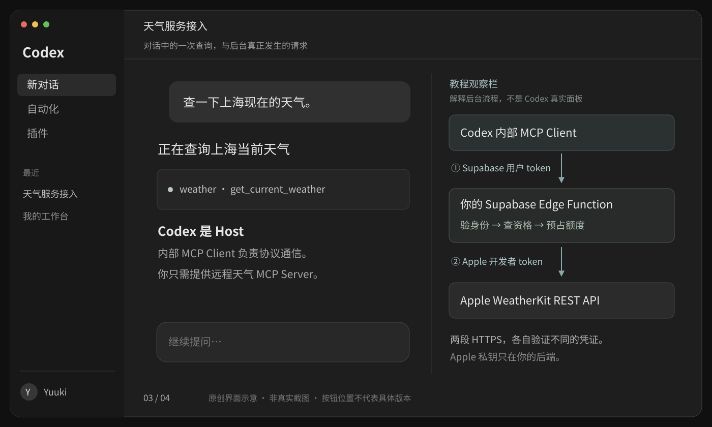
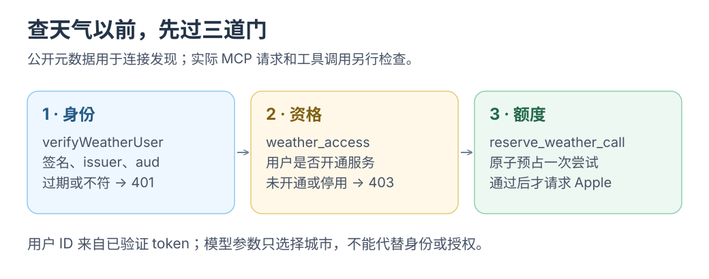

# 4 · 把天气查询封装成远程 MCP 工具

[上一课](03-apple-weatherkit.md) · [目录](README.md) · [下一课：连接与验收](05-connect-and-verify.md)

让 Codex 发现并调用天气工具；<mark class="key">权限检查留在服务端</mark>。

[](../../../site/public/diagrams/weather-mcp/03-request.svg)

<div class="heading-alias" id="1-先看完整目录" aria-hidden="true"></div>

## 1. 项目目录

在独立天气工程汇总前两课与本课文件：

```text
weather-service/
├── web/
│   └── consent.ts                 # 配套 HTML 见第二课，接入前端路由
└── supabase/
    ├── config.toml
    ├── migrations/
    │   ├── 202610260001_weather_access.sql
    │   └── 202610260002_weather_token_hook.sql
    └── functions/weather-mcp/
        ├── deno.json
        ├── env.ts
        ├── auth.ts
        ├── weatherkit.ts
        └── index.ts
```

按 Supabase 示例使用 SDK v2 `createMcpHandler`，每请求新建实例。SDK 处理协议、发现、参数和传输；业务代码处理身份与权限。[Supabase 自建 MCP 指南](https://supabase.com/docs/guides/ai-tools/byo-mcp)

`supabase/functions/weather-mcp/deno.json`：

<!-- file: supabase/functions/weather-mcp/deno.json -->
```json
{
  "imports": {
    "@modelcontextprotocol/server": "npm:@modelcontextprotocol/server@2.4.0",
    "@supabase/supabase-js": "npm:@supabase/supabase-js@2.118.0",
    "jose": "npm:jose@6.2.13",
    "zod": "npm:zod@4.3.6"
  },
  "compilerOptions": { "strict": true }
}
```

固定版本用于复现；不要混用 v2 与旧 SDK v1 import。

## 2. 给 OAuth 发现留一个公开入口

在 `supabase/config.toml` 加入：

`supabase/config.toml`：

<!-- file: supabase/config.toml -->
```toml
[functions.weather-mcp]
verify_jwt = false
```

网关关闭 JWT 检查，仅为公开资源发现；<mark class="caution">函数内验证必须保留</mark>，否则匿名用户可消耗 Apple 额度。[Edge Functions 与 MCP 认证](https://supabase.com/docs/guides/ai-tools/byo-mcp)

## 3. 验证 Supabase 签发的用户 token

`decodeJwt` 只读 JSON，不能证明签名，不能据此授权。

`supabase/functions/weather-mcp/auth.ts`：

<!-- file: supabase/functions/weather-mcp/auth.ts -->
```ts
import { createRemoteJWKSet, jwtVerify } from 'jose';
import { z } from 'zod';
import { requireEnv } from './env.ts';

const issuer = `${requireEnv('SUPABASE_URL')}/auth/v1`;
const audience = requireEnv('WEATHER_MCP_URL');
const keys = createRemoteJWKSet(new URL(`${issuer}/.well-known/jwks.json`));
const invalidTokenCodes = new Set([
  'ERR_JWT_EXPIRED', 'ERR_JWT_CLAIM_VALIDATION_FAILED',
  'ERR_JWS_SIGNATURE_VERIFICATION_FAILED', 'ERR_JWS_INVALID',
  'ERR_JWT_INVALID', 'ERR_JOSE_ALG_NOT_ALLOWED',
  'ERR_JWKS_NO_MATCHING_KEY',
]);

export class Unauthorized extends Error {}

export async function verifyWeatherUser(token: string): Promise<string> {
  let payload;
  try {
    ({ payload } = await jwtVerify(token, keys, {
      issuer,
      audience,
      algorithms: ['ES256', 'RS256'],
      requiredClaims: ['sub', 'exp', 'iat', 'client_id'],
      clockTolerance: 5,
    }));
  } catch (error) {
    if (error instanceof Error && 'code' in error &&
        invalidTokenCodes.has(String(error.code))) {
      throw new Unauthorized();
    }
    throw error; // JWKS 网络故障等由上层返回 503，不误导用户反复登录。
  }

  if (payload.role !== 'authenticated' || payload.is_anonymous !== false ||
      typeof payload.client_id !== 'string' || !payload.client_id ||
      !z.uuid().safeParse(payload.sub).success) {
    throw new Unauthorized();
  }
  return payload.sub!;
}
```

验证签名、issuer、audience、有效期与身份；`client_id` 区分 OAuth token，数据库再判断天气资格。[MCP token 校验要求](https://modelcontextprotocol.io/specification/2026-07-28/basic/authorization)、[Supabase OAuth token 安全](https://supabase.com/docs/guides/auth/oauth-server/token-security)

离线验证不保证 JWT 在退出时立即失效。每请求查 `weather_access.enabled` 可停用天气资格；即时撤销客户端授权还需另查授权状态。

[](../../../site/public/diagrams/weather-mcp/access-gates.svg)

首个负例：已登录但无天气资格，应拒绝调用 Apple，也不反复要求登录。

## 4. 注册工具并连接两套权限

仅资源元数据公开；MCP 请求验身份、查资格，天气调用再原子预占额度。

`supabase/functions/weather-mcp/index.ts`：

<!-- file: supabase/functions/weather-mcp/index.ts -->
```ts
import { createMcpHandler, McpServer } from '@modelcontextprotocol/server';
import { createClient } from '@supabase/supabase-js';
import { z } from 'zod';
import { Unauthorized, verifyWeatherUser } from './auth.ts';
import { requireEnv } from './env.ts';
import { getCurrentWeather, WeatherKitError } from './weatherkit.ts';

const resource = requireEnv('WEATHER_MCP_URL');
const resourcePath = new URL(resource).pathname;
const metadataUrl = `${resource}/oauth-protected-resource`;
// Supabase 网关转发后的路由以函数名开头；也接受未剥离的公开路径。
const mcpPaths = new Set([resourcePath, '/weather-mcp']);
const metadataPaths = new Set([...mcpPaths].map((path) => `${path}/oauth-protected-resource`));
const consentOrigin = new URL(requireEnv('CONSENT_ORIGIN')).origin;
const supabaseUrl = requireEnv('SUPABASE_URL');
const admin = createClient(supabaseUrl, requireEnv('SUPABASE_SERVICE_ROLE_KEY'), {
  auth: { persistSession: false, autoRefreshToken: false },
});

function json(body: unknown, status = 200, headers: Record<string, string> = {}) {
  return Response.json(body, {
    status,
    headers: { 'Cache-Control': 'no-store', ...headers },
  });
}

function authenticationRequired(invalid = false) {
  return json({ error: 'authentication_required' }, 401, {
    'WWW-Authenticate': `Bearer resource_metadata="${metadataUrl}", scope="openid"` +
      (invalid ? ', error="invalid_token"' : ''),
  });
}

function toolError(code: string, message: string) {
  return {
    isError: true,
    content: [{ type: 'text' as const, text: `${code}: ${message}` }],
  };
}

Deno.serve(async (request: Request) => {
  const origin = request.headers.get('Origin');
  // 原生客户端通常没有 Origin；带 Origin 的请求必须来自允许的站点。
  // 此处不是通用浏览器 MCP 客户端的 CORS 实现。
  if (origin && origin !== consentOrigin) return json({ error: 'origin_denied' }, 403);

  const path = new URL(request.url).pathname;
  if (metadataPaths.has(path) && request.method === 'GET') {
    return json({
      resource,
      authorization_servers: [`${supabaseUrl}/auth/v1`],
      scopes_supported: ['openid'],
      bearer_methods_supported: ['header'],
    });
  }
  if (!mcpPaths.has(path)) return json({ error: 'not_found' }, 404);

  const match = request.headers.get('Authorization')?.match(/^Bearer\s+(\S+)$/i);
  if (!match) return authenticationRequired();

  let userId: string;
  try {
    userId = await verifyWeatherUser(match[1]);
  } catch (error) {
    if (error instanceof Unauthorized) return authenticationRequired(true);
    return json({ error: 'authentication_service_unavailable' }, 503);
  }

  const { data: access, error: accessError } = await admin
    .from('weather_access').select('enabled').eq('user_id', userId).maybeSingle();
  if (accessError) return json({ error: 'access_check_unavailable' }, 503);
  if (!access?.enabled) return json({ error: 'weather_access_denied' }, 403);

  const handler = createMcpHandler(() => {
    const server = new McpServer({ name: 'yuuki-weather', version: '0.1.0' });
    server.registerTool('get_current_weather', {
      title: '查询当前天气',
      description: '查询上海、北京、杭州的当前天气，返回数据时间、单位和 Apple 来源。' +
        '不支持未来预报；回答时保留时间、来源链接与标识资源。',
      inputSchema: z.object({ city: z.enum(['上海', '北京', '杭州']) }),
      annotations: { readOnlyHint: true, openWorldHint: true },
    }, async ({ city }) => {
      const { data: reservation, error } = await admin.rpc('reserve_weather_call', {
        p_user_id: userId, // 来自验证后的 token，绝不来自模型参数。
      });
      if (error) return toolError('ACCESS_UNAVAILABLE', '暂时无法检查额度，请稍后重试。');
      if (reservation === 'denied') return toolError('ACCESS_DENIED', '天气权限已停用。');
      if (reservation === 'quota_exceeded') {
        return toolError('QUOTA_EXCEEDED', '今日查询次数已用完，额度按 UTC 日期重置。');
      }
      if (reservation !== 'allowed') return toolError('ACCESS_UNAVAILABLE', '额度检查未完成。');

      try {
        const weather = await getCurrentWeather(city);
        return {
          structuredContent: weather,
          content: [{ type: 'text' as const, text: JSON.stringify(weather) }],
        };
      } catch (error) {
        // 仅记错误分类和上游状态，不记录 JWT、私钥或完整请求头。
        console.error('weather_fetch_failed', {
          code: error instanceof WeatherKitError ? error.code : 'UPSTREAM_OR_CONFIG_ERROR',
          status: error instanceof WeatherKitError ? error.upstreamStatus : undefined,
        });
        return toolError('WEATHER_UNAVAILABLE', '天气来源暂时不可用，请稍后再试。');
      }
    });
    return server;
  });

  return handler.fetch(request);
});
```

`readOnlyHint` 描述查询性质，不是权限凭证；服务器仍计额度。参数只接受三个城市，不允许任意 URL 或用户身份。

## 5. 走一遍实际消息

客户端第一次访问天气 MCP，没有 token，会收到：

```http
HTTP/1.1 401 Unauthorized
WWW-Authenticate: Bearer resource_metadata="https://YOUR_PROJECT_REF.supabase.co/functions/v1/weather-mcp/oauth-protected-resource", scope="openid"
```

客户端发现 Supabase，完成浏览器授权与 PKCE，带 token 重试，再按协商版本发现、调用工具：

```json
{
  "jsonrpc": "2.0",
  "id": 12,
  "method": "tools/call",
  "params": {
    "name": "get_current_weather",
    "arguments": { "city": "上海" }
  }
}
```

HTTP `Authorization` 传身份，JSON-RPC body 传调用；`tools/list` 提供名称、说明与参数。HTTPS 负责传输，MCP 约定工具协议。

`WWW-Authenticate` 指定元数据地址，无需修改域名根路由；此处不是 Supabase 管理平台的 MCP 地址。[MCP 资源发现](https://modelcontextprotocol.io/specification/2026-07-28/basic/authorization)

公开路径含 `/functions/v1`，内部路径以 `/weather-mcp` 开头；两者都识别，但 audience 与资源标识始终用公开 URL。[Supabase 函数路由](https://supabase.com/docs/guides/functions/routing)

<div class="heading-alias" id="到这里就停" aria-hidden="true"></div>

## 验收标准

找到身份、资格、额度三道门，再去[部署与验收](05-connect-and-verify.md)。
