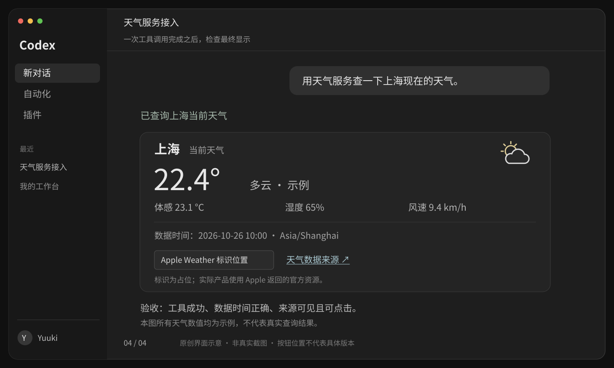

# 5 · 连接 Codex，完成第一次真实查询

[上一课](04-mcp-server.md) · [目录](README.md)

**这一课的目标：分别验证后端、OAuth、工具调用和用户最终看到的结果。**

[](../../../site/public/diagrams/weather-mcp/04-result.svg)

## 1. 把代码放进自己的练习工程

你需要安装 Supabase CLI；本地 Deno 用于类型检查。以下命令由你在新建的天气工程中运行，本教程交付并没有替你执行云端操作。

```bash
mkdir weather-service
cd weather-service
supabase init
supabase functions new weather-mcp
```

按[第二课](02-supabase-auth.md)、[第三课](03-apple-weatherkit.md)、[第四课](04-mcp-server.md)的文件名复制代码。新建 `supabase/migrations` 后放入两份 SQL；将第四课配置**追加到** CLI 生成的 `config.toml`，不要用四行片段覆盖整个配置。

检查函数类型：

```bash
deno check --config supabase/functions/weather-mcp/deno.json supabase/functions/weather-mcp/index.ts
```

登录同意页接入你已有的前端工程，安装本教程使用的 `@supabase/supabase-js@2.118.0`。HTML 与 `consent.ts` 必须在同一个 `/oauth/consent` 路由实际加载；它不是一份放在磁盘上就能被 Supabase 自动发现的文件。

## 2. 应用数据库与 Auth 配置

先在 Dashboard 创建**独立练习项目**。将 Hook SQL 中的 `YOUR_PROJECT_REF` 换成真实项目引用，再连接 CLI：

```bash
supabase login
supabase link --project-ref YOUR_PROJECT_REF
supabase migration list
supabase db push --dry-run
```

确认项目正确、待执行的只有本教程两份 migration，再运行：

```bash
supabase db push
```

随后按第二课启用 OAuth Server、动态客户端注册、非对称签名和 Token Hook，部署同意页，配置它的 Site URL、Authorization Path、邮件回跳地址。创建测试用户并由管理员开通 `weather_access`。[Supabase CLI](https://supabase.com/docs/reference/cli/supabase-db-push)、[OAuth Server 设置](https://supabase.com/docs/guides/auth/oauth-server/getting-started)

不要在已有项目里为了练习执行 `db reset`，也不要把未知的既有 migration 一起推上去。

## 3. 配置服务器 Secrets

在 Supabase Dashboard 的 Edge Functions Secrets 中设置：

| 名称 | 内容 |
| --- | --- |
| `WEATHER_MCP_URL` | `https://YOUR_PROJECT_REF.supabase.co/functions/v1/weather-mcp` |
| `CONSENT_ORIGIN` | 同意页的 origin，例如 `https://weather.example.com`，不含路径 |
| `APPLE_TEAM_ID` | Apple Team ID |
| `APPLE_KEY_ID` | WeatherKit Key ID |
| `APPLE_SERVICE_ID` | 注册的 Services ID |
| `APPLE_PRIVATE_KEY_BASE64` | `.p8` 完整内容的 Base64 |

`SUPABASE_URL` 和 `SUPABASE_SERVICE_ROLE_KEY` 是托管 Edge Function 默认环境变量，不需要把它们写进前端或 Codex 配置。这里的服务端 key 会绕过 RLS，只能在已经验证身份的固定查询里使用。[Supabase Secrets](https://supabase.com/docs/guides/functions/secrets)

在 macOS 可把私钥编码后直接复制到剪贴板，粘贴到 Dashboard 的 secret 字段，不在终端打印：

```bash
base64 -i /你的本地私密目录/AuthKey_KEYID.p8 | tr -d '\n' | pbcopy
```

这是编码后的同一份私钥，保密要求不变。保存后清空剪贴板，私钥文件继续保存在私密位置；不要放进本仓库。

部署函数：

```bash
supabase functions deploy weather-mcp
```

托管环境的 `SUPABASE_URL` 应为公开项目 URL。本教程先验证托管环境；如果改跑本地容器，Auth issuer、JWKS 可访问地址与网关地址可能不同，不能只替换一个端口就假定 OAuth 全部可用。

## 4. 先验证没有 token 时的行为

下面两个请求不需要任何密钥：

```bash
curl -i -X POST \
  'https://YOUR_PROJECT_REF.supabase.co/functions/v1/weather-mcp' \
  -H 'Content-Type: application/json' \
  -d '{}'

curl -i \
  'https://YOUR_PROJECT_REF.supabase.co/functions/v1/weather-mcp/oauth-protected-resource'
```

第一个应为 `401`，且 `WWW-Authenticate` 指向第二个地址。第二个应为 `200`，`resource` 是天气 MCP 的公开 URL，`authorization_servers` 是你项目的 Auth issuer。

如果第一个错误来自网关、没有预期 challenge，先查函数的 `verify_jwt` 配置。若第二个是 `404`，查部署名称和第四课的内部路由。**此时还不需要排查 Apple 私钥。**

## 5. 用 Codex 完成 OAuth

开发者第一次联调可以通过 CLI 添加远程服务：

```bash
codex mcp add weather --url https://YOUR_PROJECT_REF.supabase.co/functions/v1/weather-mcp
codex mcp login weather --scopes openid
```

登录命令会发起 OAuth；按实际提示打开浏览器，在你的网站登录并允许连接。动态注册让客户端登记它实际使用的回调地址，不要自己猜一个 Codex 回调 URL 写死。也不要把 Apple token 当成 `--bearer-token` 之类的手工配置。[Codex MCP 官方说明](https://learn.chatgpt.com/docs/extend/mcp?surface=cli)

回到使用同一配置环境的 Codex，检查天气服务已加载，必要时重新打开会话。桌面 app、远程开发环境或不同 `CODEX_HOME` 未必读取同一份配置；以当前客户端的 MCP 设置为准，不因 CLI 显示已连接就断言另一个环境也已连上。

发送：

> 用 weather 的 get_current_weather 查询上海当前天气。保留数据时间、摄氏度单位、Apple Weather 标识资源和来源链接，不要生成未来预报。

检查工具记录的城市参数是“上海”，返回的数据时间合理、字段有单位。工具成功后，再检查最终回答；这两步不能合并成一个“看起来成功了”。

## 6. 验证几种会真的遇到的失败

在独立测试项目中逐项操作，测试结束后恢复测试用户配置。不要把生产 token 发到在线 JWT 解码网站。

| 测试 | 预期结果 | Apple 是否应被调用 |
| --- | --- | --- |
| 没有 token / token 签名错误 / 已过期 | HTTP `401`，可发现 OAuth 元数据 | 否 |
| 使用普通网站登录 token，或 `aud` 是别的服务 | HTTP `401` | 否 |
| 已登录，但 `weather_access` 没有记录或已停用 | HTTP `403`；不应反复要求登录 | 否 |
| 参数填“成都”或请求传入 `user_id` 冒充别人 | 不支持的城市被拒；用户身份始终取自 token | 否 / 不会变成别人 |
| 测试用户额度设为 1，连续请求两次 | 首次预占；第二次 `QUOTA_EXCEEDED` | 第二次不调用 |
| 两个请求并发争抢最后一次额度 | 只有一个成功预占 | 仅成功预占的调用 |
| Apple key 配错、上游 `401` / 超时 | 工具返回 `WEATHER_UNAVAILABLE`；用户不必重登 | 尝试调用，记录安全的错误分类 |
| 上游缺字段或返回已过期数据 | 工具失败，不编造替代值 | 已调用，但不展示为成功天气 |
| 用户拒绝同意 | OAuth 不完成 | 否 |
| 用户停用天气权限后再次请求 | 新请求立即被业务检查拒绝 | 否 |

额度消耗的是尝试次数。重试不是免费操作；教程没有实现自动无限重试。更大规模上线前还需加入全服务预算、网关请求限流和运行监控，用户日额度不能防止海量匿名请求。

## 7. 让普通用户不用输入命令

上面的 CLI 是开发者联调入口。服务验证通过后，可把名称、说明、MCP URL 和 OAuth 类型放进 Codex 支持的插件包；用户安装后连接账号，后端仍然是同一个 Edge Function。

当前 OpenAI 插件配置使用 `mcp.json` 声明服务，认证扩展标记 OAuth。下例只展示相关配置，完整清单和分发方式以官方打包文档为准：

```json
{
  "$schema": "https://agent-plugins.org/schemas/1.0.0/mcp.schema.json",
  "mcpServers": {
    "weather": {
      "type": "streamable-http",
      "url": "https://YOUR_PROJECT_REF.supabase.co/functions/v1/weather-mcp",
      "extensions": {
        "com.openai": {
          "auth": { "type": "oauth", "client": { "mode": "dcr" } }
        }
      }
    }
  }
}
```

这并不自动完成发布、审核或进入插件目录。先完成服务与账号连接，再做分发；插件不代替用户授权，也不保存你的 Apple 私钥。[OpenAI 插件打包](https://developers.openai.com/plugins/build/plugins)、[OAuth 接入](https://developers.openai.com/plugins/build/auth)

## 8. 最终体验单独验收

- 第一次连接只有必要的登录与同意步骤，没有复制 token。
- 用户拒绝后仍保持未连接；允许后能回到 Codex 继续查询。
- 数据有明确时间、单位和城市，没有把当前天气说成明天预报。
- **用户实际能看见 Apple Weather 标识，并能打开 Apple 返回的来源链接。** JSON 里有 logo URL 不算通过；SVG 里的占位标识也不算通过。
- 令牌过期、刷新失败、资格停用和上游失败，各自显示正确反馈。
- 密钥没有出现在工具结果、前端 bundle、聊天内容和日志中。

如果当前 Host 无法稳定显示要求的标识，需要补充能正确展示结果的产品界面，并重新验证实际展示路径。仅在工具 description 中要求模型“记得显示”不是可靠保证。[Apple 展示要求](https://developer.apple.com/weatherkit/)

## 本次文档交付的验证记录

本节记录的是这份仓库教程的检查，不是你的云端服务验收。整理日期：2026-10-26。

| 项目 | 状态 |
| --- | --- |
| 文档站检查、构建与导航链接 | Astro check：0 errors / warnings / hints；构建 88 页，检查新增 6 页的内部链接、锚点与资源 |
| SVG 解析、渲染与可读性 | 4 张 SVG 均可解析，含标题与描述；已渲染为图片检查排版 |
| 固定版本依赖下的 TypeScript 示例 | 从文档提取，使用 TypeScript 6.0.3 严格类型检查通过；Deno API 使用最小声明，未声称执行过真实 Deno 部署 |
| 实际 MCP SDK + 模拟云端请求 | 13 项检查通过，覆盖 token 校验、权限、工具发现、参数、额度拒绝、Apple JWT、上游错误与数据校验；未模拟证明 SQL 并发正确性 |
| Supabase migrations、Hook、邮件登录与 OAuth 回调 | 未使用真实项目执行 |
| Apple 密钥、真实天气与调用额度 | 未使用真实凭证执行 |
| Codex 中的最终标识显示、刷新与撤销 | 未真实联调；图为预期体验示意 |

检查在临时目录运行，没有向仓库添加天气服务依赖，也没有读取实际账号凭证。站点构建仍提示现有配置缺少 `site`，因此跳过 sitemap 生成；不影响教程页面生成。

## 到这里就停

第一次只追求一个真实结果：**允许的测试用户，经浏览器授权后，能查询上海当前天气，并看到时间与来源。** 再分别处理展示验收和失败分支。当前天气跑通之后，才扩展预报或城市搜索。
