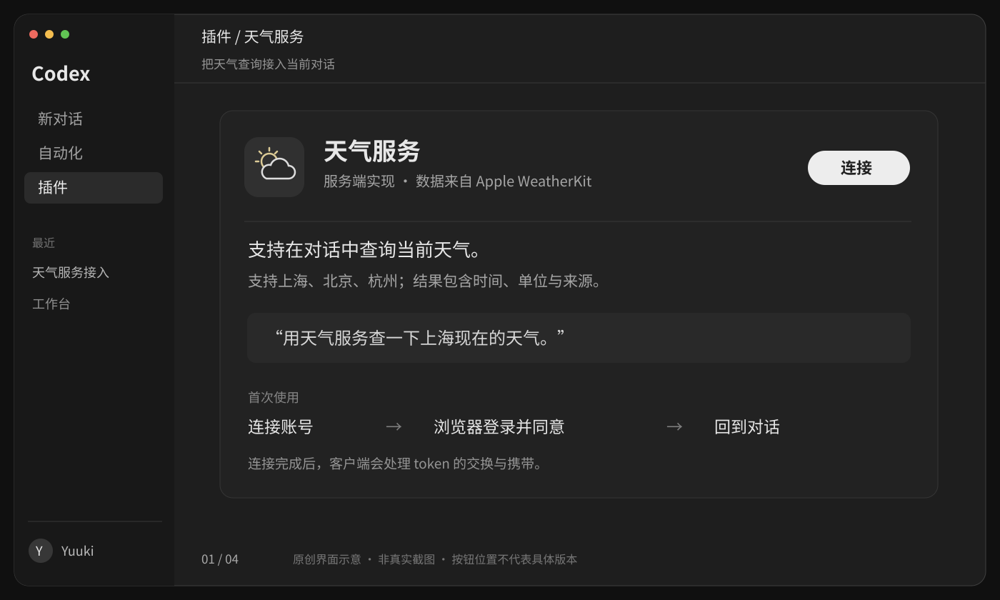

# 天气 MCP：从 Codex 里的连接按钮，到 Apple WeatherKit

[返回通信课程](../README.md) · [开始：用户会经历什么](01-user-journey.md)

**做出这样一条路径：用户在 Codex 连接你的天气服务，登录一次，之后直接问“上海现在天气怎么样”。**

后端使用 **Supabase Auth、Postgres 和 Edge Functions**；天气数据来自 **Apple WeatherKit REST API**。你提供远程 MCP Server，Codex 提供 Host 和内部的 MCP Client。

图是原创 SVG 界面示意，不是真实截图。它借用桌面应用的侧栏、对话区和连接入口表达操作；按钮位置不代表某个 Codex 版本的精确界面。图中的天气值也是示意数据。

## 今天先做到哪里

先读[第一课](01-user-journey.md)，只回答一个问题：

> **用户的 token 给谁看？Apple 的 token 又给谁看？**

能分别指出“你的天气服务”和“Apple WeatherKit”，就可以停。还不用创建云端项目或填写密钥。

## 按这条路线跟做

| 课 | 要完成的事 | 停下来的证据 |
| --- | --- | --- |
| [1 · 用户体验与参与者](01-user-journey.md) | 把连接、授权、查询串起来 | 能解释两套 token 和两次 API 调用 |
| [2 · Supabase 用户与授权](02-supabase-auth.md) | 准备账号、同意页、业务权限和 OAuth token | token 的接收方正确，用户不能给自己开权限 |
| [3 · Apple WeatherKit](03-apple-weatherkit.md) | 在后端签名并查询真实天气 | 得到带时间、单位和来源的结果 |
| [4 · 封装为 MCP 工具](04-mcp-server.md) | 把认证、额度与天气查询放进 Edge Function | 匿名请求被拒绝，允许的请求能调用工具 |
| [5 · 连接 Codex 与验收](05-connect-and-verify.md) | 完成浏览器授权和第一次真实查询 | 云端权限、工具调用、最终显示分别通过 |

每课先说明动作，再给代码。代码块标有目标文件名，供你在**自己的天气服务工程**里跟写；这份文档站不会部署它们。

## 先固定一个小范围

第一版只提供 `get_current_weather`，查询上海、北京、杭州的**当前天气**。城市映射使用固定坐标，不采集用户定位，也不把模型猜出的坐标直接交给上游。

“明天会不会下雨”需要增加日预报、当地时区和日期选择；城市搜索需要另接地理编码。先完成当前天气，再扩展这两个能力。

教程先在独立练习项目里启用 OAuth 动态客户端注册，让 Codex 自动登记回调地址。用户使用时仍然是浏览器登录与同意，不需要复制 token。已有业务项目的 OAuth 客户端需要按第二课的说明单独限定，不能套用练习项目的全局配置。

## 把前面的概念落在具体位置

| 名称 | 在这个例子中是什么 |
| --- | --- |
| Host | 整个 Codex 应用，负责对话、模型与任务安排 |
| MCP Client | Codex 内部实现 MCP 通信的组件，你不用再写一份 |
| MCP Server | 你部署的 `weather-mcp` Edge Function |
| 授权服务器 | Supabase Auth，处理 OAuth 授权码和令牌签发 |
| 业务权限 | Postgres 中由你管理的天气使用资格与额度 |
| 上游天气服务 | Apple WeatherKit；它不需要知道终端用户的 Supabase token |

Host 和 Client 可以在同一个程序中。MCP Server 暴露标准化工具接口；它在调用 WeatherKit 时，又是 **Apple HTTP API 的客户端**。角色取决于正在讨论哪条连接。[MCP 架构](https://modelcontextprotocol.io/docs/learn/architecture)

## 开始之前准备什么

- 一个用于练习的 Supabase 项目，以及一个能访问的 HTTPS 前端，用来承载 `/oauth/consent` 登录同意页。后端仍然全部使用 Supabase。
- Apple Developer Program 账号、WeatherKit 私钥、Key ID、Team ID 和 Services ID。
- 本机 Codex、Supabase CLI；代码使用 Deno/Edge Functions、MCP TypeScript SDK v2、Supabase JS v2 和 `jose`。

Supabase 的 OAuth Server 当前文档标为 beta；它与“让用户通过 Apple/Google 登录 Supabase”是两个不同方向。本教程让 **Supabase 给 Codex 签发访问你服务的 token**。[Supabase OAuth Server](https://supabase.com/docs/guides/auth/oauth-server/getting-started)

## 这份教程的验证边界

整理日期：**2026-10-26**。技术依据来自当前官方文档，示例使用独立的天气服务命名，不改动仓库现有的本地 MCP 示例。

- 教程、导航、SVG 和代码片段的本地检查记录见[验收页](05-connect-and-verify.md#本次文档交付的验证记录)。
- 尚未创建你的 Supabase 表、配置 OAuth、上传 Apple 私钥或部署 Edge Function。
- 没有使用你的 Apple 额度，也没有完成真实 Codex ↔ Supabase ↔ WeatherKit 联调。
- SVG 展示的是预期体验；它不能证明 token 刷新、天气准确性或 Apple 来源标识已经验收。

先从[用户第一次点击“连接”](01-user-journey.md)开始。
