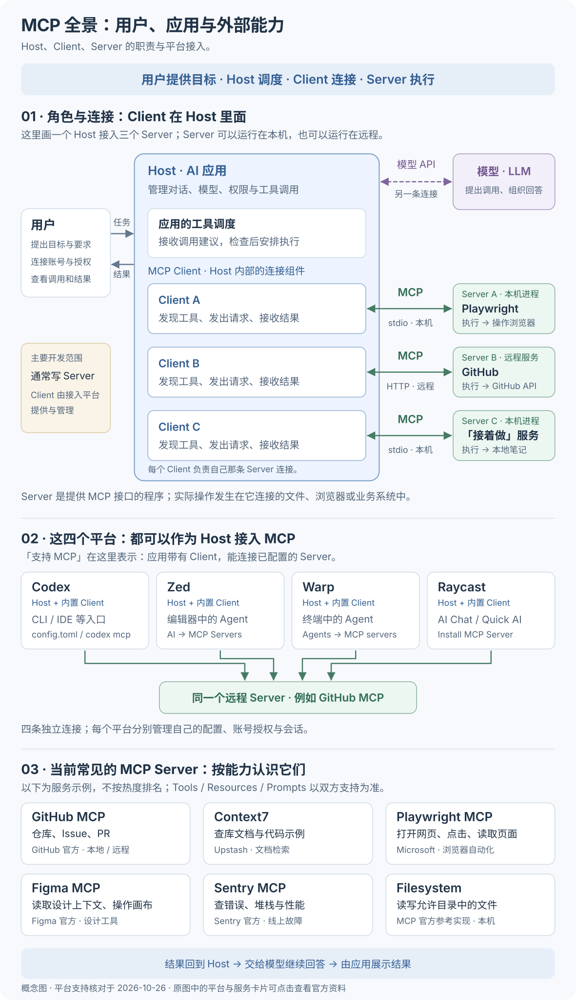
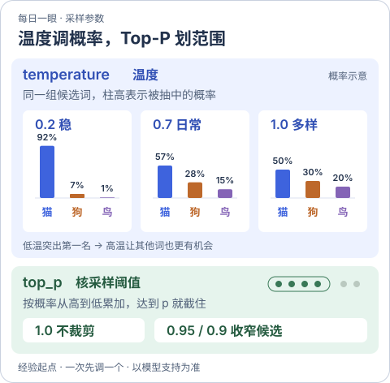

# 在 Codex 里用自己的 MCP

**本课只做一件事：用「接着做」MCP 保存一份项目记录，换一个 Codex 会话再取回。**

先看清角色，再按顺序完成「接入 → 保存与取回 → 对照源码」。参考资料与延伸练习集中在文末。

## 先看 MCP 全景

MCP 约定 AI 应用怎样连接外部能力。本课中，你操作 Codex；Codex 内置的 MCP Client 连接我们编写的「接着做」Server。

[](../../site/public/diagrams/ai-communication/mcp-roles-platforms.svg)

点击图可放大。先把上半部分的三个角色与本课对应起来：

| 图里的角色 | 本课具体是谁 | 负责什么 |
| --- | --- | --- |
| Host：宿主应用 | 你操作的 Codex | 管理对话、模型、权限与工具调用 |
| Client：连接组件 | Codex 内置的 MCP Client | 连接 Server、发现工具、发送调用并接收结果 |
| Server：能力提供程序 | 我们编写的「接着做」 | 提供保存与取回工具，实际读写 Markdown 文件 |

模型通过模型接口与 Codex 沟通，提出工具调用；Codex 检查后，由 Client 把工具名和参数发给 Server。Server 执行文件读写，再把结果返回 Codex。[MCP 官方架构说明](https://modelcontextprotocol.io/docs/learn/architecture)

**先确认这条分工：Codex 提供 Client，你编写 Server，文件由 Server 读写。** 图中的 Zed、Warp、Raycast 是其他 Host 的例子；具体接入方式与常见服务见[角色与平台说明](../ai-communication/04-mcp.md#先分清你hostclientserver)。

## 接入 Codex

准备 Node.js ≥22.22、pnpm 11.14 和可用的 Codex CLI。先在仓库根目录进入示例，再安装和编译：

```bash
cd examples/codex-continue-mcp
pnpm i --frozen-lockfile
pnpm build
```

<details class="qa">
<summary>这些命令是什么意思？为什么加 --frozen-lockfile？</summary>

| 命令 | 含义 |
| --- | --- |
| `cd examples/codex-continue-mcp` | 进入「接着做」示例目录，后面的命令就在这里执行 |
| `pnpm i` | `pnpm install` 的简写，安装示例需要的依赖 |
| `pnpm build` | 运行示例的编译脚本，把 TypeScript 源码编译到 `dist/` |

`pnpm-lock.yaml` 记录依赖的具体版本。`--frozen-lockfile` 要求按这份锁文件安装，保持它不变；锁文件缺失或与 `package.json` 的依赖声明不一致时会报错停止。教程保留这个参数，便于使用仓库记录的依赖版本复现练习。[pnpm 官方说明](https://pnpm.io/cli/install#--frozen-lockfile)

</details>

保持在示例目录，接着注册服务：

```bash
codex mcp add yuuki-continue -- \
  "$(command -v node)" \
  "$PWD/dist/server.js"

codex mcp get yuuki-continue
cd ../..
```

`$PWD/dist/server.js` 会展开成服务入口的绝对路径。最后一行 `cd ../..` 回到仓库根目录，方便继续对照源码；重开 Codex，用 `/mcp` 确认 `yuuki-continue` 已连接。

## 保存与取回

在 Codex 中说：

```text
用 yuuki-continue 给 mcp-learning 保存接续记录：
已理解 Codex 提供 MCP 客户端。
下一步读 examples/codex-continue-mcp/src/server.ts，找到保存记录的代码。
能解释参数怎样变成 Markdown 就停。
```

核对 `save_checkpoint` 的调用结果，以及 `~/.yuuki/continue/mcp-learning.md` 的内容。

换一个 Codex 会话：

```text
用 yuuki-continue 取回 mcp-learning 的接续记录，先展示原文。
```

看到 `resume` 返回原文，这一步完成。

同项目再次保存会替换整份记录；`resume` 只读取，不执行下一步。

## 对照源码

在编辑器里打开本地文件 `examples/codex-continue-mcp/src/server.ts`，只找下面四处，能把它们与刚才的保存、取回操作对应起来即可。

| 代码 | 作用 |
| --- | --- |
| `registerTool()`、`inputSchema` | 声明工具和参数 |
| `writeFile()`、`rename()` | 写入 Markdown，替换项目记录 |
| `resume` 中的 `readFile()` | 读取原文 |
| `serveStdio()` | 通过标准输入、输出连接 Codex |

改源码后重新运行 `build` 并重开会话：Codex 启动的是 `dist/server.js`。

## 本课完成

能把 Codex、Client、Server 与图中角色对应起来，完成跨会话保存与取回，并在源码中指出工具声明与文件读写的位置，就完成本课。

后面的资料不计入本课的完成条件，今天可以直接停在这里。

<details>
<summary>选读：参考资料与延伸练习</summary>

**接入与示例参考**

- [Codex 官方接入文档](https://learn.chatgpt.com/docs/extend/mcp?surface=cli)：需要核对客户端配置时查阅。
- [示例说明](../../examples/codex-continue-mcp/README.md)：工具参数、目录设置与调用统计。
- [服务端源码](../../examples/codex-continue-mcp/src/server.ts)：网页版代码入口。

**其他练习**

下次想观察跨进程调用时，选[独立 MCP 演示](00-minimal-mcp.md)；想做一个实际工具时，选 [MCP 实战项目](../mcp-projects/README.md)。[课程目录](README.md)保留其他学习入口。

</details>

<details>
<summary>选读：temperature 与 top_p 怎样影响输出</summary>

token 可以先理解为一小段文字。模型生成文本时，会为下一步的候选 token 分配概率；「采样」就是按概率抽取下一个 token。为便于理解，图里假设候选只有「猫、狗、鸟」三个；真实模型通常面对更大的词表。

[](../../site/public/diagrams/ai-from-scaling/sampling-memory-card.svg)

点击图可放大。三种温度是对照值，用来观察同一组概率怎样变化。

**temperature（温度）：改变候选之间的概率差距。** 固定同一段输入，本例在温度为 1 时，猫、狗、鸟的概率是 50%、30%、20%。温度降到 0.2 后，约变为 92%、7%、1%，更容易抽中原本概率最高的「猫」；温度调高，其他候选相对更有机会。

**top_p（核采样）：先保留一组候选，再从中抽取。** 沿用 50%、30%、20% 这组概率，设 `top_p = 0.8`：先保留猫，累计 50%；再保留狗，累计达到 80%，筛选结束。接着只在猫和狗里抽一个，两者的概率按原比例重新计算为 `50 ÷ 80 = 62.5%` 和 `30 ÷ 80 = 37.5%`。本例中，`top_p = 0.5` 只留猫，`top_p = 1` 三者都保留。

实际使用时，先确认所用模型支持这些参数；每次只改一个、另一个保持默认，比较同一任务的输出变化。[OpenAI 参数说明](https://developers.openai.com/api/reference/python/resources/responses/methods/create)

</details>
