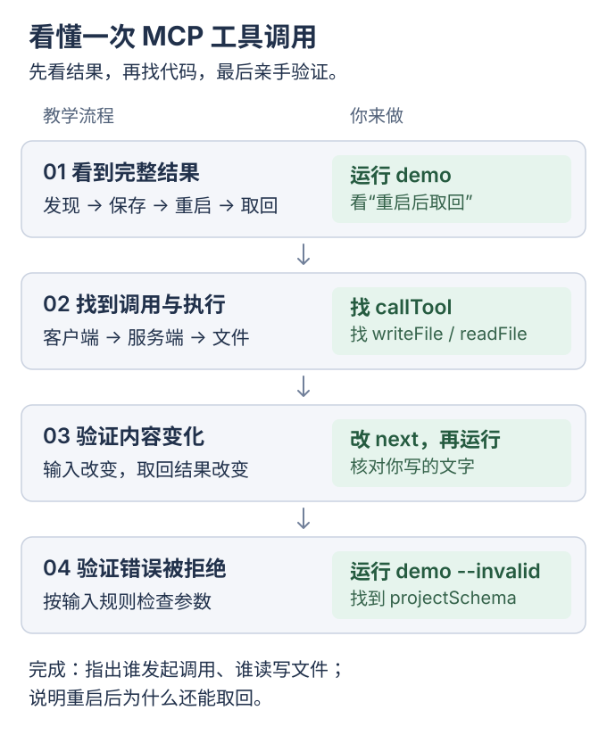

---
next:
  link: /ai-from-scaling/07-weatherkit-mcp/
  label: Apple 天气 MCP
---

# MCP 最简 demo：工具调用与文件读写

脚本安排调用、Client 发请求、Server 执行工具；MCP 通信与文件读写真实发生，<mark class="caution">未接入模型</mark>。

主线：最简 demo → 本地天气 MCP → 其他案例。后续可用[Codex 接入](00-codex-mcp.md)连接服务，案例总览见[MCP 项目实战](../mcp-projects/README.md)。

先运行本页 demo；客户端实现与错误校验按需选读。

用 `save_checkpoint` 保存 Markdown，再用 `resume` 取回。先分清两件事：

| 过程 | 验证内容 |
| --- | --- |
| `tools/list` → `tools/call` → 结果 | MCP 发现与调用 |
| 保存 → 重启 → 读同一文件 | 工具用 Markdown 持久化；MCP 不自动保存业务数据 |

**最简运行只需本页第一节；完整实验约 30 分钟。**

<div class="heading-alias" id="教学流程与你的操作" aria-hidden="true"></div>

## 实验流程

[](../../site/public/diagrams/ai-from-scaling/00-minimal-mcp-flow.svg)

<div class="heading-alias" id="1-运行先看到完整结果" aria-hidden="true"></div>

## 1. 运行与结果

使用 Node.js ≥22.22、pnpm 11.14，在仓库根目录执行：

```bash
pnpm install:mini-mcp
pnpm demo:mini-mcp
```

<details class="qa">
<summary>命令说明</summary>

| 命令 | 用途 |
| --- | --- |
| `pnpm install:mini-mcp` | 安装依赖 |
| `pnpm demo:mini-mcp` | 编译并演示 |

安装已启用 `--frozen-lockfile`：按锁文件安装；需更新时，报错停止。[官方说明](https://pnpm.io/cli/install#--frozen-lockfile)

</details>

输出如下（省略启动日志与部分记录）：

```text
[MCP] tools/list → save_checkpoint, resume
[MCP] tools/call → save_checkpoint | project=yuuki-box
[结果] 保存成功 | saved=true
[文件] <临时目录>/yuuki-box.md
[演示] 原服务进程已关闭；使用同一存储目录启动新进程。
[MCP] tools/call → resume | project=yuuki-box
[结果] 读取成功 | found=true
[文件] <临时目录>/yuuki-box.md

--- resume 返回的 Markdown ---
# yuuki-box
……
## 下一步
我随便写一个
……
--- Markdown 结束 ---
[验证] 新进程已从同一文件读回记录。
[清理] 演示临时目录已删除。
```

核对 `tools/list`、`saved=true` 与重启后的 `found=true`，确认返回同一文件原文。最简 demo 验证完成后，继续[本地 Apple 天气 MCP](07-weatherkit-mcp.md)；以下实现细节为选读。

`demo.ts` 固定工具名和参数，依次保存、重启、读取；安装后可离线运行。`next` 来自 `checkpoint` 对象，改源码即改输出。

客户端 `console.log()` 展示真实过程；方括号是日志标签，`saved/found/path` 是业务字段。

<details>
<summary>选读：客户端实现、内容修改与错误校验</summary>

## 2. 定位：谁调用，谁真正读写文件

打开三个文件，分别看调用编排、协议通信与工具执行：

1. [demo.ts](../../examples/minimal-mcp/src/demo.ts)：`client.listTools()` 查工具，`callTool(client, 'save_checkpoint', checkpoint, ...)` 传名与参数。
2. [client.ts](../../examples/minimal-mcp/src/client.ts)：`client.callTool({ name, arguments: args })` 经 MCP 发请求、等结果。
3. [server.ts](../../examples/minimal-mcp/src/server.ts)：`registerTool()` 绑定执行函数，`writeFile()`、`readFile()` 实际操作文件。

这里的 `demo.ts` 代替 Host 安排调用，与 Client 运行在同一程序中；Server 是另行启动的服务进程。

先看保存函数里的这两行：

```ts
await writeFile(temporaryPath, note, { flag: 'wx', mode: 0o600 });
await rename(temporaryPath, path);
```

参数先排成 Markdown `note`，写完临时文件后再替换正式记录，避免读到半份内容。

再看取回函数中的这一行：

```ts
const note = await readFile(path, 'utf8');
```

`demo.ts` 用 `YUUKI_CONTINUE_DIR` 给两次启动同一目录；同项目可跨进程读取，结束后清理。

`resume` 是业务读取工具；<mark class="key">协议调用，工具持久化</mark>。

<div class="heading-alias" id="3-修改让取回的内容变成你写的文字" aria-hidden="true"></div>

## 3. 修改：替换记录内容

在 [demo.ts](../../examples/minimal-mcp/src/demo.ts) 的 `checkpoint` 对象里，只修改 `next` 的值，例如：

```ts
next: '我改了这句话，重启后还能读到。',
```

保存源码，再运行：

```bash
pnpm demo:mini-mcp
```

预期 `resume 返回的 Markdown` 包含：

```text
## 下一步
我改了这句话，重启后还能读到。
```

`demo` 先编译，再保存并读回；结果应包含修改后的文字。

## 4. 验证：给一次错误输入

运行：

```bash
pnpm demo:mini-mcp --invalid
```

项目名被改为 `../outside`，应出现参数错误并以非零状态退出。

在 [contracts.ts](../../examples/minimal-mcp/src/contracts.ts) 找到 `projectSchema.regex()`，再对照 `server.ts` 注册时的 `inputSchema`：SDK 按它拒绝非法输入。

<div class="heading-alias" id="到这里完成" aria-hidden="true"></div>

## 选读验收

能够定位编排、通信、文件读写与校验，即完成选读实验。

应用案例见[MCP 项目实战](../mcp-projects/README.md)；消息流见[应用通信](../ai-communication/README.md)，工具决策见 [Agent 入门](03-build-a-harness.md)，训练原理见[模型基础](01-understand-models.md)。

编译、契约、异步与进程通信见 [TypeScript 技术栈与学习顺序](#typescript-stack)。

</details>

## 选读与参考

<details>
<summary>工具参数与文件保存规则</summary>

| 工具 | 参数 | 行为 |
| --- | --- | --- |
| `save_checkpoint` | 必填 `project/next`；可选 `context/stopWhen` | 替换项目记录 |
| `resume` | `project` | 返回原文；不存在时 `found: false` |

默认路径：`~/.yuuki/continue/<project>.md`。用 `YUUKI_CONTINUE_DIR` 指定绝对目录；演示使用临时目录，结束后清理。

项目名为 1–64 个小写字母、数字或连字符，以字母或数字开头。再次保存替换整份记录，并发时最后替换者生效；读取超过 16 KiB 会报错。

`content` 是文本，`structuredContent` 是结构化结果。`resume` 只读，不执行下一步。服务使用当前系统用户权限；远程多用户版需另做身份和访问检查。

</details>

<details id="typescript-stack">
<summary>TypeScript 技术栈与学习顺序：从 MCP 走向 Agent</summary>

基础组合：TypeScript、Node.js、pnpm、Zod、MCP SDK、自动测试；沿一次调用读分工，按需加组件。

| 层次 | 本例使用什么 | 从哪里观察 |
| --- | --- | --- |
| 依赖与命令 | pnpm、`package.json`、锁文件 | [启动与检查脚本](../../examples/minimal-mcp/package.json)，以及固定的依赖版本 |
| 类型与编译 | TypeScript、`tsc`、strict 模式 | [tsconfig.json](../../examples/minimal-mcp/tsconfig.json)：源码怎样检查、输出到哪里 |
| 程序运行 | Node.js | [client.ts](../../examples/minimal-mcp/src/client.ts)：启动服务子进程、连接与关闭 |
| 数据契约 | Zod | [contracts.ts](../../examples/minimal-mcp/src/contracts.ts)：输入输出规则与类型推导 |
| 工具通信 | MCP SDK | `listTools()` 发现工具，`callTool()` 发起调用，`registerTool()` 注册实现 |
| 业务与存储 | 普通函数、`node:fs/promises`、Markdown | [server.ts](../../examples/minimal-mcp/src/server.ts)：真正读写文件的位置 |
| 验证 | `node:test`、`assert` | [server.test.ts](../../examples/minimal-mcp/tests/server.test.ts)：正常、失败和重启后的行为 |

### 1. 源码怎样成为运行中的程序

`pnpm demo:mini-mcp` 先由 `tsc` 检查并编译，再由 Node 执行 `dist/src/demo.js`、连接和读写文件；`@types/node` 只提供类型。

先认识 ESM 的 `import/export`，再看本例的 `NodeNext` 配置。源码中的 `import './server.js'` 对应编译后的运行文件；Node 的 ESM 相对导入要求明确扩展名。[TypeScript 模块说明](https://www.typescriptlang.org/docs/handbook/2/modules.html)、[Node ESM 扩展名规则](https://nodejs.org/api/esm.html#mandatory-file-extensions)

### 2. 类型与 Zod 怎样分工

先学 `unknown`、可选属性、联合、收窄与泛型；例如检查 `found` 后，TS 才能确认可否读 `note`。

TS 不自动校验运行时数据；`next: ''` 虽是 `string`，仍由 `z.string().trim().min(1)` 拒绝空白。[类型擦除](https://www.typescriptlang.org/docs/handbook/2/basic-types.html#erased-types)、[Zod 文档](https://zod.dev/)

同一 Zod schema 校验输入输出并推导 TS 类型，避免定义不同步：

```ts
export type CheckpointInput = z.infer<typeof saveCheckpointInputSchema>;
```

客户端用 `outputSchema.parse(...)` 检查返回结果；内部已校验数据通常由 TS 类型保证，无需逐层重解析。

MCP 使用 JSON Schema 描述工具，SDK 可以把 Zod schema 转换为对应描述。Zod 是本项目的选择；当前 TypeScript SDK 也接受符合其 Standard Schema 接口要求的其他库。[MCP 工具定义](https://modelcontextprotocol.io/specification/2026-07-28/server/tools#tool)、[SDK 的 schema 接口](https://github.com/modelcontextprotocol/typescript-sdk#packages)

### 3. 异步操作怎样开始、结束和清理

先学 Promise、async/await、并发与 try/finally，再学超时取消；失败也须释放资源。

从 [withClient()](../../examples/minimal-mcp/src/client.ts) 读这一小段：

```ts
try {
  await client.connect(transport);
  return await run(client);
} finally {
  await client.close();
}
```

`return await` 使任务完成后才执行 `finally`，否则可能提前关闭；接网络或流式输出时再贯穿取消信号、核对资源释放。

### 4. 数据经过进程边界时，哪些层在工作

| 概念 | 在本例中的职责 |
| --- | --- |
| TypeScript 类型 | 编写和编译时检查代码如何使用数据 |
| Zod schema | 运行时检查实际收到的字段与取值 |
| JSON | 表示可序列化的数据 |
| JSON-RPC | 约定请求、结果和错误的消息结构 |
| MCP | 约定工具发现、调用等能力 |
| stdio | 在客户端与服务端进程之间传递消息；HTTP 是另一种传输选择 |

[stdio.ts](../../examples/minimal-mcp/src/stdio.ts) 由客户端启动，SDK 处理协议消息。客户端 demo 可以用 `console.log()` 展示结果；服务端 stdout 留给协议，日志用 `console.error()` 写到 stderr。[stdio 传输约定](https://modelcontextprotocol.io/specification/2026-07-28/basic/transports/stdio)

接模型后变成「需求 → 工具名和参数 → MCP 执行 → 结果回传」；本例先看通信，[Harness 课程](03-build-a-harness.md)再加模型循环。

### 5. 怎样区分业务结果与真正的失败

正常未找到用 `found: false`；非法参数由 SDK 拒绝；文件错误返回工具失败，再传播给客户端。

测试须核对坏输入未写入、重启可读、项目互不覆盖，不能只查成功日志。

在仓库根目录运行已有检查：

```bash
pnpm check:mini-mcp:types
pnpm build:mini-mcp
pnpm check:mini-mcp
```

分别检查类型、编译、运行完整检查。`check` 包含类型检查与测试；`demo/test` 自动先编译；`start` 只启动已有产物。

### 出现具体需求后，再增加技术

| 出现什么需求 | 可以考虑什么 |
| --- | --- |
| 提供 HTTP 接口、路由和中间件 | [Hono](https://hono.dev/docs/getting-started/nodejs)，可通过适配器运行在 Node.js 上 |
| 数据需要查询、关联和事务 | SQLite；希望用 TS 组织查询时，再考虑 [Drizzle](https://orm.drizzle.team/docs/sqlite/get-started-sqlite) |
| 接入多家模型，统一模型调用接口 | [AI SDK](https://ai-sdk.dev/docs/introduction)，提供跨模型提供商的集成能力 |

以上不是本例依赖；先读 `withClient()`，串起异步、子进程、stdio、校验与关闭。核对日期 2026-10-28；版本以清单和锁文件为准。

</details>

<details>
<summary>接入 Claude Code</summary>

如果已安装 Claude Code，在仓库根目录执行：

```bash
pnpm build:mini-mcp
MCP_NODE=$(command -v node)
MCP_SERVER="$PWD/examples/minimal-mcp/dist/src/stdio.js"
claude mcp add --transport stdio yuuki-continue -- "$MCP_NODE" "$MCP_SERVER"
claude mcp get yuuki-continue
```

这会注册项目本地配置；服务通过默认目录保存日常记录。随后在 Claude Code 的 `/mcp` 检查连接，试着说：

```text
用 yuuki-continue 给 algorithm-box 留个接续记录：
今天只检查了已有答案，下一步跑括号练习的测试，
能解释第一个失败输入就停。
```

换一个会话，再说：

```text
用 yuuki-continue 取回 algorithm-box 上次留下的记录，先展示原文。
```

`claude mcp remove yuuki-continue` 只移除连接，保留记录；范围见 [Claude Code 官方 MCP 文档](https://code.claude.com/docs/en/mcp#option-3-add-a-local-stdio-server)。本章仅验证参考客户端，实际客户端配置另行验收。

服务本身不联网。接到云端模型后，取回的文字会进入该模型的对话上下文；记录内容应符合当前客户端的数据使用范围。

</details>

<details>
<summary>官方案例对照</summary>

| 案例 | 重点看什么 | 与本课的区别 |
| --- | --- | --- |
| [OpenAI 待办应用](https://developers.openai.com/plugins/build/app-quickstart) | 输入声明、待办 ID、工具结果更新 UI | HTTP + MCP Apps；状态在内存，示例用 SDK v1 |
| [OpenAI 文档查询](https://developers.openai.com/api/docs/guides/tools-connectors-mcp) | `server_url`、工具发现和 `mcp_call` | 连接现有远程服务，需要 API 凭据并产生用量 |
| [Claude Code GitHub 审查](https://code.claude.com/docs/en/mcp#example-connect-to-github-for-code-reviews) | 服务地址、授权、实际工具调用 | GitHub 远程服务；本课是本地 stdio |

本课用 SDK v2，其他案例使用各自固定的依赖与导入。[Claude API MCP connector](https://platform.claude.com/docs/en/agents-and-tools/mcp-connector)同样连接远程 HTTP，不能直接填写本地 stdio 入口。

</details>

## 延伸问答

以下按 **2026-07-28** 规范说明，并对照旧版 **2025-11-25**。

<details class="qa" id="1-编写-mcp-时应该怎样调试">
<summary>怎样调试 MCP？</summary>

先用固定参数检查服务，再接模型。在仓库根目录执行：

```bash
pnpm check:mini-mcp
pnpm demo:mini-mcp
pnpm demo:mini-mcp --invalid
```

前两条应通过；最后一条应因 `../outside` 被拒绝而非零退出。

需要手动选工具、填参数时，用 [MCP Inspector](https://modelcontextprotocol.io/docs/2026-07-28/tools/inspector)：

```bash
pnpm build:mini-mcp
pnpm dlx @modelcontextprotocol/inspector --cli \
  node examples/minimal-mcp/dist/src/stdio.js \
  --method tools/list

pnpm dlx @modelcontextprotocol/inspector --cli \
  node examples/minimal-mcp/dist/src/stdio.js \
  --method tools/call --tool-name resume \
  --tool-arg project=inspector-demo
```

`pnpm dlx` 首次会下载工具。Inspector 启动服务子进程，沿用默认存储目录或 `YUUKI_CONTINUE_DIR`。

| 现象 | 先检查 |
| --- | --- |
| 拿不到工具清单 | 启动命令、Node、编译产物、环境变量、stderr |
| 参数被拒绝 | `inputSchema` 与 `arguments` |
| 执行或结果不对 | 工具回调、文件/API、输出 schema |
| 手动正常，模型调用异常 | Host 是否加载服务、工具描述、实际调用参数 |

逐行调试要附加到运行 `stdio.js` 的**服务子进程**。日志写 `console.error()`；stdout 留给 [stdio 协议](https://modelcontextprotocol.io/specification/2026-07-28/basic/transports/stdio)。

区分三种返回：JSON-RPC `error` 是协议错误，`isError: true` 是工具失败，`found: false` 是正常的“没有记录”。[错误约定](https://modelcontextprotocol.io/specification/2026-07-28/server/tools#error-handling)

</details>

<details class="qa" id="2-mcp-的无状态体现在哪里早期的有状态又体现在哪里">
<summary>协议无状态，为什么还能保存记录？</summary>

**无状态指协议请求不依赖先前握手留下的会话信息；业务数据仍可持久化。**

| 观察点 | 2025-11-25 | 本例：2026-07-28 |
| --- | --- | --- |
| 开始使用 | `initialize` → `notifications/initialized` | 无这套握手，可查询 `server/discover` |
| 版本与能力 | 初始化时交换 | 每次请求通过 `_meta` 携带 |
| HTTP Session ID | 可选的 `Mcp-Session-Id` | 移除协议层会话标识 |

来源：[旧版生命周期](https://modelcontextprotocol.io/specification/2025-11-25/basic/lifecycle)、[旧版会话规则](https://modelcontextprotocol.io/specification/2025-11-25/basic/transports#session-management)、[新版架构](https://modelcontextprotocol.io/docs/2026-07-28/learn/architecture#statelessness-and-discovery)。旧版 HTTP 会话也并非必选。

本例按 `project` 读文件，聊天历史归 Host，请求配对由 SDK 按 `id` 处理。

stdio 常连接或 SSE 进度不等于跨请求会话；多实例仍需共享存储与一致性管理。

</details>

<details class="qa" id="3-mcp-可以理解为-http--client--rpc-吗">
<summary>MCP、JSON-RPC、HTTP 分别负责什么？</summary>

MCP 使用 Client/Server 架构与 JSON-RPC 消息，规定能力发现和调用；HTTP 是一种可选传输。[架构说明](https://modelcontextprotocol.io/docs/2026-07-28/learn/architecture)

| 层 | 本例 |
| --- | --- |
| Host | 组织调用的演示脚本或 AI 应用 |
| Client / Server | `client.ts` 发请求，`server.ts` 提供工具 |
| MCP | `tools/list`、`tools/call` 与工具 schema |
| JSON-RPC | `id`、`method`、`params`、`result` / `error` |
| 传输 | 本地 stdio，或远程 Streamable HTTP |
| 业务 | `resume` 按 `project` 执行 `readFile()` |

调用的核心字段如下，新版元数据 `_meta` 由 SDK 补齐：

```json
{"jsonrpc":"2.0","id":7,"method":"tools/call","params":{"name":"resume","arguments":{"project":"yuuki-box"}}}
```

RPC 可跨同机进程；HTTP/JSON-RPC 仍须遵守 MCP 能力与工具约定，Streamable HTTP 可返回 JSON 或 SSE。[传输规范](https://modelcontextprotocol.io/specification/2026-07-28/basic/transports)

</details>

<details class="qa" id="4-如何发布一个-mcp">
<summary>怎样交付或发布 MCP？</summary>

`new McpServer()` 和 `registerTool()` 只创建运行时服务，不会上传或发布。

| 方式 | 交付什么 | 用户怎样连接 |
| --- | --- | --- |
| 本地 stdio | 源码、程序或软件包 | 配置启动命令 |
| 远程 HTTP | 部署好的 MCP URL | 连接 URL 并认证 |
| Registry | 包或地址的元数据 | 从目录找到服务后连接 |

本仓库已经可以交付源码与 stdio 启动命令。后两种发布需另行完成。

**发布 npm 包**：设置包名、版本、许可证，移除 `private: true`，保留依赖；为 `src/stdio.ts` 加 shebang，再合并字段：

```json
{
  "name": "@your-scope/yuuki-continue-mcp",
  "version": "1.0.0",
  "bin": { "yuuki-continue-mcp": "dist/src/stdio.js" },
  "files": ["dist/src"]
}
```

登录 npm 并完成账号验证后，在包目录执行：

```bash
pnpm check
pnpm build
npm pack --dry-run
# 核对文件清单，排除 .env、私钥和个人记录后再发布。
npm publish --access public
```

发布后通过 `npx -y @your-scope/yuuki-continue-mcp@1.0.0` 启动，验收工具清单和实际调用。[npm 配置](https://docs.npmjs.com/cli/v11/configuring-npm/package-json/)、[发布说明](https://docs.npmjs.com/creating-and-publishing-scoped-public-packages/)

**远程 HTTP**：新增 Streamable HTTP/HTTPS、认证与数据隔离，用 Inspector 验证发现、调用和认证失败；本例仅有 stdio。[远程服务说明](https://modelcontextprotocol.io/registry/remote-servers)

**Registry**：先准备好包或 URL，再运行：

```bash
brew install mcp-publisher
mcp-publisher init
```

`server.json` 中包填 `packages`、URL 填 `remotes`；名称用 `io.github.<用户名>/<服务名>`，发包前设置一致的 npm `mcpName`。再执行：

```bash
mcp-publisher login github
mcp-publisher publish
```

查询名称和版本，确认元数据可见。Registry 不运行程序，也不替客户端建立连接。[官方教程](https://modelcontextprotocol.io/registry/quickstart)

</details>

继续实践：[WeatherKit 天气 MCP](07-weatherkit-mcp.md)。
