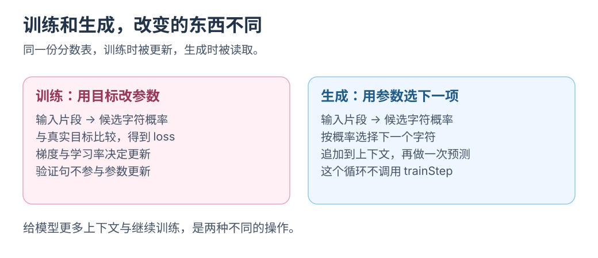

# 模型基础 1：从缩放定律理解模型

从预测下一字符，分清训练、上下文与工具。

[四小时联读路线](README.md)的起点，也可独立读：学习 50 分钟，休息 10 分钟。

## 前十分钟 缩放定律里的误差是什么

训练语言模型时，可以调整参数规模、数据量和计算量。

2020 年研究发现，交叉熵损失在研究范围内随参数、数据和训练计算量呈近似幂律变化。[Scaling Laws for Neural Language Models](https://arxiv.org/abs/2001.08361)

| 名称 | 先用一句话理解 | 在后面的实验里对应什么 |
| --- | --- | --- |
| 参数 | 训练能够调整的数字 | 用来给下一字符打分的分数表 |
| 数据 | 模型用来练习的样本 | 27 句训练短句 |
| 计算 | 完成预测与参数更新所做的工作 | 遍历训练样本并反复更新 |
| 损失 loss | 模型给正确答案的概率有多低 | 每个位置的负对数概率，再取平均 |

下降的是<mark class="caution">预测误差，不保证任务成功</mark>，也不能无限外推。

Chinchilla 进一步指出：固定计算预算下，应搭配参数规模与数据量，不能只增大模型。[Training Compute-Optimal Large Language Models](https://arxiv.org/abs/2203.15556)

<details class="qa">
<summary>同一批短句重复训练十次，增加了什么？</summary>

增加训练计算，没有增加独立数据；两者要分别计量。

</details>

## 第十到二十五分钟 模型怎样学会预测

从一句话开始：

```text
小猫吃鱼。
```

实验中一字符是一个 token；真实模型也可用词片段。

如果模型只看前一个字，训练样本里就包括：

```text
输入 小 → 目标 猫
输入 猫 → 目标 吃
输入 吃 → 目标 鱼
```

模型为候选字符打分；softmax 转成总和为 1 的概率，训练检查正确字符的概率。

“鱼”的概率从 0.1 升至 0.8，损失 `-ln(p)` 从约 2.30 降至 0.22：正确答案概率越高，损失越小。

梯度给出参数调整方向，训练反复执行：

```text
输入片段 → 预测分数 → 概率 → 和目标比较 → 更新参数
```

<mark class="key">参数更新就是训练</mark>。同时核对训练 loss、验证 loss 和生成文本；训练集只反映样本拟合。

[](../../site/public/diagrams/ai-from-scaling/training-generation.svg)

下一课从代码核对真实目标与参数更新的位置。

## 第二十五到三十五分钟 上下文与 Transformer

现在给模型两段输入：

```text
小猫吃____
小鸟吃____
```

只看“吃”，模型无法区分两段输入；看见“猫吃”和“鸟吃”，才可能给出不同概率。

组合建表会迅速膨胀；Transformer 共享参数学习表示，用 Attention 组合各位置的信息。[Attention Is All You Need](https://arxiv.org/abs/1706.03762)

因果限制要求每个位置只看前文；训练虽能并行处理各位置，也不能泄漏后文答案。

Q/K/V 的数值过程见[Attention 图解](../kv-cache/02-attention-and-kv.md)。

## 第三十五到四十五分钟 从预测能力到可用的助手

预测知识、代码与解题文本可学到多任务规律。GPT-3 展示了按指令与少量示例完成任务，无需现场更新参数。[Language Models are Few-Shot Learners](https://arxiv.org/abs/2005.14165)

这是实验观察；各项能力如何形成，仍需研究。

示范数据、反馈与奖励进一步塑造回答行为。InstructGPT 表明，人类反馈微调能改善指令遵循。[Training Language Models to Follow Instructions with Human Feedback](https://arxiv.org/abs/2203.02155)

推理时增加步骤、尝试和检查，也可能改善表现；收益取决于模型、任务与计算方式。[Learning to Reason with LLMs](https://openai.com/index/learning-to-reason-with-llms/)

| 操作 | 直接改变内容 |
| --- | --- |
| 训练或微调 | 模型参数 |
| 补充背景、例子与要求 | 本次输入的上下文 |
| 分配更多推理计算 | 本次解决任务的计算过程 |
| 提供一个工具 | 程序允许模型请求的外部能力 |

普通的一次对话请求不更新模型参数。若产品另外保存记忆或把反馈用于后续训练，那是额外机制。

## 最后五分钟 从模型走到 Harness

工具调用把动作表达为结构化请求，例如：

```json
{"name":"calculate_total","arguments":{"people":20,"perPerson":35,"venue":80,"budget":800}}
```

程序验证参数、执行函数、返回结果，模型再继续；模型提出调用，客户端实际执行。[Tool Calls](https://api-docs.deepseek.com/guides/tool_calls/)

这就是 Harness；[Agent 入门](03-build-a-harness.md)将实现循环、审批与错误处理，可独立开始。

概念检查：

<details class="qa">
<summary>loss 下降，就代表任务一定成功吗？</summary>

不一定。loss 衡量预测误差，具体任务仍要单独验收。

</details>

<details class="qa">
<summary>补背景和训练，分别改变什么？</summary>

补背景改变本次上下文；训练更新模型参数。

</details>

<details class="qa">
<summary>谁执行保存，怎样证明保存成功？</summary>

Harness 调用工具。核对工具结果和实际文件。

</details>

下一步：[模型基础 2：训练一个字符语言模型](02-train-a-model.md)。
