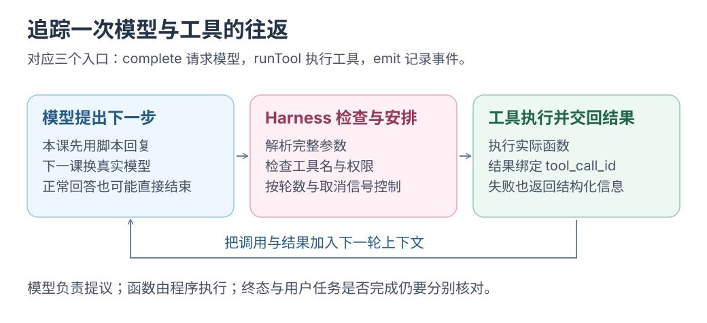

# Agent 入门 1：搭建工具调用 Harness

搭一个执行循环：读活动计划 → 算预算 → 申请保存 → 回答。

这是 [Agent 工程](../agent-engineering/README.md)的第一课，可以直接开始。需要基础 JavaScript 与终端操作；本课使用脚本模拟模型，无需先训练字符模型或实现 MCP 服务。

重点找三个入口：`complete` 请求模型，`runTool` 执行工具，`emit` 记录事件。

参考实现：[harness.mjs](labs/harness.mjs)。使用 Node.js 22.22 或更高版本，在仓库根目录执行。内容用 50 分钟，留 10 分钟休息。

本章工具是本地函数。以后接入 MCP 时，换成客户端的 `callTool()`；限制与审批仍由 Harness 管理。

## 前十分钟 沿着一次任务看循环

先跑离线模式：

```bash
node docs/ai-from-scaling/labs/harness.mjs
```

内置计划为 20 人、每人餐费 35 元、场地费 80 元、预算 800 元。终端按顺序打印模型请求、工具提议、工具结果和最终回答。总花费为 780 元，预算余额为 20 元；保存默认被拒绝。

`scriptedModel()` 按固定步骤模拟回复，用于检查循环；真实模型留到下一章。

把输出对回这条路径：

```text
用户任务
→ 请求模型
→ assistant 提出工具调用
→ Harness 验证并执行
→ 把 tool 结果追加到上下文
→ 再请求模型
→ 最终回答，或者因取消、错误、限额停止
```

[](../../site/public/diagrams/ai-from-scaling/harness-loop.svg)

## 第十到二十分钟 写出工具契约与实现

工具定义告诉模型有哪些动作可以请求。先手写其中一个：

```js
{
  type: 'function',
  function: {
    name: 'calculate_total',
    description: '用人数、每人费用、场地费和预算计算总额与余额，金额单位为元。',
    parameters: {
      type: 'object',
      properties: {
        people: { type: 'integer' },
        perPerson: { type: 'number' },
        venue: { type: 'number' },
        budget: { type: 'number' },
      },
      required: ['people', 'perPerson', 'venue', 'budget'],
      additionalProperties: false,
    },
  },
}
```

随后在 `executeTool()` 里找到实际计算：

```js
const total = Math.round((people * perPerson + venue) * 100) / 100;
return {
  ok: true,
  total,
  remaining: Math.round((budget - total) * 100) / 100,
  withinBudget: total <= budget,
};
```

schema 描述输入契约；程序仍要检查工具名、参数 JSON、字段及数值范围。

本课使用三个工具：

| 工具 | 实际行为 | 谁提供能力 |
| --- | --- | --- |
| `read_plan` | 返回源码内置的活动计划 | 我们编写的函数 |
| `calculate_total` | 计算花费、余额和是否超预算 | 我们编写的函数 |
| `save_note` | 请求向启动时指定的路径创建摘要 | 我们编写的函数与审批逻辑 |

模型提出调用，客户端执行函数并返回结果，这是 DeepSeek 工具接口规定的调用关系。[Tool Calls](https://api-docs.deepseek.com/guides/tool_calls/)

## 第二十到三十分钟 接回工具结果

一次模型回复可能包含这样的调用片段：

```json
{
  "id": "calculate",
  "type": "function",
  "function": {
    "name": "calculate_total",
    "arguments": "{\"people\":20,\"perPerson\":35,\"venue\":80,\"budget\":800}"
  }
}
```

`arguments` 是 JSON 字符串，要解析并校验，不能作为代码执行。[Chat Completions API](https://api-docs.deepseek.com/api/create-chat-completion/)

在 `runHarness()` 里找到这几步，自己写一遍：

```js
messages.push({
  role: 'assistant',
  content: message.content ?? null,
  tool_calls: calls,
});

for (const call of calls) {
  const result = await runTool(call, { ...toolOptions, signal });
  messages.push({
    role: 'tool',
    tool_call_id: call.id,
    content: JSON.stringify(result),
  });
}
```

先追加调用，再按 `tool_call_id` 追加结果。下一轮一起发给模型，它才能看到执行结果。

参考实现最多请求模型 4 次，一轮最多接收 4 个工具调用，并拒绝重复调用 ID。它检查结束原因：正常文本回答需要 `stop`；工具请求需要 `tool_calls`。输出达到长度上限等异常结束会进入失败状态。

### 三个可自定义入口

包装这三个函数，就能在调用前后加入逻辑，保持原有输入输出。

| 入口 | 什么时候经过这里 | 可以加什么 |
| --- | --- | --- |
| `complete(messages, { signal })` | 每次请求模型 | 计时、读取返回的 `usage`、请求前检查用量预算 |
| `runTool(call, options)` | 每次执行工具 | 参数检查、权限策略、等待审批、拒绝执行 |
| `emit(event)` | 产生运行事件时 | 记录 `model.request`、`model.usage`、`tool.proposed`、`tool.result` 与终态 |

先只给模型调用加计时。在仓库根目录运行下面的离线练习，无需 API key：

```bash
node --input-type=module <<'JS'
import { runHarness, scriptedModel } from './docs/ai-from-scaling/labs/harness.mjs';

const withTiming = (complete) => async (messages, options) => {
  const started = performance.now();
  try {
    return await complete(messages, options);
  } finally {
    console.log(JSON.stringify({ type: 'model.duration', elapsedMs: performance.now() - started }));
  }
};

const result = await runHarness({
  complete: withTiming(scriptedModel()),
  emit: (event) => console.log(JSON.stringify(event)),
});
console.log(result.answer);
JS
```

应看到四条 `model.duration`，最终“已核算，未保存”。包装器继续传递取消信号、结果与异常；`return await` 让计时覆盖整个调用。

**控制放在执行前，记录走 `emit`。** `emit` 是同步回调，异步落盘需另行处理。已有轮数限制和 `model.usage`；累计 token 拦截、跨会话审计与持久化尚未实现。离线无 token 用量，真实请求缺失 `usage` 时保留未知。

统一统计模型与工具时，要让两类调用都经过这些入口。

<details class="qa">
<summary>LangChain 等框架怎样对应这三个入口？</summary>

下表只作接口对照，本课未引入框架依赖。

| 框架与官方入口 | 自己能写的逻辑 | 对照本课 |
| --- | --- | --- |
| [LangChain 自定义中间件](https://docs.langchain.com/oss/javascript/langchain/middleware/custom) | 用 `createMiddleware` 定义 `beforeModel`、`afterModel`、`wrapModelCall`、`wrapToolCall` 等钩子 | 包装 `complete`、`runTool`，观察执行前后 |
| [Vercel AI SDK 模型中间件](https://ai-sdk.dev/docs/ai-sdk-core/middleware) | 用 `wrapLanguageModel` 接入自己的 `transformParams`、`wrapGenerate`、`wrapStream` | 包装模型参数、普通回复与流式回复；本例只实现非流式调用 |
| [OpenAI Agents SDK 检查与审批](https://developers.openai.com/api/docs/guides/agents/guardrails-approvals)、[运行追踪](https://developers.openai.com/api/docs/guides/agents/integrations-observability) | 自定义 guardrail 的 `execute`，配置工具审批，在追踪中加入自定义 span | 对照输入输出检查、工具执行前的决定和运行记录 |

读 `wrapModelCall(request, handler)` 时，找检查发生的位置与调用 `handler` 的时机；顺序与状态约定以框架文档为准。

</details>

## 第三十到四十分钟 让保存经过你的决定

默认运行不会保存任何文件。`save_note` 收到的内容会被转换为 `permission_denied` 结果，交回模型继续回答。

现在让程序有一个明确的保存目标：

```bash
AI_HARNESS_DIR=$(mktemp -d)
node docs/ai-from-scaling/labs/harness.mjs --write-to "$AI_HARNESS_DIR/summary.md"
```

程序展示完整内容与路径，再询问是否允许创建。第一次输入 `n`，检查结果明确写着拒绝，目录中没有摘要。第二次重跑并输入 `y`，随后查看：

```bash
cat "$AI_HARNESS_DIR/summary.md"
```

你应该读到总花费 780 元、余额 20 元。再运行并允许保存到同一路径，已有文件会被拒绝覆盖。

路径来自你启动程序时的 `--write-to`，模型只能提交摘要文本。程序在终端不可交互时拒绝审批。这项设计把本次教学的写入范围保持在一个你明确选择的新文件上。

## 最后十分钟 分清终态和任务结果

参考实现使用四个终态：

| 终态 | 表示什么 | 还需要检查什么 |
| --- | --- | --- |
| `answered` | 收到了正常结束的最终回答 | 工具是否成功，用户任务是否完成 |
| `failed` | 模型请求或协议处理失败 | 错误原因与已经产生的结果 |
| `cancelled` | 用户发出取消，循环停止 | 停止前的工具是否已经执行 |
| `limit_reached` | 用完允许的模型请求次数 | 任务还有哪些部分没完成 |

工具失败可回传给模型继续处理。`answered` 只代表回答结束；保存被拒绝时，成果仍是“已核算，未保存”。

取消也要从输入层接到整个运行。参考实现由 `AbortController` 提供共同信号；审批输入使用 readline，它会接收交互时的 `Ctrl+C`，所以还要连接这一个事件：

```js
terminal.once('SIGINT', cancel);
```

`cancel()` 中止共同信号，让等待审批与模型请求都能停止。只把一次输入标为失败，还不能表示整个任务已取消。[Node.js readline SIGINT](https://nodejs.org/api/readline.html#event-sigint)

沿 `runHarness()` 核对三处：模型与工具的调用入口、写入前的审批、阻止无限调用的轮数限制。保存成功还要检查文件内容。

本课的事件只保存在内存并打印到终端，进程退出后不会自动恢复。需要持久化与崩溃恢复时，继续做[Harness 工程实验](../agent-engineering/05-harness-vertical-slice.md)。

下一步：[Agent 入门 2：接真实模型并做对照实验](04-experiments.md)。
