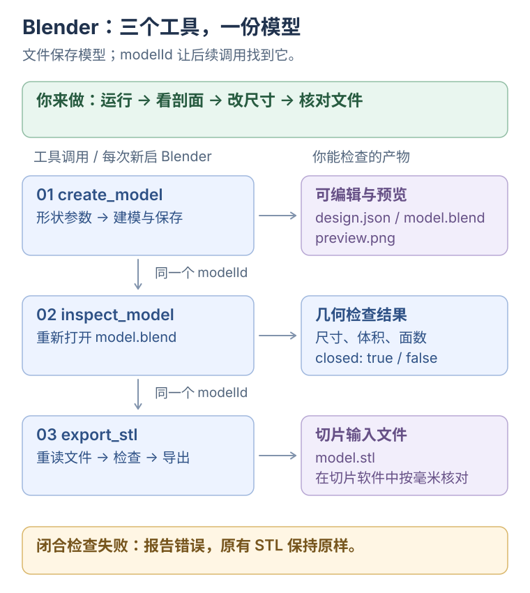
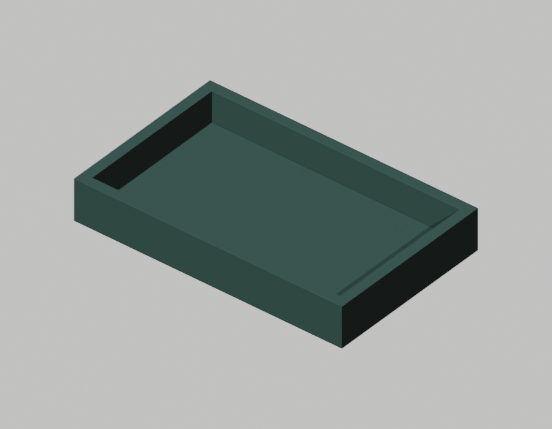
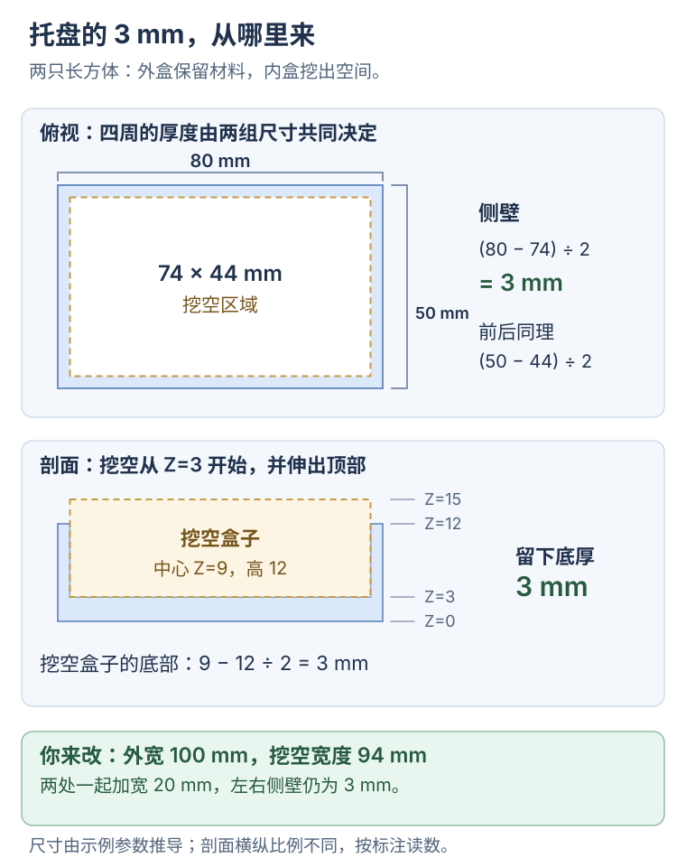

# Blender MCP：让参数变成模型

**这一课的目的：看懂一组尺寸参数怎样经过 MCP，变成可编辑、可检查、可导出的 Blender 模型。**

用一个 **80 × 50 × 12 mm** 的托盘做实验，四周和底部各留 3 mm。三个工具依次完成创建、检查和导出；你的任务是看结果、理解挖空、改尺寸，再沿代码找到真正执行建模的位置。

**MCP 负责发现工具、传递参数和返回结果；几何由 Blender 的 Python API 创建。** 本课特别观察：客户端怎样把第一次返回的 `modelId` 显式传给后两次调用，让工具找到同一份模型文件。参数与调用顺序写在 `demo.ts`，运行演示不会让 AI 自动设计托盘。

**你来做：运行 → 看剖面 → 改两处尺寸 → 对照新结果。** 前置练习是[看懂一次 MCP 工具调用](00-minimal-mcp.md)。需要本机安装 Blender、Node.js ≥ 22.22 和 pnpm 11.14。仓库已有演示记录使用 Blender 5.2.3 LTS；其他版本和实际打印效果需另行验证。

## 先看：三个工具怎样接力

[](../../site/public/diagrams/ai-from-scaling/05-blender-pipeline.svg)

## 1. 运行：找到真正生成的文件

**你来做：** 在仓库根目录执行：

```bash
pnpm install:blender-mcp
pnpm demo:blender-mcp
```

**你要看到：** 下面省略连接日志，用 `<modelId>` 和 `<模型目录>` 代替本次生成的值：

```text
[MCP] tools/list → create_model, inspect_model, export_stl
[MCP] tools/call → create_model | name=practice-tray
[结果] create_model 完成 | modelId=<modelId>
[文件] Blender：<模型目录>/model.blend
[文件] 预览：<模型目录>/preview.png
[MCP] tools/call → inspect_model | modelId=<modelId>
[结果] inspect_model 完成 | dimensionsMm=80 × 50 × 12 | closed=true
[MCP] tools/call → export_stl | modelId=<modelId>
[结果] export_stl 完成 | bytes=<文件字节数>
[文件] STL：<模型目录>/model.stl
```

`tools/list` 只证明客户端拿到了工具清单；三个 `tools/call` 才执行建模、检查和导出。`closed=true` 是本例 Python 代码的网格检查结果，不是 MCP 的连接状态，也不代表已经完成切片或打印。

打开终端打印的 `preview.png`，再用 Blender 打开同一目录的 `model.blend`。演示产物保存在 `examples/blender-mcp/.artifacts/`；每次创建使用新的目录和 `modelId`。

下面是仓库此前保留的实际预览。你本次的结果，以终端给出的文件为准。



**完成标志：** 你找到了本次的 `.blend`、PNG 和 STL，并在终端看到预期尺寸。演示参数由代码填写，不调用语言模型。

## 2. 看图：3 mm 的底和侧壁从哪里来

打开 [demo.ts](../../examples/blender-mcp/src/demo.ts)，找到 `parts` 中的两个长方体。`size` 是 XYZ 尺寸，`position` 是中心位置，单位都是毫米。

```ts
parts: [
  { shape: 'box', size: [80, 50, 12], position: [0, 0, 6] },
  { shape: 'box', size: [74, 44, 12], position: [0, 0, 9], operation: 'subtract' },
],
```

[](../../site/public/diagrams/ai-from-scaling/05-blender-geometry.svg)

**你来做：** 对着图算三次：

- 左右侧壁：`(80 - 74) / 2 = 3 mm`。
- 前后侧壁：`(50 - 44) / 2 = 3 mm`。
- 底厚：大盒子底部在 `6 - 12 / 2 = 0`，挖空盒子底部在 `9 - 12 / 2 = 3`，所以留下 3 mm。

挖空盒子的顶部达到 Z=15，超过实体顶部 Z=12，于是形成开口。托盘材料的表面仍然可以围成闭合实体，`closed: true` 检查的是网格几何。

**完成标志：** 你能说明两个 `position` 的 Z 值为什么分别是 6 和 9。

## 3. 修改：把托盘加宽，保留 3 mm 侧壁

**你来做：** 在 `demo.ts` 中把外盒宽度从 80 改成 100，同时把挖空宽度从 74 改成 94：

```ts
parts: [
  { shape: 'box', size: [100, 50, 12], position: [0, 0, 6] },
  { shape: 'box', size: [94, 44, 12], position: [0, 0, 9], operation: 'subtract' },
],
```

保存后重新执行 `pnpm demo:blender-mcp`。预期尺寸变为 `100 × 50 × 12`，网格闭合仍为 `true`。打开这次新打印的路径，对照前一次模型。

**先预测再看结果：** 如果只改外盒为 100、保留挖空宽度 74，左右侧壁会变成 `(100 - 74) / 2 = 13 mm`。两处一起改，才保持 3 mm。

**完成标志：** 你看到了加宽的模型，并能用参数解释侧壁和底厚。

## 4. 定位：哪个程序真正创建了几何

按一次创建请求的方向，找三个位置：

1. [server.ts](../../examples/blender-mcp/src/server.ts)：`registerTool('create_model', ...)` 接收并处理工具调用。
2. [blender.ts](../../examples/blender-mcp/src/blender.ts)：`runBlender()` 用 `execFile()` 启动后台 Blender，通过 JSON 文件交付参数。
3. [worker.py](../../examples/blender-mcp/worker.py)：`create_model()` 用 `bpy` 创建实体，并用 `DIFFERENCE` 做减法。

回到图中观察后两步：`inspect_model` 和 `export_stl` 都会重新打开 `model.blend`。在 `demo.ts` 找到这两次调用的 `{ modelId: model.modelId }`：演示客户端主动把同一个编号作为参数传回。服务端用 `join(root, modelId)` 定位目录，Blender 再从磁盘读文件。

`modelId` 是本例工具的业务编号，区别于配对请求和响应的 JSON-RPC `id`。模型能跨进程继续处理，依靠这个编号和保留的文件；只有编号、文件已经删除时，检查会失败。MCP 负责传递编号，不会自动保留 Blender 场景或帮客户端选择“上一个模型”。

**完成标志：** 你能指出“TS 发出调用”和“Python 创建几何”的位置，并说明三个工具为什么能接着处理同一个模型。

## 到这里完成

拿着你新生成的模型，说清三件事：MCP 怎样调用 Blender 工具，参数怎样决定底厚与侧壁，以及客户端怎样用 `modelId` 让工具找到保存的文件。`.blend`、PNG、STL 分别用于编辑、预览和交给切片软件。

## 选读与参考

<details>
<summary>支持的形状、输出文件与导出失败</summary>

第一版支持长方体 `box`、圆柱 `cylinder`、球体 `sphere`。每项包含 XYZ 尺寸、中心位置、旋转角度与 `add` / `subtract`。尺寸和位置使用毫米，旋转使用度；最多 16 项，第一项必须为 `add`。整体模型生成后移到 Z=0。

`create_model` 保存 `design.json`、`model.blend`、`preview.png`；`export_stl` 增加或替换同目录的 `model.stl`。`inspect_model` 返回尺寸、体积、面数和闭合检查结果。

手动编辑时保留名为 `MCP_Model` 的网格对象；导出只包含它。导出前会重新检查，闭合检查失败时旧 STL 保持原样。失败后查看 `.blend` 和本次错误，不能用目录里已有的 STL 证明本次成功。

</details>

<details>
<summary>输入校验、进程限制与自动检查</summary>

[contracts.ts](../../examples/blender-mcp/src/contracts.ts) 用 Zod 声明输入、输出并推导 TS 类型。[client.ts](../../examples/blender-mcp/src/client.ts) 检查工具错误与返回值。[stdio.ts](../../examples/blender-mcp/src/stdio.ts) 是协议启动入口。严格 TS 配置沿用第一个示例。

调用方提交声明式形状数据。Blender 每次在独立后台进程运行，最多 90 秒；客户端等待上限为 100 秒，取消信号会传给子进程。创建失败会清理本次新目录并报告错误。

```bash
pnpm check:blender-mcp
```

需要本机 Blender。检查包含类型检查、编译和真实 Blender 测试；测试解析 STL，核对毫米尺寸、闭合边和挖空体积，还会故意破坏测试模型的一个面，验证再次导出被拒绝。

</details>

<details>
<summary>接入日常客户端</summary>

日常生成的模型默认保存到 `~/.yuuki/blender/`。设置 `YUUKI_BLENDER_DIR` 为其他绝对路径，可以改变输出位置。`BLENDER_BIN` 可以指定可执行文件；未指定时优先使用 macOS 的 `/Applications/Blender.app/Contents/MacOS/Blender`，该路径不存在时使用 PATH 中的 `blender`。

如果已安装 Claude Code，在仓库根目录执行：

```bash
pnpm build:blender-mcp
MCP_NODE=$(command -v node)
MCP_SERVER="$PWD/examples/blender-mcp/dist/src/stdio.js"
claude mcp add --transport stdio yuuki-blender -- "$MCP_NODE" "$MCP_SERVER"
claude mcp get yuuki-blender
```

整个示例目录需要一起保留，包括 `worker.py`。实际连接后，在 `/mcp` 检查工具，再试着说：

```text
用 yuuki-blender 做一个 80×50×12 毫米的桌面托盘，底和四周各留 3 毫米。
先创建并展示预览，再检查网格；闭合检查通过后导出 STL。
```

客户端注册写法来自 [Claude Code 官方文档](https://code.claude.com/docs/en/mcp#option-3-add-a-local-stdio-server)。仓库已有验证覆盖示例 MCP 客户端；你的 Claude Code 配置需要在实际接入后检查。

</details>

<details>
<summary>从 STL 到实物：切片与打印另行验证</summary>

STL 不携带单位；本例保留毫米数值，切片时按毫米解释。闭合检查只检查网格的非流形边、零面积面与非零体积，不能代替壁厚、悬空、支撑、材料和实际打印验收。将 STL 放进你使用的切片软件，先核对外尺寸，再检查切片预览。

示例只生成文件，实际打印需要另行操作与验证。

接口资料：[Blender Python API](https://docs.blender.org/api/5.2/info_overview.html) · [布尔运算](https://docs.blender.org/manual/en/latest/modeling/modifiers/generate/booleans.html) · [STL 导出源码中的单位处理](https://github.com/blender/blender/blob/main/source/blender/io/stl/exporter/stl_export.cc)。

</details>

返回[MCP 项目实战](../mcp-projects/README.md) · 回查[独立 MCP 演示](00-minimal-mcp.md) · 选做[GitHub 修复实验](06-github-lab-mcp.md)。
