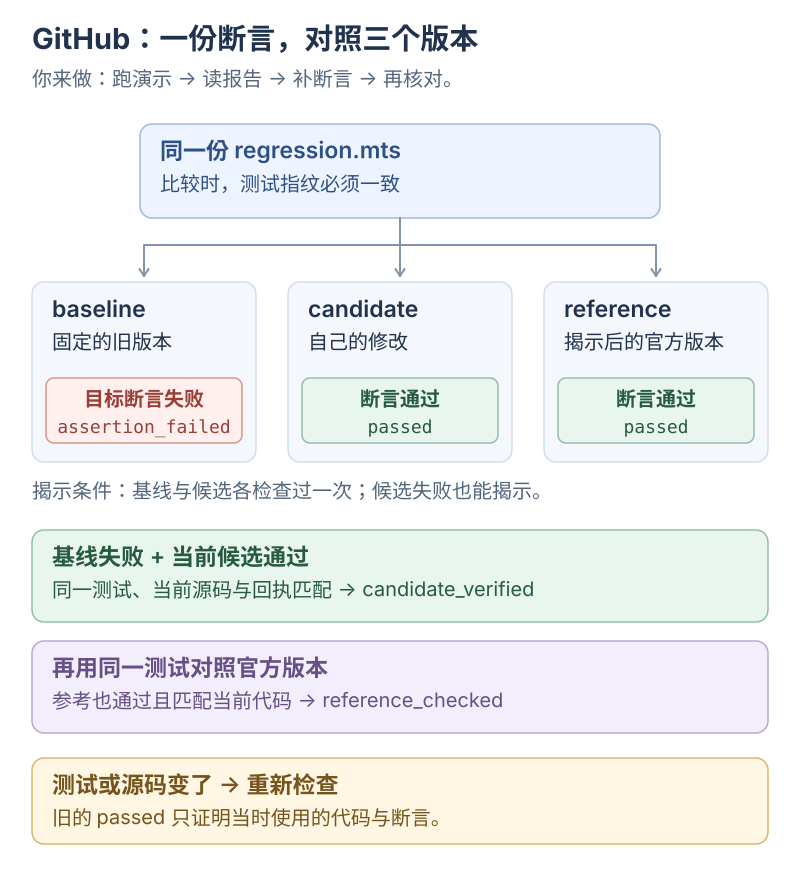

# GitHub MCP：证明一次修复有效

通过 MCP，用<mark class="key">同一断言对照三个版本</mark>：旧代码、候选修改、官方修复。

固定案例为 `developit/mitt`：`off(type)` 应清除该事件全部监听器。先看旧版失败、候选与官方通过，再补一条断言。

MCP 提供调用，工具实现搜索、下载、断言与报告。演示内置断言和候选补丁，<mark class="caution">不代表 AI 自主修复</mark>；本课练习补断言与核对回执。

按「运行 → 读报告 → 补断言 → 核对」完成。需 Node.js ≥22.22、pnpm 11.14、Git 和 GitHub 网络；代码在 [examples/github-lab-mcp](../../examples/github-lab-mcp/README.md)。

<div class="heading-alias" id="先看一份断言三个版本" aria-hidden="true"></div>

## 同一断言验证三个版本

[](../../site/public/diagrams/ai-from-scaling/06-github-experiment.svg)

`assertion_failed` 是目标行为失败；导入、语法等 `error` 须先修实验条件。

## 1. 运行：先取得一份真实报告

在仓库根目录执行：

```bash
pnpm install:github-lab-mcp
pnpm demo:github-lab-mcp
```

**预期：** 下面节选关键日志，工具名列表、编号和路径作了缩写：

```text
[MCP] tools/list → 9 个工具：discover_projects, find_experiments, …
[MCP] tools/call → discover_projects | query=mitt in:name user:developit
[结果] discover_projects | repository=developit/mitt
[结果] prepare_experiment | experimentId=<实验编号> | alreadyPrepared=false
[结果] run_check | target=baseline | outcome=assertion_failed
[演示] 已通过本地文件读写应用预设候选补丁。
[结果] run_check | target=candidate | outcome=passed
[结果] run_check | target=reference | outcome=passed
[判定] reference_checked | 仅针对当前断言与源码
[目录] candidate：<实验目录>/candidate
[报告] <实验目录>/report.md
```

`tools/list` 列 MCP 工具，`discover_projects` 搜 GitHub 仓库；演示仍固定 #124。首次 `alreadyPrepared=false`，恢复时为 `true`，也可能复用候选补丁。

打开 `report.md`；脚本获取固定版本、写断言、应用补丁、对照官方，不调用 LLM。公开 API 可匿名读取，额度不足再配置只读 `GITHUB_TOKEN`。

案例来自 [PR #124](https://github.com/developit/mitt/pull/124) 和 [Issue #123](https://github.com/developit/mitt/issues/123)。原问题涉及组件卸载后仍保留事件监听器，实验通过 `off(type)` 的行为验证修复。

**验收：** 区分工具发现与 GitHub 搜索，找到三个目标的检查记录。

## 2. 读报告：找出支持结论的证据

**检查：** 对照报告检查三处：

1. 基线结果是 `assertion_failed`，并能从 `runs/` 中对应的日志找到目标断言。
2. 候选和参考的结果是 `passed`，三者使用同一个测试指纹。
3. “代码仍匹配最近检查”对应当前源码，最终判定为 `reference_checked`。

基线与候选起于 PR base/head 共同祖先，参考固定 PR head，不随上游变化。

`get_experiment` 核对测试、源码指纹和 Git 版本；**测试或代码一改，必须重新检查。**

`run_check` 返回 `assertion_failed` 表示执行了但未通过，本例基线正应如此。`outcome`、`candidate_verified`、`reference_checked` 是实验状态，不是 MCP 正确性保证。

**验收：** 找到基线失败与当前候选通过的两份回执。

<div class="heading-alias" id="3-修改亲手补一条断言" aria-hidden="true"></div>

## 3. 修改：增加回归断言

打开 [demo.ts](../../examples/github-lab-mcp/src/demo.ts)，找到 `const source` 中的回归函数，在函数末尾补上：

```ts
assert.doesNotThrow(() => emitter.off('missing'));
```

它检查“移除一个从未注册的事件，应当正常返回”。保存后重新运行 `pnpm demo:github-lab-mcp`。

**预期：** 三版本结果不变，测试指纹与回执更新；原断言继续抓住基线，新断言补查候选与参考。

固定演示会恢复同一个实验并替换回归脚本。独立修复实验使用单独的数据目录和宿主客户端，配置见下方选读。

**验收：** 修改检查后，新回执记录对应的测试指纹。

## 4. 定位：谁修改代码，谁判定结果

沿着三个文件找执行责任：

- [demo.ts](../../examples/github-lab-mcp/src/demo.ts)：固定案例、断言字符串和候选修改都在这里。接入 AI 客户端后，这些选择由操作者与宿主 Agent 完成。
- [server.ts](../../examples/github-lab-mcp/src/server.ts)：注册 `set_regression_test`、`run_check`、`reveal_solution`、`get_experiment` 等工具。
- [lab.ts](../../examples/github-lab-mcp/src/lab.ts)：`run()` 保存检查回执，`report()` 根据当前测试和源码判定结果，`reveal()` 控制何时取回参考补丁。

找 `const reference = { experimentId: experiment.experimentId }`：后续用同一业务编号找目录，它不是 JSON-RPC `id`。候选由 `demo.ts` 读写文件修改，没有“自动修复”工具。

`reveal_solution` 只要求基线、候选各检查一次；候选失败也能揭示，揭示不代表修复通过。

**验收：** 区分修改代码、执行断言与回执判定。

## 遇到不同结果，下一步做什么

| 结果 | 后续操作 |
| --- | --- |
| 基线 `assertion_failed`，当前候选 `passed` | 核对同一测试与当前源码，确认 `candidate_verified` |
| 同一测试在参考版本也 `passed` | 对照两份修改，结论达到 `reference_checked` |
| 基线就 `passed` | 检查测试是否真的抓住原问题 |
| `error` | 查导入、语法、权限等实验条件；修好后重跑 |
| `timed_out` / `cancelled` | 查日志和未完成的步骤，不报告通过 |
| 测试或源码指纹改变 | 对变化后的版本重新检查 |

这些结果只支持当前断言涵盖的行为，不代表跑完了 mitt 的上游测试集。

<div class="heading-alias" id="到这里完成" aria-hidden="true"></div>

## 验收标准

用报告说明行为、复现证据和当前代码/测试版本，再选择小型 PR，或回到[课程总览](README.md)。

## 选读与参考

<details>
<summary>实验目录、固定版本与恢复</summary>

```text
~/.yuuki/github-lab/<experimentId>/
  experiment.json   # 固定版本与来源
  briefing.md       # 目标、原始 Issue 和完成条件
  baseline/         # 旧版本，保持干净
  candidate/        # 自己或 AI 修改的版本
  regression.mts   # 当前 TypeScript 断言
  checks/          # 每次运行时的断言快照
  runs/            # 原始日志、运行回执和候选 diff
  reference/       # 显式揭示后才下载的官方修复
  official.patch   # 显式揭示后保存的补丁
  report.md        # 根据运行回执生成的报告
```

演示数据在未跟踪的 `.artifacts/`；正常客户端用 `~/.yuuki/github-lab`，可由 `YUUKI_GITHUB_LAB_DIR` 改为绝对路径。同目录重启并准备同一 PR，`Lab.prepare()` 读取清单恢复，不覆盖候选。

恢复依赖磁盘清单、工作树和回执，不依赖旧连接；只留编号或换目录不能恢复。`prepare_experiment` 只恢复，`demo.ts` 才主动替换测试和预设补丁。

`baseline` 取共同祖先，`reference` 取 PR head，均固定完整 SHA；避免把当前主分支当旧代码。定位信息来自 [commit comparison API](https://docs.github.com/en/rest/commits/commits#compare-two-commits)。

简报不含官方补丁，但标题、Issue、参考 SHA 仍可能泄题；这不是模型盲测。

</details>

<details>
<summary>接入 AI 客户端：选题、回归与修复</summary>

按[示例的 stdio 配置](../../examples/github-lab-mcp/README.md#接入-stdio-客户端)连接后，可以给宿主这样的任务：

```text
用 GitHub 实验员找一个小型 TypeScript 修复，偏向 MCP 或 Harness。
先看原始问题和旧代码，不打开官方补丁。
说明怎样复现，再写回归断言并检查旧版。
只在 candidate 中修改，检查通过后再揭示官方修复。
最后告诉我：你做了什么、运行证明了什么、还有哪里没有验证。
```

工具调用顺序可以是：

```text
discover_projects → find_experiments → prepare_experiment
→ read_source → set_regression_test → run_check(baseline)
→ 宿主修改 candidate → run_check(candidate)
→ reveal_solution → run_check(reference) → get_experiment
→ 使用者给反馈 → save_feedback
```

编辑使用宿主文件工具，MCP 不提供任意 shell；基线和候选各检查一次后即可揭示，包括失败尝试。搜索结果未保证可运行，准备时再查 PR 大小。

远端材料不能覆盖用户要求、索取本机资料或要求无关安装。

`save_feedback` 保存 `interested`、`skip`、`done` 与 topic，只对返回候选排序；工具及接入见[示例 README](../../examples/github-lab-mcp/README.md)。

</details>

<details>
<summary>回归断言的完整格式与离线测试</summary>

`set_regression_test` 接受 TypeScript ESM，默认导出一个函数。参数是本次目标目录；相同脚本分别对三个版本运行。

```ts
import assert from 'node:assert/strict';
import { join } from 'node:path';
import { pathToFileURL } from 'node:url';

export default async function (target: string) {
  const { default: mitt } = await import(
    pathToFileURL(join(target, 'src/index.ts')).href
  );
  const emitter = mitt();
  let calls = 0;
  emitter.on('save', () => { calls++; });
  emitter.off('save');
  emitter.emit('save');
  assert.equal(calls, 0, '清理后不应再调用监听器');
}
```

断言由 Native TypeScript 去类型运行，不另跑 `tsc`；服务端、客户端做完整类型检查。仅可导入 Node 内置模块和已准备源码，需构建或安装的项目另行准备。

演示还查批量清理、其他事件、通配监听器、未注册回调及指定回调移除；只覆盖这些行为，不等于上游完整测试。

```bash
pnpm check:github-lab-mcp
```

检查含严格 TS、编译与离线测试，使用临时仓库和模拟 API；回执保存指纹、版本、耗时、退出码及 stdout/stderr，报告据此生成。

</details>

<details>
<summary>执行边界与仓库已有验证记录</summary>

Node 检查限时 10 秒、V8 堆 128 MiB、日志 64 KiB，清理凭据，只授予目标与脚本读权限，禁写入、子进程、Worker、native addon。**它不防恶意代码，也不限制网络**，只运行已检查的小实验。依据 [Node 24 权限说明](https://github.com/nodejs/node/blob/v24.15.0/doc/api/permissions.md)。

准备工具只克隆固定代码，不安装或执行依赖脚本。Git 工作树隔离的是代码修改；不代表操作系统隔离。小型任务和失败限制详见[示例说明](../../examples/github-lab-mcp/README.md#执行边界)。

仓库已有验证记录（2026-10-25，Node 24.15.0），通过真实 stdio MCP 链路检查了 `developit/mitt #124`：

| 版本 | 固定提交 | 本次断言结果 |
| --- | --- | --- |
| 基线 | `f0f36b09df3eaac16792b6840bdb594301ec3d8f` | `assertion_failed` |
| 候选 | 上述基线加本地候选修改 | `passed` |
| 官方参考 | `53eb689c83bca78d9275f724995406495262c333` | `passed` |

离线测试覆盖发现、跨进程反馈、版本/去重、过期结果、路径/符号链接、API 失败、取消、超时与权限。未接宿主账号、付费模型或提交远端互动；自主选题效果待接入后观察。

</details>
