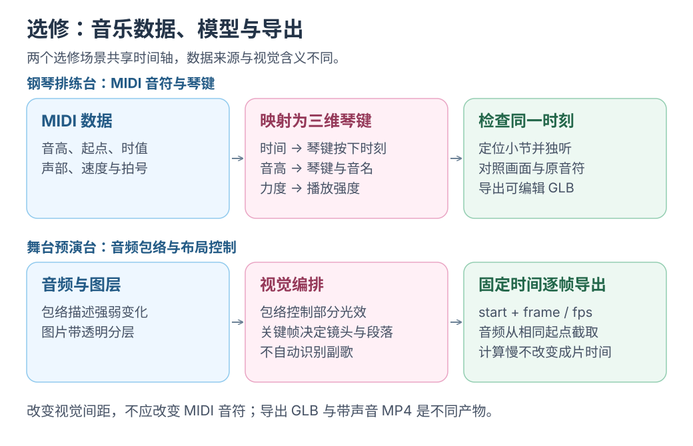

# 音乐 1：把一段音乐折成声部之结

[MCP 项目实战](../mcp-projects/README.md)音乐选修，可独立开始；初次接入先看[Codex MCP 入门](00-codex-mcp.md)。

把音乐变成可观察、可在 Blender 编辑的雕塑。

**声部之结 · Phrase Knot** 把时间折成圆环，声部交织；音高弯折光带、力度决定宽度、休止留下断口，播放时点亮当前音符。

可暂停、独听、旋转，也可导出 GLB 保存三维对象。

今天<mark class="key">定位第八小节，独听第二声部</mark>；能指出画面与声音的数据来源就停。

这套音乐 MCP 独立于 music-eyes。实现使用 TypeScript、官方 MCP SDK、Zod、Three.js 和 [Tonejs/Midi](https://github.com/Tonejs/Midi)。它与[光之剧场](08-music-photo-mcp.md)共用场景配置、时间轴、播放与导出路径。


## 打开第一场实验

需要 Node.js ≥ 22.22、pnpm、Chrome/Chromium 和 FFmpeg。依赖与环境配置见[示例 README](../../examples/music-space-mcp/README.md)。仓库根目录执行：

```bash
pnpm install:music-space-mcp
pnpm demo:music-space-mcp
pnpm demo:music-space-mcp:preview
```

打开打印的网址，选择“声部之结 · Phrase Knot”；demo 同时准备两篇素材，今天只看声部。

1. 点击“播放”，听到一段三声部的合成试听。
2. 点击第 8 小节，时间停在对应位置。
3. 点击 `Counterline` 的“独听”，再播放；其他声部的音符变暗，声音只保留这一轨。
4. 点击“听全部声部”，比较同一段音乐。

**停点：** 指出当前轨、时间与空间分离；试听是基础合成音，用于检查结构和时间。

## 音乐怎样折成一个结

| 看见的东西 | 数据或设计依据 |
| --- | --- |
| 圆环上的角度 | 音符时间 / 整段时长 |
| 不同颜色与绕环相位 | 所属声部 |
| 光段的位置、长度与粗细 | 音符起点、时值、力度 |
| 纤维的弯折高度 | 音高在声部路径上的偏移 |
| 光段之间的空隙 | 原 MIDI 的休止 |
| 发亮的端点 | 当前实际发声的音符 |
| 跨越时间的细弧 | 同轨精确重复的音高/节奏模式 |
| 同时发声点之间的细线 | 不同声部的同度/八度或纯五度音程类 |
| 结上的细截面环 | MIDI 自带的段落标记 |

圆环、绕环五圈和尺度是视觉设计，不代表真实乐器位置或必须循环；细线仅查模 12 音程。重复须音高、相对起点、时值完全相同，不自动识别副歌。

示例第二声部第 3 小节进入，第 5/6 小节第一声部休止，第 9/10 小节第二声部让位；用画面和独听核对。暗线是路线、光段是音符，短间隙平滑连接、长休止留断口。

拖动旋转、滚轮靠近，可恢复默认视角；暂停后仍可观察，运镜会保存。

[](../../site/public/diagrams/ai-from-scaling/music-timeline.svg)

## 先取得可靠的音乐数据

输入多轨 MIDI，保留音高、起点、时值、力度、轨道、速度与拍号，用 Tonejs/Midi 解析。

`src/media.ts` 把它整理成 `music.json`，示例结构如下：

```ts
{
  kind: 'midi',
  tracks: [{ id: 'track-2', notes: [/* 时间、音高、时值 */] }],
  bars: [{ number: 8, time: 15.55554, /* 拍号与时长 */ }],
  tempos: [{ time: 0, bpm: 108 }]
}
```

小节时间须按速度/拍号事件换算；本例 108 BPM、4/4 拍，第八小节约 15.556 秒，不适用于其他文件。

段落标记由 `src/fixtures.ts` 人工安排，不是自动曲式识别；外部 MIDI 也可带 marker/cuePoint。

<mark class="caution">MP3/WAV 不提供准确音符与声部</mark>；`create_score_scene` 拒绝普通音频，可用于下一篇剧场。

## MCP 怎样控制它

连接方式见[客户端配置](../../examples/music-space-mcp/README.md#接入-ai-客户端)。连接后可以说：

> 导入这份 MIDI，创建声部空间。暂停在第八小节，只听第二声部；把层间距稍微拉开，给我一张预览。

一次调用链是：

```text
import_music → create_score_scene → set_transport
→ inspect_scene → update_scene → render_preview → export_model
```

`set_transport` 按秒/小节定位，`soloTrackIds: ['track-2']` 独听，空数组听全部。`playing` 只是指令，发声仍须在预览点击“播放”或“启用声音”。

`update_scene` 须带 `inspect_scene` 当前版本，拒绝旧版覆盖；保护限单进程，同目录只用一个可写实例。

<details class="qa" id="为什么声音和画面能对齐">
<summary>声音和画面怎样对齐？</summary>

MIDI 声部 WAV 使用相同起点，浏览器从同一个 `AudioContext` 时钟播放并更新画面。暂停或定位后重建音源。

导出按 `start + frame / fps` 渲染，从相同起点截音频，因此不依赖录屏速度。未启用音频时仍可检查画面。

渲染用 [Three.js WebGPURenderer](https://threejs.org/docs/pages/WebGPURenderer.html)，优先 WebGPU，必要时回退 WebGL2；TSL 材质与 Bloom 处理颜色和辉光。

</details>

## 保存、重新打开与导出

操作即保存 `scene.json`，同数据目录重启 preview 可恢复；也能下载 JSON。跨机需一起复制音乐与场景，配置不含音频。

`render_preview` 输出 PNG，`export_clip` 输出 H.264/AAC MP4；固定快照的独听同时用于画面与混音，记录在 `exports/<exportId>/`。

## 从画面走向可编辑的对象

点击“保存三维模型 GLB”或调用 `export_model`，保存曲面、顶点颜色与素材信息，可导入 Blender 编辑。

模型不含音频、辉光或界面环框，也无实体厚度；3D 打印前须补厚并检查。

## 一项可以亲手改的挑战

把 `score.layerSpacing` 从 `3.2` 改成 `5`，让声部绕时间环展开的半径变大，保持同一音乐、同一时刻、同一独听选择，再生成预览。

先预测：哪些信息会改变，哪些音乐事实应当保持相同？比较两张图，再核对 `music.json` 的音符与时间没有改变。

参考代码：[契约](../../examples/music-space-mcp/src/contracts.ts)、[MIDI 与音频处理](../../examples/music-space-mcp/src/media.ts)、[共享时间轴](../../examples/music-space-mcp/src/timeline.ts)、[声部之结几何](../../examples/music-space-mcp/web/weave.ts)、[浏览器播放与场景组装](../../examples/music-space-mcp/web/main.ts)。

2026-10-25 已验证 stdio、小节定位/独听、音频、恢复、PNG/MP4 和 GLB；听感与画面舒适度仍需人判断。完成后可休息，或读[音乐 2](08-music-photo-mcp.md)。
