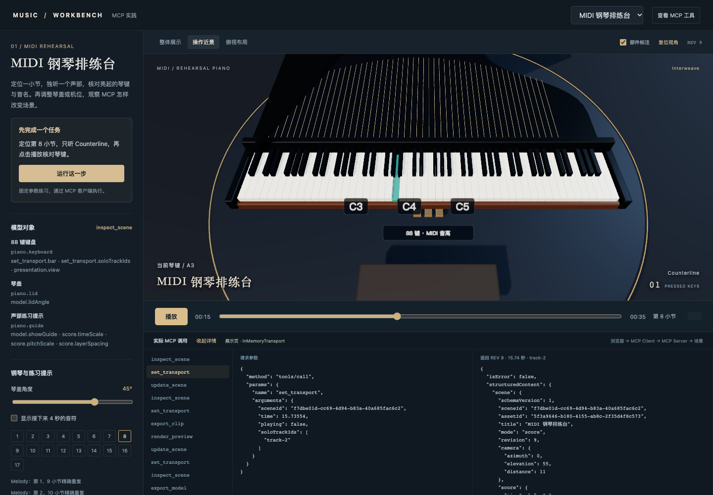
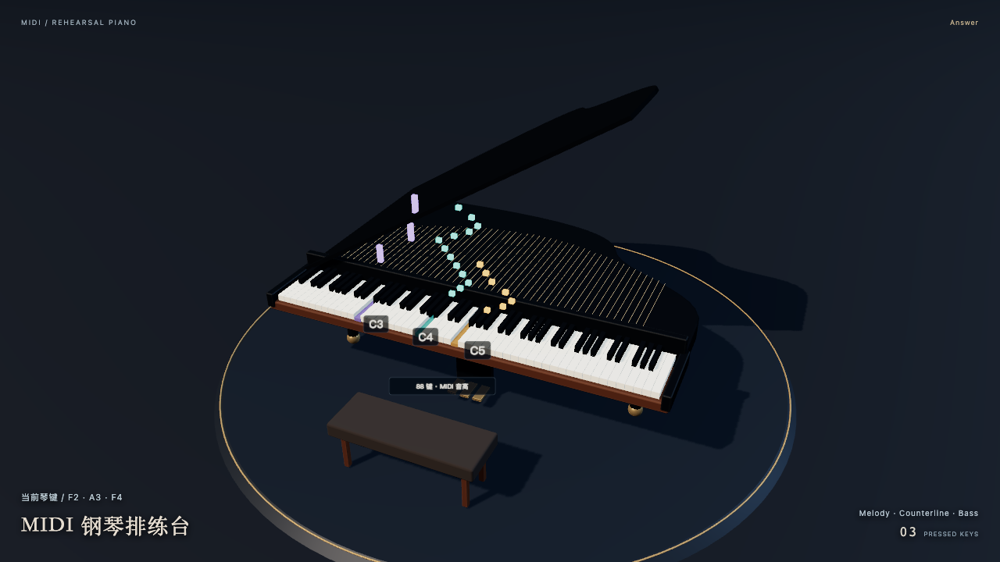

# 选修 · 音乐 1：用 MCP 控制钢琴排练台

[MCP 项目实战](../mcp-projects/README.md)的音乐选修，可独立开始；初次接入先看[Codex MCP 入门](00-codex-mcp.md)。

操作目标：<mark class="key">定位第八小节，独听第二声部</mark>，把音名对应到亮起的琴键，再对照实际 MCP 请求与结果。

钢琴有 88 个独立琴键，可调琴盖、练习提示与机位。它与[舞台预演台](08-music-photo-mcp.md)共用场景、时间轴、播放与导出，独立于 music-eyes。



## 打开第一场实验

需 Node.js ≥22.22、pnpm、Chrome/Chromium、FFmpeg；配置见[示例 README](../../examples/music-space-mcp/README.md)。根目录执行：

```bash
pnpm install:music-space-mcp
pnpm demo:music-space-mcp
pnpm demo:music-space-mcp:preview
```

打开打印的地址，选择“MIDI 钢琴排练台”：

1. 点“运行这一步”：先 `inspect_scene`，再 `set_transport`，暂停第八小节并独听 `Counterline`。
2. 点“操作近景”与“播放”，核对压下的琴键和音名。
3. 在“实际 MCP 调用”选 `set_transport`、展开详情，对照参数和结构化结果。

**停点：** 说出小节、声部、定位结果，并找到一个音名对应的琴键。按钮用固定参数，不调用付费模型。

<div class="heading-alias" id="这次调用做了什么" aria-hidden="true"></div>

## 调用行为

`sceneId` 换成当前场景返回的 UUID：

```json
{
  "name": "set_transport",
  "arguments": {
    "sceneId": "当前场景的 UUID",
    "bar": 8,
    "playing": false,
    "soloTrackIds": ["track-2"]
  }
}
```

返回 `scene.transport.position`、`soloTrackIds` 与新 `revision`。示例 108 BPM、4/4 拍，第八小节约 15.556 秒；其他文件须按自身速度、拍号换算。空独听数组恢复全部声部。

<details class="qa" id="为什么声音和画面能对齐">
<summary>声音和画面怎样对齐？</summary>

共用 `AudioContext` 时钟，定位或独听后从同一偏移重建；用户须先点击播放启用声音。导出按 `start + frame / fps` 与相同音频起点渲染。

</details>

## 再改一个可见参数

`inspect_scene.objects` 列出部件与控制路径：

| 对象 | 可以操作什么 |
| --- | --- |
| `piano.keyboard` | 小节、独听与机位 |
| `piano.lid` | `model.lidAngle`，0–65 度 |
| `piano.guide` | `model.showGuide`，接下来四秒的音符提示 |



把琴盖改为 45 度，核对 `update_scene` 的 `expectedRevision`、`model.lidAngle: 45`、返回版本与模型变化。<mark class="caution">旧版本修改应被拒绝</mark>；同一数据目录只用一个可写服务实例。

`presentation.view` 的 `overview / detail / plan` 对应整体、近景、俯视；`presentation.labels` 控制标注。拖动环绕后的姿态也经工具保存。

## 展示页为什么也能用于学习 MCP

页面经本地 Node 桥接层、官方 `Client` 与 `InMemoryTransport` 调用真实 MCP；外部宿主经 stdio，两者共用 `MusicStore`。右上角执行 `tools/list`，下方记录真实 `tools/call`、来源与结构化结果，不保存图片 base64。

代码入口：[契约](../../examples/music-space-mcp/src/contracts.ts)、[工具注册](../../examples/music-space-mcp/src/tools.ts)、[客户端桥接](../../examples/music-space-mcp/src/http.ts)、[MIDI 解析](../../examples/music-space-mcp/src/media.ts)、[琴键映射](../../examples/music-space-mcp/web/piano.ts)、[时间轴](../../examples/music-space-mcp/src/timeline.ts)、[播放与组装](../../examples/music-space-mcp/web/main.ts)。

## 保存、重新打开与导出

`scene.json` 自动保存；同目录重启可恢复，跨机需同时复制场景与音乐。`render_preview` 导出 PNG，`export_clip` 导出 H.264/AAC MP4，`export_model` 保留独立琴键、琴盖、材质与姿态，可交给 Blender 编辑。

导出使用固定配置快照，独听同时作用于画面和混音。键盘对应 MIDI 21–108（A0–C8）；范围外音符仍参与音频和时间分析，但无对应琴键。模型不提供自动指法；基础合成音不代表专业钢琴音色。

普通 MP3/WAV 不提供准确音符与声部，`create_score_scene` 会拒绝；可用于[音乐 2](08-music-photo-mcp.md)。渲染使用 [Three.js WebGPURenderer](https://threejs.org/docs/pages/WebGPURenderer.html)，WebGPU 不可用时回落 WebGL2；确定性捕获固定走 WebGL2。

连接外部宿主见[客户端配置](../../examples/music-space-mcp/README.md#接入-ai-客户端)，自然语言选工具由宿主承担。返回[MCP 项目实战](../mcp-projects/README.md)。
