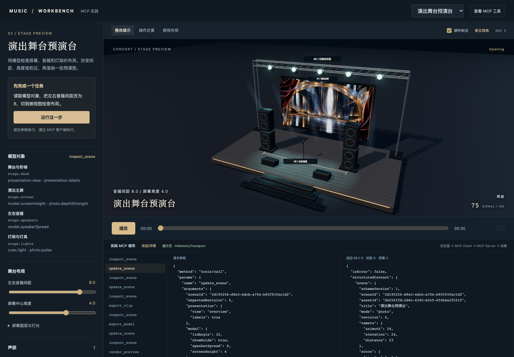
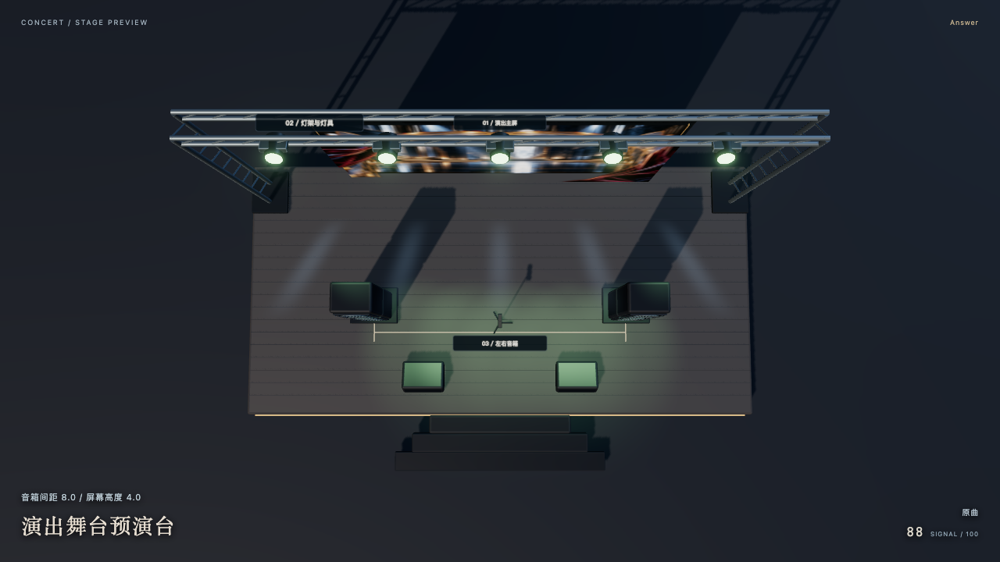

# 选修 · 音乐 2：用 MCP 调整舞台布局与机位

[MCP 案例](../mcp-projects/README.md)的音乐选修，先读[钢琴排练台](07-music-space-mcp.md)，熟悉共用服务与时间轴。

操作目标：<mark class="key">拉开音箱，切到俯视图，再导出预演图</mark>。主屏、音箱、阶梯、话筒与灯架是三维部件；音乐、屏幕贴图来自导入文件，布局和灯光由显式参数控制。



## 打开剧场

按[示例 README](../../examples/music-space-mcp/README.md)安装后，在根目录执行：

```bash
pnpm demo:music-space-mcp
pnpm demo:music-space-mcp:preview
```

打开打印的地址，选择“演出舞台预演台”：

1. 点“运行这一步”：`inspect_scene` 读取版本，`update_scene` 把音箱间距改为 8、机位改为 `plan`。
2. 对照俯视图的音箱、间距线与实际调用记录。
3. 点“整体展示”“渲染当前预览”，打开返回的 PNG。

**停点：** 把参数对应到部件变化，并找到导出文件。



## 用对象清单找到参数

| 对象 | 控制路径 |
| --- | --- |
| `stage.deck` | `presentation.view`：整体、近景、俯视 |
| `stage.screen` | `model.screenHeight`：主屏中心高度 |
| `stage.speakers` | `model.speakerSpread`：音箱间距 |
| `stage.lights` | `cues.light / photo.pulse`：段落与音量响应 |

先将 UUID 和版本替换为 `inspect_scene` 刚返回的值：

```json
{
  "name": "update_scene",
  "arguments": {
    "sceneId": "当前场景的 UUID",
    "expectedRevision": 2,
    "model": { "speakerSpread": 8, "screenHeight": 4 },
    "presentation": { "view": "plan", "labels": true }
  }
}
```

比较输入、返回的 `scene.model / revision` 与实际部件；滑块和外部 AI 调用经过同一 MCP。<mark class="caution">展示比例不是场地或声学测量</mark>，也未验证制造尺寸与承重。

## 给主屏换内容，再给片段配灯光

`import_music` 接收 MIDI 或音频，`create_photo_scene` 把 `imagePath` 变为主屏内容；可选透明 `layers` 与灰度 `depthPath` 互斥。背景不透明，最多四个有实际 alpha 的图层；素材与生成提示见 [assets/README.md](../../examples/music-space-mcp/assets/README.md)。实体部件由代码创建，GLB 内嵌屏幕贴图。

普通音频仅提供音量包络，不识别精确音符或副歌。`cues` 保存关键帧：

```ts
[
  { time: 0, label: '开场', zoom: 1, pan: -0.3, light: 0.2 },
  { time: 12, label: '展开', zoom: 1.1, pan: 0.3, light: 1 },
  { time: 24, label: '收束', zoom: 1, pan: 0, light: 0.3 }
]
```

时间须唯一且在素材时长内；`light` 平滑改变冷暖与强度，音量包络参与响应。示例用 MIDI 完整混音，段落标记来自人工安排。

## 交付预演图、短片与三维模型

- `render_preview`：当前机位、时刻的 PNG。
- `export_clip`：0.5–20 秒、24/30fps 的 H.264/AAC MP4。
- `export_model`：实体部件、当前布局与内嵌贴图的 GLB，供 Blender 编辑。

回执含本机路径与当前服务下载地址。`scene.json` 自动保存，导出另存固定快照；服务退出后用同数据目录启动 `preview` 可恢复访问，跨机须带上音乐与图片。[目录说明](../../examples/music-space-mcp/README.md#保存分享与恢复)

<details class="qa" id="为什么导出不用录屏">
<summary>为什么逐帧导出？</summary>

按快照的 `start + frame / fps` 渲染并截同起点音频，独听选择也进入导出；计算慢不改变片段时长，不能超出音乐范围。

</details>

## 沿一次调用读代码

```text
展示页 / AI 宿主 → MCP Client → tools/call
→ Zod 参数校验 → 场景版本与保存 → 模型更新 → 预览或导出
```

入口：[工具注册](../../examples/music-space-mcp/src/tools.ts)、[场景保存](../../examples/music-space-mcp/src/store.ts)、[舞台部件](../../examples/music-space-mcp/web/stage.ts)、[时间轴](../../examples/music-space-mcp/src/timeline.ts)、[逐帧导出](../../examples/music-space-mcp/src/render.ts)。再只改一次屏幕高度，固定时刻渲染比较；技术检查通过后，画面与听感仍由人验收。

返回[音乐 1](07-music-space-mcp.md)或[MCP 案例](../mcp-projects/README.md)。
