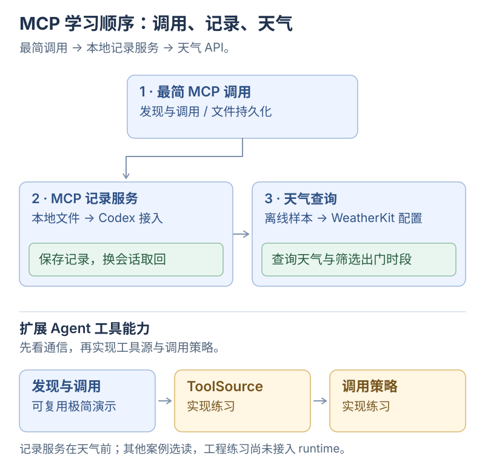

# 从极简 MCP 到模型训练与 Harness

**直接在 Codex 里使用：[在 Codex 里用自己的 MCP](00-codex-mcp.md)。** 只写服务端，让 Codex 根据你的话保存一条接续记录，再换个会话取回。客户端由 Codex 提供。

**单独观察协议：[看懂一次 MCP 工具调用](00-minimal-mcp.md)。** 运行保存与取回记录的演示，找到调用与读写代码，改一句话再运行，最后试一次错误输入。约 30 分钟，能区分 MCP 的发现与调用、工具实现的文件持久化就完成；工程配置与官方案例放在选读区。

之后从缩放定律开始，理解模型怎样从数据中学习，再训练一个能续写短句的语言模型，搭出一个能调用工具的 Harness。原主线为四小时，含新增开场连做约四小时三十分钟，也可以分次学习。

这里以大语言模型为主线。你需要会一点 JavaScript，能打开终端和编辑文件；概率、梯度和 Attention 都在用到时解释。MCP 开场使用 TypeScript 和官方 SDK，保留类型检查、编译与测试；小模型与 Harness 使用 JavaScript 和 Node.js 标准库，先在本地运行，接真实模型时再配置 API。

完成开场后进入[第一小时 从缩放定律理解模型](01-understand-models.md)，先回答一个问题：缩放曲线上不断下降的误差，到底是什么误差？

想先操作一个真实软件，可以转到 [Blender MCP：让参数变成模型](05-blender-mcp.md)。对着俯视与剖面图改两处尺寸，核对新生成的模型、预览与 STL；这一篇独立于下面的四小时主线。

想验证一次修改是否有效，可以做 [GitHub MCP：证明一次修复有效](06-github-lab-mcp.md)。用同一份断言对照旧代码、候选与官方修复，再补一条检查，核对新回执；同样独立于四小时主线。

已经看懂 `McpServer` 和 `registerTool`，想做一个每天能用的工具，可以接着做 [Apple 天气 MCP：从查询天气到安排出门](07-weatherkit-mcp.md)。先改离线样本的出门条件，再配置自己的 WeatherKit，查询常用地点并筛选连续时段。

## MCP 练习怎么选

极简、Blender 和 GitHub 三份演示都由脚本安排工具调用，不调用语言模型。WeatherKit 课程另外提供离线样本、真实 API 检查和接入现成 AI 客户端的步骤；没有 Apple 密钥时可先完成样本练习。MCP 提供发现与调用的共同协议，各项业务由工具实现。读每一篇时，都先找“请求怎么发出”，再找“谁真正执行，以及结果来自哪里”。

[](../../site/public/diagrams/ai-from-scaling/mcp-learning-route.svg)

想看清请求如何往返，读[发现与调用](../ai-communication/04-mcp.md)；准备接入自己的 Agent 时，再做[工具源](../agent-engineering/01-mcp-tool-source.md)和[调用策略](../agent-engineering/02-mcp-policy.md)两篇实现练习。后两篇的接口与状态是待实现方案，正文标出了需要自己补上的部分。

## 先做 MCP 再进入四小时主线

| 开场 | 内容 | 第一份成果 |
| --- | --- | --- |
| Codex 接入 | [只写服务端，在真实会话里调用工具](00-codex-mcp.md) | 看到 Codex 的工具调用，保存并跨会话取回自己的记录 |
| 约 30 分钟 | [看懂一次 MCP 工具调用](00-minimal-mcp.md) | 改一句记录并在服务重启后取回，找到调用、读写和输入校验的位置 |

下面的 240 分钟属于原来的模型与 Harness 主线。

| 时间 | 内容 | 这一段要完成什么 |
| --- | --- | --- |
| 00—50 分钟 | [从缩放定律理解模型](01-understand-models.md) | 连起规模、预测、训练、Transformer、后训练与推理 |
| 50—60 分钟 | 休息与提问 | 用自己的话解释参数、上下文和工具分别是什么 |
| 60—110 分钟 | [训练一个小语言模型](02-train-a-model.md) | 亲手写出概率、loss 和参数更新，比较训练前后的输出 |
| 110—120 分钟 | 休息与整理 | 保存一份模型，记下一个它仍然会犯的错 |
| 120—170 分钟 | [搭建工具调用 Harness](03-build-a-harness.md) | 跑通工具循环，找到可加统计、策略和审计的三个入口 |
| 170—180 分钟 | 休息与提问 | 找出模型提出动作与程序执行动作的交界处 |
| 180—230 分钟 | [接真实模型并做对照实验](04-experiments.md) | 切换模型接口，制造错误、拒绝、循环和取消，检查真实结果 |
| 230—240 分钟 | 复述与验收 | 用两份产物解释学习、推理、行动和验证 |

总计 240 分钟，包含 30 分钟休息与提问。也可以拆成四次学习，每次完成一章；五十分钟是内容预算，实际跟写速度可以调整。

## 我们会做出什么

### 一个可被发现和调用的 MCP 服务

把“留下下一步、回来接着做”包装成独立工具服务，用客户端执行 `tools/list` 和 `tools/call`。Codex 接入篇使用应用内置的客户端，独立演示篇提供客户端源码供你观察。记录是按项目保存的 Markdown，重启服务进程后仍可取回；从这里分清工具提供方、调用方、业务状态与后面的模型执行循环。

### 一个真正更新参数的小模型

给模型看“今天小猫吃鱼”“小鸟喝水”等原创短句，从所有候选字符概率相同的状态开始，用预测误差更新参数，再让它逐字生成新文本。

第一版采用字符级的上下文分数表：看到最近一个或两个字，取出一行分数，转换成下一个字符的概率。它保留了语言模型的训练目标、参数更新和生成循环，结构小到可以逐步算清楚。Transformer 的 Attention 与多层表示放在第一小时理解，后续再扩展实现。

### 一个自己控制执行的 Harness

任务固定为“读取活动计划，核算预算，申请保存摘要”。模型提出工具调用，程序验证参数、执行工具、回传结果，并负责轮数限制、取消和记录。

在[第三小时的三个可自定义入口](03-build-a-harness.md#三个可自定义入口)，用 `complete` 包装模型调用、`runTool` 控制工具执行、`emit` 观察运行事件。先完成离线计时练习，再选读它们与 LangChain、Vercel AI SDK、OpenAI Agents SDK 的接口对照。

先用固定脚本模拟模型回复，检查程序是否走对；再切到 DeepSeek，由真实模型决定调用哪些工具、填写什么参数。离线脚本只用于练习协议与运行机制，它的固定动作不代表模型推理能力。

**Harness 实验调用具备工具使用能力的现成模型。** 训练实验的小模型只学过短句续写；两部分分别让你观察模型的学习过程，以及应用怎样组织模型与工具。

## 开始前准备

在仓库根目录执行：

```bash
node --version
```

使用 Node.js 22.22 或更高版本，与现有文档站要求一致。MCP 开场需要用 pnpm 安装固定版本的官方 SDK；小模型与 Harness 两份实验无需安装 npm 包，所有本地实验均无需下载模型或使用 GPU。

参考实现：[Codex 用 MCP 服务端](../../examples/codex-continue-mcp/src/server.ts)、[独立演示服务端](../../examples/minimal-mcp/src/server.ts)、[独立演示客户端](../../examples/minimal-mcp/src/client.ts)、[演示入口](../../examples/minimal-mcp/src/demo.ts)、[小语言模型](labs/tiny-model.mjs)与[Harness](labs/harness.mjs)。按章节逐个函数跟写，或先运行参考实现，再回头改动关键步骤。

第四章的真实模型实验需要你自己的 DeepSeek API key，并会产生 API 用量，配置步骤写在该章。独立 MCP 演示、字符模型训练与脚本 Harness 可离线完成；Codex 接入篇使用你已经配置好的 Codex 模型服务。

## 学完以后检查什么

- 能启动 MCP 客户端，发现服务端的工具，完成一次调用并解释结果从哪里来。
- 能指出预测概率、loss 和参数更新分别发生在哪一行，并解释验证集的用途。
- 能说明为什么“多训练一些”和“让模型多看一个字”改变的是不同因素。
- 能沿着 `assistant.tool_calls → 本地执行 → tool 结果 → 下一轮模型请求` 追踪一次任务。
- 能让保存请求被拒绝，也能在自己允许后创建文件，并核对文件内容。
- 能区分模型回答结束、工具执行成功，以及用户任务确实完成。

## 学完以后接到哪里

想继续实现 Transformer，可以先复习 [Attention 与 KV Cache](../kv-cache/02-attention-and-kv.md)，再参考 Karpathy 的 [makemore](https://github.com/karpathy/makemore) 从字符模型走到神经网络结构。

想把 Harness 接进 Yuuki，继续读[共享运行时](../../examples/shared/runtime/README.md)与[可取消和恢复的运行](../agent-engineering/05-harness-vertical-slice.md)。MCP 开场通过 Markdown 文件实现持久化，演示结束时会清理临时记录；本课程小型 Harness 的运行事件保存在内存并打印到终端。执行过程的持久化、崩溃恢复和多设备执行沿用后续工程专题展开。

## 番外：工具调用怎样长成 Agent

主线跑完、或者中途想换口气时，可以读[这篇番外](extra-tool-use-story.md)。它不要求跟做，把 ReAct、Plugins、Code Interpreter、function calling 与 MCP 串成一条故事线，解释主线里的 `stopWhen`、`readOnlyHint`、`outputSchema` 分别是从哪次失败里长出来的。

## 末章选修：音乐 MCP

先完成模型与 Harness 主线，以及感兴趣的 Blender、GitHub 实践，最后再按兴趣阅读这两个音乐案例。

| 选修章节 | 内容 |
| --- | --- |
| [音乐 1：声部之结](07-music-space-mcp.md) | 把 MIDI 折成可编辑的音乐雕塑，练习独听、配置保存与 GLB 导出 |
| [音乐 2：光之剧场](08-music-photo-mcp.md) | 用透明图层、音乐包络与灯光关键帧制作 2.5D 舞台短片 |

两篇共用同一个 TypeScript MCP，可保存场景、重新打开和导出 MP4，独立于 music-eyes。

返回[文档目录](../README.md)。
