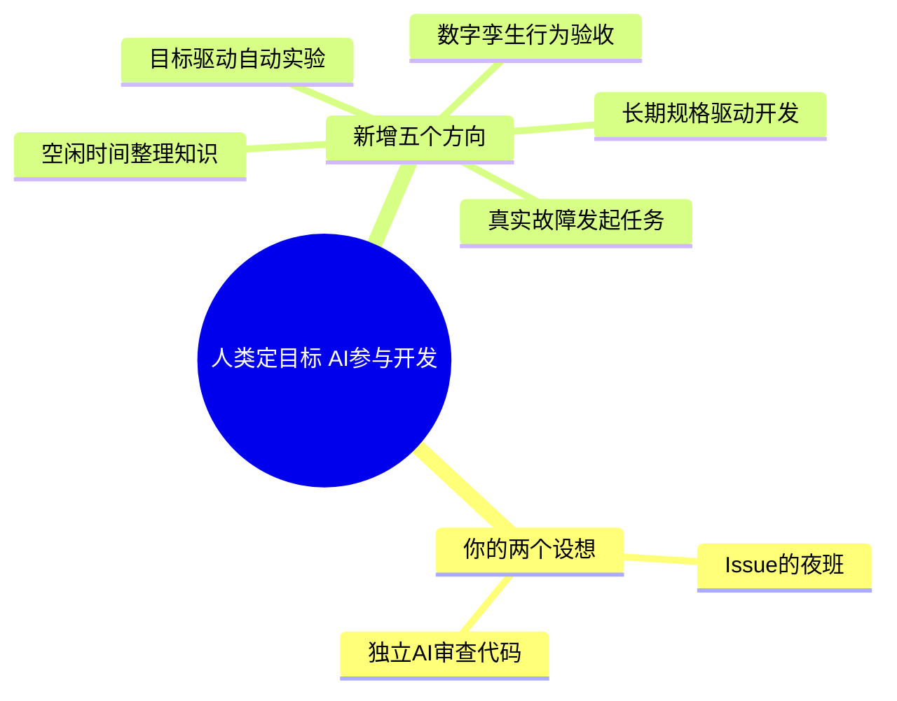

# AI 协作构想：Issue 夜班、独立代码审查与验收流程

从“白天记 Issue，晚上有人来修”出发，旁边还会长出自动审查、故障驱动任务、目标驱动实验。先把整张地图摊开，沿一条最让你好奇的分支走走看。

这里收录你提出的两个设想、上一轮讨论的配套环节，以及新探索的五个方向。这些内容仍处于构想与教学阶段，没有落地记录；已经有公开案例的做法另见[已落地的 AI 开发实践](../ai-practices/README.md)。共同目标是：人表达意图，AI 交付改动与可检查的证据，人保留最终判断。

核对日期：2026-10-21。新增方向的代表方案公开于 2025—2026 年，其中包含 2026-09-29 的近期产品更新；这些日期代表所引用实现或更新的公开节点，不代表某种思想第一次诞生。

2026-10-22 补充：[已落地的 AI 开发实践](../ai-practices/README.md)收录 CodeRabbit 等六项方案的案例与小实验；[你的工作流分析](../ai-practices/your-workflow.md)则说明哪些做法更适合减少验收与返工。

## 协作地图：Issue 夜班、独立审查与探索方案

[](../../site/public/diagrams/ai-ideas-map.svg)

点击图片可打开 SVG 原图放大。各方向的来源、时间和小实验见[故障驱动、自动实验、模拟验收、规格驱动与知识整理](02-five-new-directions.md)。

<details>
<summary>展开可编辑的 Mermaid 源码</summary>



SVG 与这份 Mermaid 表达同一层级，SVG 用于直接阅读，源码保留给后续编辑。

</details>

## 你的设想一：白天记 Issue，AI 夜间修复

```text
你记录问题与验收条件
  → 定时扫描未关闭的 Issue
  → 选择 ai-ready 的小问题
  → AI 修改、运行检查
  → 草稿 PR 与验收摘要
```

首版建议一次只领一个问题，已有 PR 的任务跳过。完整学习路径从[先替我看一眼 Issue](../issue-garden/01-first-scan.md)开始，调度与权限分工见[把流程交给夜班](../issue-garden/03-night-shift.md)。

已有 Dot 时，可以跟做[用 Dot 接手 GitHub 开发任务](../issue-garden/04-dot-shift.md)：用现有产品额度安排 Codex 开发、独立审查和有限返修，先试跑一个 Issue，再确认持续跟进的方式。

这条路线已有产品对应：GitHub 支持把 Issue 分配给 Copilot cloud agent，由它处理并产出 PR。[GitHub 官方说明](https://docs.github.com/en/copilot/how-tos/use-copilot-agents/cloud-agent/use-cloud-agent-on-github)

## 你的设想二：另一个 AI 来审查代码

这个方向已有对应工具 **CodeRabbit**。Nuxt 的 [PR #36124](https://github.com/nuxt/nuxt/pull/36124)有它的公开审查记录；功能、团队案例与体验步骤见 [CodeRabbit 自动审查 PR](../ai-practices/01-coderabbit-review.md)。

```text
AI A 创建或更新 PR
  → 触发独立的 AI B 会话
  → B 读取需求、当前提交的 diff、相关源码和检查结果
  → B 给出可核实的问题
  → A 返修，重新检查当前提交
  → 你确认结果
```

第二个 AI 可以使用同一模型的新会话，也可以换模型。这里建议它只读代码、输出审查意见；把修改责任留给 A，自动返修先限制为两轮。这是首版设计建议。

可以从这段审查指令开始：

```text
请审查当前 PR，先记录 base/head 提交 SHA。
结合 Issue 的验收条件、diff 和相关调用方，寻找可复现的行为错误与遗漏。
每条意见包含：文件与位置、触发条件、影响、验证方法。
区分已经确认的问题与需要补充证据的猜测。
没有发现问题时直接说明；先不修改代码。
```

如果已经在使用 Copilot，也可以给自己的一份 PR 手动请求一次代码审查。观察反馈是否有用，再决定是否启用自动审查。具体入口与账号条件见[GitHub 代码审查操作](https://docs.github.com/en/copilot/how-tos/use-copilot-agents/use-code-review)。

## 配套环节：Issue 澄清、回归测试、CI 返修与维护

这些保留为原有路线的扩展，不计入本次新增五个方向：

| 环节 | AI 可以交付什么 |
| --- | --- |
| Issue 澄清与拆分 | 缺失的复现条件、验收标准和范围明确的小任务 |
| 独立回归测试 | 修复前失败、修复后通过的同一份检查 |
| 浏览器验收 | 操作路径、截图与实际结果 |
| CI 失败后返修 | 失败原因、最小补丁与重跑结果 |
| 依赖和文档维护 | 升级影响、迁移改动、更新后的使用说明 |
| 每日验收摘要 | 少量待判断的 PR、关键改动与验证缺口 |

GitHub Agentic Workflows 已将 Issue 分类、CI 调查、文档维护和测试覆盖列为应用场景；该功能当前为公开预览。[官方介绍](https://docs.github.com/en/copilot/concepts/agent-capabilities/agent-powered-workflows-and-operations/about-github-agentic-workflows)

## 效果验证：确认问题、验收时间与合并后返工

产品已经支持某件事，说明有现成路径可试；公司工程实践说明有团队在使用；研究或开源实验说明存在一种可探索的方法。它们对个人项目的收益仍需分别验证。

AI 审查也会漏报或误报，结论仍需通过具体检查验证。[GitHub 对局限的说明](https://docs.github.com/en/copilot/responsible-use/agents#7-limitations)

先用自己的少量任务观察三件事：发现了多少经你确认的问题、你花了多少验收时间、合并后有多少返工。记录任务类型、模型和代码版本，保留不成功的案例。

**当前最小下一步：从[工作流分析中的小实验](../ai-practices/your-workflow.md#下一次只试一件事)开始，让 AI 先复现问题，再交付修复后的检查结果。** 想体验新的协作方式，再从上面的独立审查或[五个探索方向](02-five-new-directions.md)中挑一个。

本文是构想与教学资料。图的层级和 SVG 结构经过本地检查；远端 Agent、自动审查和上述协作流程尚未在本仓库启用。
