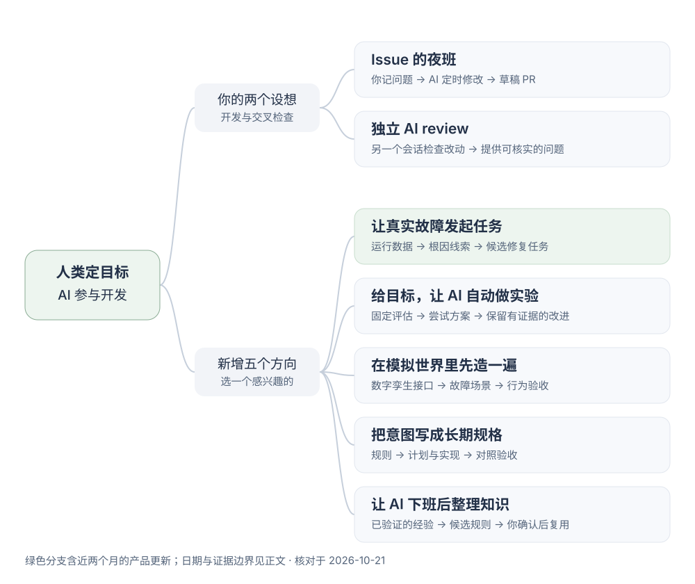
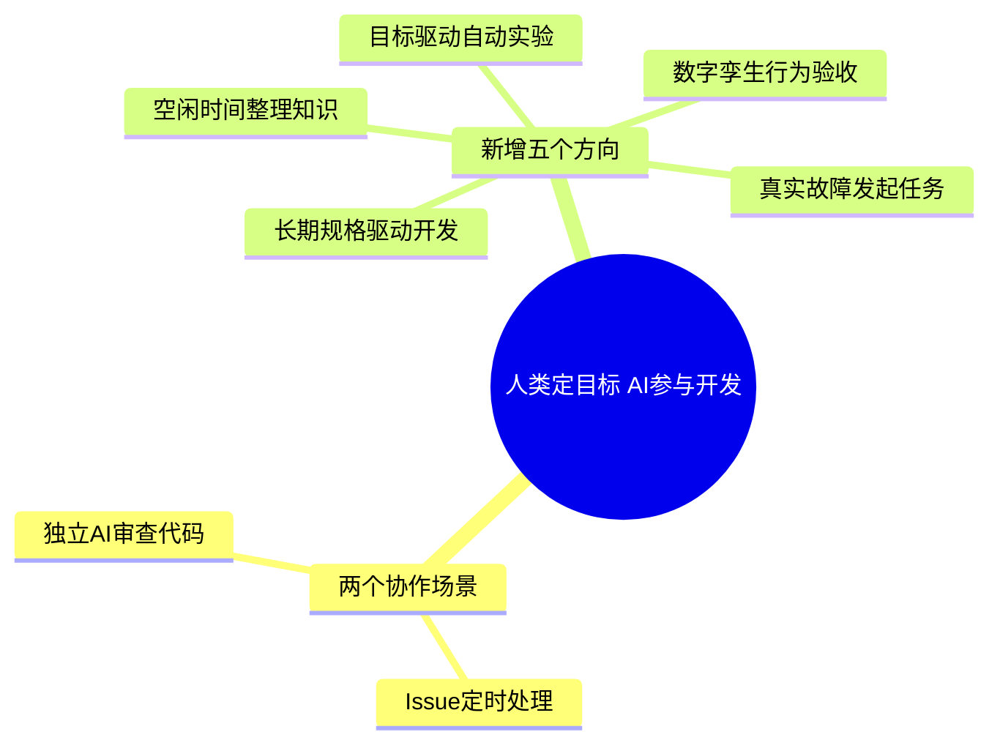

# AI 协作构想：Issue 定时处理、独立代码审查与验收流程

基于 Issue 自动化，扩展独立审查、故障任务和目标实验。

收录两个设想、配套环节和五个新方向，尚无本项目落地记录；公开案例见[已落地的 AI 开发实践](../ai-practices/README.md)。目标是 <mark class="key">AI 交付改动和证据，人最终判断</mark>。

核对日期 2026-10-21；方案公开于 2025—2026 年，含 2026-09-29 更新，日期不代表思想起源。

2026-10-22 补充：[已落地的 AI 开发实践](../ai-practices/README.md)含六项案例，[工作流分析](../ai-practices/your-workflow.md)聚焦验收与返工。

<div class="heading-alias" id="协作地图issue-夜班独立审查与探索方案" aria-hidden="true"></div>

## 协作地图：Issue 定时处理、独立审查与探索方案

[](../../site/public/diagrams/ai-ideas-map.svg)

点击放大；来源、时间和实验见[故障驱动、自动实验、模拟验收、规格驱动与知识整理](02-five-new-directions.md)。

<details>
<summary>Mermaid 源码</summary>



SVG 与这份 Mermaid 表达同一层级，SVG 用于直接阅读，源码保留给后续编辑。

</details>

<div class="heading-alias" id="你的设想一白天记-issueai-夜间修复" aria-hidden="true"></div>

## 场景一：Issue 记录与自动修复

```text
人工记录问题与验收条件
  → 定时扫描未关闭的 Issue
  → 选择 ai-ready 的小问题
  → AI 修改、运行检查
  → 草稿 PR 与验收摘要
```

首版一次只领取一个问题，已有 PR 的任务跳过。完整学习路径从[Issue 扫描](../issue-garden/01-first-scan.md)开始，调度与权限分工见[定时任务流程](../issue-garden/03-night-shift.md)。

已有 Dot 时，可以跟做[用 Dot 接手 GitHub 开发任务](../issue-garden/04-dot-shift.md)：用现有产品额度安排 Codex 开发、独立审查和有限返修，先试跑一个 Issue，再确认持续跟进的方式。

这条路线已有产品对应：GitHub 支持把 Issue 分配给 Copilot cloud agent，由它处理并产出 PR。[GitHub 官方说明](https://docs.github.com/en/copilot/how-tos/use-copilot-agents/cloud-agent/use-cloud-agent-on-github)

<div class="heading-alias" id="你的设想二另一个-ai-来审查代码" aria-hidden="true"></div>

## 场景二：独立 AI 代码审查

这个方向已有对应工具 **CodeRabbit**。Nuxt 的 [PR #36124](https://github.com/nuxt/nuxt/pull/36124)有它的公开审查记录；功能、团队案例与体验步骤见 [CodeRabbit 自动审查 PR](../ai-practices/01-coderabbit-review.md)。

```text
AI A 创建或更新 PR
  → 触发独立的 AI B 会话
  → B 读取需求、当前提交的 diff、相关源码和检查结果
  → B 给出可核实的问题
  → A 返修，重新检查当前提交
  → 人工确认结果
```

审查者可用同模型新会话或另一模型；只读提意见，由 A 修改，首版最多返修两轮。

审查指令示例：

```text
请审查当前 PR，先记录 base/head 提交 SHA。
结合 Issue 的验收条件、diff 和相关调用方，寻找可复现的行为错误与遗漏。
每条意见包含：文件与位置、触发条件、影响、验证方法。
区分已经确认的问题与需要补充证据的猜测。
没有发现问题时直接说明；先不修改代码。
```

已有 Copilot 可先手动审查一份 PR，再决定是否自动运行；条件见[GitHub 代码审查操作](https://docs.github.com/en/copilot/how-tos/use-copilot-agents/use-code-review)。

## 配套环节：Issue 澄清、回归测试、CI 返修与维护

以下为基础路线的扩展，不计入五个探索方向：

| 环节 | AI 可以交付什么 |
| --- | --- |
| Issue 澄清与拆分 | 缺失的复现条件、验收标准和范围明确的小任务 |
| 独立回归测试 | 修复前失败、修复后通过的同一份检查 |
| 浏览器验收 | 操作路径、截图与实际结果 |
| CI 失败后返修 | 失败原因、最小补丁与重跑结果 |
| 依赖和文档维护 | 升级影响、迁移改动、更新后的使用说明 |
| 每日验收摘要 | 少量待判断的 PR、关键改动与验证缺口 |

GitHub Agentic Workflows 已将 Issue 分类、CI 调查、文档维护和测试覆盖列为应用场景；该功能当前为公开预览。[官方介绍](https://docs.github.com/en/copilot/concepts/agent-capabilities/agent-powered-workflows-and-operations/about-github-agentic-workflows)

## 效果验证：确认问题、验收时间与合并后返工

产品、公司实践、研究各提供不同证据，不能直接推断目标项目收益。

<mark class="caution">审查可能漏报、误报</mark>，仍须验证。[GitHub 对局限的说明](https://docs.github.com/en/copilot/responsible-use/agents#7-limitations)

用少量任务记录确认问题数、验收时间、合并后返工；注明模型、代码版本，并保留失败案例。

先做[工作流分析中的小实验](../ai-practices/your-workflow.md#下一次只试一件事)：复现后修复并交证据；再选独立审查或[五个探索方向](02-five-new-directions.md)。

本文是构想与教学资料。图的层级和 SVG 结构经过本地检查；远端 Agent、自动审查和上述协作流程尚未在本仓库启用。
