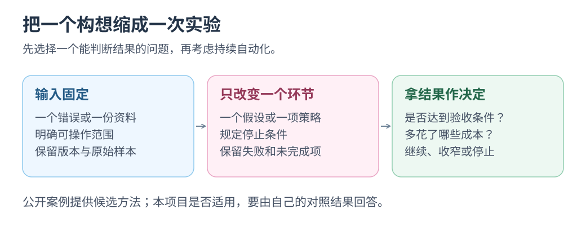

# AI 探索方案：故障驱动、自动实验、模拟验收、规格驱动与知识整理

报错找任务、自动试改法，还是整理经验？<mark class="key">选一个方向，做一次小实验</mark>。

实际案例见[已落地的 AI 开发实践](../ai-practices/README.md)，含 CodeRabbit 和故障驱动记录。

五方向补充 Issue 修复与审查，分别改变任务来源、解法、验收环境、意图表达和经验复用。

核对日期 2026-10-21，近期窗口为 2026-08-21—10-21；表中日期是公开/更新节点，不是思想起源。<mark class="caution">接法与实验均未在本项目运行</mark>。

| 方向 | 代表方案与时间证据 | 现有证据到哪一步 |
| --- | --- | --- |
| 1. 让真实故障发起任务 | Seer：2025-06-17 正式发布；Seer Agent：2026-09-29 增强 | 已有调试产品；近期增强仍以发布文章描述的能力与状态为准 |
| 2. 给目标，让 AI 自动做实验 | Karpathy autoresearch：2026-03，README 自述 | 公开的模型训练实验项目，迁移到 Web 开发需另建评估 |
| 3. 在模拟世界里先造一遍 | StrongDM Software Factory：2026-02-06 工程文章 | 公司实践自述，不能推成所有项目的成熟方案 |
| 4. 把意图写成长期规格 | GitHub Spec Kit：2025-09-02 发布文章 | 开源工具与明确工作流，具体项目收益需验证 |
| 5. 让 AI 下班后整理知识 | Letta Sleep-time Compute：2025-04-21 研究发布 | 研究与框架实现，编码项目的收益仍要单独测量 |

[](../../site/public/diagrams/ai-ideas/one-experiment.svg)

## 1. 故障驱动：从真实报错生成修复任务

**你负责决定什么体验值得修，运行数据帮助 AI 发现具体问题。**

<details>
<summary>来源、接入与实验</summary>

**已有事实。** Sentry 在 2025-06-17 发布的 Seer 功能包括结合堆栈、追踪和代码分析根因、建议修复，以及自动创建 PR。[正式发布说明](https://sentry.io/changelog/seer-sentrys-ai-debugger-is-generally-available/)

2026-09-29 更新加入 API 写操作和 Datadog、Google Cloud Platform 数据连接，当时标为 beta；这是增强日期，不是 AI 调试起源。[近期更新原文](https://blog.sentry.io/big-improvements-to-seer-agent/)

**借到项目里。** 按错误与版本归并，让 AI 整理候选 Issue，人确认优先级后交夜班：

```text
错误事件与版本 → 归并去重 → 根因假设与复现线索
              → 候选 Issue → 你选择 → 补丁与验证
```

**小实验。** 选三份已脱敏的本地错误记录，让 AI 判断是同一个 bug 还是三个不同问题，并给出证据。先只生成报告。

**交付与边界。** 留样本、版本、依据与未知项；日志缺失、数据处理和归因均影响结论，正式修改与发布另定。

</details>

## 2. 自动实验：固定评估并比较改法

**你给一个可以测量的目标，AI 尝试不同改法，保留有证据的改进。**

<details>
<summary>来源、接入与实验</summary>

**已有事实。** autoresearch README 标于 2026 年 3 月：单 GPU 下修改训练代码，固定五分钟比较指标，再保留或放弃；评估与可改代码分离，不是通用 Web 优化工具，也未核定首发日。[项目 README](https://github.com/karpathy/autoresearch)

**借到自己的项目里。** 你提出“让固定样本的处理更快，输出保持一致”，让 AI 自动寻找方案：

```text
固定输入与评估 → 测基线 → 修改一个实现 → 检查输出与耗时
              → 保留改善或放弃 → 留下实验记录
```

**小实验。** 固定纯函数输入、输出和测量，最多试三种实现，保存版本与多次测量后再选。

**交付与边界。** 记录失败、预算和环境，独立保管评估脚本，禁删检查或换输入；收益只适用于该负载。

</details>

## 3. 模拟验收：在仿真接口中构建与验证

**先给 AI 一套能反复尝试的假接口和真实使用场景，再让它生成与修正代码。**

<details>
<summary>来源、接入与实验</summary>

**已有事实。** StrongDM 于 2026-02-06 介绍 Software Factory，以规格/场景驱动，模拟 Okta、Jira、Slack 等 API 与边界，并将部分验收场景保存在仓库外。[StrongDM 原文](https://factory.strongdm.ai/)

这是公司自述，自动收敛与经济收益未经本文独立验证。

**借到自己的项目里。** 给 Yuuki 的一个外部工具做最小模拟服务，让 AI 在其中实现与验收任务：

```text
用户场景 → 最小模拟接口 → AI 构建工具调用
        → 正常与故障场景验收 → 复查真实接口差异
```

**小实验。** 只模拟“读取一个任务”的接口，准备成功、超时和重复响应三种情况。让 AI 实现调用和恢复路径，再用固定场景验收。

**交付与边界。** 保存协议、场景和行为记录；模拟通过后，仍须在真实测试环境确认关键行为。

</details>

## 4. 规格驱动：从产品规则生成实现与验收

**你维护几条重要的产品规则，AI 根据规则更新计划、代码和验收。**

<details>
<summary>来源、接入与实验</summary>

**已有事实。** GitHub 于 2025-09-02 介绍 Spec Kit：Specify → Plan → Tasks → Implement，以规格驱动实现；自然语言仍需解释和验证，不是正确性证明。[发布文章](https://github.blog/ai-and-ml/generative-ai/spec-driven-development-with-ai-get-started-with-a-new-open-source-toolkit/)

**借到自己的项目里。** 为本站的“专注阅读”和独立目录开关保留三条短规格，后续每次改动都对照它们：

```text
专注阅读默认收起补充内容，专题章节仍可按需展开。
目录开关独立控制左侧导航，打开目录不应退出专注阅读。
刷新后保留阅读偏好；存储不可用时，本页仍能切换。
```

**小实验。** 请 AI 根据这三条规则列出验收场景，然后只实现其中一条小变更。你只需判断规格是否准确、改动是否满足规格。

**交付与边界。** 规格、实现、验收须对应；规则不准先修规则。几行文字即可实验，无需整套工具链。

</details>

## 5. 知识整理：从已完成任务提取可复用经验

本方向涉及 Memory，作为选读保留，暂不纳入当前课程计划。

**夜间任务也可以只是读懂项目、整理经验，让下一次任务更容易开始。**

<details>
<summary>来源、接入与实验</summary>

**已有事实。** Letta 于 2025-04-21 发布 Sleep-time Compute，由独立 Agent 在空闲时整理上下文；研究收益不能直接套给个人编码项目。[研究与实现介绍](https://www.letta.com/blog/sleep-time-compute/)

**借到自己的项目里。** 用已经接受的 PR、已确认的审查意见和失败记录，生成下次任务可查的三条候选经验：

```text
已验证的任务记录 → 找出重复问题 → 候选规则与证据链接
                → 你确认 → 版本化保存 → 下次按需读取
```

**小实验。** 给一份完成的 PR，提取改动、坑点、下次检查法，各一句并附来源，停在候选文档。

**交付与边界。** 经验须有来源、范围、失效条件，可撤回；这是资料整理，不是训练模型，长期采纳由你决定。

</details>

## 今天选哪一个

减少返工先看[你的工作流分析](../ai-practices/your-workflow.md)；本页先选**方向 4**，写三条阅读规格核对实现，无需新服务。自动优化选方向 2，先固定评估。

产品、公司实践与研究只提供路径；节省多少时间、减少多少错误，须用自己的任务记录验证。

返回[整张构想地图](01-ideas-map.md)或[Issue 夜班入口](../issue-garden/README.md)。本文只新增教学与研究材料，尚未运行这些实验或启用相应自动化。
