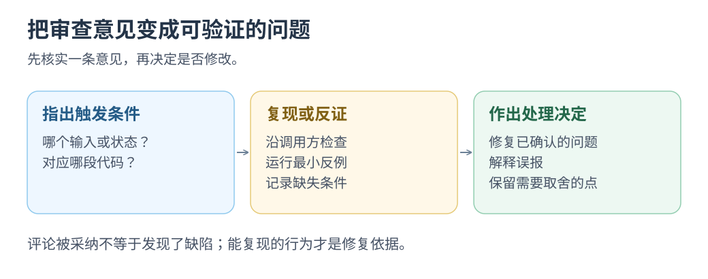

# CodeRabbit：PR 独立审查

核对一条 AI 审查意见，区分真实缺陷与误报。

**PR 更新时补一轮 AI 审查。** CodeRabbit 提供摘要、逐行建议和后续讨论。 [GitHub App 说明](https://github.com/apps/coderabbitai)

`coderabbitai[bot]` 是机器人；`.coderabbit.yaml` 配置各路径审查要求。 [配置说明](https://kb.coderabbit.ai/articles/1134523355-configure-path-instructions)

资料核对：2026-10-22。

<div class="heading-alias" id="先看一场真实审查" aria-hidden="true"></div>

## 公开审查案例

**公开记录：** Nuxt [PR #36124](https://github.com/nuxt/nuxt/pull/36124)在 2026-08-19 留有 hydration 缓存审查并已合并；合并不证明每条意见被采纳。

**供应商案例：** Cresta 自 2026-01 试用，首月覆盖 1,871 PR、建议采纳 51%，曾检出递归渲染卡死；采纳率不是缺陷检出率。 [Cresta 案例](https://www.coderabbit.ai/case-studies/how-cresta-brings-consistent-review-to-ai-generated-code-with-coderabbit)

<div class="heading-alias" id="它怎样加入你的-pr" aria-hidden="true"></div>

## PR 接入流程

```text
创建或更新 PR → CodeRabbit 读取改动与相关上下文
             → 摘要与审查意见 → 作者核实、修正 → 检查与人工验收
```

这对应[独立 AI 审查方案](../issue-garden/README.md#review)：先评估现有服务的能力，再决定是否自建。

[](../../site/public/diagrams/ai-practices/review-triage.svg)

<div class="heading-alias" id="小挑战给审查意见做一次审查" aria-hidden="true"></div>

## 验证练习：核实审查意见

打开 Nuxt PR，选一条有对应代码的意见，先自行判断，再看作者处理；接入后观察：

1. 每条意见能否指出触发条件与对应代码。
2. 建议是否修复问题，是否改变了原本的产品行为。
3. 记录有效意见、误报与核实耗时。

记录：`意见 / 怎样核实 / 采纳或放弃`。

**<mark class="key">判断一条意见是否成立</mark>。** 无意见或两个 AI 同意，都不能替代原有检查。

返回[实践目录](README.md)或[Issue 完整方案](../issue-garden/README.md#review)。
