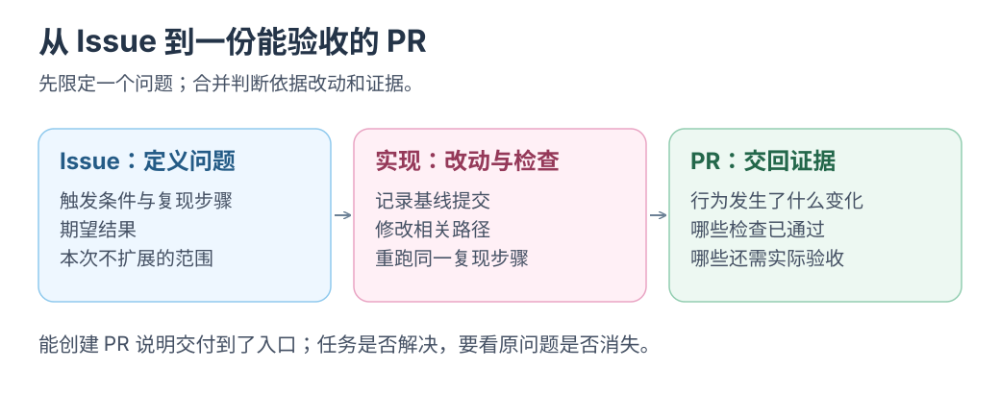

# 交出一张 Issue，接回一份 PR

先把入口、复现和预期写清，再把一个小问题交给 AI。

**<mark class="key">交清楚任务，接回可审改动</mark>。** Copilot cloud agent 支持 Issue 启动、PR 反馈；需付费计划且仓库允许。 [当前使用文档](https://docs.github.com/en/copilot/how-tos/use-copilot-agents/cloud-agent/use-cloud-agent-on-github)

资料核对：2026-10-22；下述工程案例发布于 2025-08-28，次日更新，当时产品称 coding agent。

## GitHub 团队交过什么任务

**团队部署：** GitHub Secret Protection 将背景、接口和示例写进 Issue 交给 Copilot；PR 经测试、人工审查后部署，数周新增近 90 种 token 支持。 [工程团队原文](https://github.blog/ai-and-ml/github-copilot/how-we-accelerated-secret-protection-engineering-with-copilot/)

Agent 仍会漏读细节，需补说明、查结果；该案例依赖已有框架与人工验收。

## 从任务单到交付物

```text
人确认问题与验收条件 → Issue → Agent 修改、运行检查
                   → PR → 评论反馈与返修 → 人验收
```

这是[Issue 夜班](../issue-garden/README.md)的单次交付参考；定时、去重和预算另接。

[](../../site/public/diagrams/ai-practices/issue-pr.svg)

## 小挑战：让一个失效链接走完开发流程

选失效链接，正文写入口、实际／预期和验收路径；查 Agent 的定位与检查记录。

验收时打开修复后的链接，再检查附近链接是否仍正常。保留 Issue、最终 diff 和实际访问结果。

理解错误时，用具体评论纠正，确认返修仍遵循原验收条件。

**交回能解释并验证的 PR。** 无法检查时列原因与影响，人工待验项给具体步骤。

返回[实践目录](README.md)。
