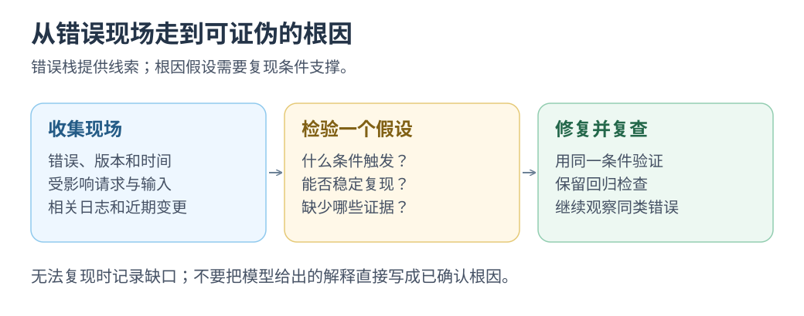

# 带着错误现场去破案：Sentry Seer

先提供堆栈、版本和操作轨迹，再让 AI 提出<mark class="key">可验证的根因假设</mark>。

**用堆栈、轨迹与代码诊断。** Seer 分析根因，再交执行 Agent 修改、检查并提 PR。

资料核对：2026-10-22；以下使用记录发布于 2026-07-23。

## 一次有记录的故障调查

**个人实践：** Dan Mindru 记录 Next.js 故障由 Seer 诊断、Cursor Cloud Agent 实现并提 PR；他查看补丁、测试后手动合并。 [完整实践记录](https://blog.sentry.io/57-bugs-to-1/)

这是附截图的产品博客自述，积压清理也含其他 Agent 与人工调查。

## 从现场走到补丁

```text
线上错误与版本 → Seer 根因分析 → 修复 Agent 获得诊断上下文
              → 修改与运行检查 → PR → 人验收 → 观察同类错误
```

案例补充了[故障发起任务的构想](../ai-ideas/02-five-new-directions.md)；其中生产认证与时序问题仍未解决，缺复现环境时继续调查。

[](../../site/public/diagrams/ai-practices/error-hypothesis.svg)

## 小挑战：让一个根因假设接受盘问

选可复现错误，提供脱敏堆栈、版本、步骤与源码；让 AI 列原因、依据和验证方法，再问：“怎样再次触发？”先手动试，不必立即接 Sentry。

同操作确认修复前失败、修复后通过；部署后继续观察版本错误，本地只覆盖已查路径。

也记录被证据推翻的假设。

**这一局的成果：一个有运行证据支持的原因，或一条明确缺失的复现条件。**

返回[实践目录](README.md)。
