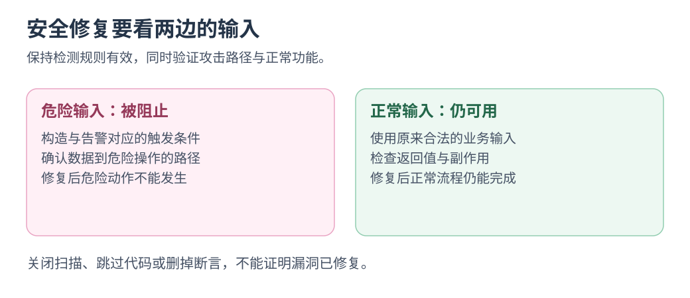

# 追着一条安全告警修到底：CodeQL × Autofix

从一条告警追到补丁，重跑扫描与正常功能。

**CodeQL 定位，Autofix 提议补丁。** 结合漏洞上下文审阅解释，再创建 PR。 [GitHub 工作原理](https://github.blog/engineering/platform-security/fixing-security-vulnerabilities-with-ai/)

资料核对：2026-10-22；以下使用数据来自 2024-08-14 发布、2025-01-21 更新的官方文章。

## 公开数据里的使用情况

**产品方数据：** 2024-05—07 公测、Advanced Security 仓库的 PR 新 CodeQL 告警中，Autofix 修复耗时中位数 28 分钟，手工约 1.5 小时；不可外推。 [数据与统计范围](https://github.blog/news-insights/product-news/secure-code-more-than-three-times-faster-with-copilot-autofix/)

## 告警怎样走到补丁

```text
CodeQL 扫描 → 告警与相关代码 → AI 解释并建议补丁
           → 修复 PR → 重跑扫描与行为测试 → 人验收
```

告警消失后仍查合法输入和业务行为；官方要求审阅、验证建议。 [当前能力与局限](https://docs.github.com/en/code-security/responsible-use/security-and-quality-ai-features)

[](../../site/public/diagrams/ai-practices/security-inputs.svg)

## 小挑战：让危险路径失败，让正常路径通过

在支持的语言、规则与账号下，选一条可理解的 CodeQL 告警，保存规则、位置与触发路径再求修复。

用<mark class="key">危险输入与正常输入对照</mark>，重跑扫描和行为检查；不得靠关规则、忽略文件或删功能消警。

**能解释告警与补丁为何有效。** 本篇限 CodeQL 代码问题，依赖告警另处理。

返回[实践目录](README.md)。
