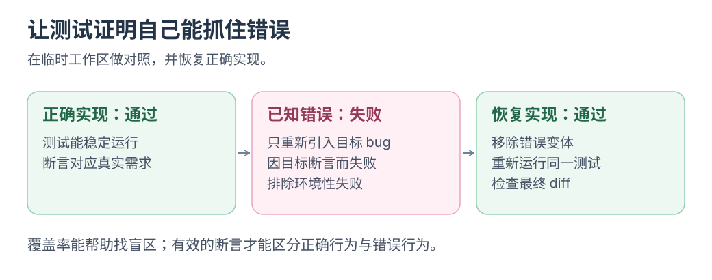

# TestGen-LLM：生成与验证测试

测试通过后，还需验证其能否检出已修复的错误。

**用执行结果筛选 AI 测试。** TestGen-LLM 增强已有人工测试，再查构建、稳定性和覆盖。

资料核对：2026-10-22；论文提交于 2024-02-14，发表于 FSE 2024。

<div class="heading-alias" id="meta-怎样筛掉无用候选" aria-hidden="true"></div>

## Meta 候选测试筛选

**部署论文：** Meta 在 Facebook／Instagram 使用；Reels、Stories 评估中，75% 候选可构建、57% 可靠通过、25% 增加覆盖；其他活动中 73% 推荐被工程师采纳。 [论文与摘要](https://arxiv.org/abs/2402.09171)

前三项分母为生成测试，73% 则为交给工程师的推荐；不能混比。

<div class="heading-alias" id="让候选测试过几道关" aria-hidden="true"></div>

## 候选测试验证流程

```text
已有测试与待覆盖行为 → AI 生成候选测试
                   → 构建 → 重复运行 → 检查新增覆盖 → 人检查断言
```

覆盖增加仍须核对断言。Meta 内部工具不在此复现，只借鉴筛选流程。

[](../../site/public/diagrams/ai-practices/test-red-green.svg)

<div class="heading-alias" id="小挑战亲眼看见它由绿变红" aria-hidden="true"></div>

## 验证练习：已知错误回归

选有明确风险的纯函数，如 URL 锚点保留；给预期和已有测试，让 AI 最多提三个有效断言候选。

先通过，再临时<mark class="key">引入目标错误确认失败</mark>，恢复后再通过；保留能抓目标错误的候选，删除重复或无效断言。

始终全绿就查断言约束；此实验只借鉴筛选原则。

**测试能在目标错误出现时失败。** 不为覆盖数字批量补低风险测试。

返回[实践目录](README.md)。
