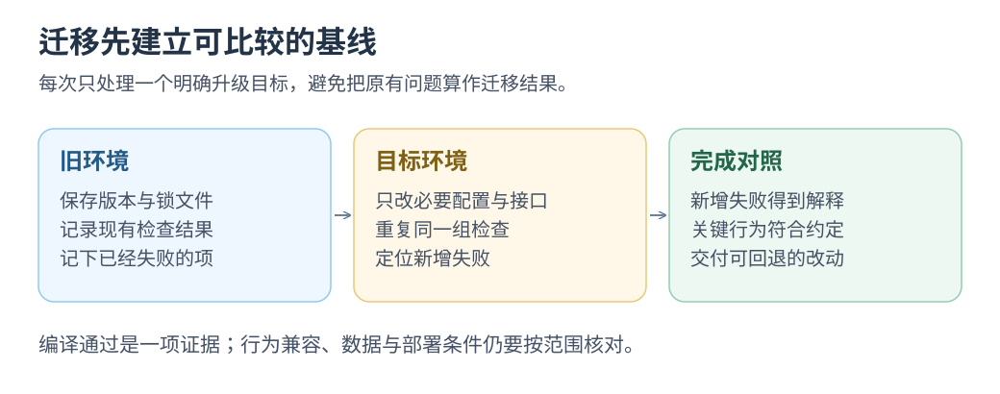

# 给升级划条线，再让 AI 动手：借鉴 Amazon Q

<mark class="key">固定目标版本</mark>与升级前检查结果，再让 AI 逐项处理迁移错误。

**按构建、测试反馈做迁移。** Amazon Q Java 转换会列计划、改代码、反复检查，交摘要与 diff。 [当前转换流程](https://docs.aws.amazon.com/amazonq/latest/qdeveloper-ug/how-CT-works.html)

资料核对：2026-10-22；以下生产迁移记录发布于 2024-08-01。

## Amazon 的生产迁移记录

**企业记录：** AWS 报告 Amazon 借 Q Developer 将数万生产应用从 Java 8／11 迁至 17。 [AWS 工程文章](https://aws.amazon.com/blogs/devops/amazon-q-developer-just-reached-a-260-million-dollar-milestone/)

节省工时与成本为企业估算，不用于预测个人收益。

## 把升级拆成一条能回查的路径

```text
固定目标版本 → 记录现有构建与测试基线 → 迁移计划
            → 修改代码与依赖 → 构建、测试、修正 → 人审查 diff
```

直接使用该工具需要符合支持条件的 Java/Maven 项目。[支持范围与前置条件](https://docs.aws.amazon.com/amazonq/latest/qdeveloper-ug/code-transformation.html)

本站可借鉴限定目标、保留基线、逐项修错；前端依赖升级效果仍需实测。

[](../../site/public/diagrams/ai-practices/migration-baseline.svg)

## 小挑战：带着同一张检查单完成一次升级

确需升级时，在独立分支记录版本与基线，给 AI 目标版本、官方迁移说明和必须保持的行为。

记录 `原有失败 / 新增失败 / 修复复查`，对比同组检查并操作受影响功能；改断言、配置或范围须说明依据。

**交回范围清楚、关联改动能解释的迁移 diff。**

返回[实践目录](README.md)。
