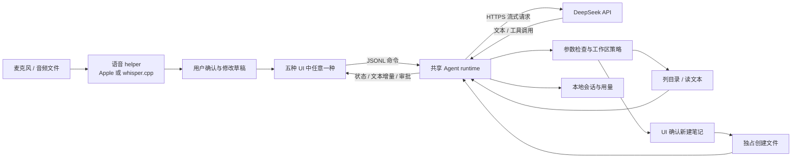

# MVP 的 AI 与语音基础：现在接 DeepSeek，稍后放入 Whisper

更新：2026-09-26。实现入口：[共享 Agent runtime](../../examples/shared/runtime/README.md) · [Apple / Whisper helper](../../examples/shared/native/README.md) · [五条 UI 路线](../../examples/README.md)。

本轮把此前的纯回放小样扩展为具有实际调用路径的小型 Agent 工作台。真实 API、模型文件和权限由用户准备；本轮没有产生 API 费用、下载模型或执行识别。代码与本机构建是交付证据，端到端行为仍待用户使用。

## 1. 功能怎样形成闭环



语音识别与大模型是两种独立能力：Whisper 将音频变成文字；DeepSeek 根据文字和工具结果完成任务。Whisper 模型不负责聊天，DeepSeek API 也不直接读取本例的录音文件。

## 2. 本次采用哪些框架

| 部分 | 当前实现 | 选择理由 | 可以继续探索的路线 |
|---|---|---|---|
| 模型 API | Swift Foundation `URLSession`，DeepSeek Chat Completions / SSE | 没有额外服务或 SDK；请求、取消、工具回传直接可读 | 在保留运行语义后接其他供应商适配器 |
| Agent Harness | 自己实现的有界 model/tool loop | 掌控上下文、工具权限、取消、用量与恢复 | 之后依据需求拆 Swift core 或写 Rust 对照 |
| 系统语音 | Apple Speech / AVFoundation | 保留可用的 Apple 集成路径 | 继续改善部分转写、输入法和权限体验 |
| 本地 Whisper | AVFoundation + `whisper.cpp` CLI | 你准备小模型后即可接；五条 UI 使用同一协议 | 常驻 worker / C API / Rust FFI，减少重复加载 |
| 凭据 | macOS Keychain | 密钥不进入聊天记录、设置 JSON 或 UI 事件 | 正式签名与稳定的权限归属 |
| 存储 | 原子 JSON + 每路线单写者锁 | 便于学习和检查，当前会话规模有界 | 稳定后转 SQLite 事务与迁移 |

DeepSeek 官方提供流式文本、工具 schema 与工具调用结构；本例自己负责参数校验、执行和把结果回传。默认 `deepseek-flash`、关闭 thinking，模型名与输出/轮数限制可配置。没有写死一张可能过期的价格表。[Chat Completions](https://api-docs.deepseek.com/api/create-chat-completion)、[工具调用](https://api-docs.deepseek.com/guides/tool_calls)、[Thinking 模式](https://api-docs.deepseek.com/guides/thinking_mode)

## 3. 你下载 Whisper 时需要准备什么

需要两样独立的东西：**本机可执行的 `whisper-cli`**，以及**与 whisper.cpp 兼容的模型文件**。只有下载模型权重还不能调用。中文选择多语言 small，例如 `ggml-small.bin`，不要选只支持英语的 `small.en`。不要把其他推理引擎的模型目录或文件格式直接填进去。[whisper.cpp 项目与用法](https://github.com/ggml-org/whisper.cpp)、[模型格式与下载说明](https://github.com/ggml-org/whisper.cpp/tree/master/models)

在任意示例的设置中填写：

```text
语音后端      whisper
Whisper CLI  /你的目录/whisper.cpp/build/bin/whisper-cli
Whisper 模型  /你的目录/whisper.cpp/models/ggml-small.bin
```

路径为占位示意，不代表这台机器已经安装；不写 `~` 或 shell 表达式。共享设置保存后，新启动的其他路线也可使用同一配置。

实时输入先录音，点击“停止并转写”后才推理；文件输入跳过录音。识别结果先出现在转写区，点击采用后进入草稿，发送才调用 DeepSeek。Whisper 文件模式不需要 Apple Speech 授权；麦克风模式需要录音权限。

当前录音最多 120 秒；音频文件最多 10 分钟 / 256 MiB。转换采用有界分块，输出 16 kHz mono PCM WAV；CLI 使用参数数组启动，生成文本文件供 helper 读取。明确取消、关闭 App 或宿主断开都会结束工作并清理可控临时文件。详细限制见 [语音 helper 文档](../../examples/shared/native/README.md)。

## 4. 这套 Whisper 接法的取舍

优点是学习路径短：你能直接看见录音、音频格式、模型文件、CLI、结果与取消各在哪里。Rust、Swift、React 三种客户端不必各写一套声学输入和模型绑定。

代价是每次调用都重新启动 CLI、加载模型，并经过临时文件；它还不是边说边出字的流式引擎。VAD、连续分段、说话人分离与模型常驻尚未实现。用户长时间使用后若加载成本明显，可以保持 UI 协议，替换 helper 内部的执行方式。

下一步最值得比较的是：短命 CLI 与常驻 worker、进程桥与 C/Swift/Rust FFI、Whisper 的不同模型大小。不要仅根据语言推断识别精度或 GPU 使用情况；这些还受模型、后端编译选项、音频与硬件影响。

## 5. 其他 Apple AI 框架的简短地图

| 框架 / 项目 | 适合解决的问题 | 与当前方案的关系 |
|---|---|---|
| whisper.cpp | 本地 Whisper 推理，可从 CLI 逐步深入 C/C++ 接口 | 本次实际接入的后端；CLI/模型由你准备 |
| WhisperKit（Argmax 开源 Swift SDK 内的产品） | Swift 中集成本地 Whisper 语音识别 | 可作为 Apple 平台内嵌版本对照；本次未安装或集成 |
| MLX Swift LM | Apple Silicon 上运行本地 LLM / VLM | 将来想离线聊天再研究；调用 DeepSeek API 不需要本地大语言模型 |
| GPUI / SwiftUI / React | 界面、状态与交互 | 它们本身不替你实现模型推理、工具权限和恢复 |

WhisperKit 的原仓库现重定向到 Argmax 的开源 Swift SDK，WhisperKit 仍作为语音识别产品存在；不要把新仓库全部功能或商业产品能力算进本例。[Argmax 开源 Swift SDK](https://github.com/argmaxinc/argmax-oss-swift)

MLX Swift LM 提供 LLM/VLM 相关实现，解决的是本地模型运行问题。它可以成为未来模型适配器的一端，但不会替代工作区工具策略、会话恢复与 UI 协议。[MLX Swift LM](https://github.com/ml-explore/mlx-swift-lm)

## 6. “五脏俱全”的本轮完成标准

五个方向都保留自己的真实渲染路径，同时接入相同的任务、会话、模型、工具、确认、取消、语音、设置和导出能力。原有固定回放和更新清单实验继续保留，避免真实网络速度掩盖 UI 差异。

它仍是本地 MVP：更新没有安装替换链，Runner 不常驻后台，不具备通用 shell、任意文件修改、多 Agent、移动端 UI 或跨设备同步。真实 API/Whisper 的成功率、延迟与系统权限还没有运行验收，不能用“构建成功”替代。

这次的共同 Swift runtime 也意味着：可以比较 Rust/GPUI 与其他 UI 的开发和集成成本，但还不能把它称为 Swift Harness 与 Rust Harness 的性能对照。后续替换运行时语言时，应复用同一协议与任务场景，单独记录差异。
