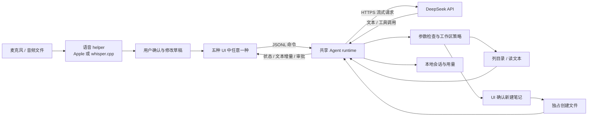
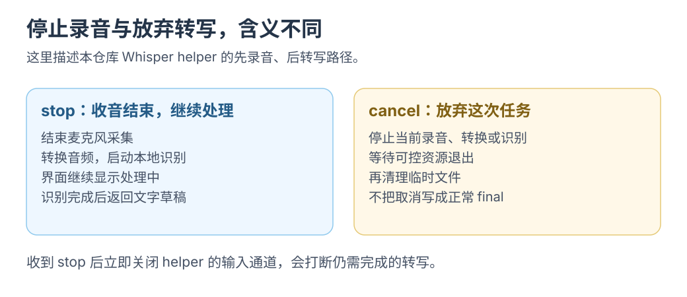

# MVP 的 AI 与语音基础：现在接 DeepSeek，稍后放入 Whisper

更新：2026-09-26。实现入口：[共享 Agent runtime](../../examples/shared/runtime/README.md) · [Apple / Whisper helper](../../examples/shared/native/README.md) · [五条 UI 路线](../../examples/README.md)。

回放小样已扩展为 Agent 工作台。API、模型文件与权限由用户准备；本轮仅交付代码和本机构建，<mark class="caution">未调用付费 API、下载模型或执行识别</mark>。

## 1. 功能怎样形成闭环



Whisper 将音频转成文字；DeepSeek 根据文字和工具结果完成任务，不直接读取本例录音。

## 2. 本次采用哪些框架

| 部分 | 当前实现 | 选择理由 | 可以继续探索的路线 |
|---|---|---|---|
| 模型 API | Swift Foundation `URLSession`，DeepSeek Chat Completions / SSE | 没有额外服务或 SDK；请求、取消、工具回传直接可读 | 在保留运行语义后接其他供应商适配器 |
| Agent Harness | 自己实现的有界 model/tool loop | 掌控上下文、工具权限、取消、用量与恢复 | 之后依据需求拆 Swift core 或写 Rust 对照 |
| 系统语音 | Apple Speech / AVFoundation | 保留可用的 Apple 集成路径 | 继续改善部分转写、输入法和权限体验 |
| 本地 Whisper | AVFoundation + `whisper.cpp` CLI | 你准备小模型后即可接；五条 UI 使用同一协议 | 常驻 worker / C API / Rust FFI，减少重复加载 |
| 凭据 | macOS Keychain | 密钥不进入聊天记录、设置 JSON 或 UI 事件 | 正式签名与稳定的权限归属 |
| 存储 | 原子 JSON + 每路线单写者锁 | 便于学习和检查，当前会话规模有界 | 稳定后转 SQLite 事务与迁移 |

DeepSeek 提供流式文本与工具调用结构，本例负责校验、执行和回传。默认 `deepseek-flash`、关闭 thinking；模型与输出/轮数限制可配置，价格以官方为准。[Chat Completions](https://api-docs.deepseek.com/api/create-chat-completion)、[工具调用](https://api-docs.deepseek.com/guides/tool_calls)、[Thinking 模式](https://api-docs.deepseek.com/guides/thinking_mode)

## 3. 你下载 Whisper 时需要准备什么

准备<mark class="key">本机 `whisper-cli` 与兼容模型文件</mark>。中文可选多语言 `ggml-small.bin`，不要选英语专用 `small.en` 或其他引擎格式。[whisper.cpp 用法](https://github.com/ggml-org/whisper.cpp)、[模型格式与下载](https://github.com/ggml-org/whisper.cpp/tree/master/models)

在任意示例的设置中填写：

```text
语音后端      whisper
Whisper CLI  /你的目录/whisper.cpp/build/bin/whisper-cli
Whisper 模型  /你的目录/whisper.cpp/models/ggml-small.bin
```

填写实际绝对路径，不用 `~` 或 shell 表达式。保存后，新启动的其他路线共用此配置。

录音后点“停止并转写”；文件输入直接转写。采用结果后进入草稿，发送才调用 DeepSeek。文件模式无需 Apple Speech 授权，麦克风模式需录音权限。

录音上限 120 秒，文件上限 10 分钟 / 256 MiB；分块转为 16 kHz mono PCM WAV，以参数数组启动 CLI、读取文本结果。取消、关闭 App 或宿主断开会结束工作并清理可控临时文件。见[语音 helper 限制](../../examples/shared/native/README.md)。

[](../../site/public/diagrams/tts/stop-cancel.svg)

读 `WhisperSession` 时区分 `stop` 与 `cancel`，检查转写中的忙碌和取消状态。图示仅辅助读源码，未验收真实录音。

## 4. 这套 Whisper 接法的取舍

CLI 路径便于追踪录音、格式、模型、结果和取消；Rust、Swift、React 共用语音接入。

代价是每次启动 CLI、加载模型并经过临时文件，尚无流式识别、VAD、连续分段、说话人分离或模型常驻。加载成本明显时，可保留 UI 协议替换 helper。

下一步比较 CLI/常驻 worker、进程桥/FFI 与模型大小。精度和 GPU 使用取决于模型、编译选项、音频及硬件，不能只看语言。

## 5. 其他 Apple AI 框架的简短地图

| 框架 / 项目 | 适合解决的问题 | 与当前方案的关系 |
|---|---|---|
| whisper.cpp | 本地 Whisper 推理，可从 CLI 逐步深入 C/C++ 接口 | 本次实际接入的后端；CLI/模型由你准备 |
| WhisperKit（Argmax 开源 Swift SDK 内的产品） | Swift 中集成本地 Whisper 语音识别 | 可作为 Apple 平台内嵌版本对照；本次未安装或集成 |
| MLX Swift LM | Apple Silicon 上运行本地 LLM / VLM | 将来想离线聊天再研究；调用 DeepSeek API 不需要本地大语言模型 |
| GPUI / SwiftUI / React | 界面、状态与交互 | 它们本身不替你实现模型推理、工具权限和恢复 |

WhisperKit 原仓库已重定向到 Argmax 开源 Swift SDK；其他组件或商业能力不属于本例。[Argmax 开源 Swift SDK](https://github.com/argmaxinc/argmax-oss-swift)

MLX Swift LM 可作未来本地模型适配器，不替代工具策略、会话恢复或 UI 协议。[MLX Swift LM](https://github.com/ml-explore/mlx-swift-lm)

## 6. “五脏俱全”的本轮完成标准

五条路线保留各自渲染路径，共用任务、会话、模型、工具、确认、取消、语音、设置和导出。固定回放与更新清单实验继续保留，便于排除网络波动。

MVP 尚无更新安装链、常驻 Runner、通用 shell、任意文件修改、多 Agent、移动端 UI 或跨设备同步。<mark class="caution">构建成功不等于端到端验收</mark>：真实 API/Whisper 的成功率、延迟与权限仍待验证。

共用 Swift runtime 可比较 UI 开发与集成成本，不能比较 Swift/Rust Harness 性能。替换运行时语言时，应复用协议和任务场景再测量。
