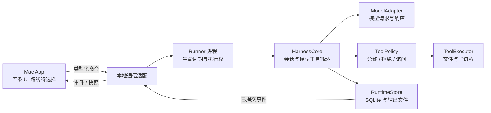

# Mac 本地 Agent Harness：架构提案

更新日期：2026-09-26。状态：完整 Harness 的设计提案；最新示例已加入共享 Swift runtime、DeepSeek 流、固定工具循环、审批、取消与 JSON 会话存储，真实网络/工具行为尚未运行验收。

当前最小实现和本文完整提案的差别见 [AI 与语音基础](ai-and-speech-foundation.md) 与 [runtime README](../../examples/shared/runtime/README.md)：没有 SQLite、常驻 Runner、通用 shell 或多设备能力，关闭 App 会取消子进程工作。

本文把一个可独立掌控的 Agent runtime 收敛到第一个 Mac 本地闭环，并解释未来扩展需要保留的边界。
开始本次文档工作时，当前目录没有应用源码、Swift package 或已有实现；文中类型、协议、路径和状态均为提案。
Swift、SwiftUI/AppKit、独立 Runner 与 SQLite 是基于当前目标的建议，不是用户已经确认的选型。用户随后确认五条技术路线并行实验，Rust/GPUI 可以直接开始；见 [examples](../../examples/README.md)。本篇使用 Swift 说明候选方案，状态、取消、持久化和进程边界也适用于 Rust 实现。

阅读入口：[文档导航](../README.md) · [产品实现调研](../research/zed-raycast-warp.md) · [渲染性能学习](../learning/rendering-performance.md) · [第一阶段计划](../plan/first-mac-loop.md)。

## 1. 已确认目标与当前范围

- 面向自己的 Apple 生态，长期涉及 Mac Mini、MacBook Air、iPad 和 iPhone。
- 追求交互流畅、低开销与简单结构，并希望理解 Zed、Raycast 为什么流畅。
- 第一版自行实现模型调用、工具循环与运行状态，掌控完整 Agent runtime。
- 当前先把一台 Mac 的本地闭环做好，多设备连接在后续验证。
- 产品首先是 Agent 工作台，不以完整编辑器、终端模拟器或插件市场为第一阶段目标。

第一版应能接收任务、调用一个模型、执行少量工具、呈现进度、取消任务，并在重启后解释上次发生了什么。
“恢复”首先意味着恢复可信的历史和状态；它不承诺自动重放所有中断动作。
界面流畅与任务可靠性分别验收：前者关注主线程、更新范围和输出量，后者关注执行边界与持久化。

## 2. 从已有实现提炼的依据

Zed 的 `Thread` 持有消息、模型、工具和跨多次模型请求的 `running_turn`；`ThreadEvent` 区分工具、授权、重试和停止等事件。
这些是可查证的实现事实，见 [Zed Thread 源码](https://github.com/zed-industries/zed/blob/main/crates/agent/src/thread.rs)。
其 `Session` 区分内部 Thread 与协议对应对象，并以后台快照保存合并突发写入，见 [Zed Agent 源码](https://github.com/zed-industries/zed/blob/main/crates/agent/src/agent.rs)。
Zed 仍在这些模块中使用 GPUI；不能将它描述为已经完全脱离 UI 框架的通用 headless runtime。

本文据此建议把自己的运行循环与表现层分离，用结构化事件向 UI 提供信息，而不复制 Zed 的全部模块。
GPUI 的文本缓存和专用绘制路径值得直接学习。本项目已有 GPUI 小样；最终是否采用它，需要结合开发体验与实际性能决定，学习本身无需等待其他框架出现瓶颈。
官方对渲染实现及帧时序问题的说明见 [GPUI 渲染](https://zed.dev/blog/videogame) 与 [Metal 优化](https://zed.dev/blog/120fps)。

## 3. 建议的模块与进程边界



这是目标分工图，不表示这些 target 或进程已经存在。
若选择 Swift 核心，可用一个 Swift package 管理，再由 Mac App 和 Runner target 消费；若选择 Rust，可用相应 crate 边界组织。不要让跨语言 UI 的选择反过来要求模型循环拥有视图对象。
开发顺序遵循[第一阶段计划](../plan/first-mac-loop.md)：先用同进程模拟事件驱动 UI，再加入可单独由命令行测试的核心，最后在 M4 验证独立 Runner 的通信和退出语义。

| 模块提案 | 负责 | 不应知道 |
| --- | --- | --- |
| `HarnessCore` | Run 状态、模型工具循环、取消、事件语义 | 窗口、视图树、AppKit/SwiftUI |
| `ModelAdapter` | 供应商请求、流解析、能力、原生数据 | UI 控件、工具实际执行方式 |
| `ToolExecutor` | 结构化参数、文件操作、受管理子进程 | 模型提示词、滚动位置 |
| `RuntimeStore` | 事务、事件游标、历史、输出索引 | 动画与展示节流 |
| `Runner` | 装配上述模块、唯一执行者、IPC、恢复 | 具体页面布局 |
| `MacApp` | 输入、任务列表、工具卡、审批、产物浏览 | 直接修改运行数据库或启动工具 |

“纯 Swift core”指不用 SwiftUI/AppKit 等 UI 框架；可以使用 Foundation 与 Swift Concurrency。
核心不标为 `@MainActor`；UI 在边界处接收不可变、可跨并发域传递的数据。
用少量 actor 或串行队列保护状态即可，不为每种消息制造新的 actor。
协议和领域类型先同模块组织；只有依赖关系实际需要时才拆更多 package。
进程隔离能避免 Runner 崩溃直接带走 UI，但进程存在本身不提供文件或网络沙箱。

## 4. Runner 生命周期：第一版必须说清楚

第一完整本地闭环的提案选择由 App 启动 Runner 子进程，不注册常驻服务；M0 的 UI 实验可以先使用同进程模拟器。
Foundation 提供 [Process](https://developer.apple.com/documentation/foundation/process) 作为子进程管理入口；进程树与故障语义仍须由实现验证。
Runner 生命周期不能仅依赖“它是 App 的子进程”这一关系，应显式管理控制通道、退出请求和存活检查。
控制通道句柄不得泄漏给工具子进程；否则 App 退出后 EOF 可能迟迟不到，破坏退出约定。

| 用户动作或故障 | v0 提案语义 |
| --- | --- |
| 关闭主窗口 | App 与 Runner 继续存在；可重新打开窗口查看 |
| 显式退出 App | 停止接收新任务，取消活动 Run，等待有限时间清理并落盘，然后退出 |
| App 崩溃 | Runner 发现控制通道 EOF 后取消、清理、记录状态并退出 |
| Runner 崩溃 | UI 停止显示“正在执行”，重启 Runner 后读取持久化记录进行恢复判定 |
| Mac 睡眠 | 不承诺睡眠期间推进；唤醒后重新核实网络请求和子进程状态 |
| Mac 重启或断电 | 重开 App 扫描未终结 Run，区分可安全恢复与结果未知 |

退出确认若需要，应展示当前任务以及“退出将停止任务”的实际行为；这属于产品设计，不是现在要求用户审批文档。
若清理超时，记录已知信息并在下次启动标为 `interrupted`，不能为了顺利退出伪造 `cancelled` 或成功。
即使 App 已崩溃，Runner 也可能短暂存活并完成清理；这与承诺长期后台执行是两回事。

当需求明确变成“退出 App 后继续工作”时，再评估由系统管理的长期 helper。
Apple 的 [SMAppService](https://developer.apple.com/documentation/servicemanagement/smappservice) 可管理 macOS 13+ 的 LoginItems、LaunchAgents 和 LaunchDaemons，注册与授权状态必须处理。
它负责服务生命周期，不是 IPC 协议；通信仍需独立选择本地 socket、XPC 或其他机制。
这个阶段还要新增版本兼容、升级交接、多个 UI 连接和服务停用语义，不能仅把 `Process` 换成一个 API。

## 5. 最少五种领域对象

| 对象 | 语义 | 关键字段提案 |
| --- | --- | --- |
| Session | 一组连续上下文与历史 | id、标题、workspace、创建时间 |
| Run | 一次已接受的用户任务及其模型工具循环 | id、sessionId、commandId、状态、模型引用 |
| ToolCall | 一次有明确输入和结果的工具动作 | id、runId、工具名、输入、状态、attempt |
| Event | 已发生事实的有序记录 | seq、类型、runId、toolCallId、时间、payload |
| Artifact | 可独立打开或检查的输出引用 | id、runId、类型、路径、摘要、完整性信息 |

Session 不是另一个调度器，第一版不增加一套与 Run 重复的执行状态。
Run 可跨多次模型请求；一次 HTTP 请求不等于一次 Run。
ToolCall 失败不自动意味着 Run 失败：模型可以收到错误结果后决定修正或结束。
Artifact 与终端输出块不同；文件、diff、报告可以成为产物，普通日志只保存引用。
一条事件是否给模型看、是否给 UI 看、是否需要永久保存，分别由明确策略决定。
模型供应商的 tool-call ID 另外保存，不把它作为系统全局唯一 ID。

## 6. Run 与 ToolCall 的状态

```text
Run:
  queued -> running <-> waiting_for_approval
  queued -> cancelled
  running / waiting_for_approval -> cancelling -> cancelled
  running -> succeeded | failed
  运行中断且无法完整确认 -> interrupted

ToolCall:
  proposed -> waiting_for_approval -> ready -> running
  proposed -> ready                    （策略直接允许）
  proposed / waiting_for_approval -> failed （参数无效或策略拒绝）
  running -> succeeded | failed | cancelled | unknown
  proposed / waiting_for_approval / ready -> cancelled
```

拒绝审批以工具失败结果 `permission_denied` 结束该调用，模型仍可给出无需该工具的回答。
`ready` 表示输入已验证、策略允许、执行 intent 已持久化；它还不代表副作用发生。
`running` 表示已尝试开始执行；崩溃后仅凭这个状态无法知道完成与否。
`unknown` 表示结果或副作用无法确认；相关 Run 转为 `interrupted` 并等待对账或用户选择。
`cancelled` 表示执行已停止或未开始，不表示已经产生的文件修改、请求或其他副作用被撤销。
终态记录原则上不可改写；补充结果以新的事实事件表达，并保留原中断信息。

第一版每个 Session 同时最多一个活动 Run，全应用默认也只运行一个任务。
显式继续中断任务创建新 Run，并引用旧 Run；先对账旧工具，不能把历史直接当执行脚本重放。
用户新消息如何排队、打断或纠偏应有明确操作；初版可只支持当前任务完成后再提交。

## 7. 最小模型工具循环

1. 接受带 `commandId` 的任务，验证 workspace 与模型配置。
2. 在事务中创建 Run、保存用户输入、追加接受事件，再回应客户端。
3. 组装上下文与本次允许提供的工具 schema，发起模型请求。
4. 解析流式文本和工具参数；未完整验证的参数只可展示，不可执行副作用。
5. 对完整工具输入执行策略判定；需要审批则持久化请求并暂停对应调用。
6. 保存执行 intent，调用 executor，持续收集有界输出与进程状态。
7. 保存工具结果和事件，再把结构化结果回传模型。
8. 按模型结束原因、取消信号或预算结束 Run，保存最终状态。

先支持一个模型供应商和少量原生工具，例如读取文件、列目录、受管理命令执行。
文件写入可以单独加入，要求预期文件版本或内容摘要，避免静默覆盖已变化内容。
工具默认顺序执行，保持简单的权限、结果顺序与资源竞争语义。
只有测量显示等待独立读取是瓶颈，且工具明确声明无副作用与独立性时，才加入有限读并发。
模型同时提出多个调用不等于这些调用可以安全并行；read 工具名称本身也不能证明实现没有副作用。

### 7.1 上下文如何保持有界

第一轮显式区分完整会话记录与本次送给模型的上下文。历史可以完整保存，但不能每轮无界发送。
先保留当前任务、必要约束和最近的完整交互单元；工具请求与对应结果必须成对保留，大输出通过有界摘要和产物引用进入上下文。
为模型输出与工具结构预留空间；字符数、字节数不能冒充供应商精确 token 用量，无法精确计数时记录估计口径并留余量。
接近预算时先按明确规则裁剪可重建日志，再考虑生成摘要。摘要标记覆盖范围，保留原始记录，不能把摘要当作无损压缩。
供应商要求保留的原生数据按该供应商的规则处理；取消、待解决审批和未知工具结果不能因为压缩历史而消失。
若无法构造合法且足够完整的上下文，应停止并显示原因；不自动陷入“上下文超限、原样重试”的循环。

## 8. 模型适配层保持必要差异

模型接口统一文本增量、工具请求、结束原因、usage 与错误类别，不抹平供应商独有字段。
供应商要求后续回传的签名、opaque blocks、continuation ID 等，应原样保存并按该供应商规则回传。
对未知字段采用可保留的带版本 envelope；不得把不理解的字段重新生成成看似等价文本。
切换模型前检查上下文可迁移性，不能默认所有原生历史都兼容。

能力信息建议包括 tool calling、流式参数、图像、上下文限制和可用的取消/续传方式。
工具 schema 根据真实能力生成；不支持的能力在请求前报出可理解错误。
HTTP 超时、限流、模型拒绝、上下文过长、工具错误各有独立分类。
重试只针对可判断的请求阶段和有上限的错误；取消本地网络任务不证明远端生成或计费已停止。
预算先设置运行时长、模型轮数与工具输出量；更细的 token/费用预算待 usage 行为验证后加入。

## 9. 本地命令与事件协议提案

以下 JSON 仅说明推荐语义，不是当前仓库已有 API，也不是 ACP 的规范。
v0 可以用 stdio 上的有大小限制的 JSON Lines；Runner 的 stdout 专用于协议，诊断写 stderr。
传输适配层负责分帧、消息长度上限、协议版本检查与错误响应。

```jsonl
{"v":1,"commandId":"cmd-42","type":"run.submit","sessionId":"s-1","input":{"text":"检查这个目录"}}
{"v":1,"commandId":"cmd-42","type":"command.accepted","runId":"r-7"}
{"v":1,"seq":101,"type":"run.started","runId":"r-7","payload":{}}
{"v":1,"seq":102,"type":"tool.proposed","runId":"r-7","toolCallId":"t-1","payload":{"name":"list_directory"}}
{"v":1,"commandId":"cmd-43","type":"run.cancel","runId":"r-7"}
```

同一 `commandId` 加相同输入重复提交，返回已存在的 Run；同 ID 不同输入必须报冲突。
接受响应只表示任务与输入已落盘，不表示模型请求或工具已执行。
审批响应引用确定的 `toolCallId`、审批请求 ID 与输入摘要；过期或输入变化的响应不能套用。
事件 `seq` 由单一 Store 分配，保证排序与不重用；客户端不能假设连续无缺口。
订阅可携带 `afterSeq`，服务端先给一致快照及游标，再补后续事件，处理边界去重。
持久化事件才带可恢复游标；临时 token 预览可以单独传输，不能伪装成已经可靠保存的历史。

## 10. SQLite、输出文件与密钥

建议 Runner 作为运行数据库唯一写入者；UI 通过查询命令和事件获得投影。
Session、Run、ToolCall、Event、Artifact 与命令去重记录保存在同一本地 SQLite 数据库。
同一次状态变更与对应事件在同一事务提交，提交后才向 UI 宣布该事实。
[SQLite 原子提交](https://sqlite.org/atomiccommit.html) 保证的是数据库事务边界，不能把远端 API 或文件副作用也包含进来。

WAL 是待基准验证的起点；它允许读写并行，但仍需管理单写者、检查点和事务长度。
数据库留在本机 Application Support 目录，不放进网络盘或跨设备共享目录；见 [SQLite WAL 约束](https://sqlite.org/wal.html)。
持久性设置必须明确；不能关闭同步换取漂亮数字，再宣称断电不丢已确认事件。
迁移先备份、再事务化执行并验证 schema 版本；备份使用支持一致快照的方法，不只复制活动 `.db` 文件。

原始模型/工具大输出保存在受限文件中，SQLite 只保存摘要、字节数、截断标记与引用。
对每次工具调用设置字节上限、滚动保留和总磁盘配额；达到限制仍持续 drain 管道，避免工具被堵死。
模型看到的工具结果另做有界摘要；“UI 展示截断”与“模型输入截断”分别记录。
文件写入与数据库不是一笔原子事务：先临时文件写完并确认，再发布引用，启动时清理或对账孤立文件。
用户要求的产物不能默默被日志清理策略删除；明确区分缓存、可重建日志与用户产物。

API key 建议保存于 [Keychain services](https://developer.apple.com/documentation/security/keychain-services)，数据库只存凭据引用。
App/Runner 的签名、Keychain 访问权限和发布方式需要实测，不假设两个可执行文件天然共享访问。
避免把密钥放进命令行参数、原始日志或完整环境变量快照；工具默认只获得必要环境。

## 11. 副作用、未知结果与幂等

调用前记录 intent：工具 ID、规范化输入、审批结果、工作目录、预期文件版本、幂等键及 attempt。
这让恢复时知道“准备做什么”，但 intent 与外部副作用之间总有崩溃窗口。
“intent 已保存、请求已发出、结果未保存”时，不知道动作是否完成，必须显式记为 `unknown`。
禁止把 SQLite 事务、命令去重或事件序号描述为整个 Agent 工作流的 exactly-once 保证。

| 动作类型 | 恢复策略提案 |
| --- | --- |
| 纯读取 | 可在说明重试事实后重新读取；结果可能随时间变化 |
| 原子替换本地文件 | 比较目标摘要与 intent 的前后版本，确认完成、未执行或发生冲突 |
| 支持幂等键的外部 API | 使用同一键查询或重试，遵守服务实际幂等范围和时效 |
| 任意 shell 命令 | 默认不能重放；检查输出、产物、进程与外部状态后决定 |
| 不支持查询的外部写入 | 保留未知状态，由用户判断，不能自动再次写入 |

模型请求失败也可能已经被远端接受，usage 未返回时记录未知，不捏造精确成本。
对账是一种显式恢复操作，产生新的事件；历史记录不能被整理成“看起来从未失败”。

## 12. 取消、超时、进程树与背压

取消首先持久化期望状态 `cancelling`，停止调度新工具，再向模型请求与当前 executor 传递取消。
重复取消命令幂等；取消后到达的旧模型增量不能启动新的工具。
已经执行的动作可能完成得比取消快，必须保存真实结果与顺序，不能把成功响应直接丢弃。

每个命令执行分配受管理的进程组，关闭 stdin，先请求正常结束，宽限期后再升级终止。
单独 `Process.terminate()` 不应被当作整个后代进程树已经消失的证明。
验收应包含 shell 生成子进程、忽略信号、持续写 stdout/stderr 和脱离父进程等情形。
任意命令可主动脱离管理边界时，应记录限制；进程组不等于 OS 沙箱或完整 containment。
独立设置模型等待、单工具和总 Run 超时；超时终止后同样需要确认副作用是否可知。

Runner 持续读管道，输出写入有界缓冲/文件；IPC 慢消费者不能造成无限内存队列。
文本预览可合并刷新，状态与审批事件不可静默丢弃；落后 UI 可请求快照和游标补齐。
工具高输出时继续允许取消命令进入；控制消息与数据输出不能互相饿死。
UI 只更新变化的行，按固定时间片合并文本展示；完整 Markdown 解析不随每个 token 从头执行。

## 13. 调用策略与 OS 沙箱是不同边界

调用策略回答“当前用户、workspace、工具与参数是否允许开始这个动作”。
OS 沙箱回答“动作开始后，即使脚本偏离预期，它实际能访问什么”。
Zed 官方也作此区分，并说明其 Agent sandbox 并不覆盖整个应用或所有扩展，见 [Sandboxing](https://zed.dev/docs/ai/sandboxing)。

v0 可从明确授权目录与有限工具开始，记录每个 executor 实际有哪些权限。
如果第一闭环的任意命令仍以当前用户权限运行，界面与文档应直接说明“尚无 OS 执行沙箱”。
不能因工具在独立 Runner、用了参数校验或弹出审批，就标称已沙箱化。
后续实现真实限制时，要对文件路径、符号链接、网络、IPC 与继承权限作验证。
文件访问范围必须检查规范路径与实际目标；单纯判断字符串以 workspace 前缀开头不充分。
从 Zed 学习分层即可；macOS 沙箱机制与发布约束须按最终方案重新核查，不直接复制内部配置。

## 14. 故障矩阵与第一闭环验收

| 注入故障 | 应保留的信息 | 预期恢复行为 |
| --- | --- | --- |
| 提交后响应丢失 | commandId 与 Run 映射 | 重发返回同 Run，不重复开始 |
| 模型流中断 | 已保存消息、请求阶段、usage 已知部分 | 显式失败或有界重试，不启动半截工具 |
| 等待审批时退出 | 完整审批请求和输入摘要 | 重开后可查看；不视为默认同意 |
| intent 保存后崩溃 | 输入、attempt 与未确认结果 | 对账；无法确认则 unknown |
| 工具完成后提交结果失败 | intent、可检查的输出/产物 | 不自动重跑副作用 |
| 磁盘满或数据库提交失败 | 最后已提交游标与错误 | 停止新增副作用，展示持久化故障 |
| UI 处理缓慢 | Runner 的持久事件与输出上限 | 内存有界，可快照恢复显示 |
| 取消遇到子进程 | 进程组、终止阶段、清理结果 | 有限时间返回可解释状态 |
| 进程强杀或重启 | 非终态 Run 与 intent | 标记 interrupted，逐个确认工具 |

第一完整闭环至少手工与自动化覆盖上述关键崩溃窗口，并测试一条真正的模型→工具→模型路径。
循环单元测试用可控 fake model/executor，不依赖付费模型每次给出相同工具选择。
性能基准单独使用长历史和持续输出；稳定完成任务不代表滚动和输入延迟已经合格。
具体构建步骤与阶段检查点见 [第一阶段计划](../plan/first-mac-loop.md)。

## 15. 未来边界与重新评估条件

多设备阶段仍以单一执行主机拥有 Run：其他设备发送命令、订阅事件、提交审批。
增加设备配对、认证、加密通道、授权撤销和游标续传；网络重发复用命令去重语义。
断线期间执行是否继续、审批超时怎么办由 Runner 明确定义，不由某个窗口是否在线隐式决定。
这不需要分布式数据库或 CRDT；只有出现真正的并发离线文本合并需求才重新评估 CRDT。

MCP 后续作为工具适配器接入同一 Policy/Executor/结果模型，不接管核心 Run 生命周期。
ACP 后续作为外部客户端或外部 Agent 的兼容适配，保持自己的运行时状态与协议演进分离。
协议接入不能自动继承本地工具的可信假设；能力发现、认证和真实权限另行处理。
Zed 的自有 Agent 与外部 Agent 共用 UI 路径可作参考，见 [ACP 引入说明](https://zed.dev/blog/bring-your-own-agent-to-zed)。

| 当前提案 | 重新评估触发条件 |
| --- | --- |
| Swift 核心与原生 UI | 性能测量证明热点需其他实现，或复用库明显降低总复杂度 |
| App 启动 Runner | 明确需要 App 退出、无人登录或长期后台运行 |
| 顺序工具与单活动任务 | 真实任务受独立 I/O 等待限制，且资源冲突语义已清楚 |
| 本机 SQLite 与输出文件 | 实际规模超过单机目标；不是因为未来“也许”需要云 |
| 少量内置工具 | 多个真实第三方工具需求重复出现，再设计扩展契约 |
| SwiftUI 默认控件 | 测得布局/文本更新瓶颈，先局部 AppKit，再考虑更低层绘制 |

起步只需让核心以一条可解释、可取消、可恢复的路径完成工作；每次扩展都应对应可观察的问题。
