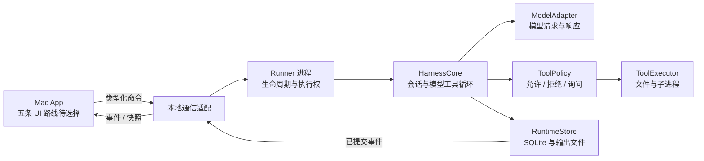

# Mac 本地 Agent Harness：架构提案

更新：2026-09-26。本文是完整 Harness 的<mark class="caution">设计提案</mark>。最新示例已有 Swift runtime、DeepSeek 流、固定工具循环、审批、取消和 JSON 存储，真实网络/工具行为未验收。

当前实现见 [AI 与语音基础](ai-and-speech-foundation.md) 与 [runtime README](../../examples/shared/runtime/README.md)：尚无 SQLite、常驻 Runner、通用 shell 或多设备能力；关闭 App 会取消子进程工作。

提案写于样例建立前，类型、协议和状态不代表已实现能力。Swift、SwiftUI/AppKit、Runner 与 SQLite 是候选方案；随后确认的是五路线并行实验，Rust/GPUI 也可直接开始，见 [examples](../../examples/README.md)。状态、取消、持久化与进程边界同样适用于 Rust。

阅读入口：[文档导航](../README.md) · [产品实现调研](../research/zed-raycast-warp.md) · [渲染性能学习](../learning/rendering-performance.md) · [第一阶段计划](../plan/first-mac-loop.md) · [Agent 工程实践](../agent-engineering/README.md)。

阅读重点：状态归属、调用授权与中断记录；主线为“模型 → 校验与执行 → 结果回传”。

## 1. 已确认目标与当前范围

- 面向 Mac Mini、MacBook Air、iPad 与 iPhone。
- 追求流畅、低开销和简单结构，理解 Zed、Raycast 的实现。
- 自行实现模型调用、工具循环与运行状态。
- 先做单台 Mac 闭环，后验多设备。
- 首版是 Agent 工作台，不扩展完整编辑器、终端或插件市场。

首版需接单、调用模型和少量工具、显示进度、取消，并在重启后解释历史；恢复不承诺重放中断动作。
流畅性检查主线程、更新范围和输出量；可靠性检查执行边界与持久化，分别验收。

## 2. 从已有实现提炼的依据

Zed `Thread` 持有消息、模型、工具与跨请求的 `running_turn`；`ThreadEvent` 区分工具、授权、重试和停止。见 [Thread 源码](https://github.com/zed-industries/zed/blob/main/crates/agent/src/thread.rs)。
`Session` 区分内部 Thread 与协议对象，以后台快照合并突发写入，见 [Agent 源码](https://github.com/zed-industries/zed/blob/main/crates/agent/src/agent.rs)。这些模块仍依赖 GPUI，并非通用 headless runtime。

本方案分离运行循环与表现层，用结构化事件通知 UI。已有 GPUI 小样可直接学习文本缓存与绘制，选型再看开发体验和性能。[GPUI 渲染](https://zed.dev/blog/videogame)、[Metal 优化](https://zed.dev/blog/120fps)。

## 3. 建议的模块与进程边界



图示是目标分工。Swift 可用共享 package、Rust 可按 crate 组织，模型循环不持有视图对象。
按[第一阶段计划](../plan/first-mac-loop.md)，先同进程模拟 UI，再做可独立命令行测试的核心，最后在 M4 验证 Runner 通信与退出。

| 模块提案 | 负责 | 不应知道 |
| --- | --- | --- |
| `HarnessCore` | Run 状态、模型工具循环、取消、事件语义 | 窗口、视图树、AppKit/SwiftUI |
| `ModelAdapter` | 供应商请求、流解析、能力、原生数据 | UI 控件、工具实际执行方式 |
| `ToolExecutor` | 结构化参数、文件操作、受管理子进程 | 模型提示词、滚动位置 |
| `RuntimeStore` | 事务、事件游标、历史、输出索引 | 动画与展示节流 |
| `Runner` | 装配上述模块、唯一执行者、IPC、恢复 | 具体页面布局 |
| `MacApp` | 输入、任务列表、工具卡、审批、产物浏览 | 直接修改运行数据库或启动工具 |

核心可用 Foundation/Swift Concurrency，不依赖 UI 框架或 `@MainActor`；UI 接收不可变、可跨并发域的数据。
少量 actor/串行队列保护状态，协议与领域类型先同模块；依赖确有需要再拆 package。
进程隔离提供崩溃边界，本身不提供文件或网络沙箱。

<div class="heading-alias" id="4-runner-生命周期第一版必须说清楚" aria-hidden="true"></div>

## 4. Runner 生命周期与退出语义

完整闭环先由 App 启动 Runner，不注册常驻服务；M0 先用同进程模拟器。
通过 [Process](https://developer.apple.com/documentation/foundation/process) 管理子进程，显式处理控制通道、退出与存活检查。控制句柄不可泄漏给工具子进程，否则 App 退出后可能收不到 EOF；进程树行为仍需验证。

| 用户动作或故障 | v0 提案语义 |
| --- | --- |
| 关闭主窗口 | App 与 Runner 继续存在；可重新打开窗口查看 |
| 显式退出 App | 停止接收新任务，取消活动 Run，等待有限时间清理并落盘，然后退出 |
| App 崩溃 | Runner 发现控制通道 EOF 后取消、清理、记录状态并退出 |
| Runner 崩溃 | UI 停止显示“正在执行”，重启 Runner 后读取持久化记录进行恢复判定 |
| Mac 睡眠 | 不承诺睡眠期间推进；唤醒后重新核实网络请求和子进程状态 |
| Mac 重启或断电 | 重开 App 扫描未终结 Run，区分可安全恢复与结果未知 |

退出确认应说明受影响任务。清理超时则记录已知信息，下次标为 `interrupted`，不伪造取消或成功。App 崩溃后 Runner 可短暂清理，不承诺长期后台运行。

需要退出后继续工作时，再评估长期 helper。[SMAppService](https://developer.apple.com/documentation/servicemanagement/smappservice) 管理 macOS 13+ LoginItems、LaunchAgents、LaunchDaemons，需处理注册与授权；IPC 另选 socket、XPC 等。还须补版本兼容、升级交接、多 UI 连接与停用语义。

## 5. 最少五种领域对象

| 对象 | 语义 | 关键字段提案 |
| --- | --- | --- |
| Session | 一组连续上下文与历史 | id、标题、workspace、创建时间 |
| Run | 一次已接受的用户任务及其模型工具循环 | id、sessionId、commandId、状态、模型引用 |
| ToolCall | 一次有明确输入和结果的工具动作 | id、runId、工具名、输入、状态、attempt |
| Event | 已发生事实的有序记录 | seq、类型、runId、toolCallId、时间、payload |
| Artifact | 可独立打开或检查的输出引用 | id、runId、类型、路径、摘要、完整性信息 |

Session 不重复维护 Run 执行状态；Run 可跨多次模型请求。ToolCall 失败后，模型仍可修正或结束。
文件、diff、报告可作 Artifact，普通日志仅存引用。事件对模型/UI 的可见性与持久化分别设策略；供应商 tool-call ID 另存，不作全局 ID。

## 6. Run 与 ToolCall 的状态

```text
Run:
  queued -> running <-> waiting_for_approval
  queued -> cancelled
  running / waiting_for_approval -> cancelling -> cancelled
  running -> succeeded | failed
  运行中断且无法完整确认 -> interrupted

ToolCall:
  proposed -> waiting_for_approval -> ready -> running
  proposed -> ready                    （策略直接允许）
  proposed / waiting_for_approval -> failed （参数无效或策略拒绝）
  running -> succeeded | failed | cancelled | unknown
  proposed / waiting_for_approval / ready -> cancelled
```

拒绝审批返回 `permission_denied`，模型仍可不用该工具回答。
`ready` 表示校验、策略与持久化 intent 已完成；`running` 只表示尝试执行，都不能证明副作用完成。
结果不可确认时，ToolCall 为 `unknown`、Run 为 `interrupted`，等待对账或用户选择。
<mark class="caution">取消不等于撤销</mark>：`cancelled` 只表示停止或未开始。终态不改写，补充结果以新事件记录，保留原中断信息。

首版每 Session 最多一个活动 Run，全应用默认单任务。继续中断任务先对账，再创建引用旧 Run 的新 Run；历史不可直接重放。新消息的排队/打断需明确定义，初版可等当前任务完成再提交。

## 7. 最小模型工具循环

1. 接受带 `commandId` 的任务，验证 workspace 与模型配置。
2. 在事务中创建 Run、保存用户输入、追加接受事件，再回应客户端。
3. 组装上下文与本次允许提供的工具 schema，发起模型请求。
4. 解析流式文本和工具参数；未完整验证的参数只可展示，不可执行副作用。
5. 对完整工具输入执行策略判定；需要审批则持久化请求并暂停对应调用。
6. 保存执行 intent，调用 executor，持续收集有界输出与进程状态。
7. 保存工具结果和事件，再把结构化结果回传模型。
8. 按模型结束原因、取消信号或预算结束 Run，保存最终状态。

先支持一个供应商和少量工具：读文件、列目录、受管理命令。写入另加预期版本或摘要，防止覆盖变化内容。
工具默认顺序执行；只有独立读取确为瓶颈，且已确认独立、无副作用时才加有限并发。多个调用或 read 名称都不能证明并行安全。

### 7.1 上下文如何保持有界

完整历史与本轮上下文分开，不能每轮无界发送。保留任务、约束和最近完整交互；工具请求/结果成对，大输出用有界摘要与产物引用。
预留模型输出和工具结构空间；无法精确计 token 时注明估算口径并留余量。先裁剪可重建日志，再摘要；标明覆盖范围，保留原始记录。
遵守供应商原生数据规则，压缩不能丢掉取消、待决审批或未知工具结果。无法构造合法上下文就停止说明，不原样循环重试。

## 8. 模型适配层保持必要差异

接口统一文本增量、工具请求、结束原因、usage 和错误分类，保留供应商差异。签名、opaque blocks、continuation ID 按原规则保存回传；未知字段放入带版本 envelope，不重生成替代文本。切换模型前检查历史兼容性。

按真实能力生成 schema，记录 tool calling、流式参数、图像、上下文限制及取消/续传方式，不支持就请求前报错。
区分超时、限流、拒绝、上下文超限与工具错误，只在明确阶段有界重试；取消本地请求不证明远端生成或计费停止。
先限制时长、轮数和工具输出，usage 验证后再加 token/费用预算。

## 9. 本地命令与事件协议提案

以下 JSON 是推荐语义，不是已有 API 或 ACP 规范。v0 用有大小限制的 stdio JSON Lines；stdout 留给协议、stderr 写诊断。传输层处理分帧、长度、版本和错误响应。

```jsonl
{"v":1,"commandId":"cmd-42","type":"run.submit","sessionId":"s-1","input":{"text":"检查这个目录"}}
{"v":1,"commandId":"cmd-42","type":"command.accepted","runId":"r-7"}
{"v":1,"seq":101,"type":"run.started","runId":"r-7","payload":{}}
{"v":1,"seq":102,"type":"tool.proposed","runId":"r-7","toolCallId":"t-1","payload":{"name":"list_directory"}}
{"v":1,"commandId":"cmd-43","type":"run.cancel","runId":"r-7"}
```

同 `commandId`、同输入返回已有 Run，不同输入报冲突；接受响应仅表示已落盘。
审批绑定 `toolCallId`、请求 ID 与输入摘要，不接受过期或输入变化的响应。
单 Store 分配不重用的 `seq`，不保证连续。`afterSeq` 订阅先取一致快照和游标，再补事件并去重；仅持久事件提供恢复游标，临时 token 预览不算可靠历史。

## 10. SQLite、输出文件与密钥

Runner 唯一写入本地 SQLite，保存 Session、Run、ToolCall、Event、Artifact 与命令去重记录；UI 通过查询和事件获取投影。
<mark class="key">状态与事件同事务提交，再通知 UI</mark>。[SQLite 原子提交](https://sqlite.org/atomiccommit.html) 不包含远端 API 或文件副作用。

WAL 待基准验证，仍须管理单写者、检查点和短事务。数据库放本机 Application Support，不放网络盘或跨设备共享目录，见 [WAL 约束](https://sqlite.org/wal.html)。
明确持久性设置，不能关闭同步却承诺断电不丢数据。迁移前做一致快照备份，再事务执行并验证 schema；不能只复制活动 `.db`。

大输出存受限文件，SQLite 留摘要、字节数、截断标记与引用。限制单调用字节、滚动保留和总磁盘量，达到上限仍 drain 管道，避免堵死工具。
模型摘要与 UI 截断分别记录。文件先写完确认再发布引用，启动时清理或对账孤立文件；缓存、可重建日志与用户产物分开，清日志不能误删产物。

API key 存 [Keychain](https://developer.apple.com/documentation/security/keychain-services)，数据库只留引用。App/Runner 的签名、访问权与发布方式需实测，不能默认共享 Keychain。密钥不进命令参数、日志或环境快照，工具只取必要环境。

## 11. 副作用、未知结果与幂等

调用前记录 intent：工具 ID、规范化输入、审批、工作目录、预期文件版本、幂等键和 attempt。
intent 与外部副作用之间仍有崩溃窗口；请求发出却未保存结果时记为 `unknown`。SQLite 事务、去重与序号不能保证整个工作流 exactly-once。

| 动作类型 | 恢复策略提案 |
| --- | --- |
| 纯读取 | 可在说明重试事实后重新读取；结果可能随时间变化 |
| 原子替换本地文件 | 比较目标摘要与 intent 的前后版本，确认完成、未执行或发生冲突 |
| 支持幂等键的外部 API | 使用同一键查询或重试，遵守服务实际幂等范围和时效 |
| 任意 shell 命令 | 默认不能重放；检查输出、产物、进程与外部状态后决定 |
| 不支持查询的外部写入 | 保留未知状态，由用户判断，不能自动再次写入 |

失败请求可能已被远端接受，usage 缺失就记未知。对账产生新事件，不改写失败历史。

## 12. 取消、超时、进程树与背压

先持久化 `cancelling`、停止调度，再取消模型请求和 executor。重复取消幂等，旧模型增量不能启动新工具；动作若已完成，仍保存真实结果与顺序。

命令使用受管理进程组，关闭 stdin，先请求正常结束、宽限后升级终止。`Process.terminate()` 不能证明后代已退出；需验收子进程、忽略信号、持续输出与脱离父进程。
进程组不是 OS 沙箱或完整 containment，能脱离时记录限制。模型等待、单工具、总 Run 分设超时，终止后仍核对副作用。

Runner 持续读管道，使用有界缓冲/文件；慢 IPC 不能堆积无限队列。文本可合并刷新，状态与审批不可丢，落后 UI 通过快照和游标补齐。
高输出不能阻塞取消等控制消息。UI 只更新变化行、按时间片合并文本，不逐 token 重解析全文 Markdown。

## 13. 调用策略与 OS 沙箱是不同边界

调用策略决定用户、workspace、工具与参数是否允许启动动作；OS 沙箱限制启动后实际可访问的资源。Zed 的 Agent sandbox 也不覆盖整个应用或全部扩展，见 [Sandboxing](https://zed.dev/docs/ai/sandboxing)。

v0 先限定目录与工具，列明 executor 权限。若命令仍以当前用户权限运行，直接说明“尚无 OS 执行沙箱”，不能以独立进程、参数校验或审批冒充。
真实沙箱需验证路径、符号链接、网络、IPC 与继承权限；路径要查规范位置和实际目标，不能只比 workspace 前缀。macOS 沙箱与发布约束按最终方案核查，不直接复制 Zed 配置。

## 14. 故障矩阵与第一闭环验收

| 注入故障 | 应保留的信息 | 预期恢复行为 |
| --- | --- | --- |
| 提交后响应丢失 | commandId 与 Run 映射 | 重发返回同 Run，不重复开始 |
| 模型流中断 | 已保存消息、请求阶段、usage 已知部分 | 显式失败或有界重试，不启动半截工具 |
| 等待审批时退出 | 完整审批请求和输入摘要 | 重开后可查看；不视为默认同意 |
| intent 保存后崩溃 | 输入、attempt 与未确认结果 | 对账；无法确认则 unknown |
| 工具完成后提交结果失败 | intent、可检查的输出/产物 | 不自动重跑副作用 |
| 磁盘满或数据库提交失败 | 最后已提交游标与错误 | 停止新增副作用，展示持久化故障 |
| UI 处理缓慢 | Runner 的持久事件与输出上限 | 内存有界，可快照恢复显示 |
| 取消遇到子进程 | 进程组、终止阶段、清理结果 | 有限时间返回可解释状态 |
| 进程强杀或重启 | 非终态 Run 与 intent | 标记 interrupted，逐个确认工具 |

完整闭环需手工和自动化覆盖上述崩溃窗口，并验收真实模型→工具→模型路径。单元测试用可控 fake model/executor，不依赖付费模型的固定选择。
长历史与持续输出另做性能基准，任务成功不代表滚动/输入合格。构建与检查点见 [第一阶段计划](../plan/first-mac-loop.md)。

## 15. 未来边界与重新评估条件

多设备仍由单一主机拥有 Run，其他设备发命令、订事件、交审批。补充配对、认证、加密、撤权与游标续传，重发复用命令去重。
断线执行和审批超时由 Runner 定义，不取决于窗口在线状态。仅出现并发离线文本合并需求时再评估 CRDT，无需先做分布式数据库。

MCP 接入 Policy/Executor/结果模型，不接管 Run；ACP 适配外部客户端或 Agent，与自身状态演进分开。能力发现、认证和权限另行处理，不能继承本地工具的信任。参考 Zed [ACP 引入说明](https://zed.dev/blog/bring-your-own-agent-to-zed)。

| 当前提案 | 重新评估触发条件 |
| --- | --- |
| 核心语言与 UI 路线尚未定案 | 根据五路线的学习、维护、系统集成与实测结果选择；可直接学习 Rust/GPUI |
| App 启动 Runner | 明确需要 App 退出、无人登录或长期后台运行 |
| 顺序工具与单活动任务 | 真实任务受独立 I/O 等待限制，且资源冲突语义已清楚 |
| 本机 SQLite 与输出文件 | 实际规模超过单机目标；不是因为未来“也许”需要云 |
| 少量内置工具 | 多个真实第三方工具需求重复出现，再设计扩展契约 |
| 采用 SwiftUI 路线时的默认控件 | 测得布局/文本更新瓶颈后，再比较局部 AppKit 或更低层绘制的成本 |

先跑通可解释、可取消、可恢复的核心路径，再按可观察问题扩展。
