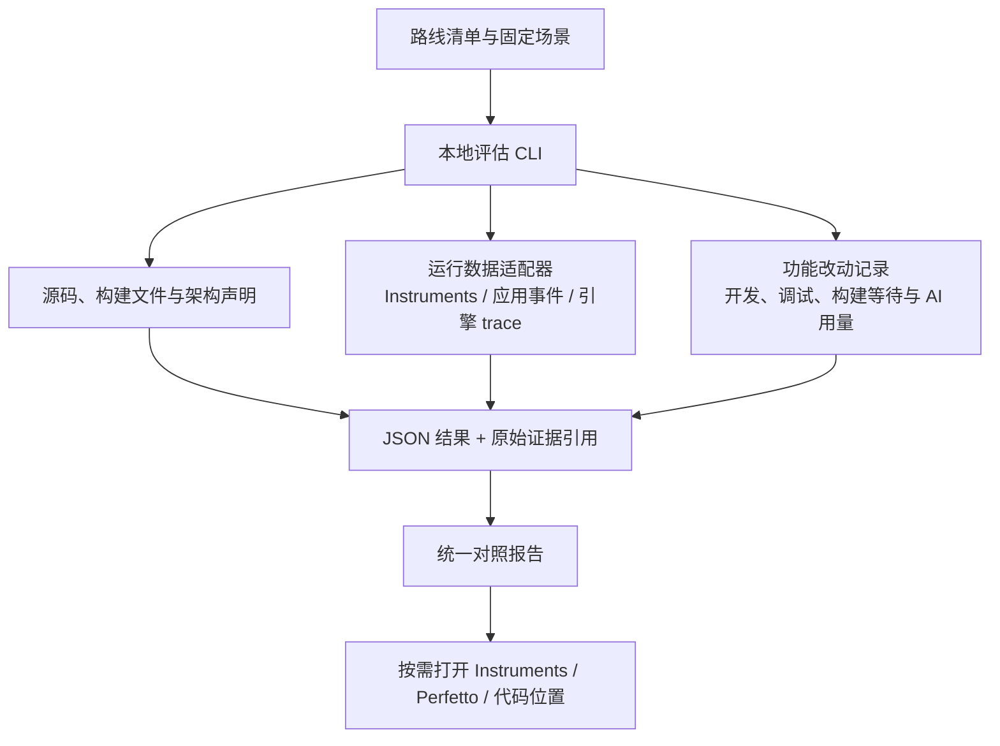

# 五条技术路线的统一评估工具

日期：2026-09-26。状态：调研与提案；未安装分析器、扫描、启动应用或采集性能。五个 MVP 见 [examples](../../examples/README.md)。

MVP 后续加入了 Swift Agent runtime、持久会话和 Whisper，见 [AI 与语音基础](ai-and-speech-foundation.md)。采集需计入 runtime 进程，回放与真实 Agent 页分开记录，避免把网络等待归因于渲染。

五个应用已加入 [十五个 Harness 场景](../learning/harness-scenario-lab.md)，可观察朴素/优化路径、局部计数、输入/取消与维护责任；本轮未执行。尚无统一导出、CLI、系统采集或开发成本推算，局部计数不代表 FPS 或应用内存。

## 1. 能统一到什么程度

五条路线可共用入口和报告，采集器仍按技术栈选择。<mark class="key">统一场景、指标、证据与展示</mark>，分别报告性能、架构和成本。

本轮没有找到能零配置、等价分析五条路线全部机制并准确推算人工成本的工具。

先做本地 CLI + JSON/Markdown 报告，按需再加 HTML，不另造桌面框架或数据库。

## 2. 可以复用的工具

| 工具 | 负责的部分 | 对本项目的限制 |
|---|---|---|
| Instruments / xctrace | macOS CPU、线程、内存，及 SwiftUI/Metal 专项 | 需要完整 Xcode；深度依赖模板、符号与权限，原生栈不等于 JS 源码分析 |
| Perfetto | 自定义事件时间线、兼容 trace 查询与展示 | macOS 无开箱即用的系统采集，不能完整替代 Instruments |
| scc | 多语言代码量、近似复杂度、JSON 输出 | 词法启发式仅辅助找同语言热点；不能跨语言排名或当真实账单 |
| CodeCharta | 将代码指标映射为交互地图 | 文件地图不是进程架构，也不测渲染或还原全部桥接协议 |
| WebKit Web Inspector | WKWebView 的 JS、布局、绘制与内存时间线 | 需结合宿主与系统采集 |
| Electron contentTracing / DevTools | Chromium 进程 trace 与 Web 性能 | 不覆盖外部 Swift helper、SwiftUI 或 GPUI |

Time Profiler、System Trace 等定位响应瓶颈，Metal 工具定位图形工作；模板以本机 Xcode 为准。[Apple 响应分析](https://developer.apple.com/videos/play/wwdc2026/268/)、[Metal 性能分析](https://developer.apple.com/documentation/xcode/analyzing-the-performance-of-your-metal-app/)

Perfetto 的 Instruments XML 导入主要面向 CPU 栈样本，不保证保留内存、signpost 或全部图形轨道。保留并链接原始 `.trace`，只导入支持的数据。[系统 trace 范围](https://perfetto.dev/docs/getting-started/system-tracing)、[外部格式与 Instruments XML](https://perfetto.dev/docs/getting-started/other-formats)

scc 不构建 AST，复杂度不能跨语言直接比较。默认关闭 COCOMO 等费用估算。[scc 复杂度边界](https://github.com/boyter/scc#complexity-estimates)、[语言列表](https://github.com/boyter/scc/blob/master/LANGUAGES.md)

CodeCharta 可导入指标看热点；五份小样先用表格即可。[CodeCharta 介绍](https://codecharta.com/docs/overview/introduction/)、[指标映射](https://codecharta.com/docs/visualization/user-controls/metrics/)

WebKit 分析 JS、布局绘制与内存；Electron contentTracing 协调相关子进程采集。[WebKit Timelines](https://webkit.org/web-inspector/timelines-tab/)、[Electron contentTracing](https://www.electronjs.org/docs/latest/api/content-tracing)

## 3. 最小工具架构



此 CLI 尚未实现。比较时逐个运行、交替顺序，避免五个应用争抢 CPU/GPU。

建议目录：

```text
tools/assessment/
  routes.json          # 五条路线、源码范围、构建方式、能力覆盖
  scenarios.json       # 相同输入、数据量、持续时间与结束条件
  assess.*             # 少量入口与适配逻辑，语言随后决定
assessment-results/
  <run-id>/
    environment.json
    metrics.json
    worklog.json
    report.md
    raw/               # 原始采集文件或明确的本地引用
```

## 4. 性能：先统一问题，再统一数字

| 指标 | 明确定义 | 主要陷阱 |
|---|---|---|
| 冷启动与热唤起 | 启动/唤起请求到指定 ready 点；另列真正可见/可输入的证据 | `main()` 或组件挂载完成不等于用户已经看见画面 |
| 流式显示延迟 | 带 ID 的事件产生到 UI 应用更新；有呈现证据才报告显示延迟 | DOM commit、SwiftUI body、GPUI render 都只是各自阶段 |
| CPU 与线程 | 同一阶段、同一采样口径的进程 CPU 时间和主线程热点 | 瞬时 CPU 百分比不足以解释整个任务成本 |
| 内存 | 明确 RSS 或 physical footprint，分别报告进程与归属范围 | RSS 求和会重复计算共享页，不能叫实际独占总内存 |
| 卡顿与图形 | 实际 presentation/hitch 证据；记录刷新率与观测区间 | 20 次/秒业务事件或 requestAnimationFrame 次数不等于实际 FPS |
| 桥接 | 消息次数、字节数、编码/解码时间与排队时间 | 原生控件的轻量不能抵消搬运整棵树的代价 |
| 空闲 | 停止任务后 CPU、唤醒及活跃计时器 | 不能用一个主进程的 CPU 推断整套应用的耗电 |
| 构建与包大小 | 冷/暖构建、下载、签名分别记录；区分压缩包与展开体积 | 当前 GPUI dev 产物不应与 Swift 优化构建排名 |

采集主应用、关联的 Node/renderer/GPU 进程与语音 helper，并记录角色、身份和关联依据。WKWebView 托管进程不一定在 PPID 子树中；无法归属的系统共享服务单列，不强行分摊。

先采空闲、固定流、10,000 条列表三类场景。语音用固定音频复测，麦克风和权限另记；更新清单检查与下载/安装分开。

跨运行时事件统一 ID、阶段、单位和单调时钟映射；不同进程或时间原点的时间戳不能直接相减。

固定场景可用内部回放参数驱动，无需 computer-use；键盘、输入法、焦点和滚动仍需真实交互证据。

## 5. 架构：统计你需要维护的边界

源码复杂度看函数/文件，架构复杂度看职责、通信与生命周期，分别展示。

先手写架构声明，再自动核对文件与依赖；搜索 `import` 不能还原全部 IPC、动态加载和托管进程。

| 架构观察项 | 要回答的问题 |
|---|---|
| 开发语言与运行时 | 修改同一功能需要理解几种语言、几套调试方式？ |
| 状态所有者 | 任务、列表、语音各由谁持有？是否出现互相同步的副本？ |
| 跨语言/进程协议 | 一次操作经过哪些边界？谁编码、校验、处理错误和兼容？ |
| 生命周期 | 哪一侧启动/取消/回收任务？进程崩溃或关闭窗口会发生什么？ |
| 改动传播 | 增加一个字段需要改哪些模块、协议、构建文件？ |
| 平台集成 | 权限、签名、更新、输入法、可访问性由框架提供多少，自己实现多少？ |
| 依赖与分发 | 直接/传递/平台特定依赖、随包运行时、系统提供组件分别是什么？ |
| 能力覆盖 | 同样叫“语音”或“更新”，是否完成了相同错误、取消和安装路径？ |

进程数量不直接代表优劣，隔离也提供故障边界。依赖数不等于维护负担；系统框架不在 Cargo/npm 锁文件中，编译期、目标平台与打包内容需分列。

原生桥将 React 提交转成 JSON，再由 Swift 更新 AppKit，需测量这条边界。GPUI 直接绘制，但与 Swift 示例一样通过 Swift helper 接语音，都有 IPC。

WKWebView 的回放计时器与普通 UI 状态在 Web 侧；Electron 由主进程逐事件发送到 renderer，IPC 成本不同。比较框架前先控制事件位置；preload 是脚本环境，Rust stdout reader 是线程，都不是独立进程。

## 6. 编码成本：用同一功能的改动记录校准

<mark class="caution">源码不能直接推算人工工时</mark>。缺少历史就记“未知”，不按文件量分摊会话时长。

五条路线用相同标准完成三个改动：

1. 添加可编辑任务标题，处理中文输入、提交与取消。
2. 把固定单行日志变成可展开的多行内容，保留合理滚动位置。
3. 增加语音状态/错误处理，随后另做真正的 v0.1→v0.2 更新安装实验。

每项单独记录：

- 阅读/学习、编码、调试、人工验收时间；下载/编译等待另记。
- 改动的文件、模块、语言、协议与构建配置；共享/独有代码分列。
- 编译失败、返工原因与为相同交互补写的控件能力。
- AI 请求、实际 token/账单与人工修正；无日志记未知，不按代码量反算。
- 首次学习与后续类似改动的维护成本。

人力总量与交付时长分开，并行耗时不能简单相加。Git 间隔不能证明主动工作时间；代码量、圈复杂度和模型估算只作线索。

## 7. 第一版报告与实现顺序

统一报告保留三个并排维度：

| 路线 | 性能：场景与原始结果 | 架构：边界与状态归属 | 成本：同一功能的实际改动 | 能力完成度 |
|---|---|---|---|---|
| Swift | 未采集 | 待形成机器可读声明 | 未记录 | 参见路线 README |
| GPUI | 未采集 | 待形成机器可读声明 | 未记录 | 参见路线 README |
| React 原生桥 | 未采集 | 待形成机器可读声明 | 未记录 | 参见路线 README |
| WKWebView | 未采集 | 待形成机器可读声明 | 未记录 | 参见路线 README |
| Electron | 未采集 | 待形成机器可读声明 | 未记录 | 参见路线 README |

每项保存定义、单位、采集器版本、commit、构建模式、场景、原始证据和局限。<mark class="key">缺失值用 `null` 加原因</mark>；区分 measured（实测）、declared（声明）、estimated（估算）和 missing（未知）。

先做静态清单和成本模板：代码量排除依赖目录、`target/build/dist`、生成物及锁文件，依赖另读锁文件。共享 helper 全仓只计一次，各路线标明使用关系。

再统一回放与事件标记，接运行采集。此前本机使用 CLT，完整 Instruments/xctrace 尚待配置；本轮未重查或安装。

最后按瓶颈增加语言/引擎分析或 Perfetto/CodeCharta 视图。首版不设任意加权总分，积累数据与偏好后再讨论权重。

下一项交付：列出五条路线代码范围、运行时、协议边界与能力缺口，再填入实测与改动记录。

返回 [文档入口](../README.md) · [实现对照](../../examples/COMPARISON.md)。
