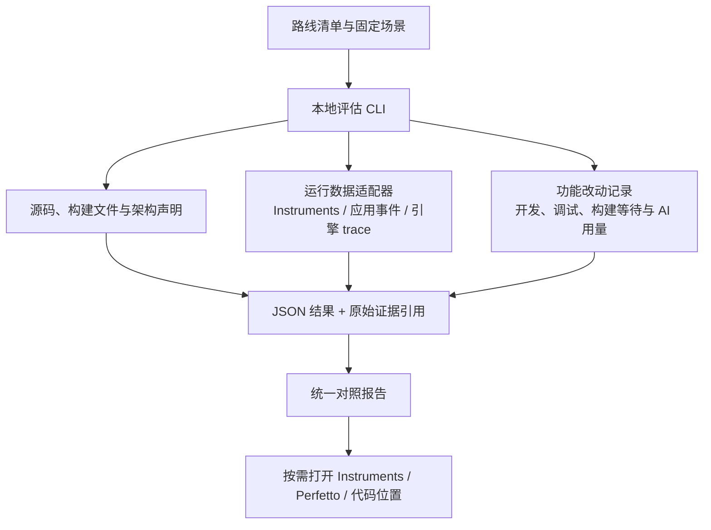

# 五条技术路线的统一评估工具

日期：2026-09-26。状态：工具调研与实现提案；本轮未安装分析器、执行静态扫描、启动应用或采集性能数据。已有五个 MVP 见 [examples](../../examples/README.md)。

后续 MVP 已新增共同的 Swift Agent runtime、持久会话和 Whisper 后端，见 [AI 与语音基础](ai-and-speech-foundation.md)。评估工具本身仍是提案；将来采集时还需计入 Agent runtime 进程。原回放页与真实 Agent 页分开记录，不能把后者的网络等待归因到渲染路线。

## 1. 能统一到什么程度

可以为五条路线建立一个统一入口和报告，分别呈现运行性能、架构复杂度与开发成本。采集端仍按技术栈使用适合的工具，统一的是场景、指标定义、证据和展示。

本轮核实的工具中，没有一个能零配置、等价地分析 SwiftUI、Rust/GPUI、React→AppKit、WKWebView、Electron 的全部内部机制，并据此准确算出人的开发成本。

建议先做小型本地 CLI + JSON/Markdown 报告；后续需要时生成 HTML。无需先为评估工具选择第六套桌面框架，也无需把所有数据迁入数据库。

## 2. 可以复用的工具

| 工具 | 负责的部分 | 对本项目的限制 |
|---|---|---|
| Instruments / xctrace | macOS CPU、线程、内存等采集；需要时加入 SwiftUI、Metal 等专项分析 | 深度内容依赖模板、符号和权限；原生调用栈不等于 JS 源码级分析；需要完整 Xcode |
| Perfetto | 自定义事件时间线、兼容 trace 的查询与展示 | macOS 没有开箱即用的系统级数据源集成；不能把它当成 Instruments 的完整替代 |
| scc | 多语言文件、代码量和近似复杂度统计，可输出 JSON | 复杂度是词法启发式，适合找同语言热点，不直接比较 Swift/Rust/JS；工时和费用估算不是实际账单 |
| CodeCharta | 将已有指标和代码目录展示为交互式地图，发现大文件与热点 | 文件地图不等于真实进程架构；依赖原始指标，不能测量渲染或自动还原全部桥接协议 |
| WebKit Web Inspector | WKWebView 内部 JavaScript、布局、绘制、内存等时间线 | 专门分析 Web 内容，需要与宿主和系统侧结果结合 |
| Electron contentTracing / DevTools | Chromium 相关进程的 trace、Web 内容性能 | 不会自动覆盖外部 Swift helper，也不是 SwiftUI 或 GPUI 的分析器 |

Apple 描述了通过 Time Profiler、System Trace 与并发相关工具定位响应瓶颈，以及通过 Metal 工具定位图形工作。具体可用模板以安装的 Xcode 为准。[Apple 响应分析](https://developer.apple.com/videos/play/wwdc2026/268/)、[Metal 性能分析](https://developer.apple.com/documentation/xcode/analyzing-the-performance-of-your-metal-app/)

Perfetto 官方明确 macOS 系统采集的限制；其 Instruments XML 导入主要针对 CPU 栈样本，不能保证完整保留内存分配、signpost 或所有图形轨道。因此应保留原始 `.trace`，报告链接到它，只导入支持的数据。[系统 trace 支持范围](https://perfetto.dev/docs/getting-started/system-tracing)、[外部格式与 Instruments XML](https://perfetto.dev/docs/getting-started/other-formats)

scc 支持 Swift、Rust 等多种语言，官方也明确其复杂度近似没有构建 AST，不能直接跨语言比较。默认关闭 COCOMO/类似费用估算，避免产生精确但无依据的开发报价。[scc 说明及复杂度边界](https://github.com/boyter/scc#complexity-estimates)、[语言列表](https://github.com/boyter/scc/blob/master/LANGUAGES.md)

CodeCharta 支持指标映射与导入，适合后续看热点；五份小样第一阶段用普通表格即可。[CodeCharta 介绍](https://codecharta.com/docs/overview/introduction/)、[指标映射](https://codecharta.com/docs/visualization/user-controls/metrics/)

WebKit 可以分别显示 JS、布局绘制及内存；Electron 的 contentTracing 可协调其相关子进程采集。这些工具能解释各自引擎内部的时间分布。[WebKit Timelines](https://webkit.org/web-inspector/timelines-tab/)、[Electron contentTracing](https://www.electronjs.org/docs/latest/api/content-tracing)

## 3. 最小工具架构



以上均为提案，未创建相应 CLI。一个报告可以覆盖五条路线；做公平性能比较时，应逐个运行并交替顺序，避免五个应用一起争抢 CPU/GPU。

建议的目录也是未来结构：

```text
tools/assessment/
  routes.json          # 五条路线、源码范围、构建方式、能力覆盖
  scenarios.json       # 相同输入、数据量、持续时间与结束条件
  assess.*             # 少量入口与适配逻辑，语言随后决定
assessment-results/
  <run-id>/
    environment.json
    metrics.json
    worklog.json
    report.md
    raw/               # 原始采集文件或明确的本地引用
```

## 4. 性能：先统一问题，再统一数字

| 指标 | 明确定义 | 主要陷阱 |
|---|---|---|
| 冷启动与热唤起 | 启动/唤起请求到指定 ready 点；另列真正可见/可输入的证据 | `main()` 或组件挂载完成不等于用户已经看见画面 |
| 流式显示延迟 | 带 ID 的事件产生到 UI 应用更新；有呈现证据才报告显示延迟 | DOM commit、SwiftUI body、GPUI render 都只是各自阶段 |
| CPU 与线程 | 同一阶段、同一采样口径的进程 CPU 时间和主线程热点 | 瞬时 CPU 百分比不足以解释整个任务成本 |
| 内存 | 明确 RSS 或 physical footprint，分别报告进程与归属范围 | RSS 求和会重复计算共享页，不能叫实际独占总内存 |
| 卡顿与图形 | 实际 presentation/hitch 证据；记录刷新率与观测区间 | 20 次/秒业务事件或 requestAnimationFrame 次数不等于实际 FPS |
| 桥接 | 消息次数、字节数、编码/解码时间与排队时间 | 原生控件的轻量不能抵消搬运整棵树的代价 |
| 空闲 | 停止任务后 CPU、唤醒及活跃计时器 | 不能用一个主进程的 CPU 推断整套应用的耗电 |
| 构建与包大小 | 冷/暖构建、下载、签名分别记录；区分压缩包与展开体积 | 当前 GPUI dev 产物不应与 Swift 优化构建排名 |

性能归属至少包括主应用、已关联的 Node/renderer/GPU 进程和语音 helper。WKWebView 的系统托管进程不能保证通过普通 PPID 子树找到；进程应记录角色、身份和关联依据。系统共享服务无法精确归属时，单列为系统观察，不强行分摊。

最初只采空闲、固定流和 10,000 条列表三类场景。语音的固定音频文件比真人每次说话更可重复；真实麦克风与权限体验另记。更新清单检查与真正下载/安装是不同任务。

若未来汇合不同运行时的事件，统一 `run_id`、`event_id`、阶段名、单位与单调时钟映射。不能直接减去来自不同进程、不同时间原点的时间戳。

可以用应用内部的回放参数驱动固定场景，采集无需 computer-use。不过自动回放只证明该路径；真实键盘、输入法、焦点和滚动仍需要相应的交互证据。

## 5. 架构：统计你需要维护的边界

源代码复杂度与架构复杂度分别展示。前者关注函数/文件，后者关注职责、通信和生命周期。

建议先手写一份很小的架构声明，自动核对部分文件与依赖事实。跨语言 IPC、动态加载和系统托管进程不能靠搜索 `import` 完整还原。

| 架构观察项 | 要回答的问题 |
|---|---|
| 开发语言与运行时 | 修改同一功能需要理解几种语言、几套调试方式？ |
| 状态所有者 | 任务、列表、语音各由谁持有？是否出现互相同步的副本？ |
| 跨语言/进程协议 | 一次操作经过哪些边界？谁编码、校验、处理错误和兼容？ |
| 生命周期 | 哪一侧启动/取消/回收任务？进程崩溃或关闭窗口会发生什么？ |
| 改动传播 | 增加一个字段需要改哪些模块、协议、构建文件？ |
| 平台集成 | 权限、签名、更新、输入法、可访问性由框架提供多少，自己实现多少？ |
| 依赖与分发 | 直接/传递/平台特定依赖、随包运行时、系统提供组件分别是什么？ |
| 能力覆盖 | 同样叫“语音”或“更新”，是否完成了相同错误、取消和安装路径？ |

不要将进程更多直接标为更差：隔离也能提供故障边界。依赖数量同样不等于维护负担，系统框架不会出现在 Cargo/npm 锁文件里；编译期、目标平台和实际打包内容应分别记录。

当前原生桥的 React 提交要转成 JSON，再由 Swift 更新 AppKit，这条边界值得明确计量。GPUI 的 Rust UI 直接进入绘制路径，但接语音仍跨到 Swift helper。Swift 示例为了统一实验也使用该 helper，不能把它画成完全没有 IPC 的实现。

另外，当前 WKWebView 示例的回放计时器和普通 UI 状态留在 Web 侧；Electron 示例由主进程每次发送一个事件到 renderer。两者同为 ReactDOM，也有不同的逐事件 IPC 成本。因此评估对象是这五份具体实现，归因到框架前应先控制事件发生位置。preload 是脚本环境，不应计为独立进程；Rust stdout reader 是线程，也不应计为进程。

## 6. 编码成本：用同一功能的改动记录校准

工具能辅助记录，不能只看现有源码就准确推算一个人未来的学习与开发工时。缺少历史时记录“未知”，不能把这次会话总时长按文件量分摊给五条路线。

建议五条路线各做相同的三个改动，要求相同完成标准：

1. 添加可编辑任务标题，处理中文输入、提交与取消。
2. 把固定单行日志变成可展开的多行内容，保留合理滚动位置。
3. 增加语音状态/错误处理，随后另做真正的 v0.1→v0.2 更新安装实验。

每项单独记录：

- 主动阅读/学习、编码、调试、人工验收的时间；等待下载/编译另外记。
- 修改文件、模块、语言、协议和构建配置；共享代码与该路线独有代码分列。
- 编译失败与返工原因，以及为完成相同交互额外实现的控件能力。
- AI 请求次数、实际 token/账单与人工修正时间；无日志即未知，不从源码行数反算。
- 后续再次做类似改动的成本，分开首次学习投入与熟练后的维护成本。

人力总量与日历时长也应分开：多个 Agent/开发者并行的耗时不能简单相加当作交付时间。Git 提交间隔不足以证明主动工作时间；代码行、圈复杂度和模型推算只作为线索。

## 7. 第一版报告与实现顺序

统一报告保留三个并排维度：

| 路线 | 性能：场景与原始结果 | 架构：边界与状态归属 | 成本：同一功能的实际改动 | 能力完成度 |
|---|---|---|---|---|
| Swift | 未采集 | 待形成机器可读声明 | 未记录 | 参见路线 README |
| GPUI | 未采集 | 待形成机器可读声明 | 未记录 | 参见路线 README |
| React 原生桥 | 未采集 | 待形成机器可读声明 | 未记录 | 参见路线 README |
| WKWebView | 未采集 | 待形成机器可读声明 | 未记录 | 参见路线 README |
| Electron | 未采集 | 待形成机器可读声明 | 未记录 | 参见路线 README |

每个指标保存：定义、单位、采集器版本、源码快照/commit、构建模式、场景、原始证据链接、局限。值缺失用 `null` 加原因，不能填成 0。状态区分 measured（实测）、declared（声明）、estimated（估算）和 missing（未知）。

第一步只做静态清单与成本记录模板，排除 `node_modules`、`target`、`build`、`dist`、生成文件与锁文件的代码量；依赖清单另读锁文件。共享 helper 在全仓维护量中只算一次，同时在每条路线标出使用关系。

第二步统一回放和事件标记，然后接运行采集。按之前环境记录，本机选中的是 CLT；完整 Instruments/xctrace 环境尚需配置，本轮没有重新检查或安装。

第三步才根据实际瓶颈增加语言/引擎专项分析，或接入 Perfetto/CodeCharta 的详细视图。首版不生成任意加权的“总分”；等有真实偏好与数据，再讨论性能、维护和学习价值的权重。

推荐的下一项具体交付：**一份能列出五条路线代码范围、运行时、协议边界与能力缺口的静态对照报告，再逐步填入真实性能与改动记录。**

返回 [文档入口](../README.md) · [实现对照](../../examples/COMPARISON.md)。
