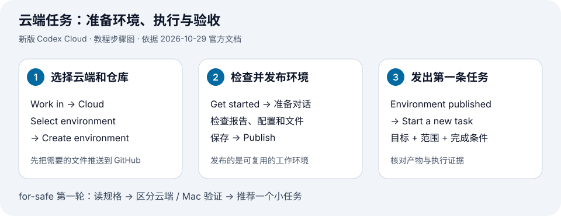

# 1 · 用 for-safe 发出第一条云端任务

**第一轮只做一件事：让云端读 `for-safe` 的 README 和实际目录，交回一份有文件依据的简短小结。** 先体验一次发出任务、收到结果的过程。



上图是操作步骤图。按 ① → ② → ③ 做到第一份只读结果，本次就可以结束。

## ① 把需要读的文件放进 GitHub

准备有 Cloud 使用权限的 ChatGPT 账号，以及你愿意授权给 Codex 的 GitHub 仓库；仓库可以是私有的。套餐与工作区权限以[官方说明](https://learn.chatgpt.com/docs/pricing)和实际入口为准。把本轮要读的规格提交并推送到目标分支。**本机 `~/codex/for-safe` 中未推送的文件，不会因为你写了这个路径就自动进入云端。**

第一次只需要规格文档。没有可执行项目，就明确告诉 Codex 当前没有安装、构建和测试命令。

## ② 创建并发布环境

在 [Codex 网页入口](https://chatgpt.com/codex)或桌面端的新任务中，依次选择：

**Work in → Cloud → Select environment → Create environment**

选择目标 GitHub 仓库；如有提示，完成 GitHub 连接，再点 **Get started**。也可以从 **Settings → Codex Cloud → Environments** 进入。[官方操作说明与界面示意](https://learn.chatgpt.com/docs/environments/cloud-environments#create-and-publish-an-environment)

在环境准备对话里直接说：

```text
这个仓库是 for-safe，目前处于规格阶段。
先读取实际文件，确认是否已有可执行代码、依赖清单和测试命令。
若只有文档，只准备读取和检索文档所需的环境。
不要创建应用骨架、猜测安装命令，或声称已有测试通过。
报告找到的仓库、分支/提交、可用命令与缺失条件。
```

检查准备报告，确认选中了正确仓库、没有遗留失败步骤；保存改动并点 **Publish**。等到 **Environment published**，再点 **Start a new task**。只保存草稿还没有完成发布。[保存与发布的区别](https://learn.chatgpt.com/docs/environments/cloud-environments#create-and-publish-an-environment)

<details class="qa">
<summary>以后有代码了，依赖和测试怎么配置？</summary>

让 Codex 从仓库已有的清单、锁文件和说明中确认运行时、安装与测试命令，再实际执行。可复用的安装命令放进 **Install script**，启动服务和检查就绪的说明放进 **Start skill**；测试与验收规则写进仓库的 `AGENTS.md`，供后续任务读取。

依赖变化时，编辑环境、验证后 **Republish**，再用新任务检查。已有任务保留自己的状态；仓库后台刷新不会自动重跑安装和启动命令。[安装与启动](https://learn.chatgpt.com/docs/environments/cloud-environments#customize-installation-and-startup)

</details>

## ③ 复制这条任务

确认当前选中了 **Cloud** 和刚发布的环境，发送：

```text
阅读 for-safe 的 README 和实际目录。
本轮只分析，不修改文件，不创建 PR。

只交回三项：
1. 这个项目想做什么，用一句话说明，附文件路径依据。
2. 是否找到可执行代码和测试命令；没找到就明确写“未找到”。
3. 推荐一个最小的下一步，写明做到什么就完成。

列出本次实际读过的文件。没有执行测试就写“未运行测试”。
先交回这份小结，等我决定下一项任务。
```

你的交付物是**有文件依据的三项小结**。核对一个引用的文件，确认与原文相符，这一轮就完成了。下面的实现任务留到下一次。

<details>
<summary>下一次再做：实现、验收与故障排查</summary>

## ④ 进入实现时，一次交一个小任务

等你决定让 `for-safe` 进入实现阶段，再把上一轮确认的任务发给云端。例如：

```text
本轮允许实现一个离线切片：权限拒绝、扫描成功但无设备、
能力不支持、未知/过期结果，应保留为可区分的结果。
先以仓库现有契约为准；若契约尚未定义，先指出缺口，不自行定稿。

只改这个切片所需的最少文件，不连接 Wi-Fi、蓝牙或 macOS API。
用样本测试这些状态不会互相误判，不修改验收条件来迎合实现。
执行仓库已有的相关检查；缺少工具或套件时如实报告。

交付改动摘要、diff、实际执行的命令与结果、未验证项。
保留给我审阅，不合并。
```

检查结果只抓三件事：

1. **改对了吗？** diff 是否只包含约定的切片，是否改动了原本的验收标准。
2. **真跑了吗？** 命令、退出结果和失败原因是否可查；「未运行」不能算通过。
3. **还差什么？** 把代码改动带回本地或通过 PR 分支检出，在 Mac 补做原生与设备验证，再决定合并。

用于交接的一句话可以是：**「云端样本测试通过；真实权限拒绝、无线开关与休眠恢复未验证。」** 这样 AI 可以继续接手实现和修复，人也能看清最后缺哪份证据。

<details class="qa">
<summary>卡在联网、密钥或找不到仓库时怎么办？</summary>

| 现象 | 先检查 |
| --- | --- |
| 找不到仓库或规格 | GitHub 连接是否获准访问该仓库；文件是否已推送；任务实际读取的是哪个提交 |
| 安装依赖失败 | 先看具体错误。新版可开放 Package managers 或额外域名，保存、验证后重新发布 |
| 关掉全网开关，仍然能访问某些站点 | **Enable all public internet access** 关闭后，显式允许的域名仍可访问 |
| 需要调用私有 API | 在环境配置中选择变量或 HTTP secrets；允许联网本身不会提供凭证。本次文档任务不需要业务密钥 |

新版 **Network secret / HTTP secret** 通过代理向允许的 HTTPS 目标替换凭证，可用于准备阶段和任务阶段。它与直接传给程序的环境变量不同；不能照搬 Legacy「秘密只在 setup 阶段可用」的说法。[联网与密钥](https://learn.chatgpt.com/docs/environments/cloud-environments#configure-environment-variables-and-network-secrets)

</details>

<details class="qa">
<summary>能在云端替我点应用、验收界面、一直跑服务吗？</summary>

截至本次核对，新版 Cloud 的限制仍列出不支持内置 computer / browser use。不要把桌面端可用的电脑操控能力直接算到云端头上；项目自带的命令行浏览器测试工具能否运行，需要另行配置和实测。[当前限制](https://learn.chatgpt.com/docs/environments/cloud-environments)

同样，开发服务能启动，不代表已经获得正式部署。云端任务不会自动接管本机 Mac 的屏幕、系统权限或无线设备。

</details>

</details>

<details>
<summary>以后再看：社区案例与历史截图</summary>

[社区案例截图](02-community.md#screenshots)保留了真实历史界面，并标明 Legacy。

</details>
