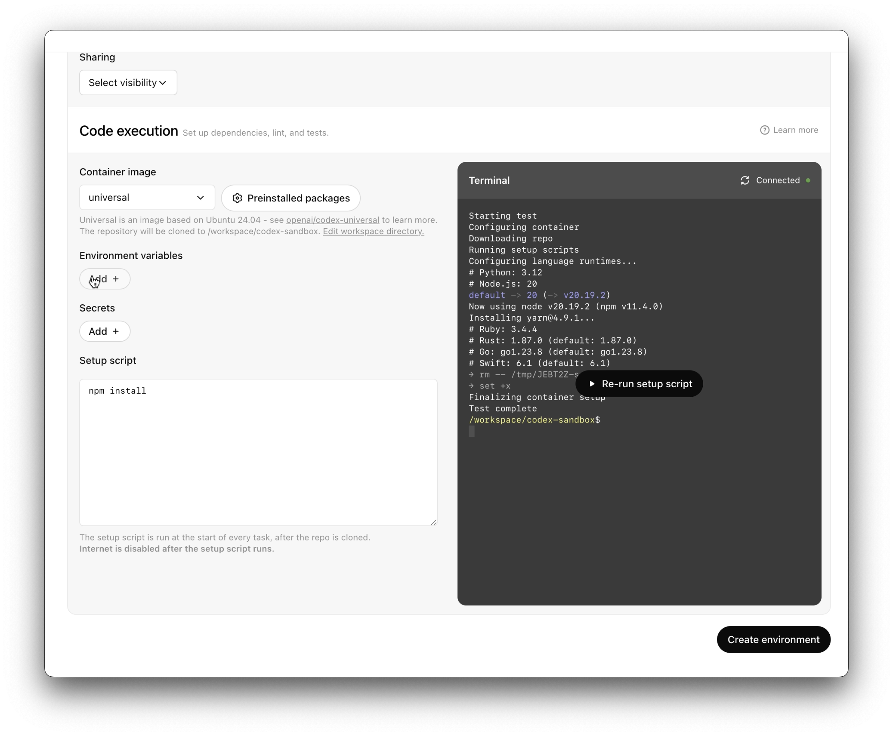
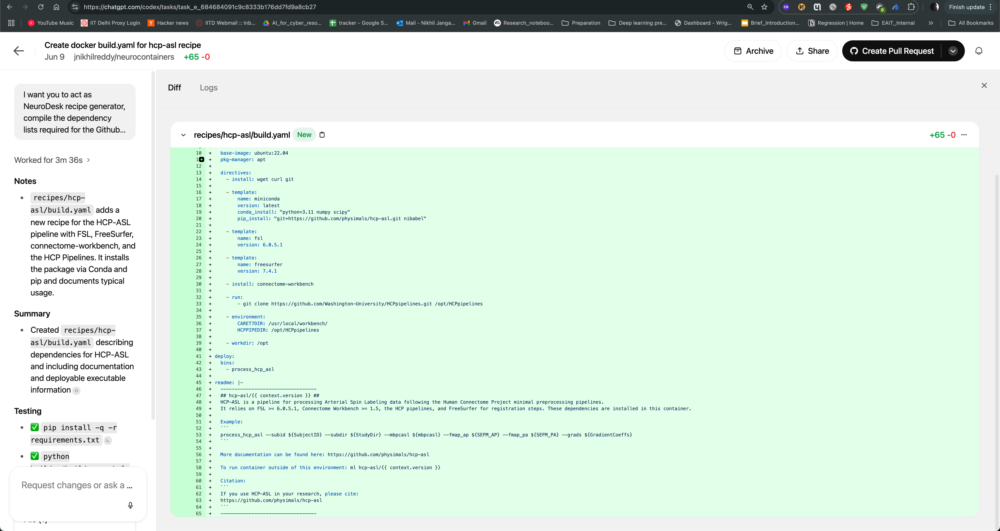

# 2 · 社区怎么用：后台任务、专门产物与本地验收

**从公开案例里借鉴任务分工，再按当前官方文档配置环境。** 下面是作者或项目自己的记录，不是速度、成功率或「无人开发」的保证；迁移到 `for-safe` 的建议是本教程的判断。

## 三种可以直接学的做法

| 谁在用 | 公开记录中的做法 | 在 for-safe 上怎么借鉴 |
| --- | --- | --- |
| **Simon Willison** | 在 2025 年 9 月月报中说，他每天发起一两次云端任务，让它后台检出代码、安装依赖，完成后交回答案或 PR | 把有明确输出的小型规格调查、离线逻辑任务交出去，稍后集中审阅 |
| **Neurodesk 项目** | 用已有配方和工具文档，让 Codex 生成新工具的容器构建配方；随后创建 PR，交给团队审阅或本地测试 | 给 AI 已有契约与示例，让它交一份明确文件；例如一组状态分类样本，而不是让它自由搭整个平台 |
| **Reddit 用户 waiting4myteeth** | 云端完成工作后建 PR，本地检出分支测试；在原对话要求修改，更新 PR 后继续拉取验证，满意再合并 | 云端负责实现与可移植测试；Mac 负责原生、权限和无线设备验收，失败记录交回同一任务 |

来源：[Simon 的月报，发布于 2025-10-01](https://feeds.simonwillison.net/newsletters/monthly-2025-09-september/)、[Neurodesk 自己的操作记录](https://neurodesk.org/developers/neurocontainer-copilot/openai-codex/)、[cloud → local 社区讨论](https://www.reddit.com/r/ChatGPTCoding/comments/1nyd3ny/how_are_people_using_codex_cloud_interested_in/)。后两者使用旧版界面；这里引用工作方式，不据此判断今天的按钮或限额。

同一 Reddit 讨论中也有人报告：复杂依赖和 Docker 嵌套让环境准备成本很高。这个负面经验提示我们，**先验证最小环境能完成一个任务，再逐步增加依赖。** 它不能证明新版仍有同样的问题。[原讨论](https://www.reddit.com/r/ChatGPTCoding/comments/1nyd3ny/how_are_people_using_codex_cloud_interested_in/)

## 看两张真实界面截图

两张均为公开来源的 **Legacy 历史截图**，不是本账号或 `for-safe` 的运行结果。用于认识「准备环境」和「检查产物」这两件事；新版按钮路径按[上一页](01-for-safe.md)操作。

### 图 1：先确认环境能准备成功

[放大查看](../../site/public/images/codex-cloud/legacy-environment-setup.png)

只看两个位置：左侧 **setup script** 写了什么；右侧终端是否实际完成。准备成功只能说明环境准备步骤结束，不能证明项目验收通过。

来源：[OpenAI Codex 更新记录](https://developers.openai.com/codex/changelog)，[官方原图](https://developers.openai.com/images/codex/changelog/environment_setup.png)。这是旧版 setup 界面；新版使用准备对话、Install script / Start skill 和 Publish。

### 图 2：任务完成后，看它交了什么文件

[放大查看](../../site/public/images/codex-cloud/legacy-neurodesk-result.png)

中间 **Diff** 是文件改动，左侧 **Testing** 是执行汇报，右上 **Create Pull Request** 是发起审阅的入口。Neurodesk 交付构建配方；你可以交付一段离线逻辑。看完改动，还要核对测试证据，完成标记本身不代表真机验收完成。

来源：[Neurodesk 操作记录](https://neurodesk.org/developers/neurocontainer-copilot/openai-codex/)，[项目公开原图](https://neurodesk.org/developers/recipe_generator/codex-build-yaml.png)。图片保留原样，未把示例仓库改成 `for-safe`。

看到旧教程时，怎么判断哪些操作要重新查？

| 旧教程中的词 | 新版应该核对什么 |
| --- | --- |
| setup / maintenance script、容器缓存 | 准备对话、Install script / Start skill、Publish / Republish 与独立任务状态 |
| agent 默认断网 | 当前环境的全网开关、包管理器预设与允许域名 |
| secrets 只用于 setup | 当前的直接环境变量与代理替换型 HTTP secrets |

官方仍将 Code Review、Linear 和 GitHub 集成中的部分工作流保留在 Legacy。先确认使用的是哪个入口，再读对应文档：[新版](https://learn.chatgpt.com/docs/environments/cloud-environments)、[Legacy](https://learn.chatgpt.com/docs/environments/cloud-environment)。

## 你的第一次实验，到这里就够了

先完成 **读规格 → 拆一个任务 → 检查依据**。进入实现后再增加 **写代码 → 自动检查 → PR → Mac 验收**。跑通一个任务后，才尝试并行互不依赖的任务；同一模块的改动按顺序整合。

云端省掉了你持续盯着开发机器的负担，也提供了可复用的执行环境。`for-safe` 的无线验证条件仍需要你定义和准备；把这条边界写清楚，才知道 AI 实际接管了多少工作。

继续做自己的 AI 实验时，可联读 [AI 探索](../ai-ideas/README.md)与 [Issue 修复、验证和交班](../issue-garden/README.md)。
