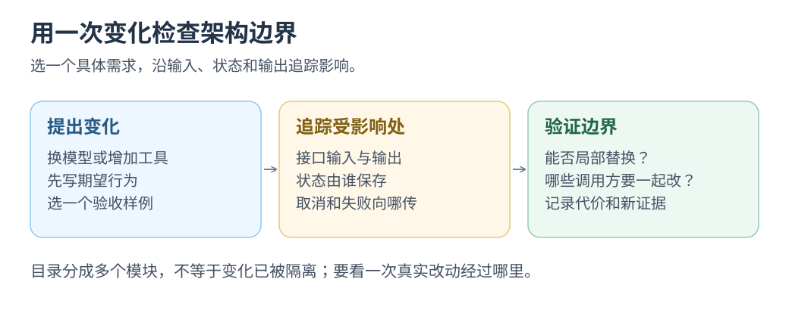

# 简单性、组合与复杂性：分析框架

本轮假设：<mark class="key">少数稳定概念覆盖真实任务，常见变化停在少数边界</mark>。两者也可能冲突：一个输入框背后仍可有庞大系统。

这是案例分析框架，不是复杂度定理、评分或选型公式。[调查入口](README.md) · [Raycast / Warp](02-raycast-warp.md) · [Zed / Grok Build](03-zed-grok.md) · [Yuuki 变化实验](04-yuuki.md)。

## 1. 简单性的评价主体与任务

Rich Hickey 区分结构简单与使用容易：前者看责任纠缠，后者受熟悉度和可获得性影响；不能据此给语言、范式或可变状态统一定性。[演讲原始资料，2011](https://www.infoq.com/presentations/Simple-Made-Easy/)

本轮把“简单”拆成四个观察面：

| 观察面 | 具体问题 | 容易混淆的现象 |
|---|---|---|
| 用户操作 | 找到目标、判断状态、完成动作，要记住几套规则？ | 按钮少，却必须自己搬运上下文、猜进度 |
| 局部实现 | 修改一项行为，必须同时理解哪些状态与责任？ | 文件短，却依赖大量隐含调用顺序 |
| 组合使用 | 一个能力接入另一个入口，需要重复多少业务规则？ | 都能调用，却无法传递结果、等待完成、取消 |
| 维护与运行 | 出错后能否定位原因、解释副作用、恢复工作？ | 演示流畅，异常后只剩下重启和猜测 |

四面没有共同最优点。Raycast 宿主承担运行时/桥接，Grok Web 平台接管部署/授权，降低了使用门槛；仍须写清成本承担者。[Raycast 案例](02-raycast-warp.md) · [Grok 边界](03-zed-grok.md)

少代码、语言、进程或依赖只是线索。单进程少通信却共享故障；多进程多生命周期工作，也可复用成熟生态。PI 展示了这类交换，数 crate 不能判断整体复杂度。[PI 责任与协议](../2026-09-26-zed-pi-rust/03-pi-desktop.md)

## 2. 组合成立，需要共同语义

Parnas 围绕困难、易变的设计决定划分责任，比较改动传播，而非按流程分文件。本轮据此检验“变化扩散到哪里”。[Parnas 原文，1972，大学转载](https://www.cs.lafayette.edu/~gexia/cs301/resources/parnas.html)

以下为本轮检查表；异步、有状态或跨进程能力才需补齐对应项，不要求纯函数拥有持久化协议。

| 接缝 | 必须讲清的事 | 研究中的反例 |
|---|---|---|
| 对象与身份 | 两端操作的是同一个什么？ID 的寿命有多长？ | 屏幕第 3 行不能充当跨更新的任务身份 |
| 输入与结果 | 参数怎样获得？结果是值、句柄还是通知？ | 同为 JSON，不代表字段语义一致 |
| 状态权威 | 谁能决定运行、取消、失败和完成？ | UI 和 Runner 分别猜一份最终状态 |
| 时间与顺序 | 接受、开始、输出、完成分别如何表示？ | Raycast 启动确认不能代替业务完成 |
| 生命周期 | 关闭入口、丢弃句柄、断开连接会发生什么？ | Whisper 的 stop 与 cancel 不能合并 |
| 失败与副作用 | 超时后结果未知还是明确未发生？能否重试？ | 写入已发生，取消并不使它消失 |
| 资源与观察 | 谁限流、截断、清理？如何查有效配置？ | 丢弃积压快照仍可能付出完整序列化成本 |

反例的源码和 API 依据分别见[命令与 Block](02-raycast-warp.md)、[Grok 的扩展与会话](03-zed-grok.md)、[本地三条变化链](04-yuuki.md)。

还需要分开四种常被混称的组合：

1. **呈现组合**：把列表、详情、按钮放进同一界面，解决布局与交互。
2. **能力组合**：不同入口调用同一业务操作，复用参数校验、执行和结果。
3. **执行组合**：让任务可靠衔接，处理等待、取消、失败与已发生的副作用。
4. **部署组合**：通过进程或网络协议分工，处理版本、连接、身份与资源寿命。

Warp 共享滚动区属于呈现；Form 与 AI tool 共用函数属于能力；PI turn/持久化属于执行；Grok ACP 属于部署。<mark class="caution">一层成立不代表下一层成立</mark>。

## 3. 复杂性既可以搬动，也可以实际减少

Brooks 区分问题难度、表达/工具附加成本及外部约束。本轮借此区分成本来源，不把历史论述当作对 AI 进步的绝对预测。[原始报告](https://www.cs.unc.edu/techreports/86-020.pdf)

以下分类随需求变化，不意味着问题永远不可简化：

| 来源 | 例子 | 可以怎样处理 |
|---|---|---|
| 已接受需求带来的状态 | 流式输出、审批、取消与文件写入竞态 | 明确状态和责任；也可缩小需求减少组合 |
| 平台与兼容约束 | 输入法、PTY、Shell hooks、音频格式、子进程退出 | 集中到适配层，给调用方保留必要失败语义 |
| 自己引入的纠缠 | 多份权威状态、重复校验、不必要中转、共享全局开关 | 合并责任或删除机制，真正减少总工作 |
| 尚未需要的通用性 | 任意插件、全套云编排、通用原生控件协议 | 延后到具体复用压力出现 |

复杂性并非总量守恒：删除需求、重复权威或并发交互可减少状态。部署托管则主要改变承担者，仍以费用、观察、迁移和故障处理影响使用者。

调用方无需知道音频转换或数据库布局，却需分清停止录音/仍在转写、接受确认/已持久化。本轮据此归纳：<mark class="key">隐藏实现，保留影响行动的事实</mark>，并非引用产品宣言。

## 4. 为什么限制有时增加表达力

自由度更高也可能增加学习成本。Raycast 固定选择、确认、返回和动作语法；Zed 让单文件经过 MultiBuffer，使普通/片段编辑复用能力。[动作契约](https://developers.raycast.com/api-reference/user-interface/action-panel) · [MultiBuffer 证据](../2026-09-26-zed-pi-rust/02-zed-architecture.md)

优先找多功能共用、语义明确的单位，如执行、片段、业务操作或会话；不必是最小函数或独立包。

反例是任意 JSON 将检查推迟到运行时、合并 stop/cancel 丢失意图、强行统一不同生命周期增加例外分支。

## 5. 用变化实验代替复杂度总分

固定真实变化，再记录：

- 实际阅读的模块、协议和状态，不只数修改文件。
- 改过的责任边界，是否重复修改规则。
- 新增状态、跨界消息与顺序假设。
- 错误、取消、重投、迟到结果的用户表现。
- 哪些运行过，哪些仅静态推断。

观察项不能相加成“简单分”，产品规模与任务也不等价。对 Yuuki，先在五条 UI 上记录同一变化，探针见 [04 · Yuuki](04-yuuki.md)。

评价操作一致性时，同步核对契约、成本与责任边界。
