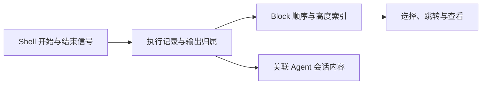

# Raycast 与 Warp：让操作可以组合，需要怎样的约束？

核实日期：**2026-09-26**。本章延续[第一轮产品研究](../../research/zed-raycast-warp.md)，将关注点从技术栈转到操作、状态和责任的组合。阅读导航：[本轮入口](README.md) · [分析框架](01-framework.md) · [Zed 与 Grok Build](03-zed-grok.md) · [Yuuki 的取舍](04-yuuki.md)。

**本章判断：Raycast 的力量来自统一的操作语法，Warp 的力量来自可引用的执行记录。** 用户因此少记住一些界面规则，开发者因此少写一些重复逻辑；宿主则必须承担规则一致性、生命周期和兼容性。下文区分官方事实与设计推断，没有运行产品、复现完整调用链或测量性能。

## 1. Raycast：小而稳定的操作语法

### 一次添加任务，如何由少量构件完成？

官方 Todo 示例包含一条完整路径：`List → Action.Push → Form → Action.SubmitForm → onCreate → pop`。列表组件持有任务数组；表单提交新对象；父组件更新状态；导航返回列表。这份示例只使用内存，关闭后重新进入会丢失数据。它证明了界面构件如何配合，没有证明任务已持久化。[Todo 示例](https://developers.raycast.com/examples/todo-list)

构件能接起来，还因为宿主规定了交互语义。`ActionPanel` 的前两个动作自动成为主、次动作，并获得相应的默认快捷键；列表中的第一动作与表单中的第一动作，其默认键位并不相同。因此，**动作顺序也是行为接口**，不能只当作视觉排序。[ActionPanel 契约](https://developers.raycast.com/api-reference/user-interface/action-panel)

**设计推断。** 这里的简单来自少量明确约束：列表拥有集合，表单收集输入，动作触发变化，导航管理返回。扩展作者不用重新设计每个页面的键盘操作；用户学过一次，便可迁移到其他扩展。代价是构件必须服从宿主的交互词汇，业务仍需补上持久化、校验和失败处理。一个视觉上只有一页的界面，也可能把这些责任混在一起。

### 第二条链：让同一能力进入 AI 会话

Raycast 将 AI Extension 的组成明确为 tools、instructions 和 evals；多个扩展可以出现在同一会话中。官方因此要求 instructions 聚焦本扩展能力，避免抢占全局助手身份。工具描述还应说明参数格式，以及调用前需要先取得哪些 ID。[AI Extension 核心概念](https://developers.raycast.com/ai/learn-core-concepts-of-ai-extensions)、[组合时的最佳实践](https://developers.raycast.com/ai/follow-best-practices-for-ai-extensions)

工具的 `confirmation` 可以在执行前要求用户确认；用户取消时，工具函数不会执行。这给“是否开始产生副作用”提供了明确关口，但输入语义、远端 API 失败和幂等性仍需由具体工具处理。[Tool API](https://developers.raycast.com/api-reference/tool)

**设计推演，非 Raycast 所有扩展的实际内部实现：** Yuuki 可以让表单和模型工具共同调用 `createTask(input)`，把数据写入、身份生成和失败结果放在共同能力中。两种入口保留各自的输入方式，不再各维护一份任务逻辑。必须共享的是业务含义与执行规则，仅仅都使用 React 或都能发 JSON，并不足以保证组合正确。

### 接得上，并不等于已经形成工作流

`launchCommand()` 返回的 Promise 在命令**启动后**完成，不代表被启动的命令已经执行完毕。于是 `await launchCommand(A)` 后再启动 B，不能证明 B 读到了 A 的最终结果；跨扩展调用还可能出现权限提示。[命令启动契约](https://developers.raycast.com/api-reference/command)

`List` 可以提供过滤、搜索节流和分页机制，但文档也说明宿主会基于内存限制停止加载，即使扩展仍声明 `hasMore`。这里暴露了组合的另一个条件：组件的局部状态必须服从宿主的资源预算。[List API](https://developers.raycast.com/api-reference/user-interface/list)

**设计推断。** 前一例是时间语义，后一例是资源语义。只读函数签名，会漏掉这两类约束。评估一个可组合接口时，应继续追问：返回表示受理还是完成？谁保存结果？谁可以停止？停止后，消费者还能看到什么？

## 2. Raycast 的简单，由谁维护？

要把产品交互与底层版本分开。2023-05-31 的 v1 工程文描述 React 自定义 reconciler、渲染树及补丁、Node 与 Swift 的通信，最后由原生组件显示。扩展作者免去了重复 UI 工作，宿主则必须维护跨边界更新的顺序和一致性。[v1 扩展实现](https://www.raycast.com/blog/how-raycast-api-extensions-work)

2026-05-14 的 v2 工程文描述另一种分工：原生 host、Web UI、Node 业务与扩展、Rust 数据能力；跨运行时接口采用共同声明生成类型化客户端。它减少共享业务和平台版本间的重复，同时引入 WebView 时机、输入法及多运行时调试等工作。不能把 v1 的渲染路径当作 v2 当前实现。[v2 架构](https://www.raycast.com/blog/a-technical-deep-dive-into-the-new-raycast)

版本状态也要明确：v2.0 于 2026-08-25 结束 beta，2026-09-25 已发布 v2.5。后者仍包含外部模型供应商下的审批显示与重试问题修复，说明组合边界会持续产生维护工作；一份更新日志不足以推断发生率或整体可靠性。[v2.0](https://www.raycast.com/changelog/macos/2-0)、[v2.5](https://www.raycast.com/changelog/macos/2-5)

**设计推断。** 这也解释了为何“它推荐 Rust”不足以概括 Raycast：公开架构选择的是职责分配，Rust 承担其中一部分。共同声明能够集中接口维护，却不能让取消、重试、提交顺序自动正确。对 Yuuki，可先学习统一动作及明确所有者；是否引入同样的桥接基础设施，应取决于实际共享收益。

## 3. Warp：把输出变成一次执行的记录

本章聚焦 Warp 的 Terminal 与 Agent 交互。2026-08-18 的官方文章已将产品拓展至 Warp Factories；以下局部分析不覆盖整个云端产品。[产品范围变化](https://www.warp.dev/blog/open-infrastructure-for-building-a-software-factory)

源码链接固定在 **`5af88f49f84e70025f9c19e13f6b9ae64b624627`**，提交时间为 2026-09-25 UTC。2026-04-29 的 Block 工程文章用于解释设计背景，其中链接的旧提交和路径不混作本轮源码版本。[固定提交](https://github.com/warpdotdev/warp/commit/5af88f49f84e70025f9c19e13f6b9ae64b624627)、[Block 设计背景](https://www.warp.dev/blog/block-model-behind-warps-agentic-development-environment)

### 从一次 Shell 命令到可操作的 Block

Warp 向用户呈现命令与输出组成的 Block，可以选择、跳转及操作这些执行单元。实现这一点，需要知道输出属于哪次命令，不能仅把终端字节连续画在屏幕上。[Block 产品契约](https://docs.warp.dev/terminal/blocks/block-basics)

固定版本的 Zsh 集成在 `preexec` 中发送命令和 session 信息，在 `precmd` 中先保存上一命令的退出状态，再发送结束信息并建立下一 Block 的边界。生命周期来自 Shell 协作，终端解析和 UI 才能继续消费这些信息。[Zsh 开始与结束 hooks](https://github.com/warpdotdev/warp/blob/5af88f49f84e70025f9c19e13f6b9ae64b624627/app/assets/bundled/bootstrap/zsh_body.sh#L254)

下面是职责分析图，省略协议编码和内部函数，并非精确调用栈：

这种结构化也有失效处。源码中的 Bash hook 说明，某些情况下取得的命令可能止于首个 `|` 或 `&&`。协议可以减少猜测，仍受 Shell 提供的信息和兼容方式约束。[命令捕获的限制](https://github.com/warpdotdev/warp/blob/5af88f49f84e70025f9c19e13f6b9ae64b624627/crates/warp_terminal/src/model/ansi/dcs_hooks.rs#L692)

**设计推断。** 对 Yuuki，更小且直接的借鉴是让工具调用天然带有调用 ID、输入、工作目录、输出和终态。自己发起的工具本来就有这些结构，无须先压成屏幕文字，再通过终端仿真重建。交互式 TUI 才可能要求更完整的终端语义。

### 相同时间线，不必是相同存储与生命周期

`BlockList` 同时使用 `Vec<Block>` 保存内容顺序、`SumTree<BlockHeightItem>` 索引高度。`RichContentItem` 具有 view ID、高度、可选会话关联及隐藏状态。内容位置与显示高度因此能够分别处理；隐藏内容不等于删除执行记录。[Block 与高度索引](https://github.com/warpdotdev/warp/blob/5af88f49f84e70025f9c19e13f6b9ae64b624627/app/src/terminal/model/blocks.rs#L79)

活跃终端仍需 `GridStorage` 的随机修改能力，历史区域可使用更紧凑的 `FlatStorage`，alternate screen 有另一套处理路径。这些差异响应的是终端行为和访问方式，不能仅因它们都显示为文本就合并成一种万能容器。[活跃存储](https://github.com/warpdotdev/warp/blob/5af88f49f84e70025f9c19e13f6b9ae64b624627/crates/warp_terminal/src/model/grid/grid_storage.rs)、[历史存储](https://github.com/warpdotdev/warp/blob/5af88f49f84e70025f9c19e13f6b9ae64b624627/crates/warp_terminal/src/model/grid/flat_storage/mod.rs)

**设计推断。** 这是一种有约束的组合：显示层统一顺序与位置，底层保留各类内容所需的结构。共享一个 Block 列表，并不能推出它们拥有相同的执行权限、持久化方式或取消机制。Yuuki 可以统一消息与工具记录的浏览方式，同时明确哪些数据仍会变化、哪些已经成为历史。

## 4. Warp 的第二种组合：围绕结果接入不同 Agent

Warp 的 Code Review 支持检查 Git diff、添加行内意见，并批量将意见交给仍在运行的 Agent。由此形成一条具体反馈链：`Agent 改文件 → Git diff → 人检查并写意见 → Agent 继续处理`。这里共享的是文件改动和审阅上下文。[Code Review 文档](https://docs.warp.dev/code/code-review)

2026-04-14 的官方文章还介绍了为不同 coding agents 提供统一输入、附件、通知和审阅体验。**设计推断：** 这种外围组合不要求各 Agent 的内部循环相同，但也不能自动统一它们的工具权限、上下文策略和失败恢复。[多 Agent 支持](https://www.warp.dev/blog/universal-agent-support-level-up-coding-agent-warp)

开源范围必须随之收紧。当前固定版本 FAQ 将客户端主要代码列为 AGPLv3、WarpUI 相关部分列为 MIT，并明确服务端内置 harness、Drive 后端、托管认证和云编排等不在该仓库。2026-05-20 的推理接入文章把本地 Rust harness 和 ACP 写为后续方向；本轮没有足够证据确认这些计划已交付，不能据此补写内部架构。[固定版本 FAQ](https://github.com/warpdotdev/warp/blob/5af88f49f84e70025f9c19e13f6b9ae64b624627/FAQ.md#L63)、[计划与当时范围](https://www.warp.dev/blog/bring-your-own-inference-to-warp)

**设计推断。** Warp 的吸引力包含让结果容易理解和继续操作。它没有使执行语义消失：Shell 集成由平台维护，工具差异由适配承担，未公开服务的行为仍是本调查的边界。Yuuki 自建 model/tool loop 时，可以保留上述反馈链，同时自己定义运行、等待审批、失败和取消等状态。

## 5. 并排看：简单的收益与代价落在哪里？

以下表格是本章基于上述证据的分析归纳，不是两家公司共同声明的架构标准。

| 观察角度 | Raycast | Warp |
| --- | --- | --- |
| 核心组合单位 | 命令、结果项、动作及受控页面 | 执行 Block、输出、富内容与审阅结果 |
| 用户少承担什么 | 重复学习导航、主动作和快捷键 | 从长输出中寻找命令边界与归属 |
| 开发者获得什么 | 可复用的交互契约与系统能力 | 执行记录的展示和结果操作能力 |
| 宿主集中承担什么 | 组件规则、桥接、一致性及资源预算 | Shell 协议、终端兼容、索引与渲染 |
| 仍需另外说明什么 | 启动与完成、业务持久化、工具副作用 | 命令捕获误差、Agent 内部语义及服务端行为 |
| Yuuki 最小可学单元 | 一个有身份、输入、结果和明确动作的能力 | 一条有归属、状态和终点的执行记录 |

**对本项目的判断：** 先建立能反复使用的操作和记录，再观察哪些跨界工作确实重复。两者都说明了约束的价值：稳定词汇让更多能力能够接入，清楚的边界让用户少承担内部差异。边界本身仍要有人实现、维护和验证；它的价值应体现在具体变化只影响必要位置，见[Yuuki 的变更检验](04-yuuki.md)。
