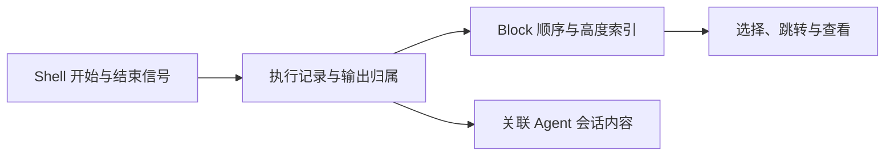

# Raycast 与 Warp：操作组合的约束

核实：**2026-09-26**。承接[第一轮研究](../../research/zed-raycast-warp.md)，转看操作、状态与责任的组合。[本轮入口](README.md) · [分析框架](01-framework.md) · [Zed / Grok](03-zed-grok.md) · [Yuuki](04-yuuki.md)。

本章判断：<mark class="key">Raycast 统一操作，Warp 组织执行记录</mark>；宿主维护一致性、生命周期与兼容。下文区分事实与推断，未运行产品、复现完整调用链或测性能。

## 1. Raycast：小而稳定的操作语法

### 添加任务的组件协作

Todo 示例按 `List → Action.Push → Form → Action.SubmitForm → onCreate → pop` 运行：列表持数组、表单提交、父组件更新、导航返回。仅存内存，关闭后重进会丢失，不代表持久化。[Todo 示例](https://developers.raycast.com/examples/todo-list)

`ActionPanel` 前两个动作决定主/次动作与默认快捷键，列表和表单的首动作默认键位也不同。动作顺序属于行为接口。[ActionPanel 契约](https://developers.raycast.com/api-reference/user-interface/action-panel)

**推断。** 列表、表单、动作与导航各负其责，让键盘操作可迁移。扩展必须服从宿主词汇，并补持久化、校验和失败处理；单页也可能混杂责任。

### AI 会话中的能力复用

AI Extension 由 tools、instructions、evals 组成，可在同一会话组合。instructions 应聚焦本扩展，工具说明参数格式和前置 ID，不抢全局身份。[核心概念](https://developers.raycast.com/ai/learn-core-concepts-of-ai-extensions)、[最佳实践](https://developers.raycast.com/ai/follow-best-practices-for-ai-extensions)

`confirmation` 在执行前确认，取消就不执行工具函数；输入语义、远端失败和幂等性仍由工具处理。[Tool API](https://developers.raycast.com/api-reference/tool)

**设计推演：** Yuuki 的表单与模型工具可共用 `createTask(input)`，集中写入、身份和错误，各保留输入方式。共享业务语义与规则才构成复用，React/JSON 本身不保证；这不代表所有 Raycast 扩展均如此实现。

### 启动确认与业务完成

`launchCommand()` 的 Promise 只确认<mark class="caution">启动，不确认完成</mark>。`await` 后启动 B，不保证得到 A 的最终结果；跨扩展还可能提示权限。[启动契约](https://developers.raycast.com/api-reference/command)

`List` 支持过滤、节流和分页，但即使 `hasMore` 为真，宿主也可因内存限制停止加载。局部状态服从宿主资源预算。[List API](https://developers.raycast.com/api-reference/user-interface/list)

**推断。** 函数签名之外，还要查时间和资源语义：返回表示受理还是完成？谁存结果、谁能停止、停止后剩什么？

## 2. Raycast 的宿主职责

2023-05-31 的 v1 工程文描述 React reconciler、渲染树/补丁、Node→Swift 通信与原生显示。作者少写 UI，宿主维护更新顺序和一致性。[v1 实现](https://www.raycast.com/blog/how-raycast-api-extensions-work)

2026-05-14 的 v2 则分为原生 host、Web UI、Node 业务/扩展、Rust 数据层，共同声明生成类型化客户端。减少业务重复，却增加 WebView、输入法与跨运行时调试；不能沿用 v1 渲染路径。[v2 架构](https://www.raycast.com/blog/a-technical-deep-dive-into-the-new-raycast)

v2.0 于 2026-08-25 结束 beta；2026-09-25 的 v2.5 仍修复外部模型审批显示与重试。日志说明维护持续，不说明故障率或整体可靠性。[v2.0](https://www.raycast.com/changelog/macos/2-0)、[v2.5](https://www.raycast.com/changelog/macos/2-5)

**推断。** Raycast 选择的是职责分配，不是全部 Rust 化；共同声明也不自动保证取消、重试或顺序。Yuuki 先学统一动作与明确所有者，桥接设施按共享收益决定。

## 3. Warp：把输出变成一次执行的记录

本章仅看 Terminal/Agent 交互，不覆盖 2026-08-18 官方介绍的 Warp Factories 全部云产品。[范围变化](https://www.warp.dev/blog/open-infrastructure-for-building-a-software-factory)

源码固定于 **`5af88f49f84e70025f9c19e13f6b9ae64b624627`**（2026-09-25 UTC）；2026-04-29 的 Block 文章只作背景，不混用旧提交路径。[固定提交](https://github.com/warpdotdev/warp/commit/5af88f49f84e70025f9c19e13f6b9ae64b624627)、[设计背景](https://www.warp.dev/blog/block-model-behind-warps-agentic-development-environment)

### 从一次 Shell 命令到可操作的 Block

Block 将命令与输出组织为可选择、跳转和操作的单元，必须知道每段输出的命令归属。[Block 契约](https://docs.warp.dev/terminal/blocks/block-basics)

Zsh 集成在 `preexec` 发送命令/session，`precmd` 先保存退出状态，再发结束信息、建立下一 Block 边界，供解析器和 UI 消费。[Zsh hooks](https://github.com/warpdotdev/warp/blob/5af88f49f84e70025f9c19e13f6b9ae64b624627/app/assets/bundled/bootstrap/zsh_body.sh#L254)

职责图，省略协议编码与内部函数：

Bash hook 在某些情况下只捕获到首个 `|` 或 `&&`；结构化仍受 Shell 信息和兼容方式限制。[捕获限制](https://github.com/warpdotdev/warp/blob/5af88f49f84e70025f9c19e13f6b9ae64b624627/crates/warp_terminal/src/model/ansi/dcs_hooks.rs#L692)

**推断。** Yuuki 的工具应直接携带 ID、输入、工作目录、输出和终态，无需先变屏幕文字再重建；交互 TUI 才需完整终端语义。

### 相同时间线，不必是相同存储与生命周期

`BlockList` 以 `Vec<Block>` 存顺序、`SumTree<BlockHeightItem>` 索引高度；`RichContentItem` 带 view ID、高度、可选会话和隐藏状态。位置与高度分开，隐藏不等于删记录。[高度索引](https://github.com/warpdotdev/warp/blob/5af88f49f84e70025f9c19e13f6b9ae64b624627/app/src/terminal/model/blocks.rs#L79)

活跃区用支持随机修改的 `GridStorage`，历史区用紧凑 `FlatStorage`，alternate screen 另有路径；显示为文本不代表存储可统一。[活跃存储](https://github.com/warpdotdev/warp/blob/5af88f49f84e70025f9c19e13f6b9ae64b624627/crates/warp_terminal/src/model/grid/grid_storage.rs)、[历史存储](https://github.com/warpdotdev/warp/blob/5af88f49f84e70025f9c19e13f6b9ae64b624627/crates/warp_terminal/src/model/grid/flat_storage/mod.rs)

**推断。** 显示层统一顺序/位置，底层保留差异；共享 Block 不代表同权限、持久化或取消。Yuuki 可统一浏览，同时区分活动数据与历史。

## 4. Warp 的第二种组合：围绕结果接入不同 Agent

Code Review 可查看 diff、加行内意见，批量交回运行中的 Agent，形成 `改文件 → diff → 人写意见 → Agent 继续`，共享改动与审阅上下文。[文档](https://docs.warp.dev/code/code-review)

2026-04-14 官方介绍了跨 Agent 的统一输入、附件、通知和审阅。**推断：**外围组合无需相同内循环，也不自动统一权限、上下文和恢复。[多 Agent 支持](https://www.warp.dev/blog/universal-agent-support-level-up-coding-agent-warp)

固定版 FAQ 将客户端主要代码列为 AGPLv3、WarpUI 部分列为 MIT；仓库不含服务端 harness、Drive、托管认证或云编排。2026-05-20 文章仍把本地 Rust harness/ACP 列为计划，本轮无法确认交付。[FAQ](https://github.com/warpdotdev/warp/blob/5af88f49f84e70025f9c19e13f6b9ae64b624627/FAQ.md#L63)、[当时计划](https://www.warp.dev/blog/bring-your-own-inference-to-warp)

**推断。** Warp 让结果便于理解和继续操作，Shell/工具适配仍需维护，未公开服务仍是边界。Yuuki 可保留反馈链，自行定义运行、审批、失败和取消状态。

## 5. 组合收益与维护成本对照

以下为本章归纳，不是两家共同的架构标准。

| 观察角度 | Raycast | Warp |
| --- | --- | --- |
| 核心组合单位 | 命令、结果项、动作及受控页面 | 执行 Block、输出、富内容与审阅结果 |
| 用户少承担什么 | 重复学习导航、主动作和快捷键 | 从长输出中寻找命令边界与归属 |
| 开发者获得什么 | 可复用的交互契约与系统能力 | 执行记录的展示和结果操作能力 |
| 宿主集中承担什么 | 组件规则、桥接、一致性及资源预算 | Shell 协议、终端兼容、索引与渲染 |
| 仍需另外说明什么 | 启动与完成、业务持久化、工具副作用 | 命令捕获误差、Agent 内部语义及服务端行为 |
| Yuuki 最小可学单元 | 一个有身份、输入、结果和明确动作的能力 | 一条有归属、状态和终点的执行记录 |

**项目判断：**先建立可复用操作与记录，再找重复跨界工作。稳定词汇和明确边界减少用户负担，但实现、维护和验证仍需承担；用具体变化检验收益，见 [Yuuki](04-yuuki.md)。
